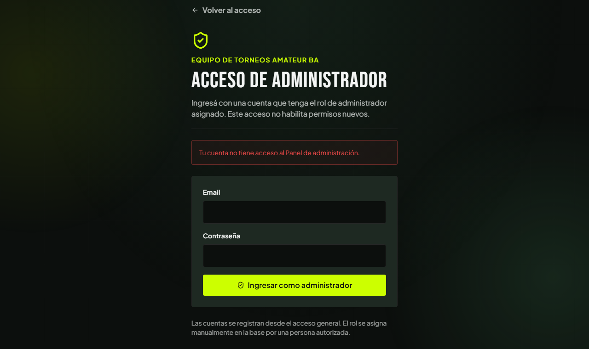

# Módulo Administración · Pantallas

Versión del **04/11/2026**. Cada pantalla del backoffice que existe hoy, con su ruta, el caso, los requerimientos, lo que muestra y la captura. Siguen a los [casos de uso](02-casos-de-uso.md) y preceden a los [diagramas de secuencia](04-diagramas-secuencia/README.md).

**Estado de las capturas**

| Marca | Significa |
|---|---|
| ✅ **Vigente** | Sacada el 04/11/2026 de `main`, con la UI actual, a 1280 px de ancho. |
| ⏳ **Pendiente** | Todavía no hay captura. Todas las pantallas del backoffice salvo el acceso requieren una cuenta con el rol de administrador. |

Las capturas están en [`pantallas/`](pantallas/).

**Lo que no tiene pantalla:** los casos de moderación (UC-F03 a UC-F06: reportes, suspensión, búsqueda de usuarios) **no tienen pantalla porque no están implementados**. Sus diagramas son un diseño objetivo.

## Mapa de pantallas

| Pantalla | Ruta | Caso de uso | Sesión |
|---|---|---|---|
| [P1 · Acceso de administrador](#p1--acceso-de-administrador) | `/admin/login` | UC-F01 | No (es el formulario público) |
| [P2 · Resumen de la plataforma](#p2--resumen-de-la-plataforma) | `/admin` | UC-F02 | Administrador |
| [P3 · Seguridad y acceso](#p3--seguridad-y-acceso) | `/admin/seguridad` | UC-F02 | Administrador |
| [P4 · Sidebar de administración](#p4--sidebar-de-administración) | todas las de `/admin` | UC-F02 | Administrador |

Todas las rutas `/admin/…` están protegidas (sesión y rol), **salvo `/admin/login`**. A diferencia del resto de la app, **el backoffice no lleva la barra superior ni el footer del catálogo**: tiene su propio marco.

---

## P1 · Acceso de administrador

**Ruta:** `/admin/login` · **Caso de uso:** [UC-F01](02-casos-de-uso.md#uc-f01--acceder-al-panel-de-administración) · **Requerimientos:** RF-F01 a RF-F07 · **Diagrama:** [S01](04-diagramas-secuencia/uc-f01-acceder-administracion.md)

*Captura ✅ vigente, con el error de **acceso denegado** (`/admin/login?error=denied`). Es la misma pantalla sin el aviso rojo cuando se abre normalmente (`pantallas/acceso-administrador.png`).*

**Qué muestra.** Sin la barra del sitio: el link «← Volver al acceso» (a `/login`), el ícono de escudo, «Equipo de Torneos Amateur BA», el título **«Acceso de administrador»** y la bajada «Ingresá con una cuenta que tenga el rol de administrador asignado. Este acceso no habilita permisos nuevos». El formulario:

| Campo | Tipo | Obligatorio |
|---|---|---|
| Email | email | Sí |
| Contraseña | contraseña | Sí |

El botón es «Ingresar como administrador» (con «Verificando acceso…» mientras trabaja). Al pie: «Las cuentas se registran desde el acceso general. El rol se asigna manualmente en la base por una persona autorizada». No hay desplegables, ni registro, ni «entrar como invitado».

**Estados de la pantalla**

| Estado | Qué ve la persona |
|---|---|
| Normal | El formulario vacío. |
| Credenciales inválidas | Banda roja: «No pudimos iniciar sesión. Revisá tu email y contraseña.» |
| Cuenta sin rol | Banda roja: «Tu cuenta no tiene acceso al Panel de administración.» ✅ (captura) y, si tiene sesión, el link «Continuar en el catálogo con mi cuenta». |
| No se pudo verificar el rol | Banda roja: «No pudimos verificar el acceso de administrador. Probá de nuevo.» |
| Ya es administrador con sesión | No se ve la pantalla: se lo lleva al destino. |

---

## P2 · Resumen de la plataforma

**Ruta:** `/admin` · **Caso de uso:** [UC-F02](02-casos-de-uso.md#uc-f02--consultar-el-tablero) · **Requerimientos:** RF-F08, RF-F09, RF-F11 · **Diagrama:** [S02](04-diagramas-secuencia/uc-f02-consultar-tablero.md)

> ⏳ **Captura pendiente:** requiere una cuenta con el rol de administrador.

**Qué muestra.** El título «Resumen de la plataforma» y «Panel de administración · Torneos Amateur BA»; tres tarjetas con los **contadores reales** de **Torneos**, **Equipos** y **Usuarios**; y dos bloques: **«Seguridad y acceso»** (con el link «Ver acceso de mi cuenta») y **«Próximas etapas»** (explica que Usuarios, contenido, reportes, actividad, soporte, avisos y configuración se implementarán por etapas).

**Estados:** *normal*; *contador no disponible* (la tarjeta dice «No disponible» y arriba aparece el aviso ámbar «No pudimos cargar todos los contadores…»). Nunca se muestra un cero inventado.

---

## P3 · Seguridad y acceso

**Ruta:** `/admin/seguridad` · **Caso de uso:** [UC-F02](02-casos-de-uso.md#uc-f02--consultar-el-tablero) · **Requerimientos:** RF-F10 · **Diagrama:** [S02](04-diagramas-secuencia/uc-f02-consultar-tablero.md)

> ⏳ **Captura pendiente.**

**Qué muestra.** «Seguridad y acceso» con dos secciones: **«Acceso confirmado»** (cuenta actual, rol «Administrador, verificado en el servidor» y «Asignación del rol: manual en la base; no se puede cambiar desde el perfil ni el formulario de acceso») y **«Controles de esta etapa»** (comprobación de sesión y rol antes de mostrar datos, acceso denegado cuando falla la comprobación, cerrar sesión solo en este dispositivo). Cierra aclarando que MFA, gestión de sesiones, permisos granulares, suspensiones y registro de actividad requieren sus propias etapas: **no es una auditoría de seguridad completa**.

---

## P4 · Sidebar de administración

**Ruta:** todas las de `/admin` · **Caso de uso:** [UC-F02](02-casos-de-uso.md#uc-f02--consultar-el-tablero) · **Requerimientos:** RF-F08, RF-F11

> ⏳ **Captura pendiente**, en escritorio y en celular.

**Qué muestra.** En escritorio, una columna fija a la izquierda; en el celular, una barra superior con un botón que despliega la navegación.

1. **Encabezado:** el nombre del panel (link a `/admin`) y, debajo, «← Volver al sitio» (al catálogo), visible también en el celular sin abrir el menú.
2. **Secciones disponibles:** **Resumen** (`/admin`) y **Seguridad y acceso** (`/admin/seguridad`); la actual se marca con `aria-current`.
3. **Secciones pendientes** (sin enlace y rotuladas como pendientes): Usuarios, Torneos y equipos, Reportes, Registro de actividad, Soporte, Avisos y Configuración.
4. **Al pie:** la cuenta y «Cerrar sesión» (solo este dispositivo).

El menú del celular se cierra al elegir una sección o con Escape.

---

## Capturas pendientes

Convención: PNG en `docs/administracion/pantallas/`, ventana de unos 1280 px de ancho (y ~390 px para el celular), con datos de prueba. **Hace falta una cuenta con el rol de administrador** (se asigna insertando su id en `admins`, ver [acceso-administrador.md](../especificaciones-y-requerimientos/acceso-administrador.md)).

| Archivo | Pantalla y estado | Cómo conseguirlo |
|---|---|---|
| `resumen.png` | P2 con los tres contadores | Entrar como administrador. |
| `resumen-no-disponible.png` | P2 con un contador «No disponible» | Solo reproducible con una falla de la base; opcional. |
| `seguridad-y-acceso.png` | P3 | Abrir «Ver acceso de mi cuenta». |
| `sidebar-escritorio.png` | P4 en escritorio | Con la sidebar visible, mostrando las secciones pendientes. |
| `sidebar-celular.png` | P4 en el celular, desplegada | Ancho ~390 px, abrir el menú. |
| `acceso-administrador-credenciales.png` | P1 con «No pudimos iniciar sesión…» | Ingresar una contraseña incorrecta. |
