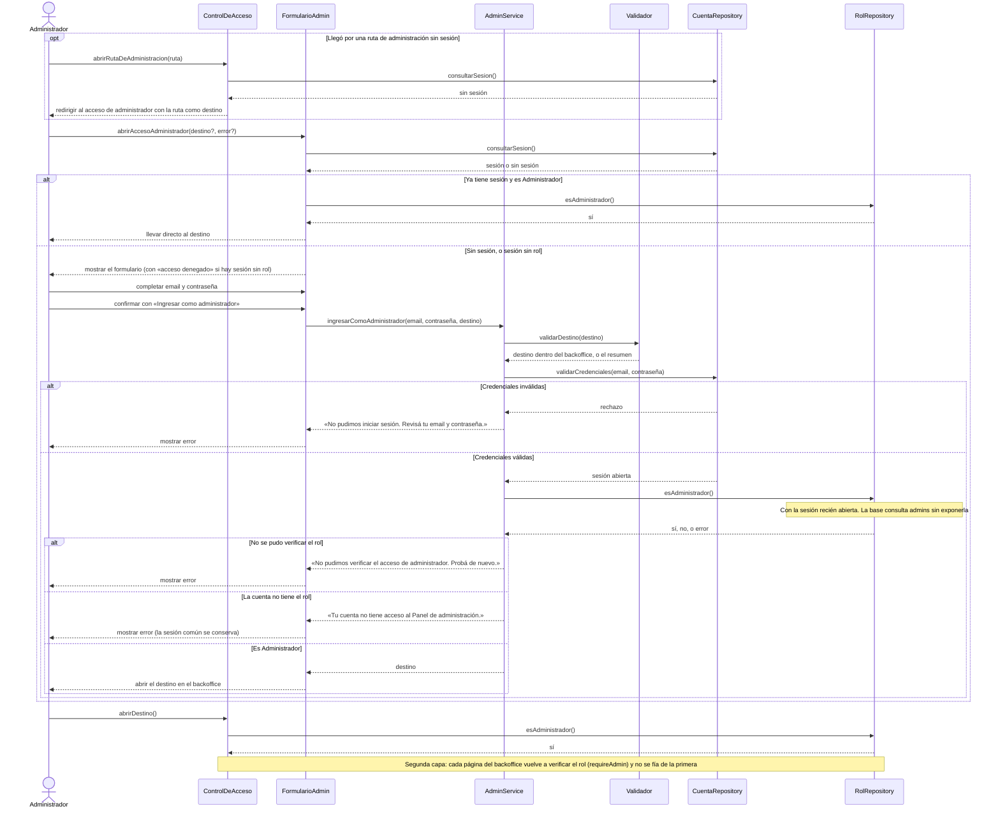

# S01 · UC-F01 — Acceder al Panel de administración

Caso de uso: [UC-F01](../02-casos-de-uso.md#uc-f01--acceder-al-panel-de-administración) · Pantalla: [P1](../03-pantallas.md#p1--acceso-de-administrador) · Requerimientos: RF-F01 a RF-F07

El formulario tiene solo email y contraseña: no hay desplegables. El diagrama incluye las **dos capas** que verifican el rol y el caso en que la persona llega redirigida.

## Cómo se lee

- **El rol no lo decide el formulario.** Ningún campo del formulario puede conceder el rol: se consulta `is_admin()` **con la sesión recién abierta**. El rol se asigna a mano, insertando el usuario en `admins` desde el SQL Editor; nunca desde la app, el perfil ni `user_metadata`.
- **Solo un `true` exacto habilita.** Credenciales inválidas, cuenta sin rol, error de la verificación o un resultado que no sea booleano **no habilitan** el backoffice. Cada caso tiene su mensaje.
- **Una cuenta común conserva su sesión normal**: el error de «acceso denegado» no la cierra, y la pantalla le ofrece seguir en el catálogo.
- **Dos capas de verificación.** `ControlDeAcceso` redirige las rutas `/admin/…` sin sesión o sin rol; pero cada página y el layout del backoffice vuelven a verificar, porque una petición directa o una página en caché podría saltearse la primera. La capa real es la segunda.
- **El destino es interno y limitado al backoffice.** Un destino externo, o el propio `/admin/login`, se reemplaza por `/admin`: así no hay bucles ni redirecciones abiertas. Al redirigir, se conservan las cookies de sesión renovadas.
- **No existe una segunda sesión de administrador:** es la misma cuenta que usa el sitio.

## Correspondencia en el código

`loginAsAdmin` (`src/app/admin/login/actions.ts`) → `authenticateAdmin` (`src/utils/supabase/admin-login.ts`): `signInWithPassword` y después la RPC `is_admin`. El control de acceso es `src/proxy.ts` y la segunda capa es `requireAdmin()` (`src/utils/admin.ts`).
