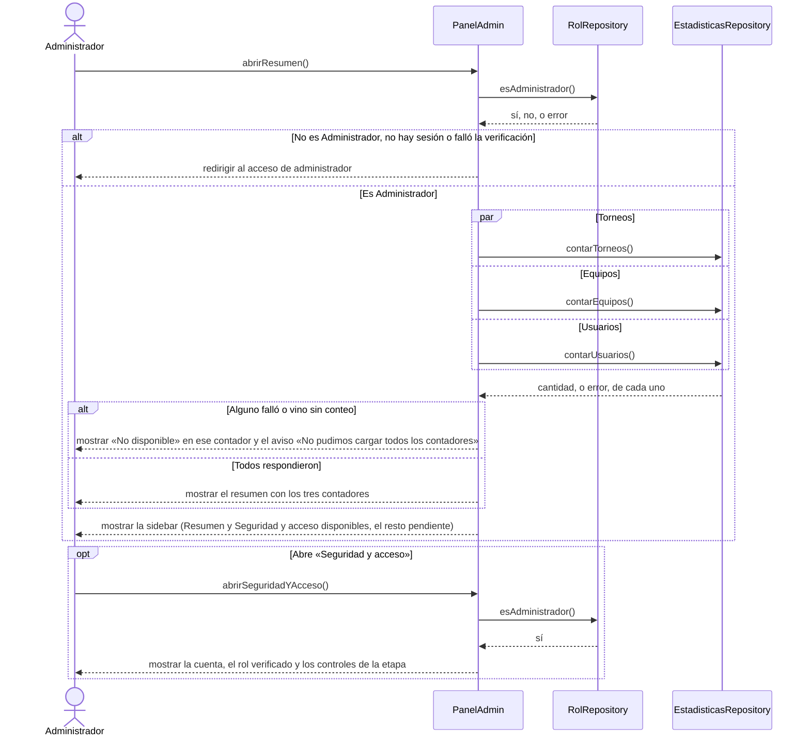

# S02 · UC-F02 — Consultar el tablero

Caso de uso: [UC-F02](../02-casos-de-uso.md#uc-f02--consultar-el-tablero) · Pantallas: [P2](../03-pantallas.md#p2--resumen-de-la-plataforma), [P3](../03-pantallas.md#p3--seguridad-y-acceso) y [P4](../03-pantallas.md#p4--sidebar-de-administración) · Requerimientos: RF-F08 a RF-F11

Es una consulta: no hay formulario ni desplegables.

## Cómo se lee

- **El rol se verifica en cada pantalla**, no solo al entrar: el resumen y «Seguridad y acceso» llaman a `esAdministrador()` antes de mostrar nada. Si falla, se vuelve al acceso.
- **Los contadores son reales y se piden en paralelo.** Una consulta fallida muestra **«No disponible»**, **nunca un cero inventado**, y el aviso lo dice. Los contadores salen de las tablas públicas `tournaments`, `teams` y `profiles`; «Usuarios» es la cantidad de perfiles.
- **No hay datos simulados.** Las secciones Usuarios, Torneos y equipos, Reportes, Registro de actividad, Soporte, Avisos y Configuración figuran en la sidebar como pendientes, **sin enlaces**. Se retiró un placeholder «Sin reportes pendientes» porque el módulo de reportes no existe.
- «Volver al sitio» y «Cerrar sesión» (solo este dispositivo) están en la sidebar; son navegación, no casos aparte.

## Correspondencia en el código

`AdminPage` (`src/app/admin/(backoffice)/page.tsx`) llama a `requireAdmin()` y hace tres `select('id', { count: 'exact', head: true })` con `Promise.all`; `AdminSidebar` (`src/components/AdminSidebar.tsx`) define las secciones.
