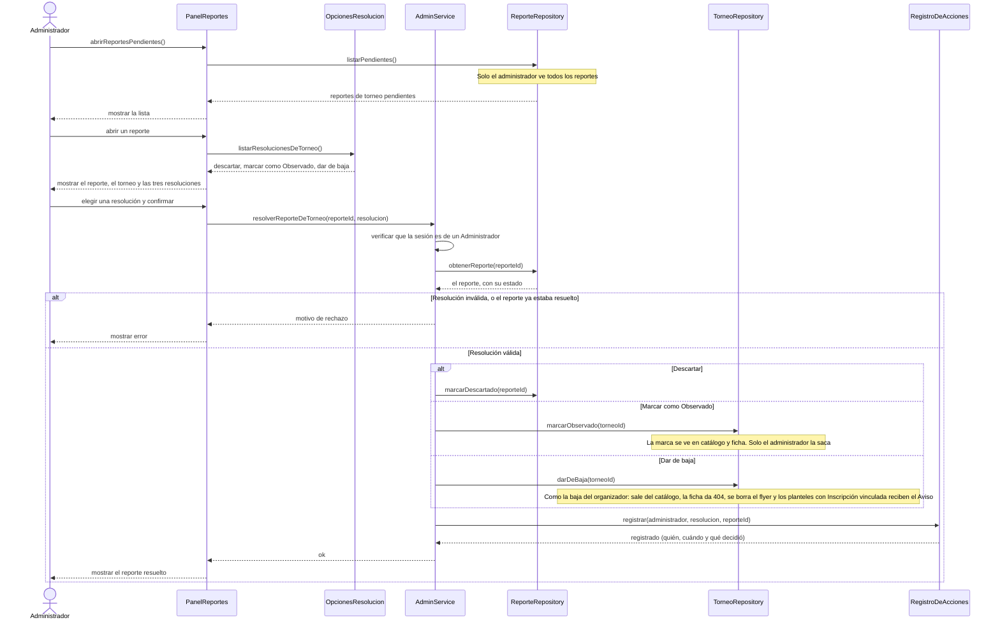

# S03 · UC-F03 — Resolver un reporte de torneo

Caso de uso: [UC-F03](../02-casos-de-uso.md#uc-f03--resolver-un-reporte-de-torneo) · Pantalla: no existe todavía · Requerimientos: RF-F12, RF-F13, RF-F18

> **Diseño objetivo, pendiente de implementación.** Hoy no hay tabla de reportes, ni pantalla, ni registro de acciones. Los participantes `PanelReportes`, `OpcionesResolucion`, `AdminService`, `ReporteRepository` y `RegistroDeAcciones` no existen todavía y sus nombres son provisorios.

El caso termina con una **elección entre tres resoluciones**. Siguiendo la guía de formularios, la pantalla obtiene la lista **antes** de que el administrador elija. Son una **lista fija del código**, así que las provee un proveedor de opciones y no un repositorio. Elegir y aplicar van en el mismo diagrama.

## Cómo se lee

- **Antes de elegir:** la pantalla trae las tres resoluciones de `OpcionesResolucion`; al elegir, viaja solo el valor elegido (`resolucion`).
- **Se valida de nuevo al aplicar.** Que el reporte aparezca pendiente en la pantalla no garantiza que lo siga estando (otra pestaña pudo resolverlo) ni que la resolución sea una de las tres. Y **el rol se verifica en el servidor** en cada acción: la pantalla no autoriza.
- **Observado vs. «Sigue vigente»:** el organizador reinicia la antigüedad de verificación con «Sigue vigente», pero **no** puede sacar la marca Observado.
- **La baja por reporte es la misma que la del organizador** (UC-E05): mismas consecuencias, incluido el Aviso a los planteles vinculados. Un torneo Finalizado no se da de baja: es la trayectoria del organizador.
- **Queda registrado** quién resolvió, cuándo y qué decidió (RF-F18). Los diagramas generales llaman a este paso «Registrar resolución administrativa» (D33).
- **Sin decidir:** el detalle del registro de acciones (qué datos guarda exactamente y quién lo puede leer). Solo está definido que registra quién, cuándo y qué decidió.
