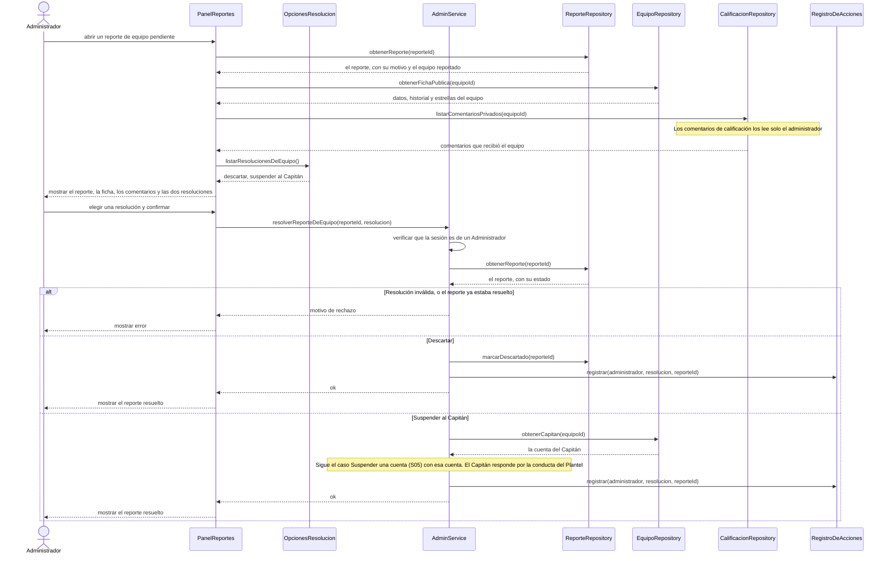

# S04 · UC-F04 — Resolver un reporte de equipo

Caso de uso: [UC-F04](../02-casos-de-uso.md#uc-f04--resolver-un-reporte-de-equipo) · Pantalla: no existe todavía · Requerimientos: RF-F14, RF-F18

> **Diseño objetivo, pendiente de implementación.** Hoy no hay tabla de reportes de equipos, ni pantalla, ni registro de acciones. Los participantes `PanelReportes`, `OpcionesResolucion`, `AdminService`, `ReporteRepository`, `CalificacionRepository` y `RegistroDeAcciones` no existen todavía y sus nombres son provisorios.

El caso termina con una elección entre **dos resoluciones**, una **lista fija del código** que provee un proveedor de opciones, cargada **antes** de elegir. Suspender al Capitán es el caso siguiente ([S05](uc-f05-suspender-cuenta.md)).

## Cómo se lee

- **Qué revisa el administrador antes de decidir:** la página del equipo (datos, historial y estrellas) y los **comentarios privados de calificación** que recibió. Esos comentarios solo los lee el administrador.
- **La Suspensión recae sobre el Capitán**, no sobre los jugadores: él responde por la conducta del Plantel.
- **El rol y el estado del reporte se vuelven a verificar al aplicar la resolución.** Una opción mostrada no garantiza que siga siendo válida.
- **El reporte lo origina un Capitán o un jugador** de un equipo que jugó al menos un partido contra el reportado (UC-C10).
- **Sin decidir:** cómo accede la pantalla al Capitán del equipo (el Plantel es privado) y a los comentarios de calificación (la tabla no es de lectura pública). Habrá que resolverlo con una función de servidor que verifique el rol de administrador.
