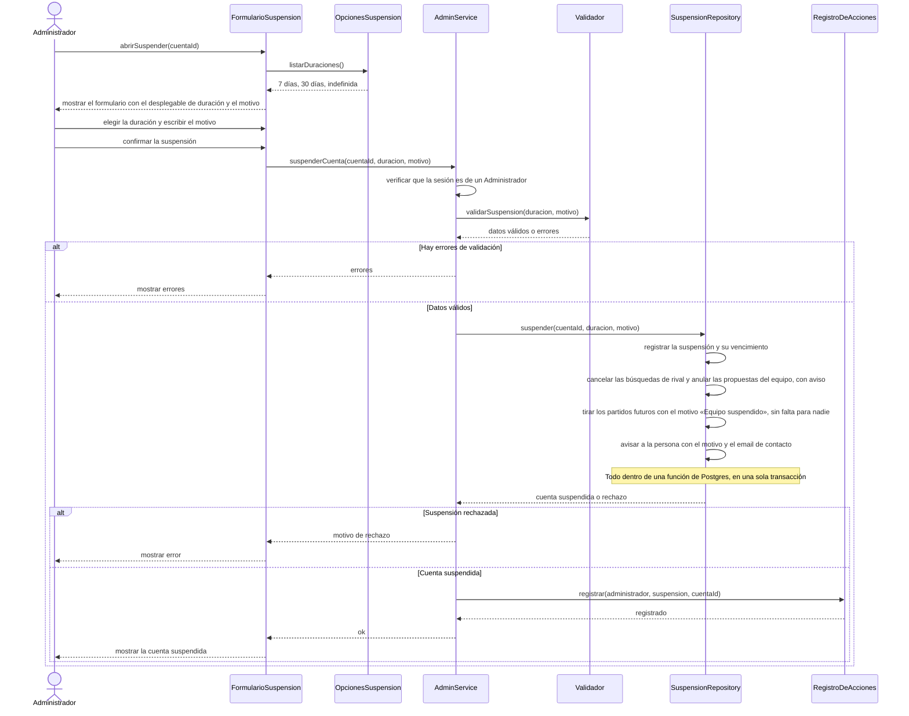

# S05 · UC-F05 — Suspender una cuenta

Caso de uso: [UC-F05](../02-casos-de-uso.md#uc-f05--suspender-una-cuenta) · Pantalla: no existe todavía · Requerimientos: RF-F15 a RF-F18

> **Diseño objetivo, pendiente de implementación.** Hoy la base no tiene Suspensión: solo hay un comentario «Pendiente cuando exista la suspensión» en `transfer_captaincy`. Los participantes `FormularioSuspension`, `OpcionesSuspension`, `AdminService`, `Validador`, `SuspensionRepository` y `RegistroDeAcciones` no existen todavía y sus nombres son provisorios.

El formulario tiene **un desplegable: la duración** (7 días, 30 días o indefinida) y un **motivo** de texto. La duración es una **lista fija del código**, así que la provee un proveedor de opciones y no un repositorio, cargada **antes** de que el administrador elija. Al enviar viajan solo los valores elegidos. La carga y la suspensión van en el mismo diagrama.

## Cómo se lee

- **Antes de elegir:** el formulario trae las duraciones de `OpcionesSuspension`; al enviar viaja solo el valor elegido (`duracion`).
- **Se valida de nuevo al guardar**, y el rol de administrador se verifica **en el servidor** en cada acción.
- **Qué impide la Suspensión:** la persona puede **entrar y mirar**, pero no publicar torneos, crear equipos, buscar rival ni recibir la capitanía. Sus torneos siguen visibles y los puede editar y verificar; los partidos pendientes de resultado los puede terminar de cargar.
- **Qué cancela o cae:** sus búsquedas de rival (con sus propuestas pendientes, con aviso) y sus partidos futuros, que **se caen** con el motivo «Equipo suspendido» (lo escribe el sistema), **sin falta para nadie**. Su equipo deja de aparecer entre los compatibles, su página sigue visible y **no puede cambiar de capitán** mientras dure.
- **No hay apelación dentro de la app:** el Aviso incluye el motivo y un email de contacto.
- **No es el Bloqueo por faltas**, que es automático, recae sobre el equipo y no lo decide nadie.
- **Sin decidir:** cuál es el email de contacto del Aviso y qué reglas tiene el motivo (largo máximo, si es obligatorio); y qué pasa con lo cancelado al vencer la Suspensión.
