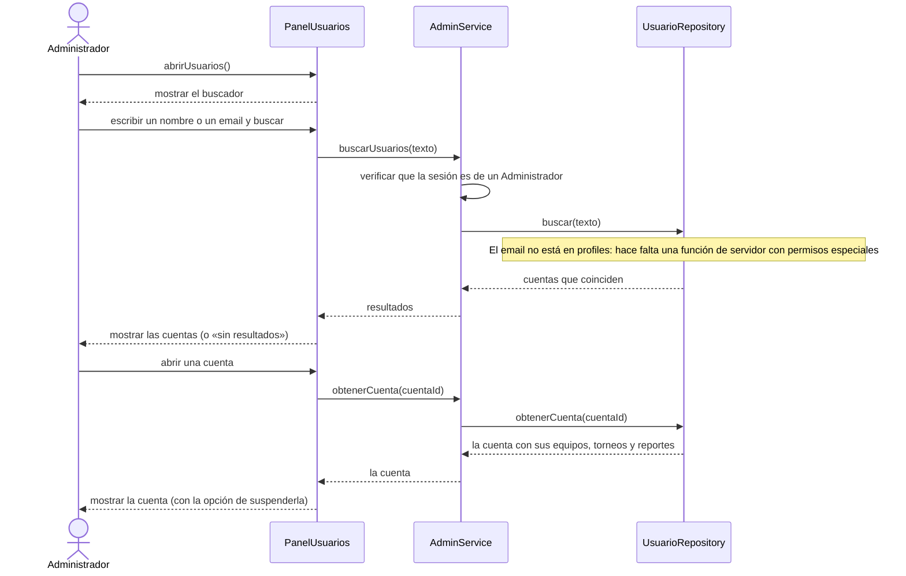

# S06 · UC-F06 — Buscar usuarios

Caso de uso: [UC-F06](../02-casos-de-uso.md#uc-f06--buscar-usuarios) · Pantalla: no existe todavía · Requerimientos: RF-F19

> **Diseño objetivo, pendiente de implementación.** Hoy no hay ninguna pantalla ni función de búsqueda de usuarios. Los participantes `PanelUsuarios`, `AdminService` y `UsuarioRepository` no existen todavía y sus nombres son provisorios.

El formulario es un campo de texto (nombre o email): no hay desplegables ni listas que cargar.

## Cómo se lee

- **El rol se verifica en el servidor** en cada búsqueda: la pantalla no autoriza.
- **Qué se ve de una cuenta:** sus equipos, sus torneos y sus reportes; y desde ahí se la puede **suspender** ([S05](uc-f05-suspender-cuenta.md)).
- **Sin decidir, y es lo más delicado del caso:** el **email** vive en la autenticación (`auth.users`), que no se lee desde la app. Buscar por email exige una función de servidor que **verifique el rol de administrador** y no exponga los emails de todos; y la `service_role key` nunca debe salir de un contexto de servidor controlado.
