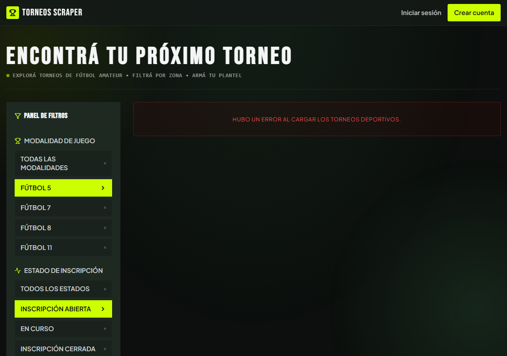
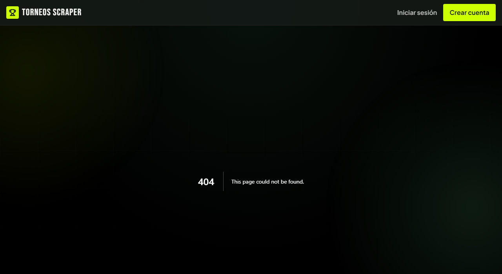

# Módulo Catálogo de torneos · Pantallas

Actualizado el **18/11/2026**. Cada pantalla pública de los torneos, con su ruta, el caso, los requerimientos, lo que muestra y la captura. Siguen a los [casos de uso](02-casos-de-uso.md) y preceden a los [diagramas de secuencia](04-diagramas-secuencia/README.md).

**Estado de las capturas**

| Marca | Significa |
|---|---|
| ✅ **Vigente** | Representa la UI actual. |
| ⏳ **Pendiente** | Todavía no hay captura. Al final están los pasos para sacarla. |
| 🗂️ **Histórica** | Se conserva como referencia, pero ya no representa la UI actual. |

Las capturas están en [`pantallas/`](pantallas/). La captura del catálogo es **histórica**: se sacó antes del rediseño del panel de filtros del 18/11/2026 y muestra el error de carga de la base, no la nueva sidebar ni el drawer. El 404 de la ficha sigue vigente. Faltan capturas nuevas del catálogo con la base disponible, incluida la vista móvil.

## Mapa de pantallas

| Pantalla | Ruta | Casos de uso | Sesión |
|---|---|---|---|
| [P1 · Catálogo](#p1--catálogo) | `/` (y `/?modality=…&status=…`) | UC-B01, UC-B02 | No |
| [P2 · Ficha del torneo](#p2--ficha-del-torneo) | `/torneos/{id}` | UC-B03, UC-B04, UC-B06 | No (el dueño ve una barra extra) |
| [P3 · Página del organizador](#p3--página-del-organizador) | `/organizadores/{id}` | UC-B05 | No |

Las tres son **públicas**: ninguna está en la lista de rutas protegidas.

---

## P1 · Catálogo

**Ruta:** `/` · **Casos de uso:** [UC-B01](02-casos-de-uso.md#uc-b01--ver-el-catálogo-de-torneos), [UC-B02](02-casos-de-uso.md#uc-b02--filtrar-torneos-y-compartir-la-búsqueda) · **Requerimientos:** RF-B01 a RF-B13, RF-B25 · **Diagramas:** [S01](04-diagramas-secuencia/uc-b01-ver-catalogo.md), [S02](04-diagramas-secuencia/uc-b02-filtrar-torneos.md)

*Captura 🗂️ histórica. URL: `/?modality=futbol_5&status=abierto`. Muestra «Fútbol 5» e «Inscripción abierta» activos y, a la derecha, el **estado de error de carga** («Hubo un error al cargar los torneos deportivos.») porque la base no respondía. Es anterior al rediseño responsive de filtros.*

**Qué muestra.** El título «Encontrá tu próximo torneo» y dos columnas:

- **Filtros**: en escritorio amplio, sidebar angosta a la izquierda y fija al desplazarse. Modalidad y Estado de inscripción empiezan plegados y muestran la selección actual en el encabezado; al desplegarlos aparecen sus opciones. «Limpiar» se muestra cuando hay filtros activos. En móvil y tablet hay un botón «Filtros» que abre un panel lateral desde la derecha, con fondo atenuado; se cierra con X, Escape o al tocar afuera. Los cambios se aplican al elegir una opción y el panel queda abierto para combinar ambos grupos. No se muestran chips de filtros sobre el catálogo. Opciones vigentes:

  | Grupo | Opciones | De dónde salen las opciones |
  |---|---|---|
  | **Modalidad de juego** | Todas las modalidades · Fútbol 5 · Fútbol 7 · Fútbol 8 · Fútbol 11 | **Lista fija del código** (`SPORT_MODALITIES`) |
  | **Estado de inscripción** | Todos los estados · Inscripción abierta · En curso · Inscripción cerrada | **Lista fija del código** (en `Filters.tsx`) |

  La opción activa se marca con un indicador y un fondo sutil. Elegir una opción reescribe la URL, vuelve a la página 1 y conserva la cantidad por página.
- **Barra de resultados**: rango mostrado y total, selector del tamaño de tarjeta (Compacta, Normal o Amplia) y selector de 12, 24 o 48 torneos por página. Compacta y 12 son los valores iniciales. Página y cantidad se comparten por URL; el tamaño de tarjeta se recuerda en el dispositivo.
- **Listado** (derecha): una tarjeta por torneo, en una grilla de 1 a 4 columnas según tamaño de tarjeta y ancho de pantalla; en móvil, una sola columna. Los tamaños adaptan Flyer, tipografía y espacios sin ocultar los datos. Cada tarjeta es un link entero a la ficha y muestra: el flyer (o un marcador) con el **Estado** y, si corresponde, «Últimos cupos»; el nombre; la Zona con su corredor y la modalidad; la **antigüedad de verificación** (ámbar o rojo desde los 30 y 60 días) y el **precio** («Consultar» o «Gratis»); y el botón «Ficha». Los torneos cerrados se ven en escala de grises.
- **Paginación**: rango de resultados, enlaces numerados, Anterior y Siguiente arriba y abajo de la grilla cuando hay más de una página.
- **Pie:** «¿Organizás torneos? Publicalo» (lleva al panel; sin sesión, a Crear cuenta con el aviso).

**Estados de la pantalla**

| Estado | Qué ve la persona |
|---|---|
| Con torneos | Conteo/rango, controles de tamaño y página, grilla paginada. |
| Cargando | Esqueletos animados del panel y de seis tarjetas, con la densidad inicial. |
| Sin resultados | Mensaje según haya filtros, opción «Ver todos los torneos» y acceso para publicar un torneo. |
| Error de carga | «Hubo un error al cargar los torneos deportivos.» ✅ (captura de arriba) |

> ⏳ **Pendiente:** faltan los filtros de Zona, precio y fechas de inicio (ver [«Sin decisión»](01-requerimientos.md#5-sin-decisión-lo-que-casos-de-usomd-dice-y-el-código-no-hace)).

---

## P2 · Ficha del torneo

**Ruta:** `/torneos/{id}` · **Casos de uso:** [UC-B03](02-casos-de-uso.md#uc-b03--ver-la-ficha-pública-de-un-torneo), [UC-B04](02-casos-de-uso.md#uc-b04--contactar-al-organizador), [UC-B06](02-casos-de-uso.md#uc-b06--reportar-un-torneo) (pendiente) · **Requerimientos:** RF-B14 a RF-B22, RF-B24 · **Diagramas:** [S03](04-diagramas-secuencia/uc-b03-ver-ficha-torneo.md), [S04](04-diagramas-secuencia/uc-b04-contactar-organizador.md), [S06](04-diagramas-secuencia/uc-b06-reportar-torneo.md)

*Captura ✅ vigente del **404** de una ficha (`/torneos/00000000-0000-0000-0000-000000000000`). Es la página genérica de Next, en inglés y sin link al catálogo: ver UC-B03 A1.*

**Qué muestra.** Con flyer, dos columnas (el flyer a la izquierda en proporción 4:5, entero y sin recortar; la información a la derecha). Sin flyer, una sola columna. En orden:

1. **Barra de dueño** (solo para el organizador del torneo): «Este torneo es tuyo · Gestionar».
2. Link «← Volver al catálogo».
3. **Estado** y «Últimos cupos» (sobre el flyer, o arriba del título si no hay flyer).
4. **Título y chips:** Zona con corredor, modalidad, organizador (link a su página, P3) y antigüedad de verificación.
5. **Precio y fechas:** precio de inscripción, cierre de inscripción, fecha de inicio, fecha de finalización y cupo (o cantidad de inscriptos).
6. **Contacto:** «Contactar por WhatsApp» (botón principal) y «Ver Instagram». Es donde termina el flujo en la app. Sin ninguno: «El organizador no suministró datos de contacto directo».
7. **Equipos anotados:** una lista numerada de nombres; los vinculados son links a la página del equipo.
8. **Sobre el torneo** (descripción), **Reglamento** y **Sede** (la dirección, con link al mapa).

Con flyer, el orden es: título, precio y fechas, contacto, equipos anotados, descripción, reglamento y sede. Sin flyer, el contacto sube justo después de saber cuánto sale, cuándo y dónde se juega.

**Mensajes extra solo para el dueño** (recién publicado): «Publicado. Así lo ve la gente» y, si falló la subida, «No pudimos subir el flyer. Probá de nuevo desde Gestionar».

**Estados:** *normal*; *no existe o dado de baja* (404, captura); *finalizado* (hoy con los botones de contacto); *con y sin flyer*.

> ⏳ **Pendiente:** la ficha con datos reales, con y sin flyer, y la de un torneo finalizado. El botón «Reportar» no existe todavía.

---

## P3 · Página del organizador

**Ruta:** `/organizadores/{id}` · **Caso de uso:** [UC-B05](02-casos-de-uso.md#uc-b05--ver-la-página-pública-del-organizador) · **Requerimientos:** RF-B23 · **Diagrama:** [S05](04-diagramas-secuencia/uc-b05-ver-organizador.md)

> ⏳ **Captura pendiente:** requiere datos de la base.

**Qué muestra.** «← Volver al catálogo»; la cabecera con la foto (o la inicial en lima), el **nombre**, la Zona con su corredor y «Organiza desde [mes y año]»; y debajo dos secciones, **«Torneos vigentes (N)»** y **«Trayectoria (N)»** (los finalizados, más apagados). Cada torneo es un link con su Estado, nombre, Zona, modalidad y fechas. No se muestra ningún contacto.

**Estados:** *sin torneos* («Todavía no publicó torneos»); *error al cargar los torneos* («No pudimos cargar sus torneos. Probá de nuevo.»); *no existe* (404).

---

## Capturas pendientes

Convención: PNG en `docs/catalogo-de-torneos/pantallas/`, ventana de unos 1280 px de ancho, con datos de prueba. Hace falta la base de desarrollo disponible.

| Archivo | Pantalla y estado | Cómo conseguirlo |
|---|---|---|
| `catalogo.png` | P1 con tarjetas | Abrir `/` con varios torneos, de distintos Estados y con y sin flyer. |
| `catalogo-sin-resultados.png` | P1 sin resultados | Combinar filtros que no coincidan con ningún torneo. |
| `catalogo-movil.png` | P1 en el celular | Ancho de ~390 px. |
| `ficha-con-flyer.png` | P2 con flyer | Un torneo con flyer, con cupo y con equipos anotados. |
| `ficha-sin-flyer.png` | P2 sin flyer | Un torneo sin flyer. |
| `ficha-dueno.png` | P2 vista del dueño | Abrir la ficha propia con sesión: se ve la barra «Este torneo es tuyo». |
| `ficha-finalizada.png` | P2 de un torneo finalizado | Para documentar que hoy muestra los botones de contacto. |
| `organizador.png` | P3 | Un organizador con torneos vigentes y finalizados. |
