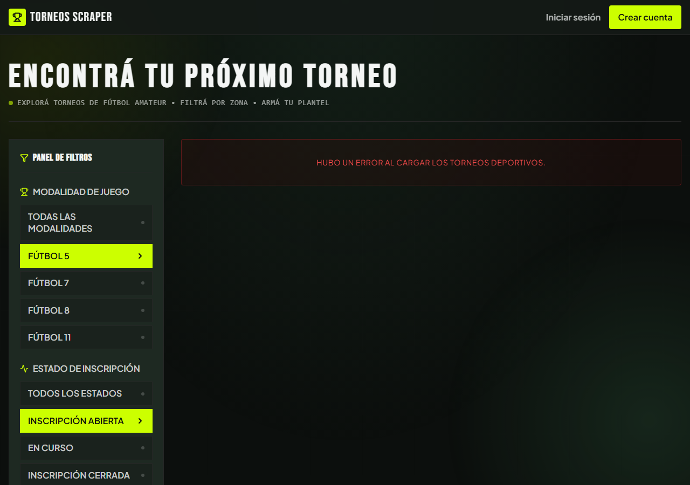
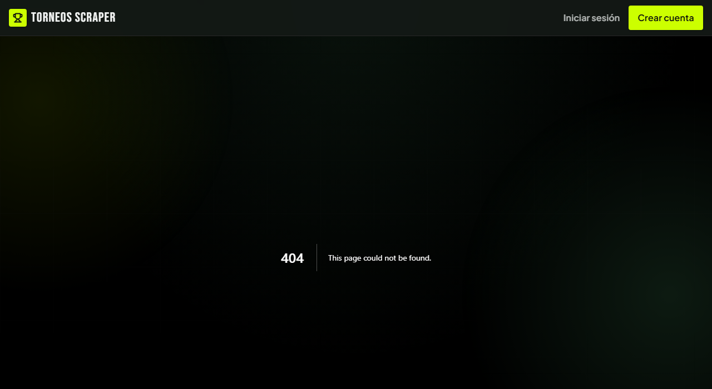

# Módulo Catálogo de torneos · Pantallas

Versión del **04/11/2026**. Cada pantalla pública de los torneos, con su ruta, el caso, los requerimientos, lo que muestra y la captura. Siguen a los [casos de uso](02-casos-de-uso.md) y preceden a los [diagramas de secuencia](04-diagramas-secuencia/README.md).

**Estado de las capturas**

| Marca | Significa |
|---|---|
| ✅ **Vigente** | Sacada el 04/11/2026 de `main`, con la UI actual, a 1280 px de ancho. |
| ⏳ **Pendiente** | Todavía no hay captura. Al final están los pasos para sacarla. |

Las capturas están en [`pantallas/`](pantallas/). **La base de datos de desarrollo no respondía** cuando se sacaron, así que las dos capturas vigentes muestran estados que la app produce justamente cuando la base falla: el catálogo en su estado de error (con el panel de filtros completo y activo) y el 404 de una ficha. Las que muestran torneos reales están pendientes.

## Mapa de pantallas

| Pantalla | Ruta | Casos de uso | Sesión |
|---|---|---|---|
| [P1 · Catálogo](#p1--catálogo) | `/` (y `/?modality=…&status=…`) | UC-B01, UC-B02 | No |
| [P2 · Ficha del torneo](#p2--ficha-del-torneo) | `/torneos/{id}` | UC-B03, UC-B04, UC-B06 | No (el dueño ve una barra extra) |
| [P3 · Página del organizador](#p3--página-del-organizador) | `/organizadores/{id}` | UC-B05 | No |

Las tres son **públicas**: ninguna está en la lista de rutas protegidas.

---

## P1 · Catálogo

**Ruta:** `/` · **Casos de uso:** [UC-B01](02-casos-de-uso.md#uc-b01--ver-el-catálogo-de-torneos), [UC-B02](02-casos-de-uso.md#uc-b02--filtrar-torneos-y-compartir-la-búsqueda) · **Requerimientos:** RF-B01 a RF-B13, RF-B25 · **Diagramas:** [S01](04-diagramas-secuencia/uc-b01-ver-catalogo.md), [S02](04-diagramas-secuencia/uc-b02-filtrar-torneos.md)

*Captura ✅ vigente. URL: `/?modality=futbol_5&status=abierto`. Muestra el panel de filtros con «Fútbol 5» e «Inscripción abierta» activos y, a la derecha, el **estado de error de carga** («Hubo un error al cargar los torneos deportivos.») porque la base no respondía. Con la base disponible, ahí van las tarjetas.*

**Qué muestra.** El título «Encontrá tu próximo torneo» y dos columnas:

- **Panel de filtros** (izquierda, fijo al desplazarse en pantalla grande), con dos grupos de botones:

  | Grupo | Opciones | De dónde salen las opciones |
  |---|---|---|
  | **Modalidad de juego** | Todas las modalidades · Fútbol 5 · Fútbol 7 · Fútbol 8 · Fútbol 11 | **Lista fija del código** (`SPORT_MODALITIES`) |
  | **Estado de inscripción** | Todos los estados · Inscripción abierta · En curso · Inscripción cerrada | **Lista fija del código** (en `Filters.tsx`) |

  La opción activa se resalta en lima con una flecha. Elegir una opción reescribe la URL.
- **Listado** (derecha): una **tarjeta** por torneo, en una grilla de 1 a 3 columnas. Cada tarjeta es un link entero a la ficha y muestra: el flyer (o un marcador) con el **Estado** y, si corresponde, «Últimos cupos»; un número de orden y el nombre; la Zona con su corredor y la modalidad; la **antigüedad de verificación** (ámbar o rojo desde los 30 y 60 días) y el **precio** («Consultar» o «Gratis»); y el botón «Ficha». Los torneos cerrados se ven en escala de grises.
- **Pie:** «¿Organizás torneos? Publicalo» (lleva al panel; sin sesión, a Crear cuenta con el aviso).

**Estados de la pantalla**

| Estado | Qué ve la persona |
|---|---|
| Con torneos | La grilla de tarjetas. |
| Cargando | Esqueletos animados del panel y de seis tarjetas. |
| Sin resultados | «No hay torneos registrados … Probá cambiando las opciones en el panel lateral o limpiando los filtros de búsqueda». |
| Error de carga | «Hubo un error al cargar los torneos deportivos.» ✅ (captura de arriba) |

> ⏳ **Pendiente:** la grilla de tarjetas con datos reales, y el estado «Sin resultados». Tampoco hay paginación, ni filtros de Zona, precio o fechas (ver [«Sin decisión»](01-requerimientos.md#5-sin-decisión-lo-que-casos-de-usomd-dice-y-el-código-no-hace)).

---

## P2 · Ficha del torneo

**Ruta:** `/torneos/{id}` · **Casos de uso:** [UC-B03](02-casos-de-uso.md#uc-b03--ver-la-ficha-pública-de-un-torneo), [UC-B04](02-casos-de-uso.md#uc-b04--contactar-al-organizador), [UC-B06](02-casos-de-uso.md#uc-b06--reportar-un-torneo) (pendiente) · **Requerimientos:** RF-B14 a RF-B22, RF-B24 · **Diagramas:** [S03](04-diagramas-secuencia/uc-b03-ver-ficha-torneo.md), [S04](04-diagramas-secuencia/uc-b04-contactar-organizador.md), [S06](04-diagramas-secuencia/uc-b06-reportar-torneo.md)

*Captura ✅ vigente del **404** de una ficha (`/torneos/00000000-0000-0000-0000-000000000000`). Es la página genérica de Next, en inglés y sin link al catálogo: ver UC-B03 A1.*

**Qué muestra.** Con flyer, dos columnas (el flyer a la izquierda en proporción 4:5, entero y sin recortar; la información a la derecha). Sin flyer, una sola columna. En orden:

1. **Barra de dueño** (solo para el organizador del torneo): «Este torneo es tuyo · Gestionar».
2. Link «← Volver al catálogo».
3. **Estado** y «Últimos cupos» (sobre el flyer, o arriba del título si no hay flyer).
4. **Título y chips:** Zona con corredor, modalidad, organizador (link a su página, P3) y antigüedad de verificación.
5. **Precio y fechas:** precio de inscripción, cierre de inscripción, fecha de inicio, fecha de finalización y cupo (o cantidad de inscriptos).
6. **Contacto:** «Contactar por WhatsApp» (botón principal) y «Ver Instagram». Es donde termina el flujo en la app. Sin ninguno: «El organizador no suministró datos de contacto directo».
7. **Equipos anotados:** una lista numerada de nombres; los vinculados son links a la página del equipo.
8. **Sobre el torneo** (descripción), **Reglamento** y **Sede** (la dirección, con link al mapa).

Con flyer, el orden es: título, precio y fechas, contacto, equipos anotados, descripción, reglamento y sede. Sin flyer, el contacto sube justo después de saber cuánto sale, cuándo y dónde se juega.

**Mensajes extra solo para el dueño** (recién publicado): «Publicado. Así lo ve la gente» y, si falló la subida, «No pudimos subir el flyer. Probá de nuevo desde Gestionar».

**Estados:** *normal*; *no existe o dado de baja* (404, captura); *finalizado* (hoy con los botones de contacto); *con y sin flyer*.

> ⏳ **Pendiente:** la ficha con datos reales, con y sin flyer, y la de un torneo finalizado. El botón «Reportar» no existe todavía.

---

## P3 · Página del organizador

**Ruta:** `/organizadores/{id}` · **Caso de uso:** [UC-B05](02-casos-de-uso.md#uc-b05--ver-la-página-pública-del-organizador) · **Requerimientos:** RF-B23 · **Diagrama:** [S05](04-diagramas-secuencia/uc-b05-ver-organizador.md)

> ⏳ **Captura pendiente:** requiere datos de la base.

**Qué muestra.** «← Volver al catálogo»; la cabecera con la foto (o la inicial en lima), el **nombre**, la Zona con su corredor y «Organiza desde [mes y año]»; y debajo dos secciones, **«Torneos vigentes (N)»** y **«Trayectoria (N)»** (los finalizados, más apagados). Cada torneo es un link con su Estado, nombre, Zona, modalidad y fechas. No se muestra ningún contacto.

**Estados:** *sin torneos* («Todavía no publicó torneos»); *error al cargar los torneos* («No pudimos cargar sus torneos. Probá de nuevo.»); *no existe* (404).

---

## Capturas pendientes

Convención: PNG en `docs/catalogo-de-torneos/pantallas/`, ventana de unos 1280 px de ancho, con datos de prueba. Hace falta la base de desarrollo disponible.

| Archivo | Pantalla y estado | Cómo conseguirlo |
|---|---|---|
| `catalogo.png` | P1 con tarjetas | Abrir `/` con varios torneos, de distintos Estados y con y sin flyer. |
| `catalogo-sin-resultados.png` | P1 sin resultados | Combinar filtros que no coincidan con ningún torneo. |
| `catalogo-movil.png` | P1 en el celular | Ancho de ~390 px. |
| `ficha-con-flyer.png` | P2 con flyer | Un torneo con flyer, con cupo y con equipos anotados. |
| `ficha-sin-flyer.png` | P2 sin flyer | Un torneo sin flyer. |
| `ficha-dueno.png` | P2 vista del dueño | Abrir la ficha propia con sesión: se ve la barra «Este torneo es tuyo». |
| `ficha-finalizada.png` | P2 de un torneo finalizado | Para documentar que hoy muestra los botones de contacto. |
| `organizador.png` | P3 | Un organizador con torneos vigentes y finalizados. |
