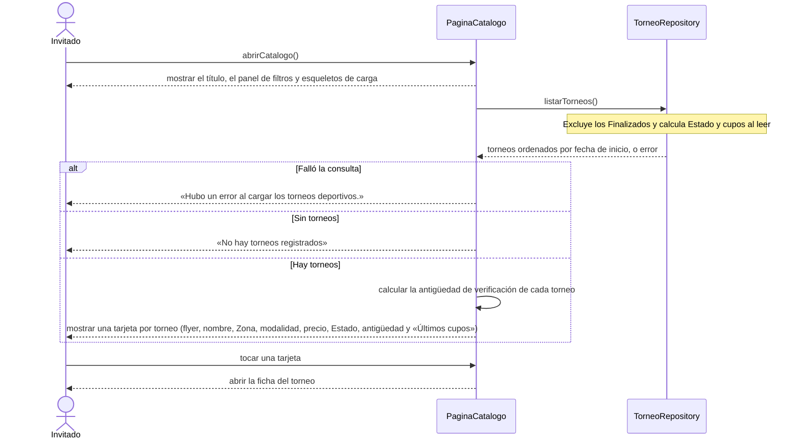

# S01 · UC-B01 — Ver el catálogo de torneos

Caso de uso: [UC-B01](../02-casos-de-uso.md#uc-b01--ver-el-catálogo-de-torneos) · Pantalla: [P1](../03-pantallas.md#p1--catálogo) · Requerimientos: RF-B01 a RF-B07

Es una consulta: no hay formulario. Los filtros son otro caso de uso ([S02](uc-b02-filtrar-torneos.md)); acá se ve el catálogo sin filtros.

## Cómo se lee

- **Lectura pública:** `listarTorneos` no necesita sesión; la base permite leer los torneos a cualquiera (RLS).
- **Estado y cupos los calcula la base al leer**, con la hora actual: nadie los elige y no hay tareas programadas. Por eso se piden explícitamente (`status`, `inscriptions_count`). «Últimos cupos» sale de ahí: torneo **Abierto** con 2 lugares o menos.
- **Los Finalizados nunca salen** en el catálogo; su ficha sigue accesible por link. (`casos-de-uso.md` A4 dice otra cosa: ver [«Sin decisión»](../01-requerimientos.md#5-sin-decisión-lo-que-casos-de-usomd-dice-y-el-código-no-hace).)
- **La antigüedad se calcula en el servidor** y la tarjeta la recibe hecha, para que el «ahora» del servidor y el del navegador no difieran al hidratar. Desde 30 días es ámbar; desde 60, rojo con «Sin confirmar».
- **Sin paginación:** hoy `listarTorneos` devuelve todos los torneos. `casos-de-uso.md` dice que está paginado.
- El panel de filtros y el listado cargan por separado (`Suspense`): el panel aparece primero.

## Correspondencia en el código

`Home` (`src/app/page.tsx`) renderiza `Filters` y `TournamentList`; `TournamentList` hace `from('tournaments').select('*, status, inscriptions_count, zones(...)').neq('status','finalizado').order('start_date')`.
