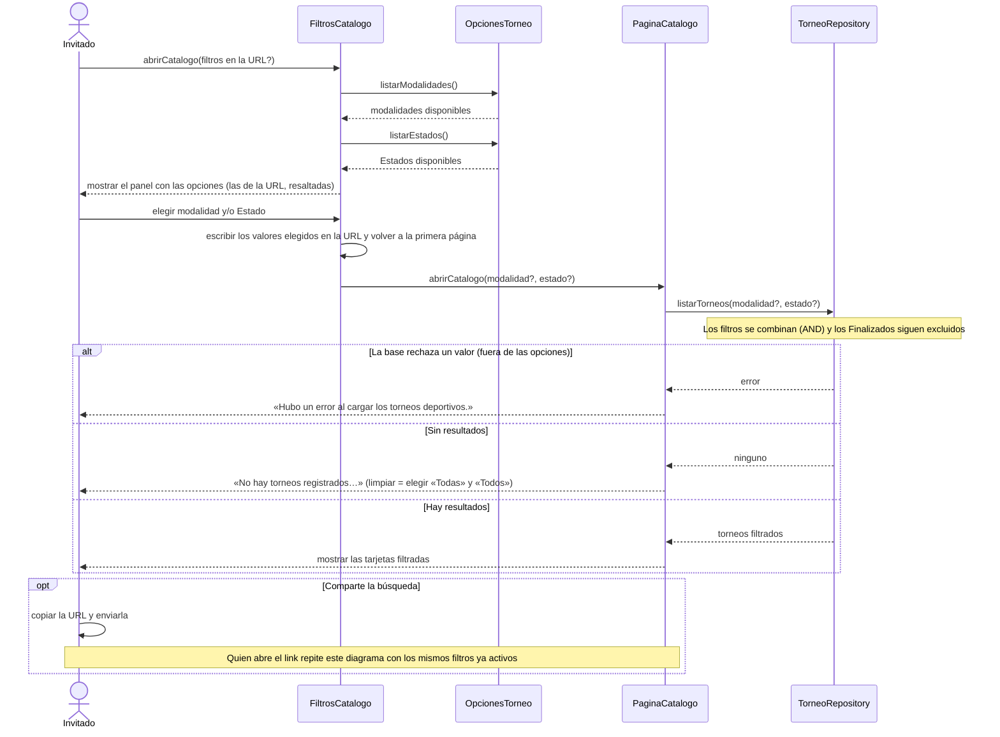

# S02 · UC-B02 — Filtrar torneos y compartir la búsqueda

Caso de uso: [UC-B02](../02-casos-de-uso.md#uc-b02--filtrar-torneos-y-compartir-la-búsqueda) · Pantalla: [P1](../03-pantallas.md#p1--catálogo) (panel de filtros) · Requerimientos: RF-B08, RF-B11 a RF-B13

El caso empieza con **dos grupos de opciones** (modalidad y Estado). Siguiendo la guía de formularios, el panel obtiene las opciones **antes** de que la persona elija. Las dos listas son **fijas del código** (no se guardan en la base), así que las provee `OpcionesTorneo` y no un repositorio. La carga de las opciones y el filtrado van en el mismo diagrama.

> **Alcance real.** Hoy el panel filtra solo por **modalidad** y **Estado**. Zona o Corredor, precio máximo y fechas de inicio figuran en `casos-de-uso.md` pero **no están en `main`**: cuando entren, la Zona se consultará en la base (un `ZonaRepository`, como en Editar perfil) y agregará su lista a este diagrama.

## Cómo se lee

- **Antes de elegir:** el panel muestra las opciones de `OpcionesTorneo` y resalta las que ya están en la URL. «Todas las modalidades» y «Todos los estados» quitan ese filtro.
- **Al elegir**, solo viajan los **valores elegidos** (`modalidad`, `estado`), nunca las listas. El panel los escribe en la URL y **vuelve a la primera página** (borra `page`).
- **Los filtros viven en la URL**, no en estado local: una vista filtrada es siempre un **link compartible**. Por eso compartir no necesita un paso aparte: quien abre el link repite la consulta.
- **La validación se repite al consultar… en teoría.** Un valor que el panel ofrece puede no seguir siendo válido, porque la URL se puede editar a mano. Hoy el servidor **no valida** `modality` y `status` antes de consultar: un valor fuera de la lista lo rechaza la base y la persona ve el error de carga, en lugar de que se ignore ese filtro como dice `casos-de-uso.md`. Una **clave** desconocida (`?foo=1`) sí se ignora.
- Las dos listas son del código: si algún día modalidad o Estado se guardaran en una tabla, `OpcionesTorneo` se reemplazaría por un repositorio.

## Correspondencia en el código

`Filters` (`src/components/Filters.tsx`) lee `useSearchParams`, arma la URL con `router.push` y borra `page`; `TournamentList` aplica `.eq('sport_modality', …)` y `.eq('status', …)`.
