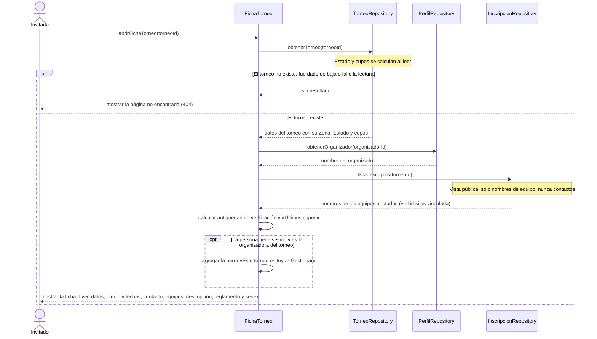

# S03 · UC-B03 — Ver la ficha pública de un torneo

Caso de uso: [UC-B03](../02-casos-de-uso.md#uc-b03--ver-la-ficha-pública-de-un-torneo) · Pantalla: [P2](../03-pantallas.md#p2--ficha-del-torneo) · Requerimientos: RF-B14 a RF-B20

Es una consulta: no hay formulario ni desplegables. Los botones de contacto son el caso siguiente ([S04](uc-b04-contactar-organizador.md)).

## Cómo se lee

- **Qué se muestra:** todo lo del torneo más su organizador (con link a su página) y los **nombres** de los equipos anotados. Los inscriptos salen de una **vista pública** que expone solo nombres: la tabla de inscripciones solo la lee el organizador.
- **Los equipos de una Inscripción vinculada son un link** a su página (`team_id`); los de una Inscripción por nombre son solo texto.
- **404 cubre tres casos con el mismo resultado:** el torneo no existe, se dio de baja (su fila se borra) o la lectura falló. Hoy es la página 404 genérica de Next, sin link al catálogo (`casos-de-uso.md` pide uno).
- **Un torneo Finalizado se muestra** (su ficha sigue siendo pública). `casos-de-uso.md` dice que sin botones de contacto; hoy los muestra.
- **Para el dueño**, la ficha es idéntica a la de cualquiera salvo la barra «Este torneo es tuyo · Gestionar». Eso se decide comparando la sesión con el organizador del torneo; un Invitado nunca la ve.
- **Metadatos:** la ficha no define los suyos (flyer, nombre, Zona) para la vista previa de WhatsApp; usa los del sitio.

## Correspondencia en el código

`TournamentDetail` (`src/app/torneos/[id]/page.tsx`): `from('tournaments').select('*, status, inscriptions_count, zones(...)')`, `from('profiles')` para el organizador, `from('tournament_inscriptions')` para los anotados, y `notFound()` si no hay torneo.
