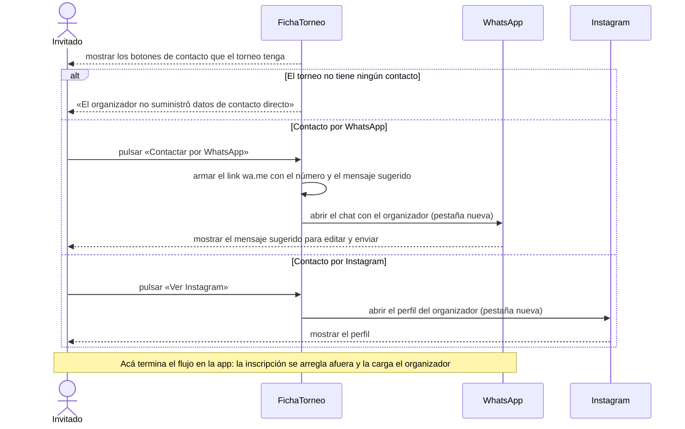

# S04 · UC-B04 — Contactar al organizador

Caso de uso: [UC-B04](../02-casos-de-uso.md#uc-b04--contactar-al-organizador) · Pantalla: [P2](../03-pantallas.md#p2--ficha-del-torneo) (botones de contacto) · Requerimientos: RF-B21, RF-B22

No hay formulario ni desplegables. **Aquí termina el flujo de la app:** la inscripción se arregla por fuera y la carga el organizador (UC-E06). `WhatsApp` e `Instagram` son sistemas externos.

## Cómo se lee

- **Cada medio es independiente:** si falta uno, su botón no se muestra; si hay ambos, se muestran los dos. Al publicar un torneo es obligatorio al menos un contacto, así que el mensaje «sin datos» solo puede aparecer en torneos viejos.
- **El link a WhatsApp se arma en la pantalla**, sin llamar al servidor: `https://wa.me/<número>?text=<mensaje>`. El número está guardado solo con dígitos, en formato argentino de celular (`549…`), que es lo que pide `wa.me`. La persona puede editar el mensaje antes de enviarlo.
- **El mensaje sugerido hoy** es «Hola, vengo de Torneos Scraper. Me interesa el torneo "[nombre]"!». `casos-de-uso.md` documenta otro texto.
- **Instagram:** se abre `instagram.com/<usuario>` (se quita la `@` si la tiene).
- **La app no inscribe ni cobra.** No hay un «Anotar mi equipo»: eso se descartó y es un límite del producto.

## Correspondencia en el código

Los botones están en `TournamentDetail` (`src/app/torneos/[id]/page.tsx`); `whatsappLink` está en `src/utils/whatsapp.ts`. Ambos links usan `target="_blank"` y `rel="noopener noreferrer"`.
