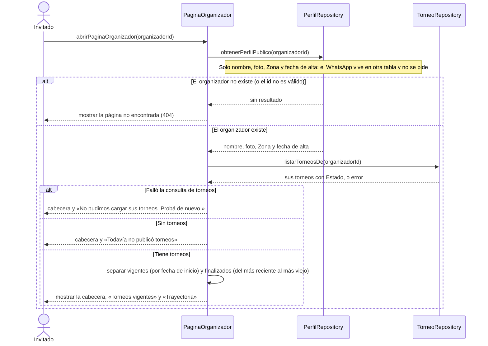

# S05 · UC-B05 — Ver la página pública del organizador

Caso de uso: [UC-B05](../02-casos-de-uso.md#uc-b05--ver-la-página-pública-del-organizador) · Pantalla: [P3](../03-pantallas.md#p3--página-del-organizador) · Requerimientos: RF-B23

Es una consulta: no hay formulario. La página es pública y **no pide ningún contacto**.

## Cómo se lee

- **Privacidad:** la página pide solo las columnas que muestra. El WhatsApp del perfil vive en `profile_contacts` y **nunca llega** a esta página, ni tampoco el contacto de cada torneo: el contacto es siempre el de la ficha del torneo.
- **«Organiza desde [mes y año]»** sale de la fecha de alta de la cuenta, con el mes contado en hora de Buenos Aires.
- **Trayectoria:** los torneos finalizados quedan en la página como historia del organizador. Por eso un Finalizado no se puede dar de baja.
- Cada torneo de la lista es un link a su ficha ([S03](uc-b03-ver-ficha-torneo.md)).

## Correspondencia en el código

`OrganizerPage` (`src/app/organizadores/[id]/page.tsx`): `from('profiles')` y `from('tournaments').eq('user_id', id)`; `splitTournaments` y `organizesSince` están en `src/utils/organizer-page.ts`.
