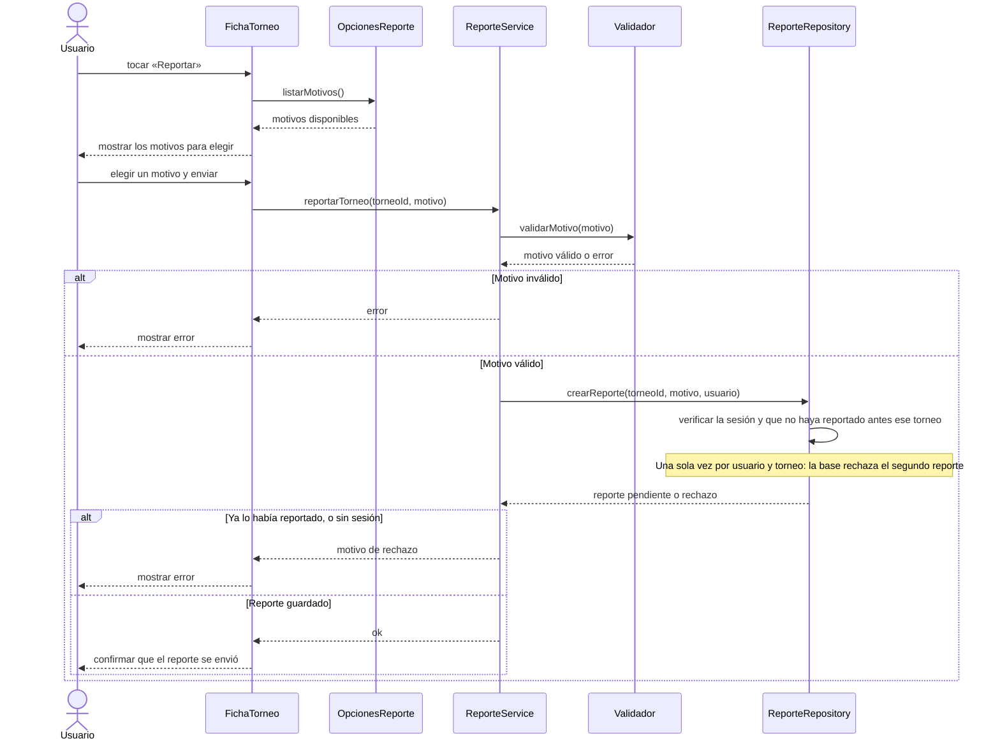

# S06 · UC-B06 — Reportar un torneo

Caso de uso: [UC-B06](../02-casos-de-uso.md#uc-b06--reportar-un-torneo) · Pantalla: [P2](../03-pantallas.md#p2--ficha-del-torneo) (botón «Reportar», todavía no existe) · Requerimientos: RF-B24

> **Diseño objetivo, pendiente de implementación.** Hoy no hay tabla, función ni botón de reportes de torneos. El diagrama dibuja lo que dicen las reglas vigentes; `OpcionesReporte`, `ReporteService`, `Validador` y `ReporteRepository` no existen todavía y sus nombres son provisorios.

El caso empieza con una elección entre tres motivos. Siguiendo la guía de formularios, la pantalla obtiene la lista de motivos **antes** de que la persona elija. Los motivos son una **lista fija del código**, así que los provee un proveedor de opciones y no un repositorio.

## Cómo se lee

- **Motivos** (lista fija): «Ya no existe», «Datos incorrectos» y «No es un torneo».
- **Una sola vez por usuario y torneo.** No alcanza con ocultar el botón: la base lo hace cumplir al guardar, porque la pantalla pudo quedar desactualizada o el pedido pudo armarse a mano.
- **Privacidad:** cada usuario ve solo sus reportes; el administrador ve todos.
- **Destino:** el reporte queda pendiente en el panel de administración, donde el administrador elige entre descartarlo, marcar el torneo como **Observado** o darlo de baja (UC-F03).
