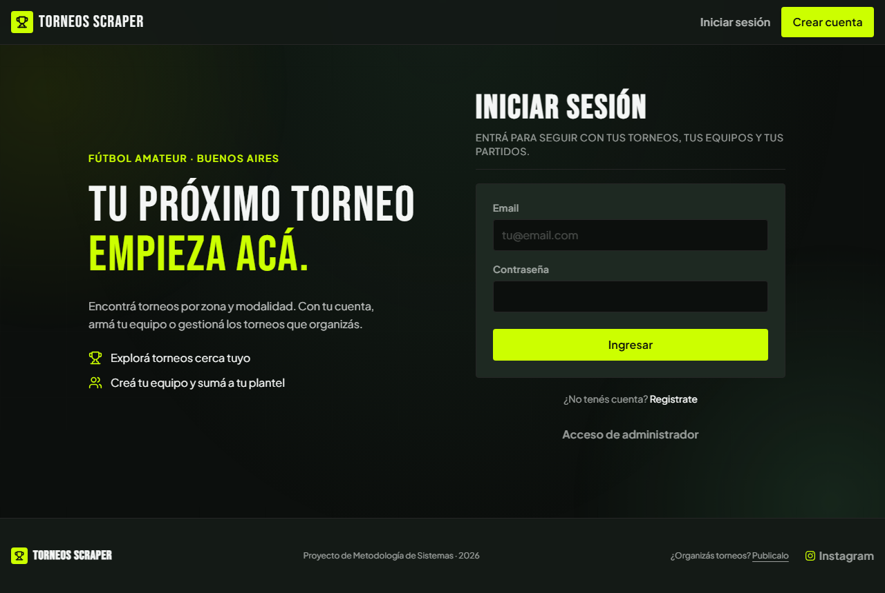
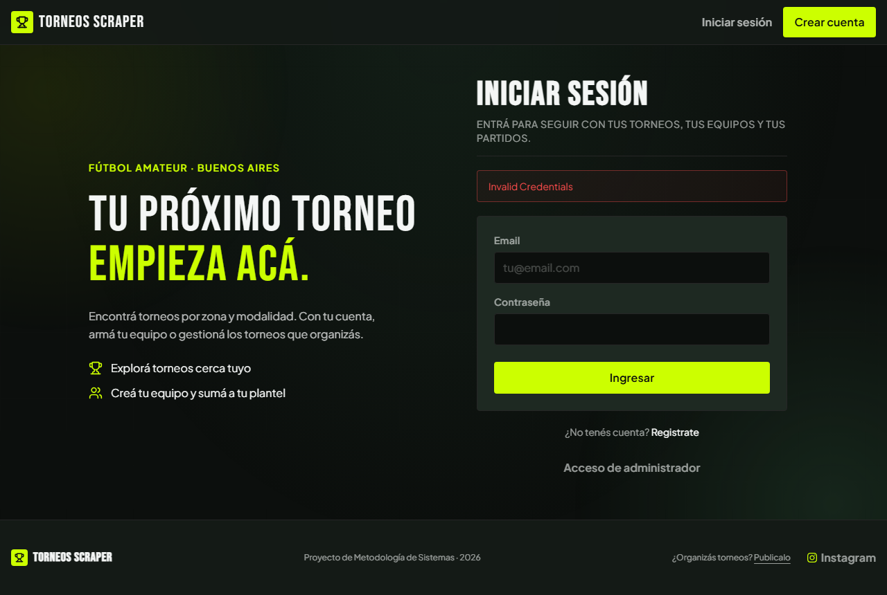
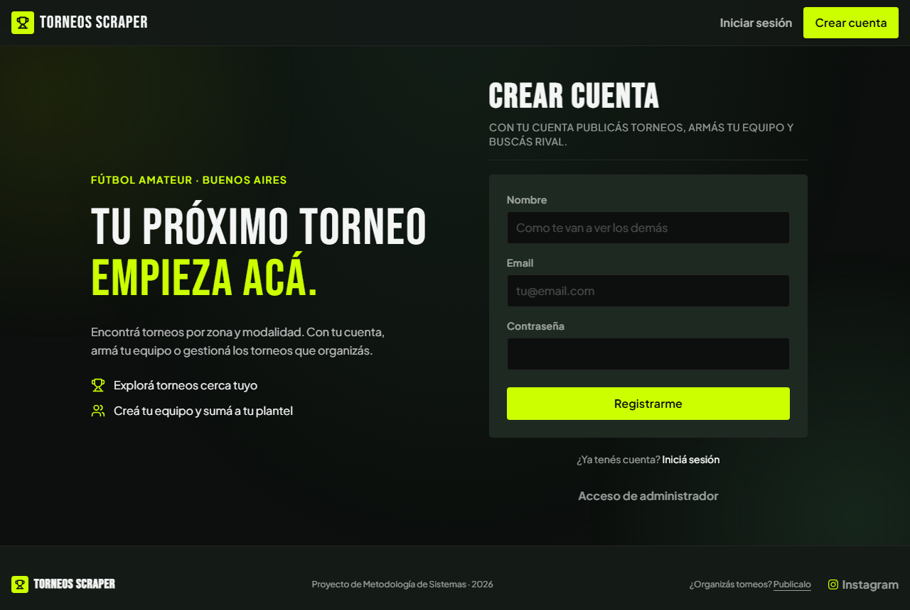
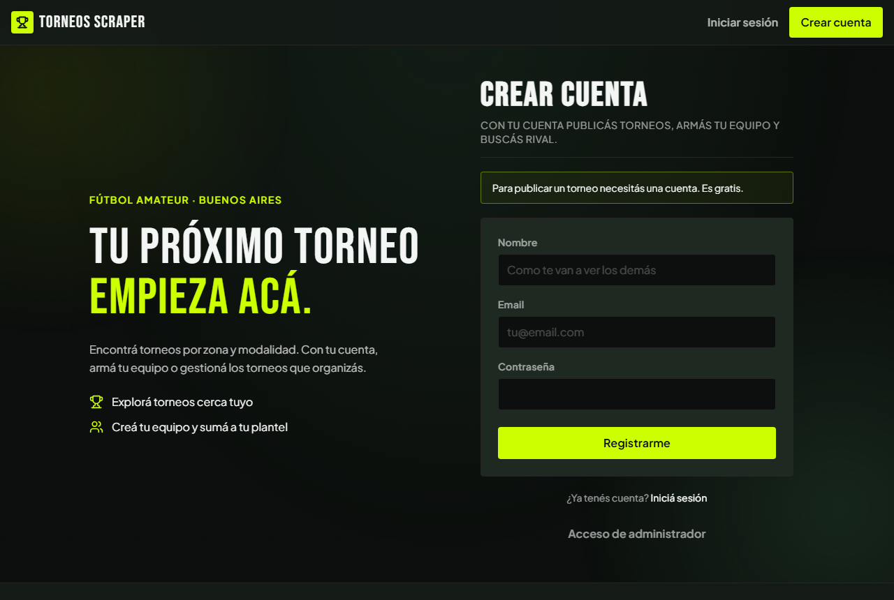

# Módulo Cuenta y acceso · Pantallas

Versión del **04/11/2026**. Cada pantalla de la app que representa un caso de uso del módulo, con la ruta, el caso, los requerimientos, lo que muestra y la captura. Siguen a los [casos de uso](02-casos-de-uso.md) y preceden a los [diagramas de secuencia](04-diagramas-secuencia/README.md).

**Estado de las capturas**

| Marca | Significa |
|---|---|
| ✅ **Vigente** | Sacada el 04/11/2026 de `main`, con la UI actual (lima y negro), a 1280 px de ancho. |
| ⏳ **Pendiente** | Todavía no hay captura. Al final están los pasos para sacarla. |

Las imágenes están en [`pantallas/`](pantallas/). Las de `/login` se sacaron de la app corriendo en local, sin sesión.

## Mapa de pantallas

| Pantalla | Ruta | Casos de uso | Sesión |
|---|---|---|---|
| [P1 · Iniciar sesión](#p1--iniciar-sesión) | `/login` | UC-A02 | No (con sesión, redirige) |
| [P2 · Crear cuenta](#p2--crear-cuenta) | `/login?modo=registro` | UC-A01 | No (con sesión, redirige) |
| [P3 · Mi perfil](#p3--mi-perfil) | `/perfil` | UC-A05 | Obligatoria |
| [P4 · Barra superior](#p4--barra-superior) | todas | UC-A01 a A03, A05, A06 | Cambia según haya sesión |
| [P5 · Campanita de avisos](#p5--campanita-de-avisos) | todas (con sesión) | UC-A06 | Obligatoria |

Iniciar sesión y Crear cuenta son **la misma página** (`/login`) con dos modos. El modo vive en la URL (`?modo=ingreso` o `?modo=registro`), no en el estado del navegador, así que cada pantalla es un link. `/perfil` exige sesión: sin ella, el control de acceso redirige a `/login?next=/perfil`.

---

## P1 · Iniciar sesión

**Ruta:** `/login` (o `/login?modo=ingreso`) · **Caso de uso:** [UC-A02](02-casos-de-uso.md#uc-a02--iniciar-sesión) · **Requerimientos:** RF-A04 a RF-A08 · **Diagrama:** [S02](04-diagramas-secuencia/uc-a02-iniciar-sesion.md)

*Captura ✅ vigente.*

**Qué muestra.** A la izquierda (solo en pantalla grande), el mensaje de bienvenida «Tu próximo torneo empieza acá» con dos beneficios. A la derecha, el título «Iniciar sesión», la bajada «Entrá para seguir con tus torneos, tus equipos y tus partidos» y el formulario:

| Campo | Tipo | Obligatorio |
|---|---|---|
| Email | email | Sí |
| Contraseña | contraseña | Sí |

El botón principal es «Ingresar». Debajo: «¿No tenés cuenta? **Registrate**» (cambia a P2) y el link «Acceso de administrador» (`/admin/login`, [UC-F01](../casos-de-uso/casos-de-uso.md#uc-f01--acceder-al-panel-de-administración)). No hay desplegables ni opciones que cargar.

**Estados de la pantalla**

| Estado | Qué ve la persona |
|---|---|
| Normal | El formulario vacío. |
| Credenciales inválidas | Banda roja con el texto «Invalid Credentials» (ver la captura de abajo). El destino pendiente se conserva. |
| Con sesión abierta | No se ve la pantalla: se redirige al destino. |
| Llegó por una ruta protegida | El mismo formulario; al ingresar vuelve a esa ruta (no hay aviso). |

*Captura ✅ vigente del error. El mensaje está en inglés en el código (`Invalid Credentials`); el resto de la pantalla está en español.*

---

## P2 · Crear cuenta

**Ruta:** `/login?modo=registro` · **Caso de uso:** [UC-A01](02-casos-de-uso.md#uc-a01--crear-cuenta) · **Requerimientos:** RF-A01 a RF-A03, RF-A06, RF-A08 · **Diagrama:** [S01](04-diagramas-secuencia/uc-a01-crear-cuenta.md)

*Captura ✅ vigente.*

**Qué muestra.** El título «Crear cuenta», la bajada «Con tu cuenta publicás torneos, armás tu equipo y buscás rival» (neutra: no habla solo de torneos) y el formulario:

| Campo | Tipo | Detalle | Obligatorio |
|---|---|---|---|
| Nombre | texto (2 a 50 caracteres) | Texto de ayuda «Como te van a ver los demás»: es público | Sí |
| Email | email | | Sí |
| Contraseña | contraseña | El gestor de contraseñas sugiere una nueva | Sí |

El botón principal es «Registrarme». Debajo: «¿Ya tenés cuenta? **Iniciá sesión**» (cambia a P1) y «Acceso de administrador».

**Llegar desde «¿Organizás torneos? Publicalo»** abre esta pantalla con el destino puesto en el panel de organizador y un aviso arriba del formulario:

*Captura ✅ vigente. URL: `/login?next=/mis-torneos`. Sin `modo` en la URL y con ese destino, la pantalla abre Crear cuenta y muestra «Para publicar un torneo necesitás una cuenta. Es gratis.». Con cualquier otro destino se abre Iniciar sesión, sin aviso.*

**Estados:** *error de nombre* («El nombre tiene que tener entre 2 y 50 caracteres»); *error de registro* («Error en registro», genérico: no distingue un email ya registrado de una contraseña inválida); *con sesión abierta* (se redirige al destino).

---

## P3 · Mi perfil

**Ruta:** `/perfil` · **Caso de uso:** [UC-A05](02-casos-de-uso.md#uc-a05--editar-perfil) · **Requerimientos:** RF-A11 a RF-A18 · **Diagrama:** [S05](04-diagramas-secuencia/uc-a05-editar-perfil.md)

> ⏳ **Captura pendiente:** requiere una cuenta con sesión.

**Qué muestra.** Cabecera «Mi perfil» con el email de la cuenta, el link «Volver al catálogo» y un formulario con:

| Campo | Tipo | De dónde salen las opciones | Obligatorio |
|---|---|---|---|
| Foto de perfil | archivo JPG, PNG o WebP, hasta 2 MB; muestra la foto actual | — | No |
| Nombre | texto (2 a 50 caracteres); «Es público: lo ven todos en tu página de organizador» | — | Sí |
| **Zona** | desplegable, agrupado por corredor, con la opción «Sin zona» | Se **consulta en la base** (`zones`, vía `getZoneGroups`) | No |
| WhatsApp | teléfono, con el prefijo fijo «+54 9» y el ejemplo «11 2345 6789» | — | No |

Bajo el WhatsApp: «Código de área sin 0 y número sin 15. No es público: hace falta para crear un equipo o ser capitán, y solo lo ve el capitán rival cuando tienen un partido acordado». El botón es «Guardar».

**Estados de la pantalla**

| Estado | Qué ve la persona |
|---|---|
| Normal | El formulario con los valores actuales. |
| Guardado | Banda lima «Perfil guardado.» |
| Error | Banda roja con el motivo (nombre, WhatsApp, foto, o fallo al guardar). |
| Llegó desde otra acción sin WhatsApp | Recuadro «Para seguir, cargá tu WhatsApp.»; al guardar, vuelve al destino. |
| Sin sesión | No se ve la pantalla: se redirige a `/login?next=/perfil`. |

---

## P4 · Barra superior

**Ruta:** todas · **Casos de uso:** [UC-A01](02-casos-de-uso.md#uc-a01--crear-cuenta), [UC-A02](02-casos-de-uso.md#uc-a02--iniciar-sesión), [UC-A03](02-casos-de-uso.md#uc-a03--cerrar-sesión), [UC-A05](02-casos-de-uso.md#uc-a05--editar-perfil), [UC-A06](02-casos-de-uso.md#uc-a06--ver-avisos-campanita) · **Requerimientos:** RF-A25 · **Diagrama:** [S03](04-diagramas-secuencia/uc-a03-cerrar-sesion.md) (cerrar sesión)

Es mínima: ningún botón destacado permanente.

| Estado | Qué muestra |
|---|---|
| **Sin sesión** | El logo; «Iniciar sesión» (texto) y «**Crear cuenta**» (único botón destacado). ✅ Se ve en la parte de arriba de todas las capturas de P1 y P2. |
| **Con sesión** | El logo; la campanita (P5); y el **menú de usuario**, un botón con la inicial y el nombre de la cuenta. ⏳ Captura pendiente. |

**El menú de usuario** se abre al tocar el botón y se cierra con un clic afuera o con Escape. Ofrece, en este orden:

1. **Mi perfil** (`/perfil`).
2. **Mis equipos** (`/mis-equipos`).
3. **Partidos** (`/partidos`).
4. **Mis torneos** (`/mis-torneos`).
5. **Administración** (`/admin`), **solo** si la cuenta es Administradora. Es solo el link: el acceso lo controlan el control de acceso y `is_admin()`.
6. **Cerrar sesión**, que cierra solo este dispositivo.

---

## P5 · Campanita de avisos

**Ruta:** todas, con sesión · **Caso de uso:** [UC-A06](02-casos-de-uso.md#uc-a06--ver-avisos-campanita) · **Requerimientos:** RF-A19 a RF-A24 · **Diagrama:** [S06](04-diagramas-secuencia/uc-a06-ver-avisos.md)

> ⏳ **Captura pendiente:** requiere una cuenta con Avisos (por ejemplo, un Capitán que recibió una propuesta).

**Qué muestra.** Un botón con una campana. Si hay Avisos no leídos, un **círculo rojo** con el número (hasta 99; con más, «99+»). Al tocarlo se abre un panel con el título «Avisos» y una lista de hasta 30, del más nuevo al más viejo. Cada fila es un **link** con el texto del Aviso y su fecha; los que estaban sin leer tienen un borde lima a la izquierda mientras el panel está abierto. No hay botones dentro de un Aviso.

**Estados:** *sin Avisos* («Todavía no tenés avisos.»); *con no leídos* (número rojo); *abierta* (el número baja de inmediato y los Avisos visibles quedan leídos); *sin sesión* (la campanita no existe).

---

## Capturas pendientes

Para completar el módulo. Convención: PNG en `docs/cuenta-y-acceso/pantallas/`, ventana de unos 1280 px de ancho, con datos de prueba (nunca cuentas ni Avisos reales).

| Archivo | Pantalla y estado | Cómo conseguirlo |
|---|---|---|
| `perfil.png` | P3 con los valores cargados | Con sesión, abrir `/perfil` con un perfil que tenga foto, Zona y WhatsApp. |
| `perfil-sin-whatsapp.png` | P3 con «Para seguir, cargá tu WhatsApp» | Con una cuenta sin WhatsApp, abrir `/perfil?next=/crear-equipo`. |
| `perfil-guardado.png` | P3 con «Perfil guardado.» | Guardar el perfil sin destino. |
| `perfil-error.png` | P3 con un error | Guardar un WhatsApp con «15» (por ejemplo, `11 15 2345 6789`). |
| `perfil-zona.png` | El desplegable de Zona abierto | Abrir el desplegable «Zona» para ver los corredores. |
| `barra-con-sesion.png` | P4 con sesión y el menú de usuario abierto | Con sesión, tocar el botón de la cuenta. Una cuenta Administradora muestra además «Administración». |
| `campanita.png` | P5 abierta con Avisos | Con una cuenta que recibió Avisos, abrir la campanita. |
| `campanita-vacia.png` | P5 sin Avisos | Con una cuenta nueva, abrir la campanita. |

Al agregar una captura, actualizar acá su marca de estado.
