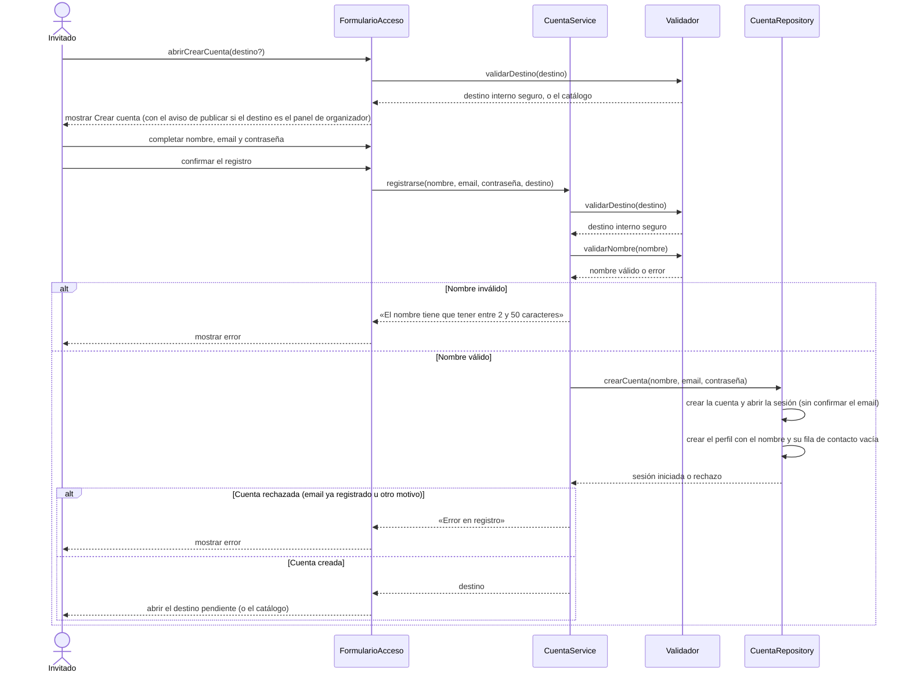

# S01 · UC-A01 — Crear cuenta

Caso de uso: [UC-A01](../02-casos-de-uso.md#uc-a01--crear-cuenta) · Pantalla: [P2](../03-pantallas.md#p2--crear-cuenta) · Requerimientos: RF-A01 a RF-A03, RF-A06, RF-A08

El formulario tiene solo campos de texto (nombre, email y contraseña): no hay desplegables ni listas que cargar. Lo que la pantalla sí resuelve antes de mostrarse es el **destino pendiente** (`next`).

## Cómo se lee

- **El destino se valida dos veces:** al abrir la pantalla y otra vez al enviar. El campo oculto `next` se puede editar, así que la acción no confía en lo que la pantalla ya revisó. Solo se aceptan rutas internas: `//sitio.com` empieza con `/` pero es externa, y se rechaza (se vuelve al catálogo).
- **Qué pantalla se abre** lo decide el destino: con `next` al panel de organizador y sin modo en la URL, se abre Crear cuenta con el aviso «Para publicar un torneo necesitás una cuenta. Es gratis.».
- **El nombre se valida antes de crear la cuenta**, para no depender del error genérico que daría la base («Database error saving new user») si el nombre no cumple la regla de 2 a 50 caracteres. El nombre viaja con la cuenta y el trigger lo usa para crear el perfil.
- **Cuenta, sesión, perfil y contacto nacen juntos:** el alta de la cuenta dispara en la base la creación del perfil y de la fila de contacto, en la misma transacción (`handle_new_user`). Nunca queda una cuenta sin perfil.
- **Se entra directo**, sin confirmar el email. Un email ya registrado y una contraseña que Supabase no acepta dan el mismo mensaje genérico, «Error en registro».
- Si ya hay una sesión abierta, abrir `/login` lleva directo al destino y el diagrama no empieza.

## Correspondencia en el código

`signup` (`src/app/login/actions.ts`): `safeNextPath` → regla del nombre → `supabase.auth.signUp` con `display_name` en los metadatos → redirige al destino. El perfil lo crea el trigger `on_auth_user_created` (`20260928000002_profiles.sql`).
