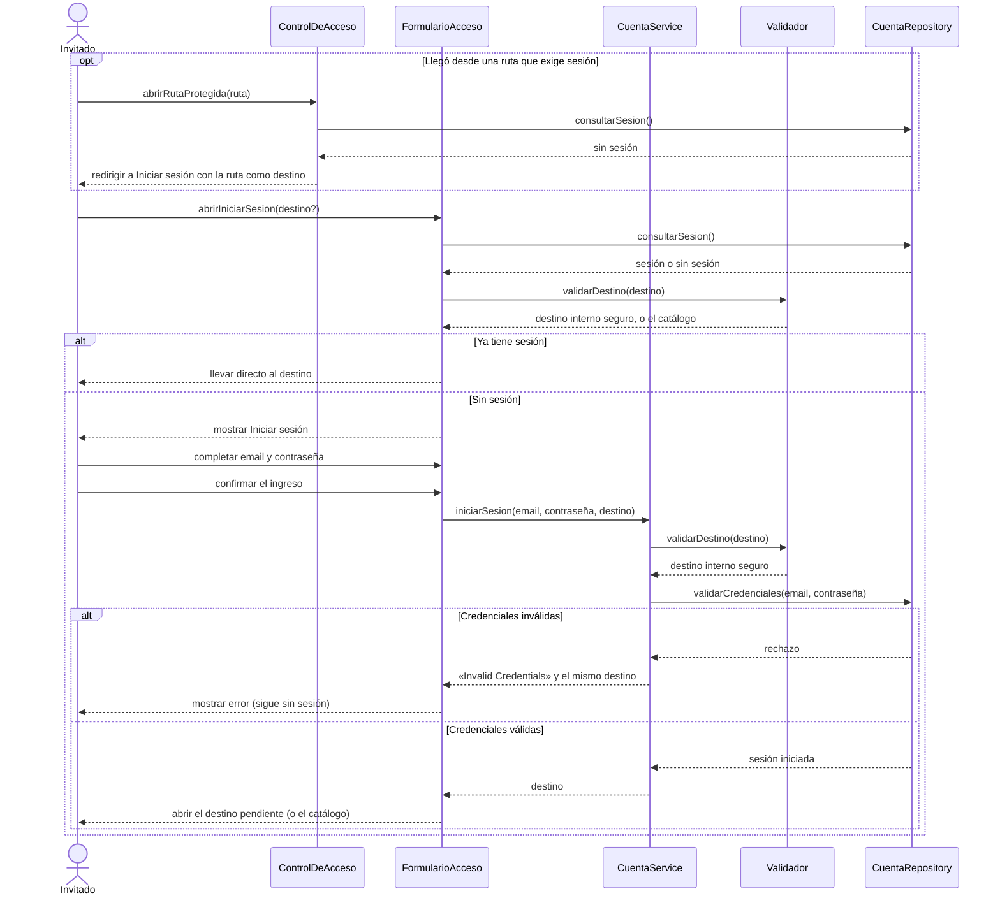

# S02 · UC-A02 — Iniciar sesión

Caso de uso: [UC-A02](../02-casos-de-uso.md#uc-a02--iniciar-sesión) · Pantalla: [P1](../03-pantallas.md#p1--iniciar-sesión) · Requerimientos: RF-A04 a RF-A08

El formulario tiene solo email y contraseña: no hay desplegables. Este diagrama incluye también el caso en que la persona llega **redirigida** por intentar entrar a una ruta que exige sesión, que es la regla de «volver a la acción pedida».

## Cómo se lee

- **Volver a la acción pedida.** Cuando una ruta exige sesión (`/crear-torneo`, `/mis-torneos`, `/perfil`, `/crear-equipo`, `/mis-equipos`, `/partidos`), `ControlDeAcceso` redirige a Iniciar sesión **conservando la ruta** como `next`. Al ingresar, la persona vuelve ahí. Es una primera capa «optimista»: cada página y cada acción vuelven a consultar la sesión y, si falta, mandan a `/login?next=…`.
- **El destino se valida dos veces** (al abrir y al enviar) y solo se aceptan rutas internas. Un destino externo o mal formado se reemplaza por el catálogo.
- **Con sesión abierta no hay nada que hacer en `/login`:** se sigue al destino.
- **El error no dice qué falló.** «Invalid Credentials» no distingue un email inexistente de una contraseña incorrecta. Está en inglés en el código; el resto de la pantalla está en español.
- **El modo va explícito** al volver con error (`modo=ingreso`): sin él, un destino al panel de organizador abriría Crear cuenta en vez de volver a Iniciar sesión.
- **No hay bloqueo por intentos fallidos** en la app: lo cubre Supabase.
- `/admin` tiene su propio acceso (`/admin/login`, UC-F01); no es parte de este diagrama.

## Correspondencia en el código

`login` (`src/app/login/actions.ts`): `safeNextPath` → `supabase.auth.signInWithPassword` → redirige al destino, o a `/login?modo=ingreso&error=…&next=…`. El control de acceso es `src/proxy.ts`.
