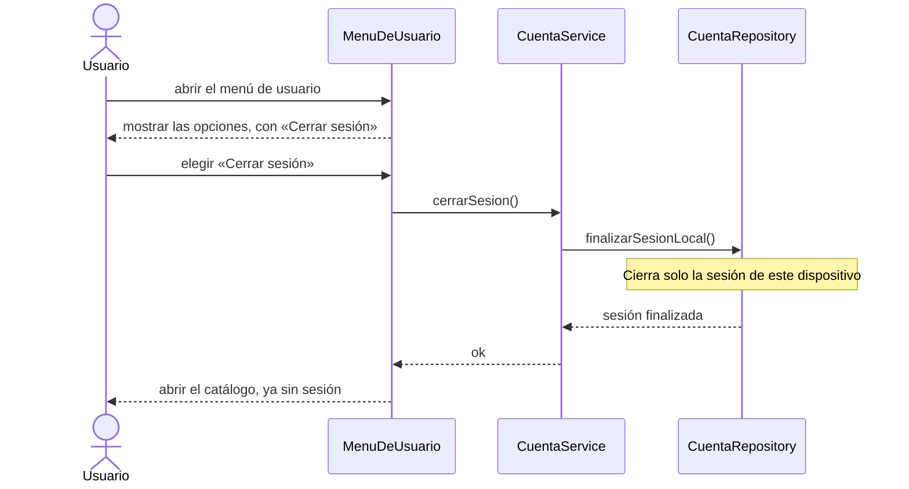

# S03 · UC-A03 — Cerrar sesión

Caso de uso: [UC-A03](../02-casos-de-uso.md#uc-a03--cerrar-sesión) · Pantalla: [P4](../03-pantallas.md#p4--barra-superior) (menú de usuario) · Requerimientos: RF-A09, RF-A25

No hay formulario ni datos que cargar: es una sola acción.

## Cómo se lee

- **Solo este dispositivo.** Si se pidiera el cierre sin indicar el alcance, Supabase revocaría las sesiones de la cuenta en **todos** los dispositivos (celular, otra computadora…). Por eso la acción pide explícitamente el cierre **local**; las demás sesiones siguen abiertas.
- **Siempre termina en el catálogo**, que es público. No hay confirmación previa: cerrar sesión no destruye nada.
- Después de cerrar, la barra vuelve a mostrar «Iniciar sesión» y «Crear cuenta», y la campanita desaparece.

## Correspondencia en el código

`logout` (`src/app/login/actions.ts`): `supabase.auth.signOut({ scope: 'local' })`, revalida el layout y redirige a `/`. El botón está en `UserMenu.tsx`.
