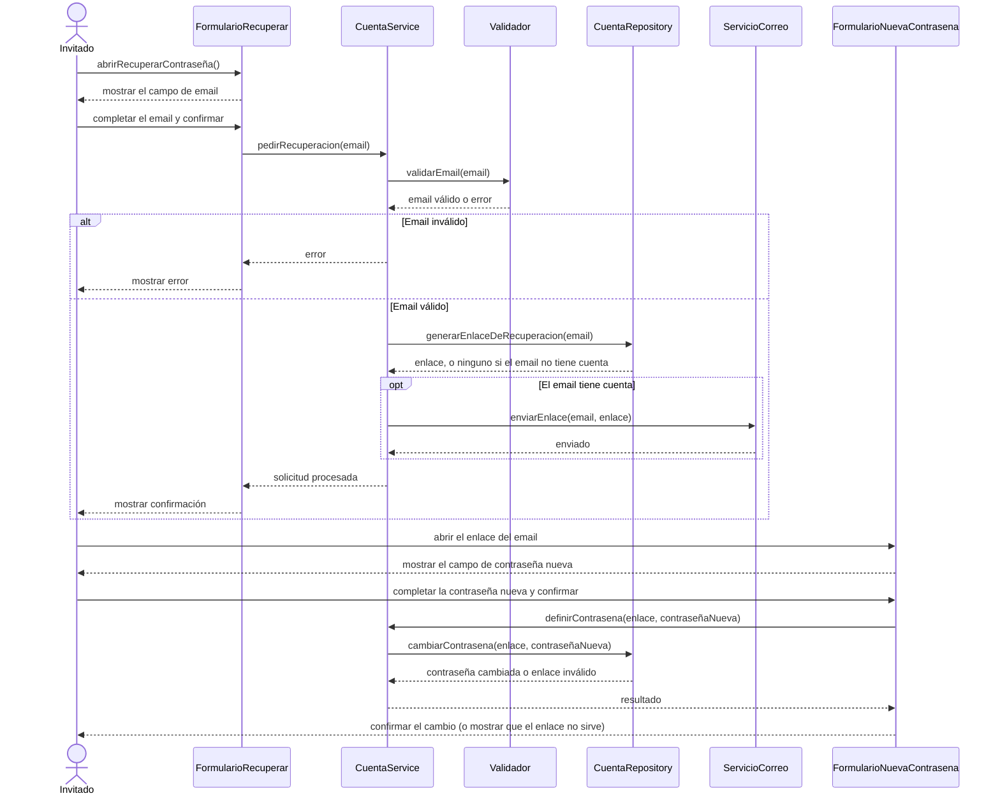

# S04 · UC-A04 — Recuperar contraseña

Caso de uso: [UC-A04](../02-casos-de-uso.md#uc-a04--recuperar-contraseña) · Pantalla: no existe todavía · Requerimientos: RF-A10

> **Diseño objetivo, pendiente de implementación** (decisión del 27/09/2026: primero producto, después infraestructura de auth). Hoy no hay pantalla, link ni acción. El diagrama dibuja lo que dicen las reglas vigentes; `FormularioRecuperar`, `FormularioNuevaContrasena` y `ServicioCorreo` no existen todavía y sus nombres son provisorios.

No hay desplegables. El caso tiene dos momentos —pedir el enlace y usarlo— que son **una sola meta**, así que van en el mismo diagrama.

## Cómo se lee

- **Es el único email que mandaría la app.** El SMTP gratuito de Supabase manda muy pocos mensajes por hora: alcanza para la entrega académica, pero con usuarios reales hace falta un servicio aparte (por ejemplo, Resend). Por eso el envío es un participante propio, `ServicioCorreo`.
- **Un enlace por email, de un solo propósito:** abrirlo lleva a definir la contraseña nueva. Un enlace inválido o vencido se muestra como tal.
- **Sin decidir, y hay que resolverlo antes de implementar** (después, agregar la regla a [decisiones-casos-de-uso.md](../../especificaciones-y-requerimientos/decisiones-casos-de-uso.md)):
  1. **Qué se responde si el email no tiene cuenta.** Decir «no existe» permite averiguar quién está registrado; responder siempre lo mismo lo evita. El diagrama deja el camino abierto: el envío es opcional y la confirmación es la misma.
  2. **Qué pasa después de cambiar la contraseña:** si la persona queda con la sesión abierta o tiene que iniciar sesión.
