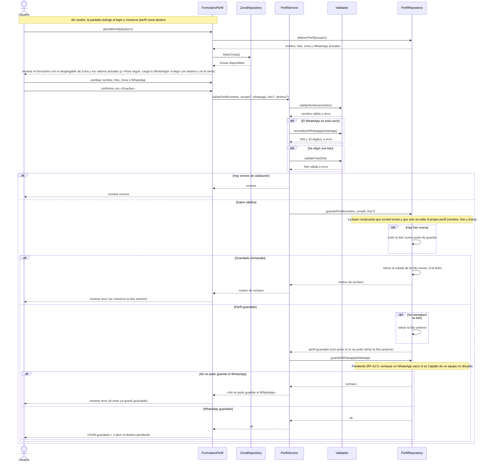

# S05 · UC-A05 — Editar perfil

Caso de uso: [UC-A05](../02-casos-de-uso.md#uc-a05--editar-perfil) · Pantalla: [P3](../03-pantallas.md#p3--mi-perfil) · Requerimientos: RF-A11 a RF-A18

El formulario tiene **un solo desplegable: la Zona**. Sigue el criterio de la guía de formularios: la pantalla obtiene las Zonas de `ZonaRepository` **antes** de que la persona elija, y al enviar manda solo el `zonaId` elegido. Nombre, WhatsApp y foto son campos de texto y de archivo, sin listas que cargar; por eso no hay proveedor de opciones fijas. La carga de la Zona y el guardado van en este único diagrama.

## Cómo se lee

- **Antes de elegir:** la pantalla trae los valores actuales de `PerfilRepository` y las Zonas de `ZonaRepository`, y recién entonces muestra el formulario. El desplegable ofrece además «Sin zona»: la Zona del perfil es **opcional**.
- **Al enviar:** `editarPerfil(...)` recibe solo los **valores elegidos** (`zonaId`), no la lista de Zonas.
- **Se valida de nuevo al guardar.** `Validador` revisa el nombre (de 2 a 50 caracteres), el WhatsApp y la foto aunque el formulario tenga sus propias restricciones; y la base comprueba que la Zona exista (clave foránea) y que cada persona edite solo su perfil, y solo las columnas nombre, foto y Zona. El rol de administrador no está entre ellas: **no se puede editar desde la app**.
- **El WhatsApp se normaliza:** la persona escribe «11 2345 6789» y se guarda `5491123456789` (`549` + código de área sin 0 + número sin 15). Un número con «15» se rechaza, porque después del código de área no se sabe dónde termina el código. Vacío es válido.
- **La foto no se pierde si algo falla:** la foto nueva se **sube antes** de guardar; si el guardado falla, se retira esa subida y la anterior queda intacta; la anterior **solo se retira después** de guardar la URL nueva. Si dos pestañas reemplazan la foto a la vez, la segunda no se guarda.
- **Guardado en dos pasos, sin transacción:** primero nombre, Zona y foto; después el WhatsApp, que está en otra tabla (`profile_contacts`, aparte para que leer el perfil público nunca exponga el número). Si el segundo paso falla, el primero **ya quedó guardado**, y el mensaje lo dice.
- **Regla pendiente:** el Capitán de un equipo no disuelto no puede dejar el WhatsApp vacío (sí cambiarlo), porque el rival lo necesita para coordinar. **Hoy nada lo hace cumplir**: la acción no consulta los equipos y la base no tiene un trigger sobre `profile_contacts` (el único trigger de la base es el del alta de cuentas). Cuando se resuelva, la comprobación va en `guardarWhatsapp`, dentro de la base.

## Correspondencia en el código

`updateProfile` (`src/app/perfil/actions.ts`): regla del nombre → `normalizeWhatsapp` → `parseAvatar` → `saveProfile` (`src/utils/supabase/profile.ts`) → `update` de `profile_contacts` → redirige al destino o a `/perfil?ok=1`. Las Zonas salen de `zones` mediante `getZoneGroups()`.
