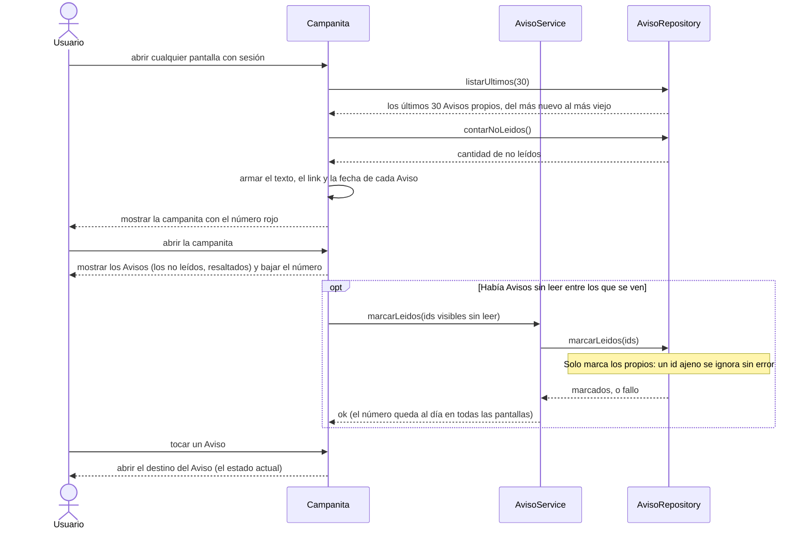

# S06 · UC-A06 — Ver avisos (campanita)

Caso de uso: [UC-A06](../02-casos-de-uso.md#uc-a06--ver-avisos-campanita) · Pantalla: [P5](../03-pantallas.md#p5--campanita-de-avisos) · Requerimientos: RF-A19 a RF-A24

No hay desplegables ni formulario: la campanita es una lista que se lee y se marca. **Nadie crea Avisos desde esta pantalla:** los escribe el sistema cuando ocurre una acción de otro caso de uso (por ejemplo, proponer un partido), por eso no hay un `crearAviso` en este diagrama.

## Cómo se lee

- **Qué se carga:** los **últimos 30** Avisos y, aparte, el total de no leídos (puede haber más de 30). La base devuelve solo los del propio usuario (RLS sobre `notices`).
- **El texto no se guarda, se arma al mostrar** a partir del hecho (`kind`) y la foto de sus datos del momento (`params`). Por eso un Aviso viejo no cambia si el rival cambia de nombre. Cada Aviso es un **link** al estado actual; no tiene botones: la acción se hace en la pantalla de destino, que valida las reglas.
- **Abrir la campanita marca leídos solo los que se ven**, no «todos». Si llega un Aviso con la campanita abierta, sigue contando como no leído. El número baja de inmediato en la pantalla, sin esperar a la base.
- **Si el marcado falla**, el Aviso sigue como no leído y se marca la próxima vez que se abra; no se muestra ningún error. Un id ajeno no se marca y no da error, para no confirmar que existe.
- **No hay borrado ni archivo, email ni push.** Los Avisos que abren un plazo dicen cuándo vence y qué pasa si no se responde.

## Correspondencia en el código

El layout (`src/app/layout.tsx`) lee `notices` (límite 30, más el conteo de `read_at` nulo) y arma el texto con `noticeText`, `noticeLink` y `noticeDate` (`src/utils/notices.ts`). `NoticeBell` muestra la lista y llama a `markNoticesRead` (`src/app/avisos/actions.ts`), que invoca la función `mark_notices_read`.
