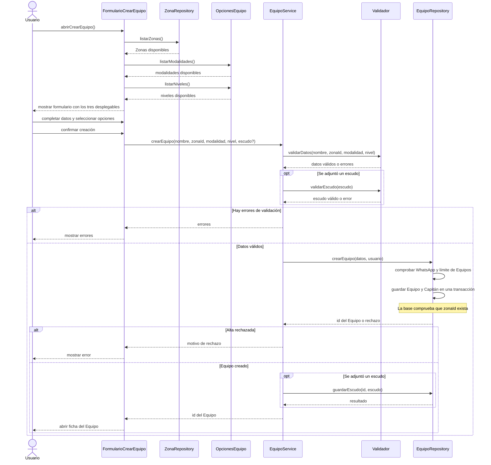

# UC-25 — Crear Equipo

El formulario carga las opciones de sus tres desplegables antes de permitir que el Usuario envíe el alta. `ZonaRepository` representa la consulta de la lista cerrada de Zonas; `OpcionesEquipo` provee las listas fijas de modalidades y niveles. Son responsabilidades conceptuales: no implican que existan clases TypeScript con esos nombres.

La pantalla envía los **valores elegidos** (`zonaId`, `modalidad`, `nivel`), no las listas completas. La validación se repite al guardar. En el código actual, las Zonas provienen de `zones` mediante `getZoneGroups()`, mientras que modalidad y nivel provienen de `SPORT_MODALITIES` y `TEAM_LEVELS`. El alta se realiza mediante la función de Postgres `create_team`.

Ver también [guia-diagramas.txt](guia-diagramas.txt) para aplicar el mismo criterio a otros formularios.
