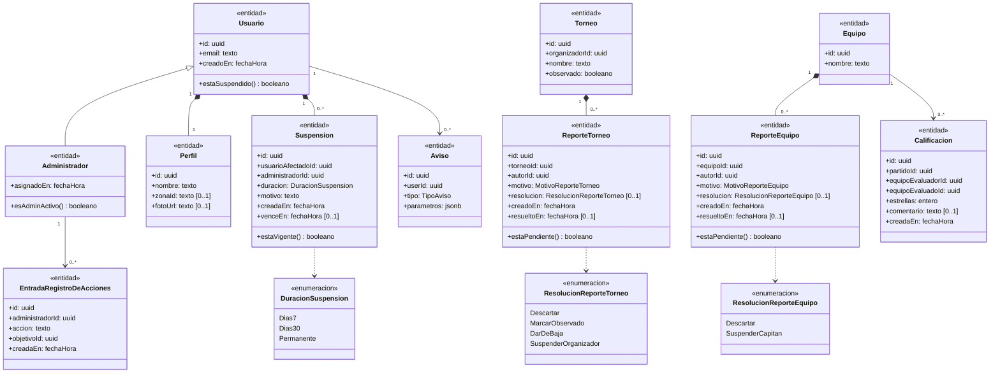
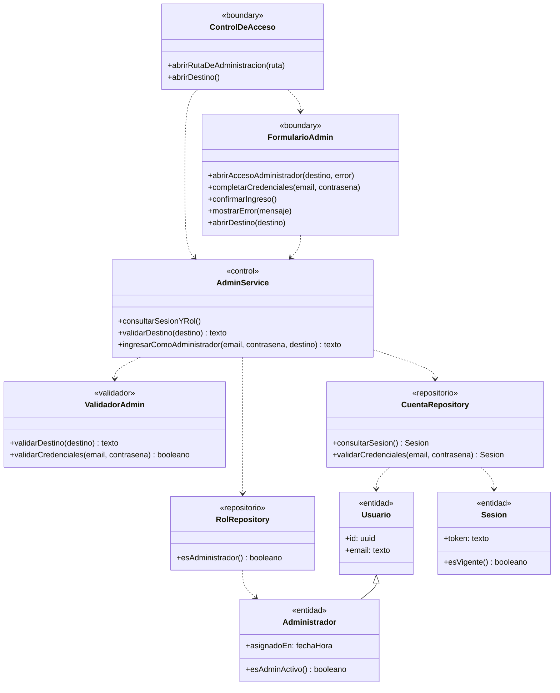
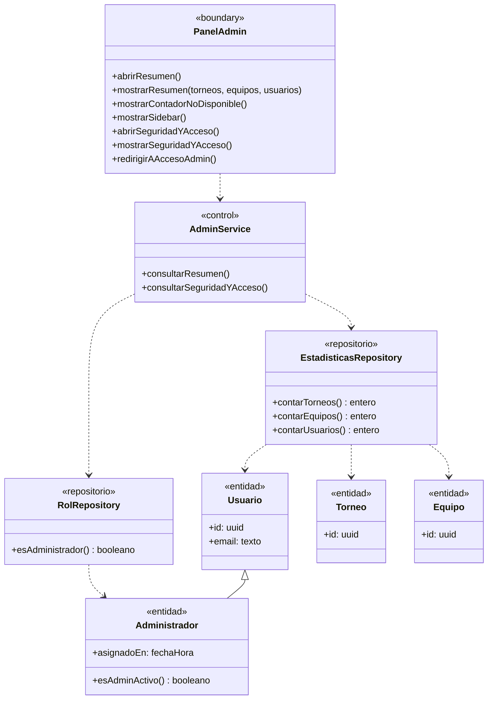
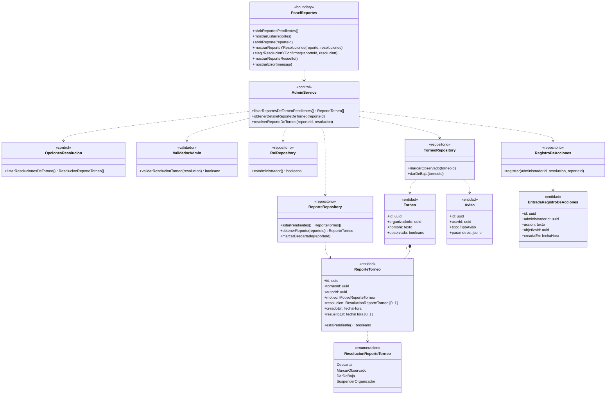
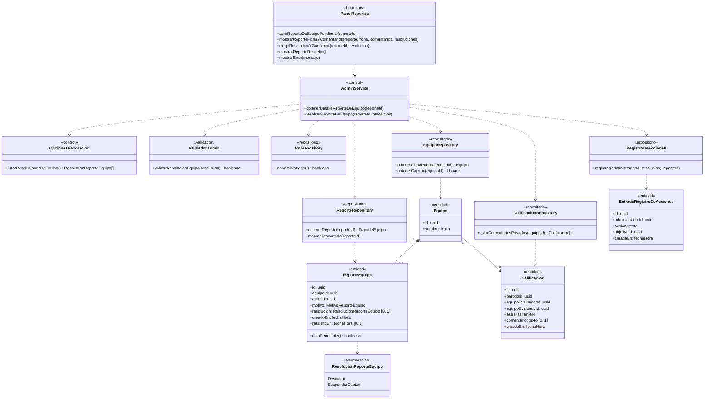
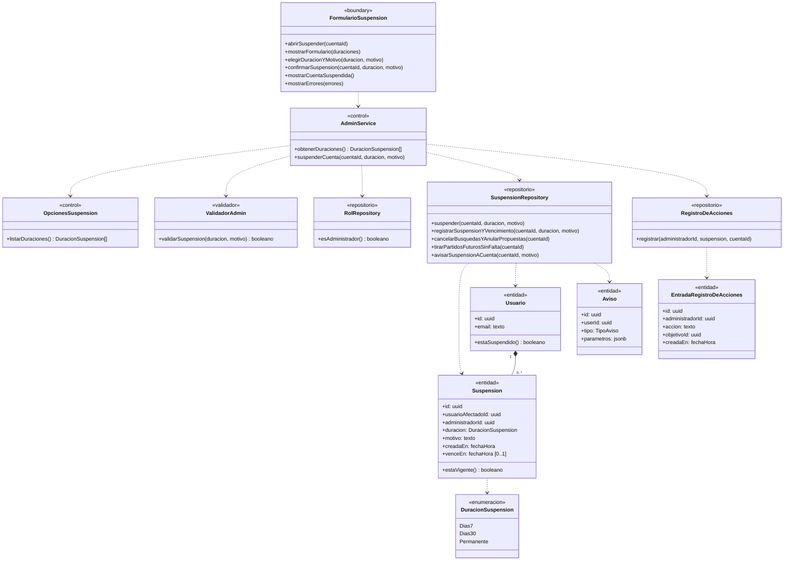
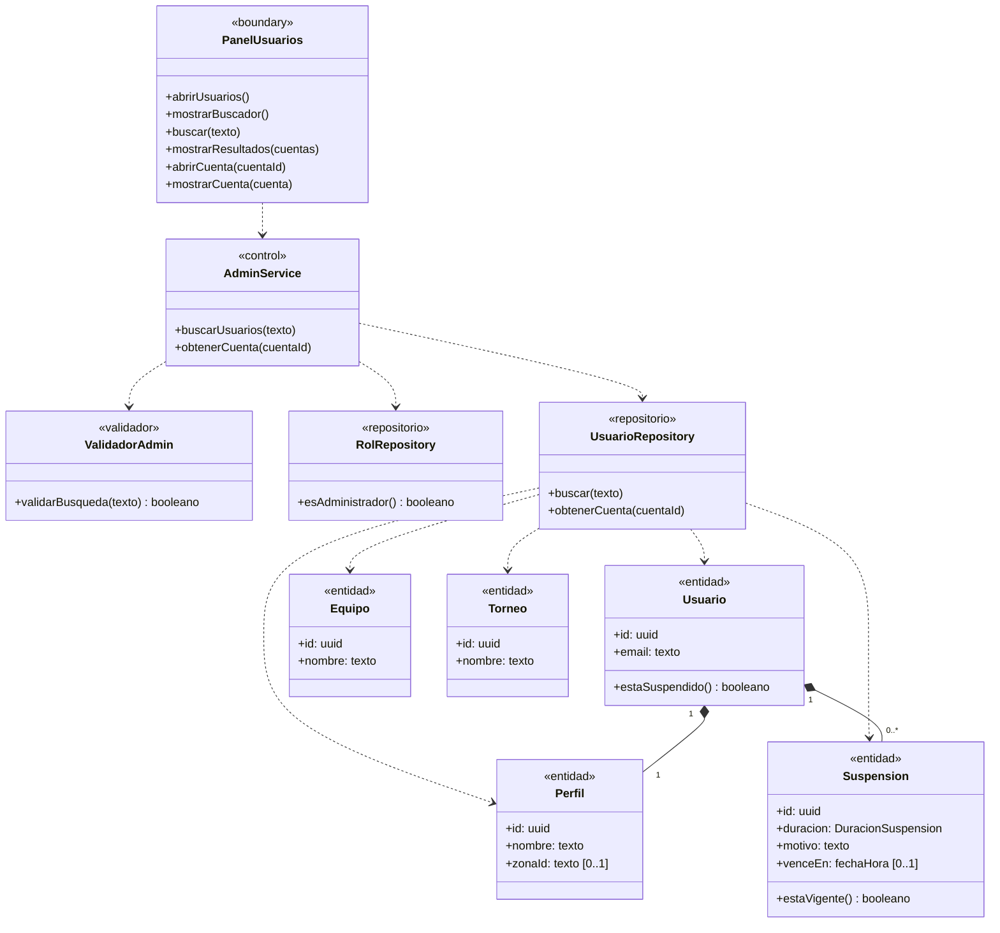

# Módulo F — Administración

> Documenta las clases de dominio y de diseño que participan en el **Módulo F — Administración** (`UC-F01` a `UC-F06`).
> Fuentes del módulo: [01-requerimientos.md](../administracion/01-requerimientos.md) · [02-casos-de-uso.md](../administracion/02-casos-de-uso.md) · [03-pantallas.md](../administracion/03-pantallas.md) · [04-diagramas-secuencia/](../administracion/04-diagramas-secuencia/README.md). Convenciones en el [README](README.md).

---

## Modelo de dominio del módulo

Vista estructural de las entidades, relaciones de herencia/composición y enumeraciones que comparten los casos de uso `UC-F01` a `UC-F06`.

---

## Clases por caso de uso

### UC-F01 · Acceder a la administración

> Especificación: [UC-F01](../administracion/02-casos-de-uso.md#uc-f01--acceder-a-la-administración) · Pantalla: [P1 · Acceso Administrador](../administracion/03-pantallas.md#p1--acceso-administrador) · Secuencia: [S01 · Acceder a la administración](../administracion/04-diagramas-secuencia/uc-f01-acceder-administracion.md)

---

### UC-F02 · Consultar el tablero

> Especificación: [UC-F02](../administracion/02-casos-de-uso.md#uc-f02--consultar-el-tablero) · Pantallas: [P2 · Resumen](../administracion/03-pantallas.md#p2--resumen-tablero) y [P3 · Seguridad y acceso](../administracion/03-pantallas.md#p3--seguridad-y-acceso) · Secuencia: [S02 · Consultar tablero](../administracion/04-diagramas-secuencia/uc-f02-consultar-tablero.md)

---

### UC-F03 · Resolver reporte de torneo

> Especificación: [UC-F03](../administracion/02-casos-de-uso.md#uc-f03--resolver-reporte-de-torneo) · Pantalla: [P4 · Reportes](../administracion/03-pantallas.md#p4--reportes-pendiente) · Secuencia: [S03 · Resolver reporte de torneo](../administracion/04-diagramas-secuencia/uc-f03-resolver-reporte-torneo.md)

---

### UC-F04 · Resolver reporte de equipo

> Especificación: [UC-F04](../administracion/02-casos-de-uso.md#uc-f04--resolver-reporte-de-equipo) · Pantalla: [P4 · Reportes](../administracion/03-pantallas.md#p4--reportes-pendiente) · Secuencia: [S04 · Resolver reporte de equipo](../administracion/04-diagramas-secuencia/uc-f04-resolver-reporte-equipo.md)

---

### UC-F05 · Suspender una cuenta

> Especificación: [UC-F05](../administracion/02-casos-de-uso.md#uc-f05--suspender-una-cuenta) · Pantalla: [Suspender cuenta](../administracion/03-pantallas.md#suspender-cuenta-pendiente) · Secuencia: [S05 · Suspender cuenta](../administracion/04-diagramas-secuencia/uc-f05-suspender-cuenta.md)

---

### UC-F06 · Buscar usuarios

> Especificación: [UC-F06](../administracion/02-casos-de-uso.md#uc-f06--buscar-usuarios) · Pantalla: [P5 · Usuarios](../administracion/03-pantallas.md#p5--usuarios-pendiente) · Secuencia: [S06 · Buscar usuarios](../administracion/04-diagramas-secuencia/uc-f06-buscar-usuarios.md)

---

## Trazabilidad

| Clase | Estereotipo | Implementación en el repo | Estado |
|---|---|---|---|
| `ControlDeAcceso` | `«boundary»` | `src/proxy.ts` + `requireAdminSession` (`src/utils/supabase/admin.ts`) | Implementado |
| `FormularioAdmin` | `«boundary»` | `src/app/admin/login/page.tsx` | Implementada |
| `PanelAdmin` | `«boundary»` | `src/app/admin/(panel)/layout.tsx`, `src/app/admin/(panel)/page.tsx`, `src/app/admin/(panel)/seguridad/page.tsx` | Implementada (parcial en métricas nuevas) |
| `PanelReportes` / `FormularioSuspension` / `PanelUsuarios` | `«boundary»` | — (previstos en `03-pantallas.md`) | **Pendiente** |
| `AdminService` / `OpcionesResolucion` / `OpcionesSuspension` | `«control»` | `adminLogin` (`src/app/admin/login/actions.ts`) + consultas en `src/app/admin/(panel)/page.tsx` + listas fijas de resoluciones y duraciones | Parcial (faltan UC-F03 a UC-F06) |
| `ValidadorAdmin` | `«validador»` | `safeAdminNextPath` (`src/utils/safe-next-path.ts`) + validadores de moderación | Parcial |
| `CuentaRepository` / `RolRepository` | `«repositorio»` | Supabase Auth + función `public.is_admin()` y tabla `public.admins` (`20260928000002_profiles.sql`) | Implementados |
| `EstadisticasRepository` | `«repositorio»` | `countTable` en `src/app/admin/(panel)/page.tsx` (`tournaments`, `teams`, `profiles`) | Implementado |
| `ReporteRepository` / `SuspensionRepository` / `UsuarioRepository` / `RegistroDeAcciones` | `«repositorio»` | — (tablas de reportes, suspensiones y auditoría) | **Pendiente** |
| `Usuario` / `Administrador` / `Perfil` / `Torneo` / `Equipo` / `Calificacion` / `Aviso` | `«entidad»` | `auth.users`, `public.admins`, `profiles`, `tournaments`, `teams`, `ratings`, `notices` | Implementadas |
| `ReporteTorneo` / `ReporteEquipo` / `Suspension` / `EntradaRegistroDeAcciones` | `«entidad»` | — (esquema de moderación y auditoría) | **Pendiente** |
