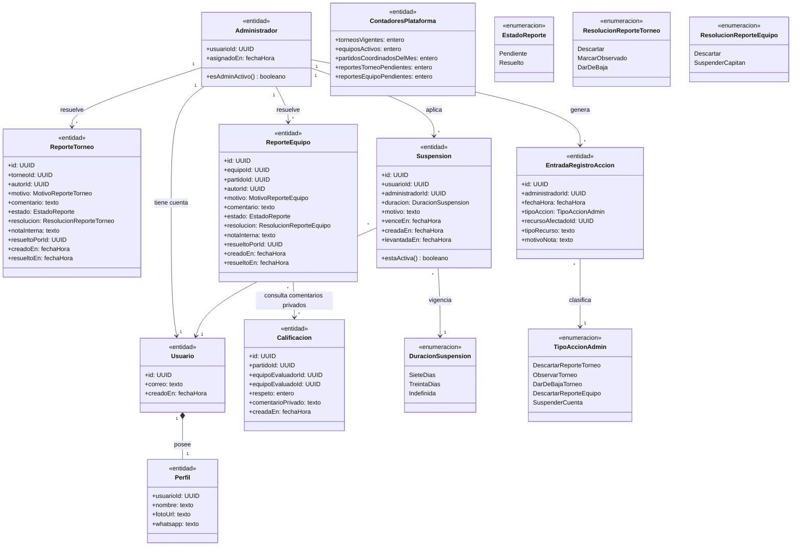
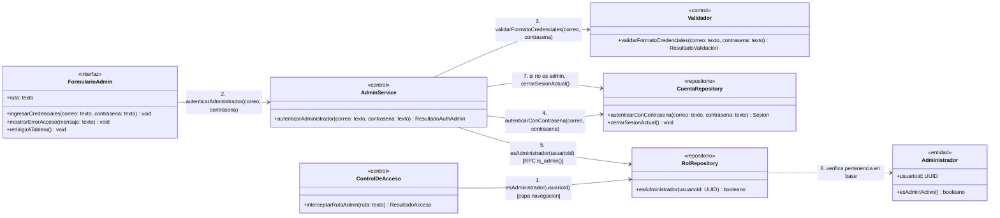
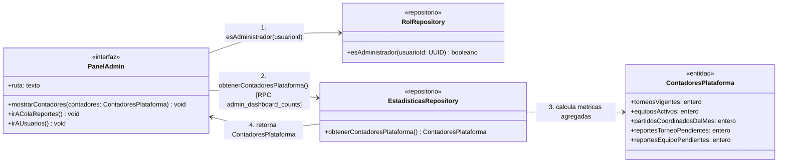
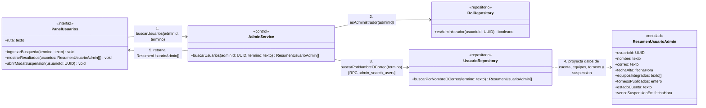

# Diagramas de clases — Administración

> Documenta las clases que participan en el **Módulo F — Administración** (`UC-F01` a `UC-F06`).
> Se alinea con [01-requerimientos.md](../administracion/01-requerimientos.md), [02-casos-de-uso.md](../administracion/02-casos-de-uso.md), [03-pantallas.md](../administracion/03-pantallas.md) y los diagramas de secuencia en [`04-diagramas-secuencia/`](../administracion/04-diagramas-secuencia/README.md).
> Todos los términos provienen de [`CONTEXT.md`](../../CONTEXT.md).

---

## Modelo de dominio del módulo

Vista estructural de las entidades y enumeraciones vinculadas a la moderación de reportes de torneos y equipos, la **Suspensión** de cuentas, el **Registro de acciones** y el tablero del **Panel de administración**.

---

## Clases por caso de uso

### UC-F01 — Acceder al Panel de administración

**Requerimientos:** `RF-F01`, `RF-F02`, `RNF-F01`, `RNF-F03` · **Pantalla:** `P-F01` (`/admin/login`) · **Secuencia:** [`uc-f01-acceder-panel-admin.md`](../administracion/04-diagramas-secuencia/uc-f01-acceder-panel-admin.md)

- **Reglas de negocio:** El rol de **Administrador** se asigna únicamente desde la base de datos y nunca desde la interfaz web (`RF-F02`). La verificación se ejecuta en dos capas independientes (`RNF-F01`): al navegar a `/admin/*` y dentro de cada consulta/RPC en la base (`is_admin()`). El mensaje de rechazo no distingue entre credenciales inválidas y falta de rol de Administrador.

---

### UC-F02 — Consultar el tablero

**Requerimientos:** `RF-F03`, `RNF-F01` · **Pantalla:** `P-F02` (`/admin`) · **Secuencia:** [`uc-f02-consultar-tablero.md`](../administracion/04-diagramas-secuencia/uc-f02-consultar-tablero.md)

- **Reglas de negocio:** Muestra en tiempo real los 4 indicadores operativos de la plataforma: torneos vigentes (`Abierto` y `En curso`), equipos activos (no dados de baja), partidos coordinados en el mes en curso y reportes pendientes de revisión (separados en torneos y equipos).

---

### UC-F03 — Resolver un reporte de torneo

**Requerimientos:** `RF-F04`, `RF-F05`, `RF-F09`, `RNF-F01`, `RNF-F02` · **Pantalla:** `P-F03` (`/admin/reportes`) · **Secuencia:** [`uc-f03-resolver-reporte-torneo.md`](../administracion/04-diagramas-secuencia/uc-f03-resolver-reporte-torneo.md)

```mermaid
classDiagram
    direction LR

    class PanelReportes {
        <<interfaz>>
        +ruta: texto
        +mostrarColaTorneos(reportes: ReporteTorneo[], opciones: ResolucionReporteTorneo[]) void
        +resolverReporteTorneo(reporteId: UUID, resolucion: ResolucionReporteTorneo, nota: texto) void
    }

    class OpcionesResolucion {
        <<proveedor de opciones>>
        +resolucionesTorneo() ResolucionReporteTorneo[]
    }

    class AdminService {
        <<control>>
        +resolverReporteTorneo(adminId: UUID, reporteId: UUID, resolucion: ResolucionReporteTorneo, nota: texto) void
    }

    class Validador {
        <<control>>
        +validarResolucionTorneo(resolucion: ResolucionReporteTorneo, nota: texto) ResultadoValidacion
    }

    class ReporteRepository {
        <<repositorio>>
        +listarReportesTorneoPendientes() ReporteTorneo[]
        +resolverReporteTorneo(reporteId: UUID, resolucion: ResolucionReporteTorneo, nota: texto) void
    }

    class TorneoRepository {
        <<repositorio>>
        +marcarObservado(torneoId: UUID, motivo: texto) void
        +darDeBajaPorModeracion(torneoId: UUID, motivo: texto) void
    }

    class RegistroDeAcciones {
        <<repositorio>>
        +registrarAccion(adminId: UUID, tipo: TipoAccionAdmin, recursoId: UUID, nota: texto) void
    }

    class Aviso {
        <<entidad>>
        +id: UUID
        +usuarioId: UUID
        +tipo: texto
        +titulo: texto
    }

    PanelReportes --> ReporteRepository : 1. listarReportesTorneoPendientes()
    PanelReportes --> OpcionesResolucion : 2. resolucionesTorneo()
    PanelReportes --> AdminService : 3. resolverReporteTorneo(adminId, reporteId, resolucion, nota)
    AdminService --> Validador : 4. validarResolucionTorneo(resolucion, nota)
    AdminService --> ReporteRepository : 5. resolverReporteTorneo() [RPC resolve_tournament_report]
    ReporteRepository --> TorneoRepository : 6. segun resolucion aplica marcarObservado() o darDeBajaPorModeracion()
    TorneoRepository ..> Aviso : 7. avisa al Organizador (y a inscriptos vinculados si se da de baja)
    ReporteRepository --> RegistroDeAcciones : 8. registrarAccion() en misma transaccion
```

- **Reglas de negocio:** Ofrece exactamente tres resoluciones:
  1. `Descartar`: cierra el reporte sin afectar al torneo.
  2. `MarcarObservado`: oculta el torneo del catálogo público, lo mantiene visible en «Mis torneos» con el motivo y envía un **Aviso** al Organizador.
  3. `DarDeBaja`: da de baja definitiva el torneo, borra su flyer, envía un **Aviso** al Organizador y un único **Aviso** por jugador a los planteles con **Inscripción vinculada**.
  - Toda resolución escribe de forma atómica e inmutable una entrada en el **Registro de acciones** (`RF-F09`, `RNF-F02`).

---

### UC-F04 — Resolver un reporte de equipo

**Requerimientos:** `RF-F04`, `RF-F06`, `RF-F09`, `RNF-F01`, `RNF-F02` · **Pantalla:** `P-F03` (`/admin/reportes`) · **Secuencia:** [`uc-f04-resolver-reporte-equipo.md`](../administracion/04-diagramas-secuencia/uc-f04-resolver-reporte-equipo.md)

```mermaid
classDiagram
    direction LR

    class PanelReportes {
        <<interfaz>>
        +ruta: texto
        +mostrarColaEquipos(reportes: ReporteEquipo[], opciones: ResolucionReporteEquipo[], duraciones: DuracionSuspension[]) void
        +inspeccionarContextoEquipo(equipoId: UUID) void
        +resolverReporteEquipo(reporteId: UUID, resolucion: ResolucionReporteEquipo, duracion: DuracionSuspension, nota: texto) void
    }

    class OpcionesResolucion {
        <<proveedor de opciones>>
        +resolucionesEquipo() ResolucionReporteEquipo[]
        +duracionesSuspension() DuracionSuspension[]
    }

    class AdminService {
        <<control>>
        +resolverReporteEquipo(adminId: UUID, reporteId: UUID, resolucion: ResolucionReporteEquipo, duracion: DuracionSuspension, nota: texto) void
    }

    class Validador {
        <<control>>
        +validarResolucionEquipo(resolucion: ResolucionReporteEquipo, duracion: DuracionSuspension, nota: texto) ResultadoValidacion
    }

    class ReporteRepository {
        <<repositorio>>
        +listarReportesEquipoPendientes() ReporteEquipo[]
        +obtenerComentariosPrivadosRecibidos(equipoId: UUID) Calificacion[]
        +resolverReporteEquipo(reporteId: UUID, resolucion: ResolucionReporteEquipo, duracion: DuracionSuspension, nota: texto) void
    }

    class SuspensionRepository {
        <<repositorio>>
        +suspenderCuentaYLimpiarActividad(usuarioId: UUID, duracion: DuracionSuspension, motivo: texto) void
    }

    class RegistroDeAcciones {
        <<repositorio>>
        +registrarAccion(adminId: UUID, tipo: TipoAccionAdmin, recursoId: UUID, nota: texto) void
    }

    PanelReportes --> ReporteRepository : 1. listarReportesEquipoPendientes() y obtenerComentariosPrivadosRecibidos()
    PanelReportes --> OpcionesResolucion : 2. resolucionesEquipo() y duracionesSuspension()
    PanelReportes --> AdminService : 3. resolverReporteEquipo(adminId, reporteId, resolucion, duracion, nota)
    AdminService --> Validador : 4. validarResolucionEquipo(resolucion, duracion, nota)
    AdminService --> ReporteRepository : 5. resolverReporteEquipo() [RPC resolve_team_report]
    ReporteRepository --> SuspensionRepository : 6. si es SuspenderCapitan, suspenderCuentaYLimpiarActividad()
    ReporteRepository --> RegistroDeAcciones : 7. registrarAccion() en misma transaccion
```

- **Reglas de negocio:** Al revisar un reporte de equipo (nacido desde un partido con él), el Administrador puede consultar el partido de origen, la ficha del equipo y los **comentarios privados** de calificaciones recibidas (visibles solo para el Administrador). Puede `Descartar` el reporte o `SuspenderCapitan` (eligiendo 7 días, 30 días o indefinida).

---

### UC-F05 — Suspender una cuenta

**Requerimientos:** `RF-F07`, `RF-F09`, `RNF-F01`, `RNF-F02` · **Pantallas:** `P-F03` (`/admin/reportes`), `P-F04` (`/admin/usuarios`) · **Secuencia:** [`uc-f05-suspender-cuenta.md`](../administracion/04-diagramas-secuencia/uc-f05-suspender-cuenta.md)

```mermaid
classDiagram
    direction LR

    class FormularioSuspension {
        <<interfaz>>
        +mostrarModalSuspension(usuario: Usuario, duraciones: DuracionSuspension[]) void
        +confirmarSuspension(usuarioId: UUID, duracion: DuracionSuspension, motivo: texto) void
    }

    class OpcionesSuspension {
        <<proveedor de opciones>>
        +duraciones() DuracionSuspension[]
    }

    class AdminService {
        <<control>>
        +suspenderCuenta(adminId: UUID, usuarioId: UUID, duracion: DuracionSuspension, motivo: texto) void
    }

    class Validador {
        <<control>>
        +validarSuspension(duracion: DuracionSuspension, motivo: texto) ResultadoValidacion
    }

    class SuspensionRepository {
        <<repositorio>>
        +aplicarSuspension(usuarioId: UUID, adminId: UUID, duracion: DuracionSuspension, motivo: texto) UUID
        +cancelarBusquedasYPropuestasCapitan(usuarioId: UUID) void
        +tirarPartidosFuturosSinFalta(usuarioId: UUID) void
    }

    class RegistroDeAcciones {
        <<repositorio>>
        +registrarAccion(adminId: UUID, tipo: TipoAccionAdmin, recursoId: UUID, nota: texto) void
    }

    class Suspension {
        <<entidad>>
        +id: UUID
        +usuarioId: UUID
        +duracion: DuracionSuspension
        +motivo: texto
        +venceEn: fechaHora
    }

    class Aviso {
        <<entidad>>
        +id: UUID
        +usuarioId: UUID
        +tipo: texto
        +titulo: texto
    }

    FormularioSuspension --> OpcionesSuspension : 1. duraciones() [7 dias, 30 dias, indefinida]
    FormularioSuspension --> AdminService : 2. suspenderCuenta(adminId, usuarioId, duracion, motivo)
    AdminService --> Validador : 3. validarSuspension(duracion, motivo)
    AdminService --> SuspensionRepository : 4. aplicarSuspension() [RPC suspend_user]
    SuspensionRepository ..> Suspension : 5. crea Suspension e invalida sesiones
    SuspensionRepository --> SuspensionRepository : 6. cancelarBusquedasYPropuestasCapitan() y tirarPartidosFuturosSinFalta()
    SuspensionRepository ..> Aviso : 7. avisa a rivales («Equipo suspendido», sin falta para nadie)
    SuspensionRepository --> RegistroDeAcciones : 8. registrarAccion() en misma transaccion
```

- **Reglas de negocio:** No se puede suspender a otro Administrador. Al aplicar la **Suspensión** (7 días, 30 días o indefinida, con motivo obligatorio):
  1. Se bloquea el inicio de sesión y cualquier acción autenticada hasta el vencimiento.
  2. Se cancelan las búsquedas de rival activas y las propuestas pendientes de los equipos donde el usuario suspendido es Capitán (avisando a la contraparte).
  3. Los partidos futuros (`Pendiente de coordinación` o `Coordinado`) de esos equipos pasan a **Partido caído** con motivo `«Equipo suspendido»`, **sin sumar falta a ninguno de los dos equipos**, y se envía un **Aviso** a todos los integrantes del equipo rival.
  4. Queda asentado en el **Registro de acciones** (`RF-F09`).

---

### UC-F06 — Buscar usuarios

**Requerimientos:** `RF-F08`, `RNF-F01` · **Pantalla:** `P-F04` (`/admin/usuarios`) · **Secuencia:** [`uc-f06-buscar-usuarios.md`](../administracion/04-diagramas-secuencia/uc-f06-buscar-usuarios.md)

- **Reglas de negocio:** Permite buscar por nombre o correo electrónico (parcial, insensible a mayúsculas y tildes). Muestra nombre, correo (visible únicamente para el propio usuario y el Administrador según la tabla de visibilidad), fecha de alta, equipos que integra (indicando dónde es Capitán), cantidad de torneos publicados y estado actual de la cuenta (`Activa` o `Suspendida hasta [fecha] / indefinida`).

---

## Trazabilidad

| Caso de uso | Requerimientos | Pantalla | Clases principales |
| --- | --- | --- | --- |
| `UC-F01` Acceder al Panel de administración | `RF-F01`, `RF-F02`, `RNF-F01`, `RNF-F03` | `P-F01` `/admin/login` | `ControlDeAcceso`, `FormularioAdmin`, `AdminService`, `Validador`, `CuentaRepository`, `RolRepository`, `Administrador` |
| `UC-F02` Consultar el tablero | `RF-F03`, `RNF-F01` | `P-F02` `/admin` | `PanelAdmin`, `RolRepository`, `EstadisticasRepository`, `ContadoresPlataforma` |
| `UC-F03` Resolver un reporte de torneo | `RF-F04`, `RF-F05`, `RF-F09`, `RNF-F01`, `RNF-F02` | `P-F03` `/admin/reportes` | `PanelReportes`, `OpcionesResolucion`, `AdminService`, `Validador`, `ReporteRepository`, `TorneoRepository`, `RegistroDeAcciones`, `Aviso` |
| `UC-F04` Resolver un reporte de equipo | `RF-F04`, `RF-F06`, `RF-F09`, `RNF-F01`, `RNF-F02` | `P-F03` `/admin/reportes` | `PanelReportes`, `OpcionesResolucion`, `AdminService`, `Validador`, `ReporteRepository`, `SuspensionRepository`, `RegistroDeAcciones` |
| `UC-F05` Suspender una cuenta | `RF-F07`, `RF-F09`, `RNF-F01`, `RNF-F02` | `P-F03` `/admin/reportes`, `P-F04` `/admin/usuarios` | `FormularioSuspension`, `OpcionesSuspension`, `AdminService`, `Validador`, `SuspensionRepository`, `RegistroDeAcciones`, `Suspension`, `Aviso` |
| `UC-F06` Buscar usuarios | `RF-F08`, `RNF-F01` | `P-F04` `/admin/usuarios` | `PanelUsuarios`, `AdminService`, `RolRepository`, `UsuarioRepository`, `ResumenUsuarioAdmin` |
