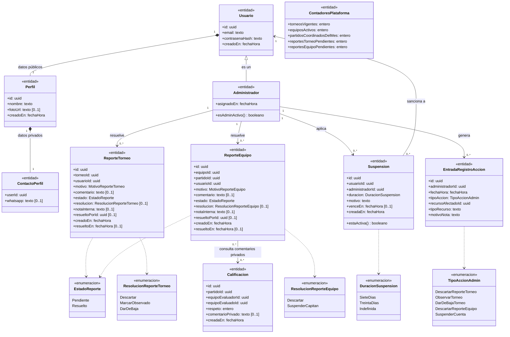
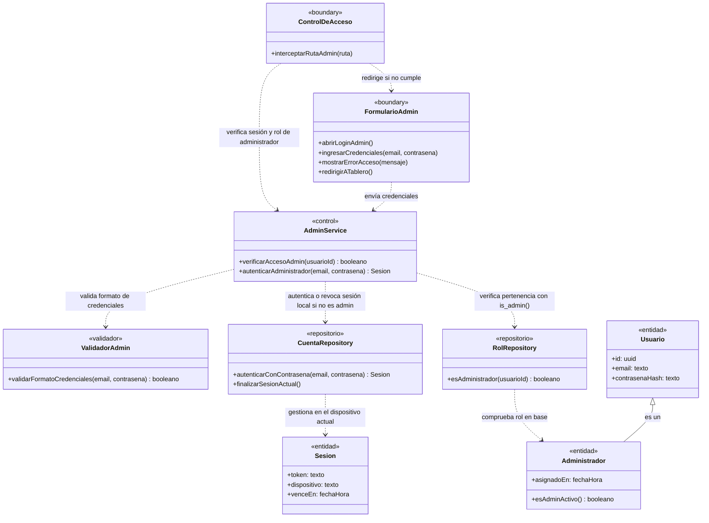
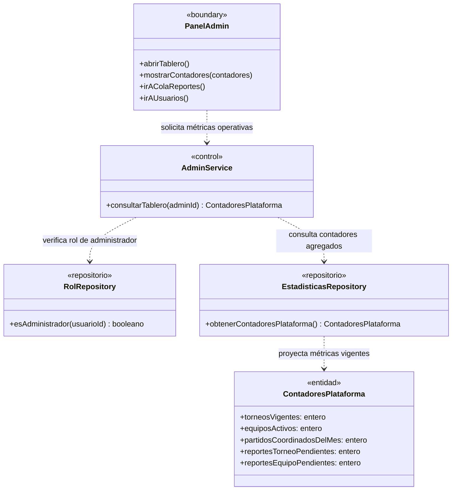
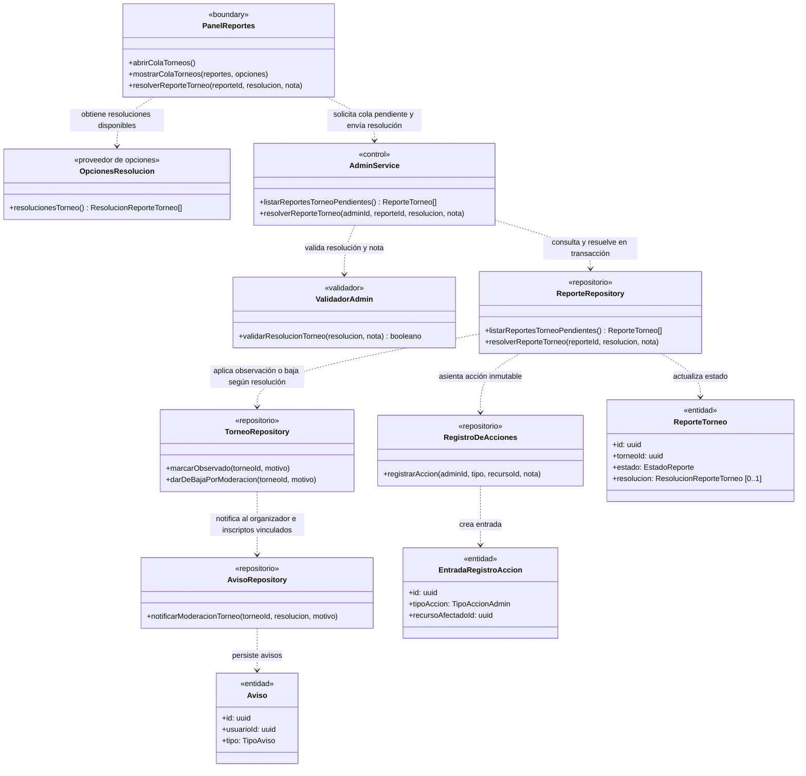
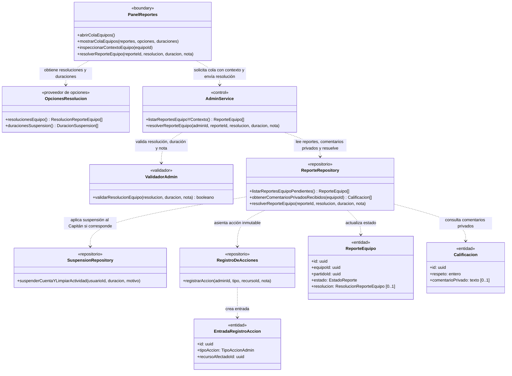
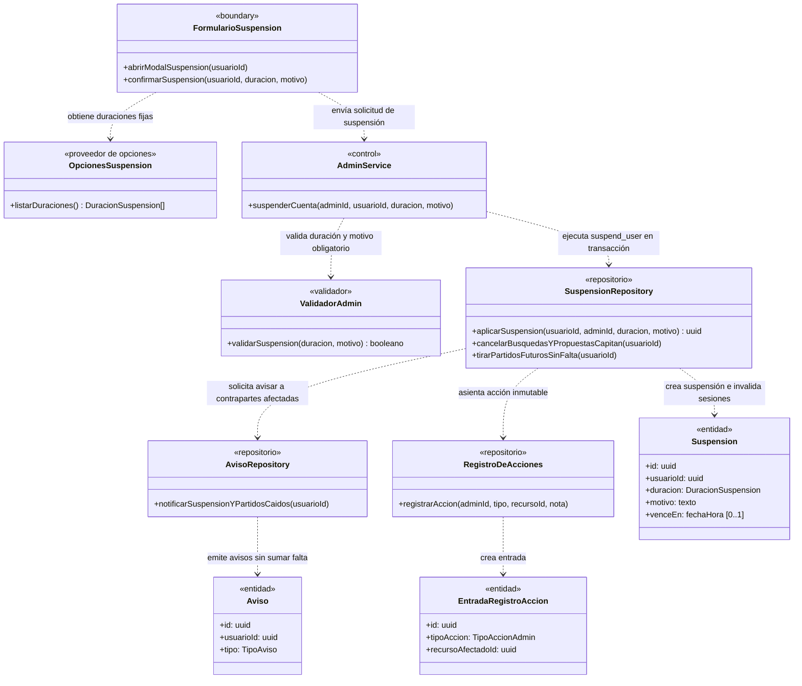
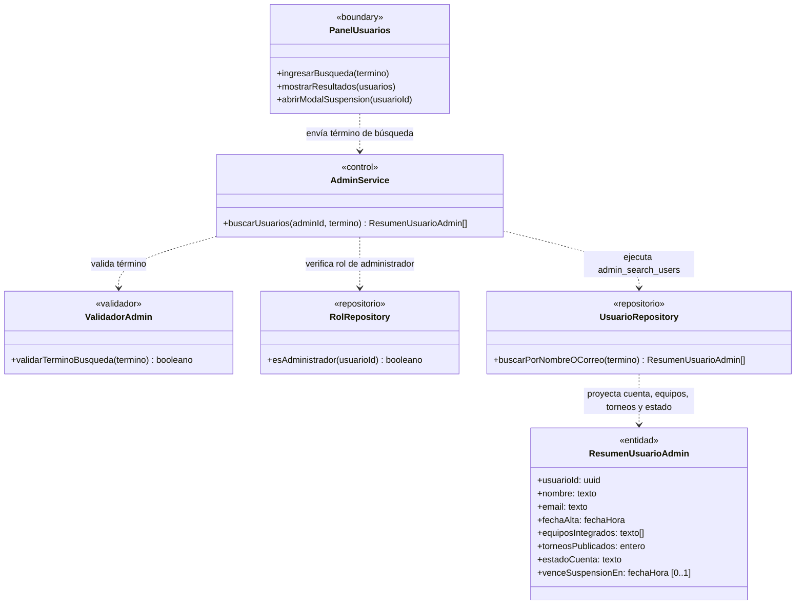

# Módulo F — Administración

> Documenta las clases de dominio y de diseño que participan en el **Módulo F — Administración** (`UC-F01` a `UC-F06`).
> Fuentes del módulo: [01-requerimientos.md](../administracion/01-requerimientos.md) · [02-casos-de-uso.md](../administracion/02-casos-de-uso.md) · [03-pantallas.md](../administracion/03-pantallas.md) · [04-diagramas-secuencia/](../administracion/04-diagramas-secuencia/README.md). Convenciones en el [README](README.md).

---

## Modelo de dominio del módulo

Vista estructural de las entidades, relaciones de herencia/composición y enumeraciones vinculadas al **Panel de administración** (`UC-F01` a `UC-F06`).

---

## Clases por caso de uso

### UC-F01 · Acceder al Panel de administración

**Requerimientos:** `RF-F01`, `RF-F02`, `RNF-F01`, `RNF-F03` · **Pantalla:** [P-F01 · Acceso administrador](../administracion/03-pantallas.md) (`/admin/login`) · **Secuencia:** [`uc-f01-acceder-administracion.md`](../administracion/04-diagramas-secuencia/uc-f01-acceder-administracion.md)

---

### UC-F02 · Consultar el tablero

**Requerimientos:** `RF-F03`, `RNF-F01` · **Pantalla:** [P-F02 · Tablero de administración](../administracion/03-pantallas.md) (`/admin`) · **Secuencia:** [`uc-f02-consultar-tablero.md`](../administracion/04-diagramas-secuencia/uc-f02-consultar-tablero.md)

---

### UC-F03 · Resolver un reporte de torneo

**Requerimientos:** `RF-F04`, `RF-F05`, `RF-F09`, `RNF-F01`, `RNF-F02` · **Pantalla:** [P-F03 · Cola de reportes](../administracion/03-pantallas.md) (`/admin/reportes`) · **Secuencia:** [`uc-f03-resolver-reporte-torneo.md`](../administracion/04-diagramas-secuencia/uc-f03-resolver-reporte-torneo.md)

---

### UC-F04 · Resolver un reporte de equipo

**Requerimientos:** `RF-F04`, `RF-F06`, `RF-F09`, `RNF-F01`, `RNF-F02` · **Pantalla:** [P-F03 · Cola de reportes](../administracion/03-pantallas.md) (`/admin/reportes`) · **Secuencia:** [`uc-f04-resolver-reporte-equipo.md`](../administracion/04-diagramas-secuencia/uc-f04-resolver-reporte-equipo.md)

---

### UC-F05 · Suspender una cuenta

**Requerimientos:** `RF-F07`, `RF-F09`, `RNF-F01`, `RNF-F02` · **Pantallas:** [P-F03 · Cola de reportes](../administracion/03-pantallas.md) y [P-F04 · Usuarios](../administracion/03-pantallas.md) · **Secuencia:** [`uc-f05-suspender-cuenta.md`](../administracion/04-diagramas-secuencia/uc-f05-suspender-cuenta.md)

---

### UC-F06 · Buscar usuarios

**Requerimientos:** `RF-F08`, `RNF-F01` · **Pantalla:** [P-F04 · Usuarios](../administracion/03-pantallas.md) (`/admin/usuarios`) · **Secuencia:** [`uc-f06-buscar-usuarios.md`](../administracion/04-diagramas-secuencia/uc-f06-buscar-usuarios.md)

---

## Trazabilidad

| Clase | Estereotipo | Implementación en el repo | Estado |
|---|---|---|---|
| `ControlDeAcceso` | `«boundary»` | `src/proxy.ts` (primera capa sobre `/admin/*`) | Implementado |
| `FormularioAdmin` | `«boundary»` | `src/app/admin/login/page.tsx` | Implementada |
| `PanelAdmin` / `PanelReportes` / `FormularioSuspension` / `PanelUsuarios` | `«boundary»` | `src/app/admin/page.tsx` y vistas de moderación | Parcial (`PanelAdmin` implementado; colas pendientes) |
| `OpcionesResolucion` / `OpcionesSuspension` | `«proveedor de opciones»` | Listas cerradas de resoluciones y duraciones (7 días, 30 días, indefinida) | **Pendiente** |
| `AdminService` | `«control»` | Server Actions en `src/app/admin/login/actions.ts` y servicios de moderación | Parcial |
| `ValidadorAdmin` | `«validador»` | Validación de credenciales, resoluciones, motivos de suspensión y búsquedas | Parcial |
| `RolRepository` / `CuentaRepository` | `«repositorio»` | Función `public.is_admin()` (`20260928000002_profiles.sql`) + Supabase Auth | Implementados |
| `EstadisticasRepository` / `ReporteRepository` / `SuspensionRepository` / `UsuarioRepository` / `RegistroDeAcciones` | `«repositorio»` | Consultas y RPCs administrativas | **Pendiente** |
| `AvisoRepository` | `«repositorio»` | Tabla `public.notices` | Implementado |
| `Usuario` / `Administrador` / `Perfil` / `ContactoPerfil` | `«entidad»` | `auth.users`, `public.admins`, `public.profiles`, `public.profile_contacts` | Implementadas |
| `ReporteTorneo` / `ReporteEquipo` / `Suspension` / `EntradaRegistroAccion` / `ContadoresPlataforma` | `«entidad»` | Modelos de moderación y auditoría | **Pendiente** |
