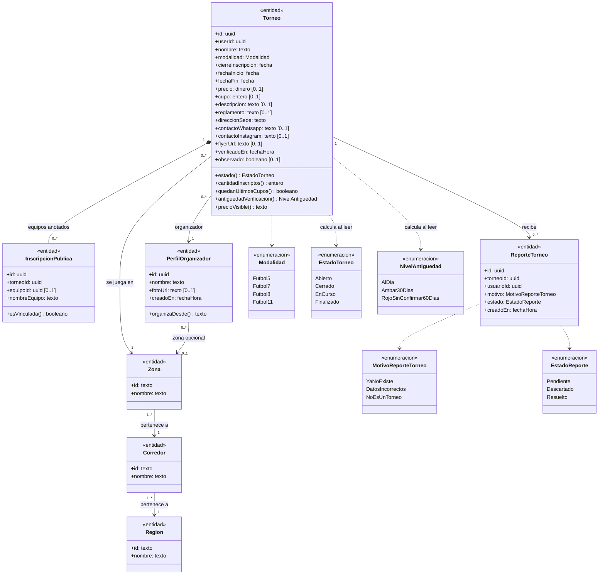
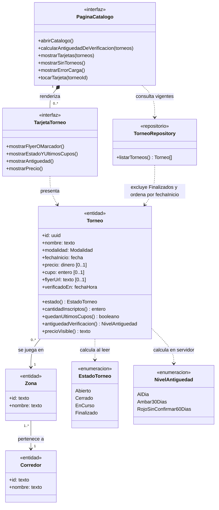
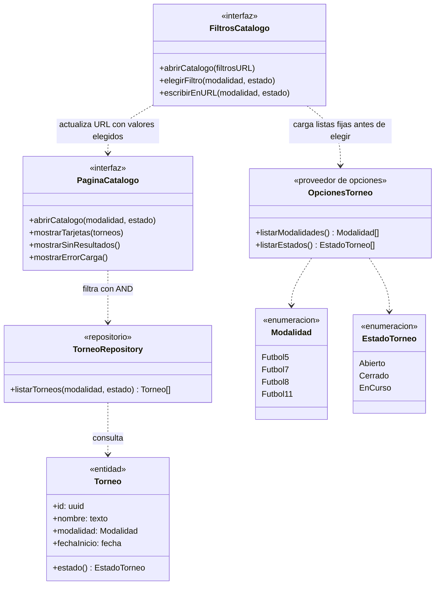
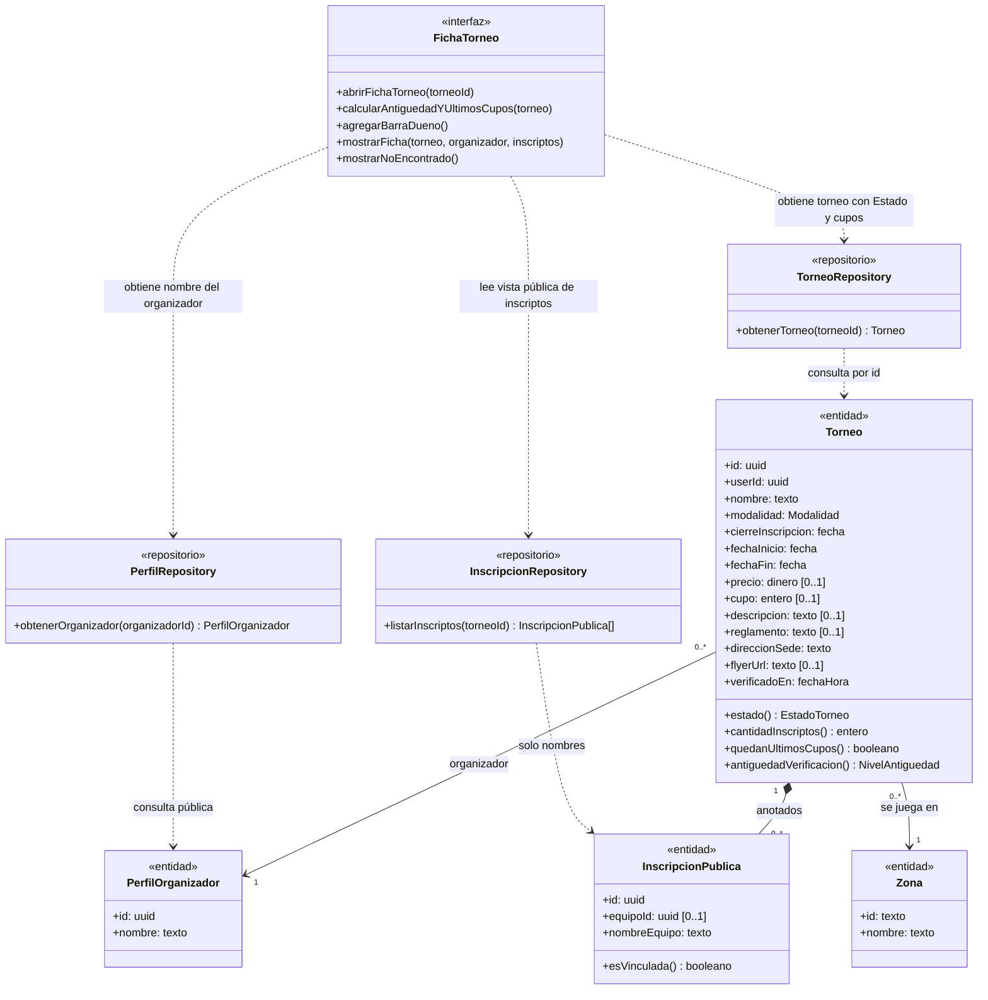
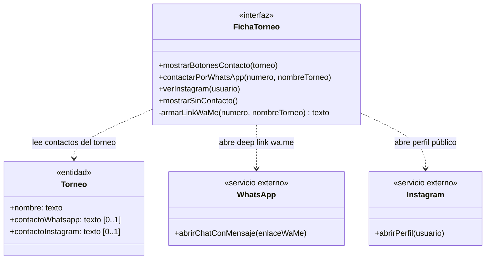
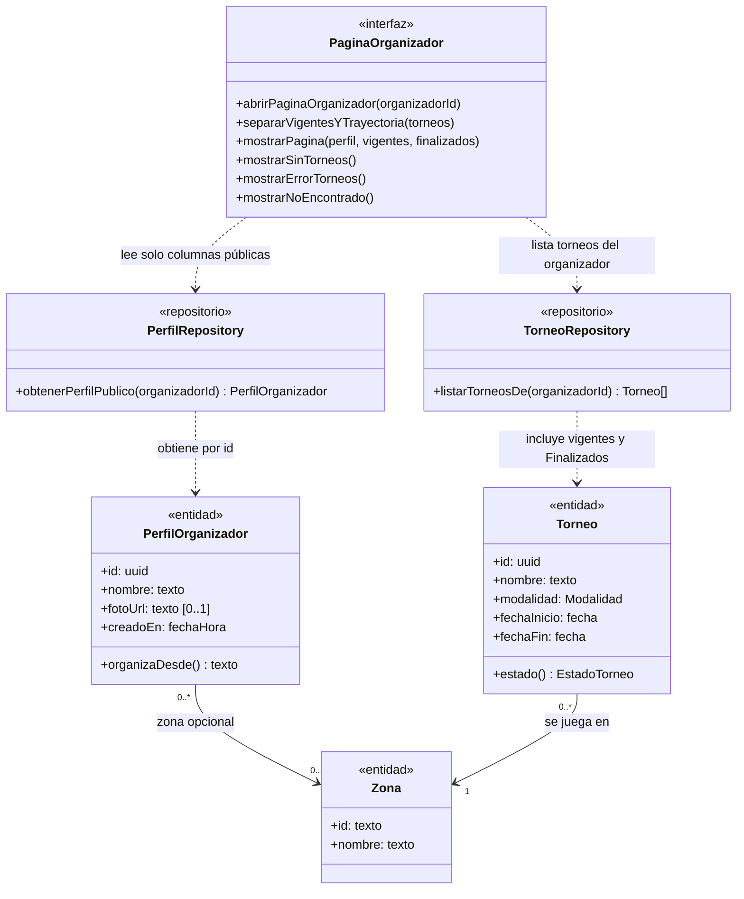
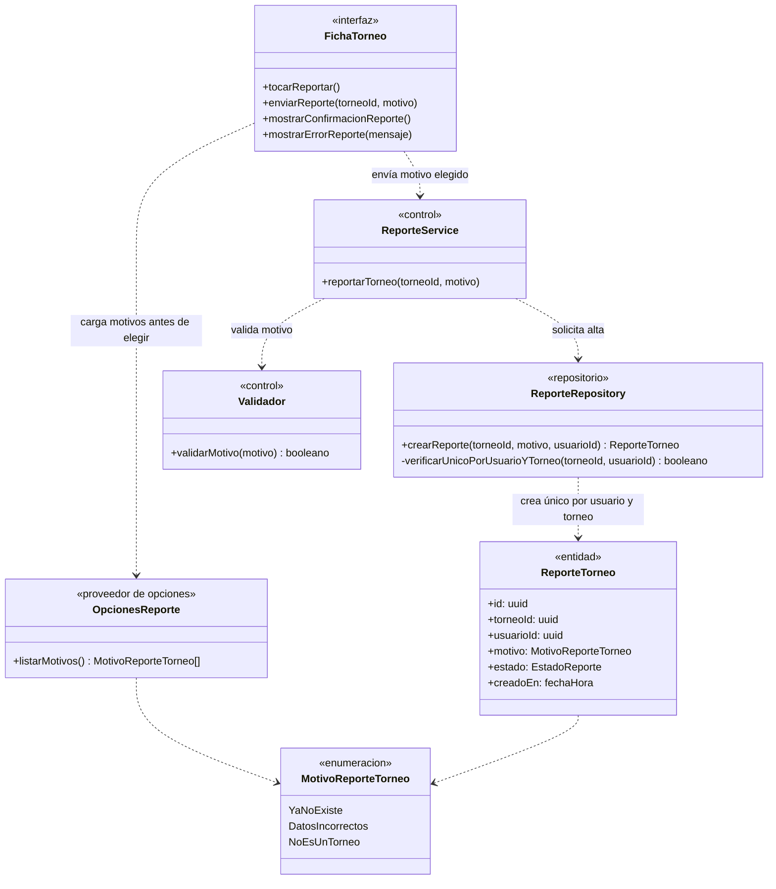

# Módulo B — Catálogo de torneos

Descubrimiento y consulta pública de torneos (`/`), filtrado por URL compartible, ficha pública del torneo (`/torneos/{id}`), contacto directo con el organizador por WhatsApp o Instagram, página pública del organizador (`/organizadores/{id}`) y reporte de torneos. **La app nunca inscribe ni cobra:** el flujo público termina en el deep link a WhatsApp o Instagram del organizador.

Fuentes del módulo: [01-requerimientos.md](../catalogo-de-torneos/01-requerimientos.md) · [02-casos-de-uso.md](../catalogo-de-torneos/02-casos-de-uso.md) · [03-pantallas.md](../catalogo-de-torneos/03-pantallas.md) · [04-diagramas-secuencia/](../catalogo-de-torneos/04-diagramas-secuencia/README.md). Convenciones en el [README](README.md).

## Modelo de dominio del módulo

Vista de conjunto de las entidades y enumeraciones que comparten los casos de uso UC-B01 a UC-B06.

- **Todo torneo tiene exactamente un Organizador (`userId`):** no existe el «torneo copiado» sin organizador (descartado el 07/10/2026).
- **Estado, cupos y antigüedad se calculan al leer (RNF-B03, RNF-B04):** `estado()` y `cantidadInscriptos()` son columnas calculadas de la base (`status`, `inscriptions_count`); «Últimos cupos» (`quedanUltimosCupos()`) es una etiqueta sobre un torneo `Abierto` con 2 lugares o menos, no un Estado.
- **Privacidad de inscriptos y del organizador (RNF-B02, RNF-B07):** `InscripcionPublica` sale de la vista `tournament_inscriptions` (solo expone nombres de equipo y el `equipoId` si es vinculada); `PerfilOrganizador` lee solo datos públicos de `profiles`, nunca `profile_contacts`.

---

## UC-B01 · Ver el catálogo de torneos

| Campo | Detalle |
|---|---|
| **Actor primario** | Invitado (y cualquier usuario) |
| **Requerimientos** | RF-B01 a RF-B07, RF-B25 |
| **Pantalla** | [P1 · Catálogo](../catalogo-de-torneos/03-pantallas.md#p1--catálogo) (`/`) |
| **Diagrama de secuencia** | [S01 · Ver el catálogo](../catalogo-de-torneos/04-diagramas-secuencia/uc-b01-ver-catalogo.md) |
| **Precondiciones** | Ninguna (`/` es público). |
| **Postcondición** | Se muestran los torneos vigentes ordenados por fecha de inicio y el actor puede abrir la ficha de cualquiera. |
| **Estado** | **Parcial** (`src/app/page.tsx`, `TournamentList`, `TournamentCard`): todo implementado salvo la paginación (RF-B02). |

**Flujo principal**

1. El Invitado abre el catálogo (`/`).
2. `PaginaCatalogo` muestra el encabezado, el panel de filtros y esqueletos de carga (`Suspense`), y solicita a `TorneoRepository` listar los torneos.
3. `TorneoRepository` consulta los torneos excluyendo los `Finalizados`, calculando `estado()` y `cantidadInscriptos()` al leer, y los devuelve ordenados por `fechaInicio` ascendente.
4. `PaginaCatalogo` calcula en el servidor la antigüedad de verificación (`antiguedadVerificacion()`) de cada torneo y renderiza una tarjeta por torneo con flyer (o marcador), nombre, Zona con su corredor, modalidad, precio (`precioVisible()`), Estado, antigüedad y etiqueta «Últimos cupos».
5. El Invitado toca una tarjeta y navega a la ficha pública del torneo (UC-B03).

**Reglas y flujos alternativos**

- **A1. Precio:** vacío → «Consultar»; 0 → «Gratis».
- **A2. Antigüedad de verificación:** desde 30 días completos sin verificar, ámbar; desde 60, rojo con «Sin confirmar».
- **A3. Últimos cupos:** etiqueta sobre un torneo `Abierto` con 2 lugares o menos.
- **A4. Finalizados:** salen del catálogo; su ficha sigue accesible por link directo.
- **A5. Sin torneos:** muestra «No hay torneos registrados».
- **A6. Falla la consulta:** muestra «Hubo un error al cargar los torneos deportivos.».

---

## UC-B02 · Filtrar torneos y compartir la búsqueda

| Campo | Detalle |
|---|---|
| **Actor primario** | Invitado |
| **Requerimientos** | RF-B08 a RF-B13 |
| **Pantalla** | [P1 · Catálogo](../catalogo-de-torneos/03-pantallas.md#p1--catálogo) (panel de filtros) |
| **Diagrama de secuencia** | [S02 · Filtrar torneos](../catalogo-de-torneos/04-diagramas-secuencia/uc-b02-filtrar-torneos.md) |
| **Precondiciones** | Está en el catálogo (`/`). |
| **Postcondición** | La URL refleja los filtros elegidos y el catálogo muestra únicamente los torneos que los cumplen. |
| **Estado** | **Parcial** (`Filters.tsx`): filtra por modalidad y estado; faltan Zona o Corredor (RF-B09), precio máximo y fechas de inicio (RF-B10). |

**Flujo principal**

1. Al abrir el catálogo, `FiltrosCatalogo` solicita las opciones a `OpcionesTorneo` (`listarModalidades()`, `listarEstados()`) **antes** de que el Invitado elija, y muestra el panel resaltando los filtros activos en la URL.
2. El Invitado elige una **modalidad** y/o un **Estado** (o «Todas / Todos» para quitar ese filtro).
3. `FiltrosCatalogo` escribe solo los valores elegidos en la URL (`?modality=…&status=…`), vuelve a la primera página (quita `page`) y navega a `PaginaCatalogo`.
4. `PaginaCatalogo` pide a `TorneoRepository.listarTorneos(modalidad, estado)` los torneos que cumplen todos los criterios (AND), siempre excluyendo `Finalizados`.
5. Si el Invitado copia y comparte la URL, quien la abre ejecuta el mismo flujo con esos parámetros ya activos.

**Reglas y flujos alternativos**

- **A1–A2. Filtros pendientes en `main`:** cuando se integren Zona o Corredor, el panel consultará además a `ZonaRepository`.
- **A3. Parámetro inválido en la URL:** una clave desconocida se ignora; un valor inválido de `modality` o `status` hoy hace fallar la consulta y muestra el error de carga.
- **A4. Sin resultados:** muestra «No hay torneos registrados… Probá cambiando las opciones en el panel lateral o limpiando los filtros».

---

## UC-B03 · Ver la ficha pública de un torneo

| Campo | Detalle |
|---|---|
| **Actor primario** | Invitado |
| **Requerimientos** | RF-B14 a RF-B20 |
| **Pantalla** | [P2 · Ficha del torneo](../catalogo-de-torneos/03-pantallas.md#p2--ficha-del-torneo) (`/torneos/{id}`) |
| **Diagrama de secuencia** | [S03 · Ver la ficha](../catalogo-de-torneos/04-diagramas-secuencia/uc-b03-ver-ficha-torneo.md) |
| **Precondiciones** | El torneo existe y no fue dado de baja. |
| **Postcondición** | Se muestra la ficha completa del torneo con sus equipos anotados y medios de contacto. |
| **Estado** | **Parcial** (`src/app/torneos/[id]/page.tsx`): implementado, con salvedades en 404 genérico (RF-B17), botones en finalizado (RF-B18) y metadatos OpenGraph (RF-B19). |

**Flujo principal**

1. El Invitado abre `/torneos/{id}`.
2. `FichaTorneo` pide el torneo a `TorneoRepository.obtenerTorneo(torneoId)` (que calcula Estado y cupos al leer).
3. Si existe, `FichaTorneo` obtiene el nombre del organizador con `PerfilRepository.obtenerOrganizador(organizadorId)` y la lista pública de equipos anotados con `InscripcionRepository.listarInscriptos(torneoId)`.
4. `FichaTorneo` calcula la antigüedad de verificación y «Últimos cupos»; si quien mira tiene sesión y es el dueño del torneo, agrega la barra «Este torneo es tuyo · Gestionar».
5. Muestra flyer (si pertenece al bucket propio), datos, precio y fechas, botones de contacto, equipos anotados (con link si es Inscripción vinculada), descripción, reglamento y dirección de la sede con link al mapa.

**Reglas y flujos alternativos**

- **A1. Torneo inexistente o dado de baja:** devuelve 404 (`notFound()`).
- **A3. Es el organizador dueño:** ve la misma ficha pública más la barra «Este torneo es tuyo · Gestionar».
- **A5. Inscriptos públicos:** la vista `tournament_inscriptions` expone solo nombres (y `team_id` si es vinculada), nunca contactos.

---

## UC-B04 · Contactar al organizador

| Campo | Detalle |
|---|---|
| **Actor primario** | Invitado |
| **Requerimientos** | RF-B21, RF-B22 |
| **Pantalla** | [P2 · Ficha del torneo](../catalogo-de-torneos/03-pantallas.md#p2--ficha-del-torneo) (botones de contacto) |
| **Diagrama de secuencia** | [S04 · Contactar al organizador](../catalogo-de-torneos/04-diagramas-secuencia/uc-b04-contactar-organizador.md) |
| **Precondiciones** | El torneo tiene al menos un medio de contacto cargado. |
| **Postcondición** | El Invitado queda en WhatsApp (con el mensaje sugerido) o en el perfil de Instagram del organizador, fuera de la app. |
| **Estado** | Implementado (`src/app/torneos/[id]/page.tsx`, `whatsappLink` en `src/utils/whatsapp.ts`). |

**Flujo principal**

1. `FichaTorneo` muestra los botones de contacto que el torneo tenga cargados («Contactar por WhatsApp» y/o «Ver Instagram»).
2. Si el Invitado pulsa «Contactar por WhatsApp», `FichaTorneo` arma el enlace `wa.me` con el número normalizado (`549…`) y el mensaje sugerido, y abre `WhatsApp` en una pestaña nueva.
3. Si el Invitado pulsa «Ver Instagram», `FichaTorneo` abre el perfil en `Instagram` en una pestaña nueva.
4. **Aquí termina el flujo en la app:** la inscripción se arregla por fuera y la carga el organizador (UC-E06).

**Reglas y flujos alternativos**

- **A1. Falta un medio de contacto:** ese botón no se muestra.
- **A2. No hay ninguno (torneos viejos):** muestra «El organizador no suministró datos de contacto directo».

---

## UC-B05 · Ver la página pública del organizador

| Campo | Detalle |
|---|---|
| **Actor primario** | Invitado |
| **Requerimientos** | RF-B23 |
| **Pantalla** | [P3 · Página del organizador](../catalogo-de-torneos/03-pantallas.md#p3--página-del-organizador) (`/organizadores/{id}`) |
| **Diagrama de secuencia** | [S05 · Ver al organizador](../catalogo-de-torneos/04-diagramas-secuencia/uc-b05-ver-organizador.md) |
| **Precondiciones** | El organizador existe. |
| **Postcondición** | Se muestran los datos públicos del organizador, sus torneos vigentes y su trayectoria (finalizados). |
| **Estado** | Implementado (`src/app/organizadores/[id]/page.tsx`, `src/utils/organizer-page.ts`). |

**Flujo principal**

1. El Invitado toca el nombre del organizador en una ficha y abre `/organizadores/{id}`.
2. `PaginaOrganizador` pide a `PerfilRepository.obtenerPerfilPublico(organizadorId)` solo el nombre, la foto, la Zona y la fecha de alta (nunca pide `profile_contacts`).
3. `PaginaOrganizador` pide a `TorneoRepository.listarTorneosDe(organizadorId)` todos los torneos de ese organizador con su Estado calculado.
4. Separa los torneos en **vigentes** (ordenados por fecha de inicio) y **trayectoria** (los `Finalizados`, del más reciente al más viejo) y muestra ambas secciones.

**Reglas y flujos alternativos**

- **A1. El organizador no existe o el id no es un uuid:** devuelve 404.
- **A2. Sin torneos:** muestra «Todavía no publicó torneos».
- **A3. Falla la consulta de torneos:** muestra la cabecera y «No pudimos cargar sus torneos. Probá de nuevo.».

---

## UC-B06 · Reportar un torneo

| Campo | Detalle |
|---|---|
| **Actor primario** | Usuario (con sesión) |
| **Requerimientos** | RF-B24 |
| **Pantalla** | [P2 · Ficha del torneo](../catalogo-de-torneos/03-pantallas.md#p2--ficha-del-torneo) (botón «Reportar», pendiente) |
| **Diagrama de secuencia** | [S06 · Reportar un torneo](../catalogo-de-torneos/04-diagramas-secuencia/uc-b06-reportar-torneo.md) (diseño objetivo) |
| **Precondiciones** | Tiene sesión activa y no reportó antes ese mismo torneo. |
| **Postcondición** | El `ReporteTorneo` queda pendiente para el Administrador (UC-F03). |
| **Estado** | **Pendiente** (diseño objetivo: no hay tabla, función ni botón). |

**Flujo principal (diseño objetivo)**

1. En `FichaTorneo`, el Usuario toca «Reportar».
2. `FichaTorneo` solicita los motivos a `OpcionesReporte.listarMotivos()` **antes** de que el Usuario elija, y los muestra («Ya no existe», «Datos incorrectos», «No es un torneo»).
3. El Usuario elige un motivo y confirma; `FichaTorneo` envía solo `(torneoId, motivo)` a `ReporteService`.
4. `ReporteService` valida el motivo con `Validador` y delega en `ReporteRepository.crearReporte(torneoId, motivo, usuario)`.
5. `ReporteRepository` verifica la sesión y que no exista ya un reporte del mismo usuario sobre ese torneo, y guarda el reporte pendiente.

---

## Trazabilidad

| Clase | Tipo | Implementación en el repo | Estado |
|---|---|---|---|
| `PaginaCatalogo` / `TarjetaTorneo` | `«interfaz»` | `src/app/page.tsx`, `src/components/TournamentList.tsx`, `TournamentCard.tsx`, `VerificationBadge.tsx`, `TournamentFlyer.tsx` | Parcial (sin paginar) |
| `FiltrosCatalogo` | `«interfaz»` | `src/components/Filters.tsx` | Parcial (modalidad y estado) |
| `FichaTorneo` | `«interfaz»` | `src/app/torneos/[id]/page.tsx` | Parcial (salvedades A1, A2, A4) |
| `PaginaOrganizador` | `«interfaz»` | `src/app/organizadores/[id]/page.tsx` | Implementada |
| `OpcionesTorneo` | `«proveedor de opciones»` | `SPORT_MODALITIES` (`src/utils/modality.ts`) y lista de estados en `src/components/Filters.tsx` | Implementado |
| `OpcionesReporte` / `ReporteService` / `ReporteRepository` | `«control»` / `«repositorio»` | — (diseño objetivo de UC-B06) | **Pendiente** |
| `TorneoRepository` | `«repositorio»` | Consultas sobre `public.tournaments` con RLS y funciones `status` e `inscriptions_count` (`20260930000002_tournaments_computed_status.sql`) | Implementado |
| `InscripcionRepository` | `«repositorio»` | Vista pública `public.tournament_inscriptions` (`20261007000000_inscriptions.sql`, `20261014000004_linked_inscriptions.sql`) | Implementado |
| `PerfilRepository` | `«repositorio»` | Lectura pública de `public.profiles` (`20260928000002_profiles.sql`) | Implementado |
| `WhatsApp` / `Instagram` | `«servicio externo»` | `whatsappLink` (`src/utils/whatsapp.ts`) y `https://instagram.com/` | Implementados |
| `Torneo` | `«entidad»` | `public.tournaments` + `src/utils/tournament-status.ts`, `tournament-verification.ts`, `tournament-price.ts`, `tournament-flyer.ts` | Implementada |
| `InscripcionPublica` | `«entidad»` | Vista `public.tournament_inscriptions` | Implementada |
| `PerfilOrganizador` | `«entidad»` | `public.profiles` + `splitTournaments`, `organizesSince` (`src/utils/organizer-page.ts`) | Implementada |
| `ReporteTorneo` | `«entidad»` | — (previsto para UC-B06 y UC-F03) | **Pendiente** |
| `Zona` / `Corredor` / `Region` | `«entidad»` | `public.zones`, `public.corridors`, `public.regions` | Implementadas |
