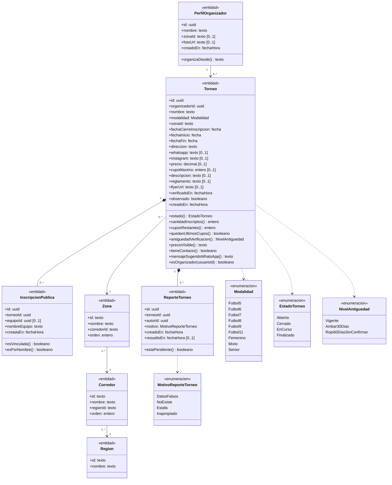
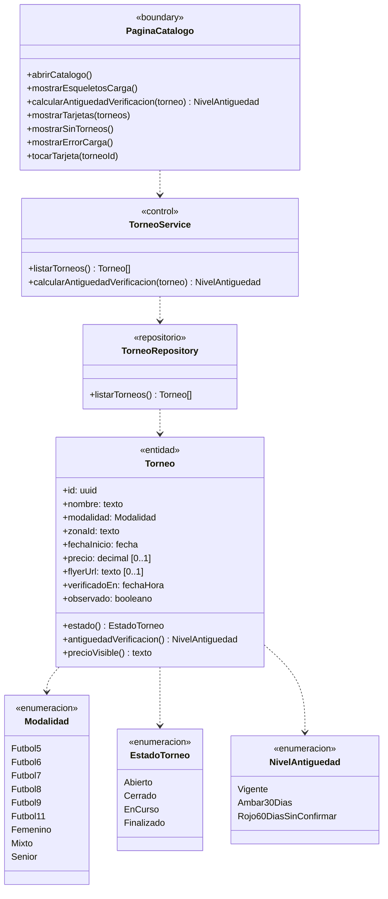
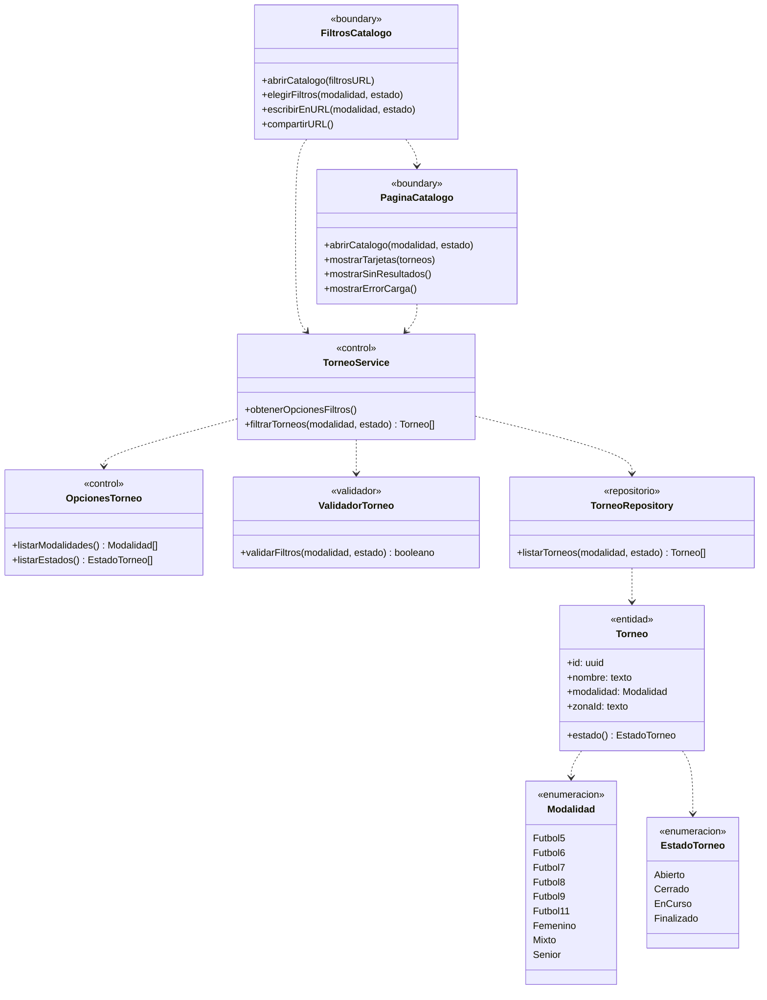
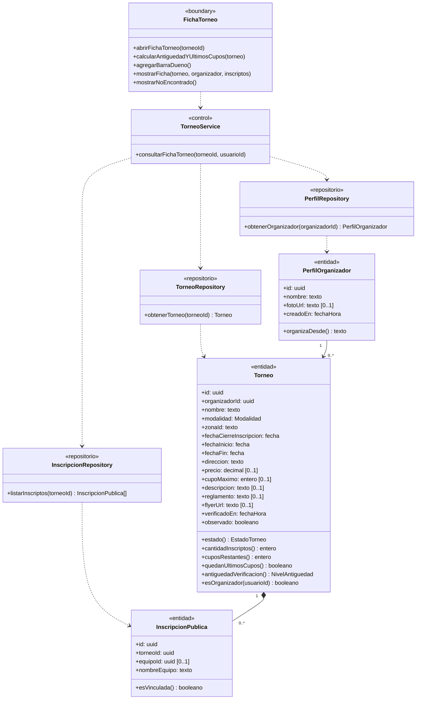
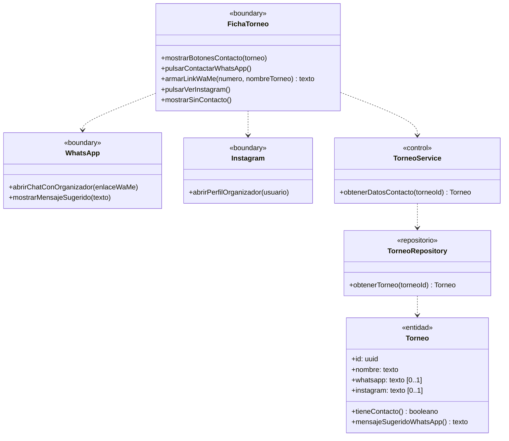
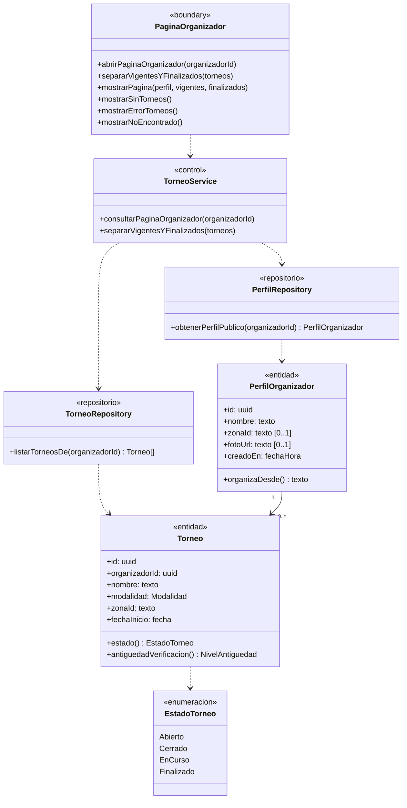
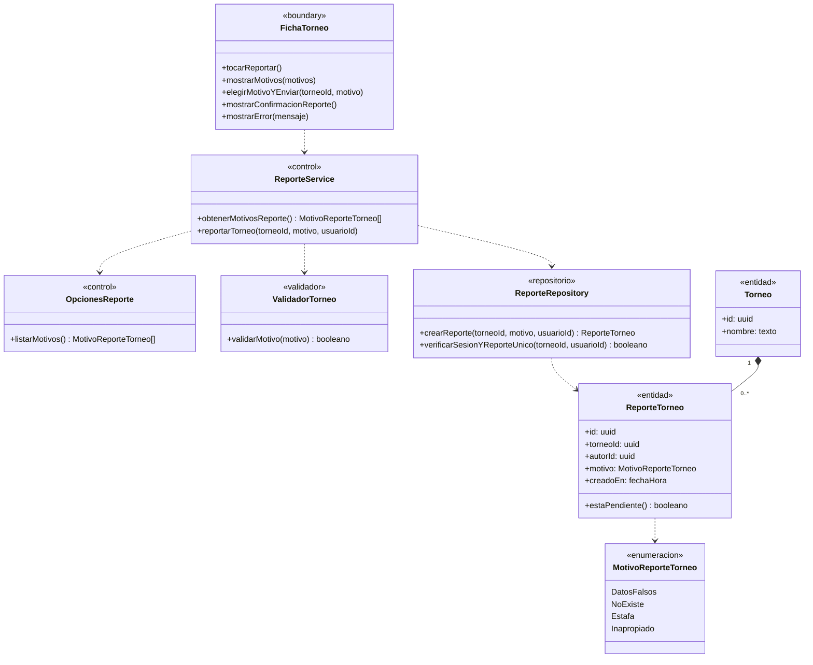

# Módulo B — Catálogo de torneos

> Documenta las clases de dominio y de diseño que participan en el **Módulo B — Catálogo de torneos** (`UC-B01` a `UC-B06`).
> Fuentes del módulo: [01-requerimientos.md](../catalogo-de-torneos/01-requerimientos.md) · [02-casos-de-uso.md](../catalogo-de-torneos/02-casos-de-uso.md) · [03-pantallas.md](../catalogo-de-torneos/03-pantallas.md) · [04-diagramas-secuencia/](../catalogo-de-torneos/04-diagramas-secuencia/README.md). Convenciones en el [README](README.md).

---

## Modelo de dominio del módulo

Vista estructural de las entidades, relaciones de composición/asociación y enumeraciones que comparten los casos de uso `UC-B01` a `UC-B06`.

---

## Clases por caso de uso

### UC-B01 · Ver catálogo de torneos

> Especificación: [UC-B01](../catalogo-de-torneos/02-casos-de-uso.md#uc-b01--ver-catálogo-de-torneos) · Pantalla: [P1 · Catálogo de torneos](../catalogo-de-torneos/03-pantallas.md#p1--catálogo-de-torneos) · Secuencia: [S01 · Ver catálogo](../catalogo-de-torneos/04-diagramas-secuencia/uc-b01-ver-catalogo.md)

---

### UC-B02 · Filtrar torneos

> Especificación: [UC-B02](../catalogo-de-torneos/02-casos-de-uso.md#uc-b02--filtrar-torneos) · Pantalla: [P1 · Catálogo de torneos](../catalogo-de-torneos/03-pantallas.md#p1--catálogo-de-torneos) · Secuencia: [S02 · Filtrar torneos](../catalogo-de-torneos/04-diagramas-secuencia/uc-b02-filtrar-torneos.md)

---

### UC-B03 · Ver ficha del torneo

> Especificación: [UC-B03](../catalogo-de-torneos/02-casos-de-uso.md#uc-b03--ver-ficha-del-torneo) · Pantalla: [P2 · Ficha del torneo](../catalogo-de-torneos/03-pantallas.md#p2--ficha-del-torneo) · Secuencia: [S03 · Ver ficha del torneo](../catalogo-de-torneos/04-diagramas-secuencia/uc-b03-ver-ficha-torneo.md)

---

### UC-B04 · Contactar al organizador

> Especificación: [UC-B04](../catalogo-de-torneos/02-casos-de-uso.md#uc-b04--contactar-al-organizador) · Pantalla: [P2 · Ficha del torneo](../catalogo-de-torneos/03-pantallas.md#p2--ficha-del-torneo) · Secuencia: [S04 · Contactar al organizador](../catalogo-de-torneos/04-diagramas-secuencia/uc-b04-contactar-organizador.md)

---

### UC-B05 · Ver página del organizador

> Especificación: [UC-B05](../catalogo-de-torneos/02-casos-de-uso.md#uc-b05--ver-página-del-organizador) · Pantalla: [P3 · Página del organizador](../catalogo-de-torneos/03-pantallas.md#p3--página-del-organizador) · Secuencia: [S05 · Ver página del organizador](../catalogo-de-torneos/04-diagramas-secuencia/uc-b05-ver-organizador.md)

---

### UC-B06 · Reportar un torneo

> Especificación: [UC-B06](../catalogo-de-torneos/02-casos-de-uso.md#uc-b06--reportar-un-torneo) · Pantalla: [P2 · Ficha del torneo](../catalogo-de-torneos/03-pantallas.md#p2--ficha-del-torneo) · Secuencia: [S06 · Reportar un torneo](../catalogo-de-torneos/04-diagramas-secuencia/uc-b06-reportar-torneo.md)

---

## Trazabilidad

| Clase | Estereotipo | Implementación en el repo | Estado |
|---|---|---|---|
| `PaginaCatalogo` | `«boundary»` | `src/app/page.tsx` + `src/components/TournamentList.tsx` + `src/components/TournamentCard.tsx` | Parcial (faltan Zona, precio «Gratis»/«Consultar», antigüedad y Observado en tarjeta) |
| `FiltrosCatalogo` | `«boundary»` | `src/components/Filters.tsx` | Parcial (faltan filtros de Zona, Estado y Precio; hoy tiene `city`/`maxPrice`) |
| `FichaTorneo` | `«boundary»` | `src/app/torneos/[id]/page.tsx` + `src/app/torneos/[id]/loading.tsx` | Implementada (falta botón «Reportar») |
| `PaginaOrganizador` | `«boundary»` | `src/app/organizadores/[id]/page.tsx` | Implementada |
| `WhatsApp` / `Instagram` | `«boundary»` | `whatsappLink` (`src/utils/whatsapp.ts`), `instagramUrl` (`src/utils/instagram.ts`) | Implementados |
| `TorneoService` / `ReporteService` / `OpcionesTorneo` / `OpcionesReporte` | `«control»` | Consultas RSC en `TournamentList`, `torneos/[id]/page.tsx`, `organizadores/[id]/page.tsx`, `SPORT_MODALITIES` (`src/utils/modality.ts`), `STATUS_FILTERS` (`src/utils/tournament-status.ts`) | Implementado (`ReporteService` y `OpcionesReporte` pendientes) |
| `ValidadorTorneo` | `«validador»` | Validación de parámetros de búsqueda y motivos de reporte | Parcial |
| `TorneoRepository` | `«repositorio»` | Vista `public.tournaments_with_status` (`20261028000010_tournaments_with_status.sql`) | Implementado |
| `PerfilRepository` | `«repositorio»` | Tabla `public.profiles` (lectura pública) | Implementado |
| `InscripcionRepository` | `«repositorio»` | Vista `public.public_inscriptions` (`20261001000000_inscriptions.sql`, `20261028000002_teams.sql`) | Implementado |
| `ReporteRepository` | `«repositorio»` | Tabla de reportes de torneo con unicidad `(tournament_id, reporter_id)` | **Pendiente** |
| `Torneo` / `InscripcionPublica` / `PerfilOrganizador` | `«entidad»` | `tournaments_with_status`, `public_inscriptions`, `profiles` + `tournament-status.ts` y `tournament-verification.ts` | Implementadas |
