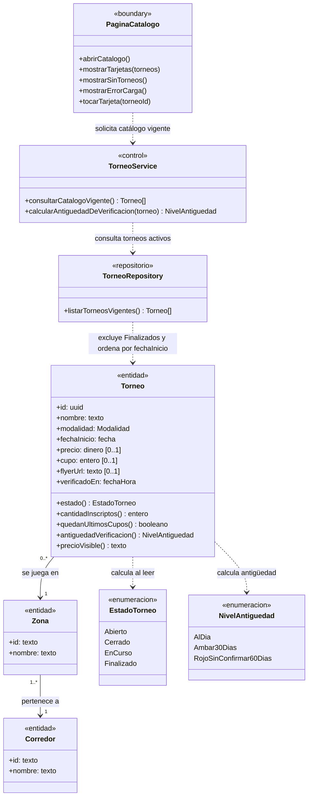
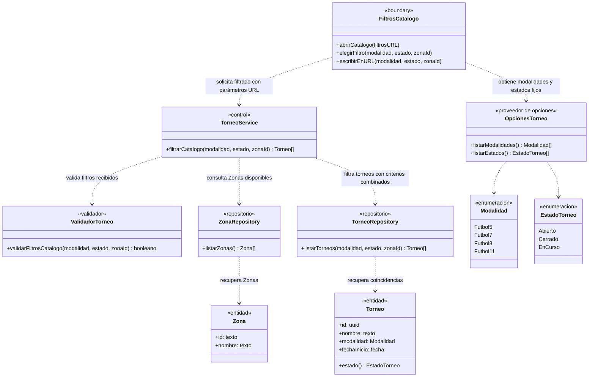
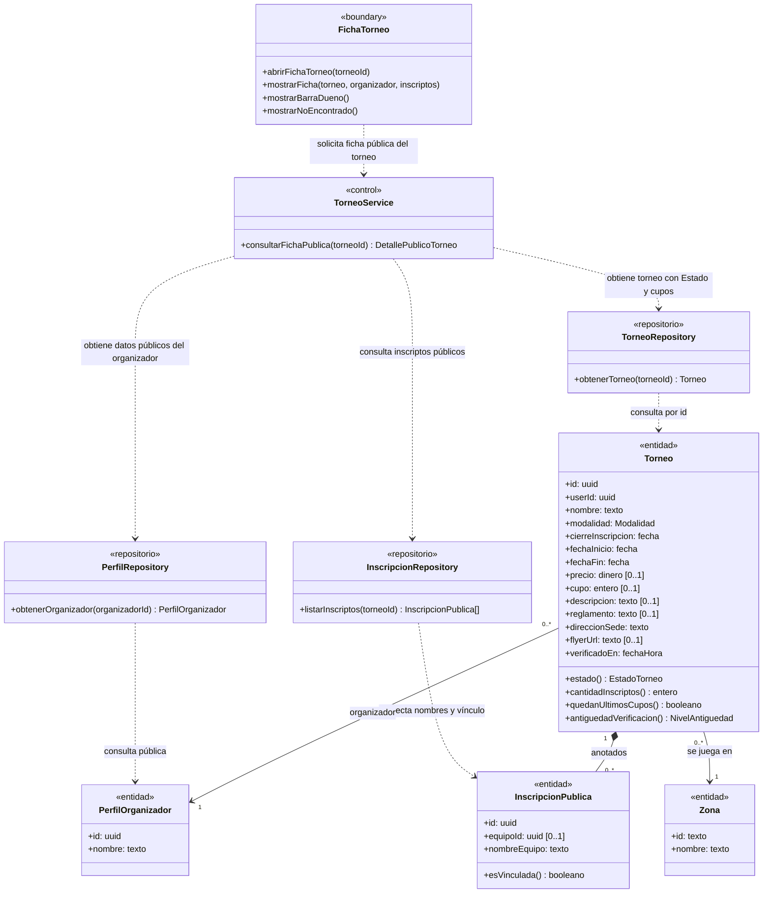
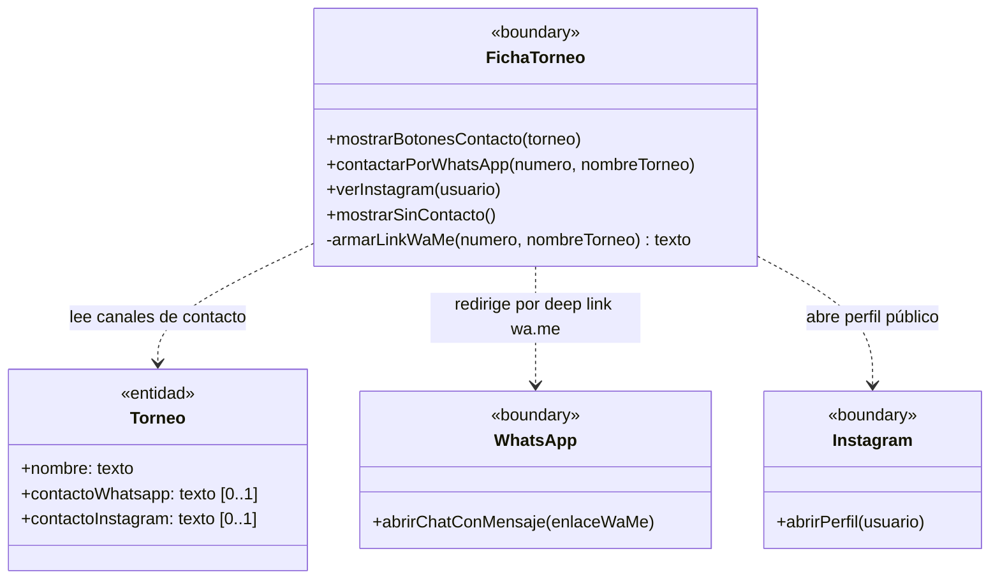
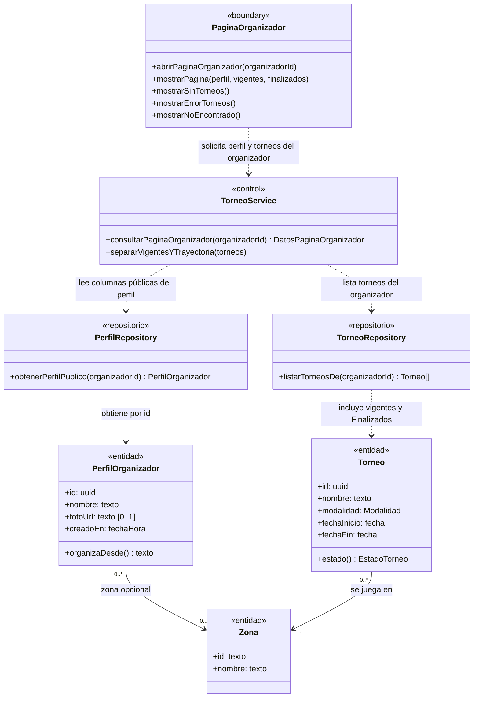
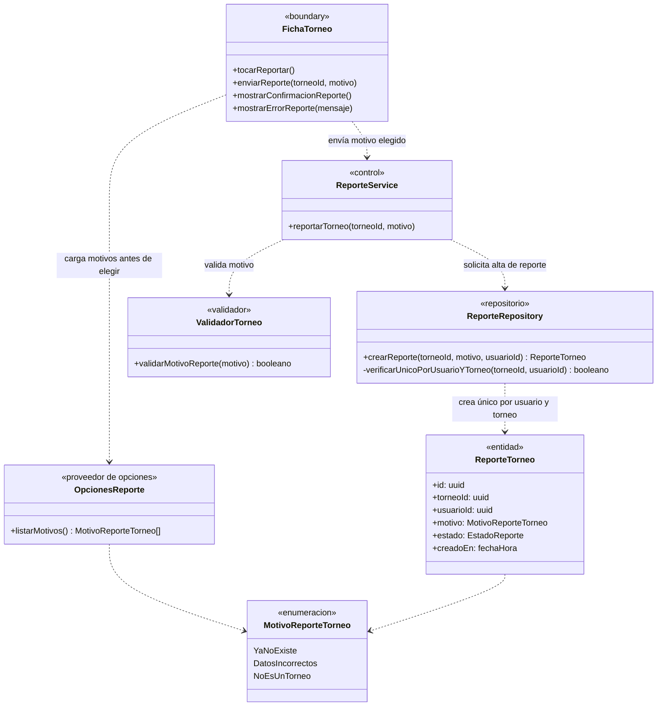

# Módulo B — Catálogo de torneos

> Documenta las clases de dominio y de diseño que participan en el **Módulo B — Catálogo de torneos** (`UC-B01` a `UC-B06`).
> Fuentes del módulo: [01-requerimientos.md](../catalogo-de-torneos/01-requerimientos.md) · [02-casos-de-uso.md](../catalogo-de-torneos/02-casos-de-uso.md) · [03-pantallas.md](../catalogo-de-torneos/03-pantallas.md) · [04-diagramas-secuencia/](../catalogo-de-torneos/04-diagramas-secuencia/README.md). Convenciones en el [README](README.md).

---

## Modelo de dominio del módulo

Vista estructural de las entidades y enumeraciones que comparten los casos de uso `UC-B01` a `UC-B06`.

---

## Clases por caso de uso

### UC-B01 · Ver el catálogo de torneos

**Requerimientos:** `RF-B01` a `RF-B07`, `RF-B25` · **Pantalla:** [P1 · Catálogo](../catalogo-de-torneos/03-pantallas.md#p1--catálogo) (`/`) · **Secuencia:** [S01 · Ver el catálogo](../catalogo-de-torneos/04-diagramas-secuencia/uc-b01-ver-catalogo.md)

---

### UC-B02 · Filtrar torneos y compartir la búsqueda

**Requerimientos:** `RF-B08` a `RF-B13` · **Pantalla:** [P1 · Catálogo](../catalogo-de-torneos/03-pantallas.md#p1--catálogo) · **Secuencia:** [S02 · Filtrar torneos](../catalogo-de-torneos/04-diagramas-secuencia/uc-b02-filtrar-torneos.md)

---

### UC-B03 · Ver la ficha pública de un torneo

**Requerimientos:** `RF-B14` a `RF-B20` · **Pantalla:** [P2 · Ficha del torneo](../catalogo-de-torneos/03-pantallas.md#p2--ficha-del-torneo) (`/torneos/{id}`) · **Secuencia:** [S03 · Ver la ficha](../catalogo-de-torneos/04-diagramas-secuencia/uc-b03-ver-ficha-torneo.md)

---

### UC-B04 · Contactar al organizador

**Requerimientos:** `RF-B21`, `RF-B22` · **Pantalla:** [P2 · Ficha del torneo](../catalogo-de-torneos/03-pantallas.md#p2--ficha-del-torneo) · **Secuencia:** [S04 · Contactar al organizador](../catalogo-de-torneos/04-diagramas-secuencia/uc-b04-contactar-organizador.md)

---

### UC-B05 · Ver la página pública del organizador

**Requerimientos:** `RF-B23` · **Pantalla:** [P3 · Página del organizador](../catalogo-de-torneos/03-pantallas.md#p3--página-del-organizador) (`/organizadores/{id}`) · **Secuencia:** [S05 · Ver al organizador](../catalogo-de-torneos/04-diagramas-secuencia/uc-b05-ver-organizador.md)

---

### UC-B06 · Reportar un torneo

**Requerimientos:** `RF-B24` · **Pantalla:** [P2 · Ficha del torneo](../catalogo-de-torneos/03-pantallas.md#p2--ficha-del-torneo) · **Secuencia:** [S06 · Reportar un torneo](../catalogo-de-torneos/04-diagramas-secuencia/uc-b06-reportar-torneo.md)

---

## Trazabilidad

| Clase | Estereotipo | Implementación en el repo | Estado |
|---|---|---|---|
| `PaginaCatalogo` | `«boundary»` | `src/app/page.tsx`, `src/components/TournamentList.tsx`, `TournamentCard.tsx`, `VerificationBadge.tsx`, `TournamentFlyer.tsx` | Parcial (sin paginar) |
| `FiltrosCatalogo` | `«boundary»` | `src/components/Filters.tsx` | Parcial (modalidad y estado) |
| `FichaTorneo` | `«boundary»` | `src/app/torneos/[id]/page.tsx` | Parcial |
| `PaginaOrganizador` | `«boundary»` | `src/app/organizadores/[id]/page.tsx` | Implementada |
| `WhatsApp` / `Instagram` | `«boundary»` | `whatsappLink` (`src/utils/whatsapp.ts`) y `https://instagram.com/` | Implementados |
| `OpcionesTorneo` | `«proveedor de opciones»` | `SPORT_MODALITIES` (`src/utils/modality.ts`) y lista de estados en `src/components/Filters.tsx` | Implementado |
| `OpcionesReporte` | `«proveedor de opciones»` | — (diseño objetivo de UC-B06) | **Pendiente** |
| `TorneoService` | `«control»` | Coordinación de consultas en `src/app/page.tsx`, `src/app/torneos/[id]/page.tsx`, `src/app/organizadores/[id]/page.tsx` | Implementado |
| `ReporteService` | `«control»` | — (diseño objetivo de UC-B06) | **Pendiente** |
| `ValidadorTorneo` | `«validador»` | Validación de filtros, modalidades y motivos de reporte | Parcial |
| `TorneoRepository` | `«repositorio»` | Consultas sobre `public.tournaments` con RLS y funciones `status` e `inscriptions_count` (`20260930000002_tournaments_computed_status.sql`) | Implementado |
| `InscripcionRepository` | `«repositorio»` | Vista pública `public.tournament_inscriptions` (`20261007000000_inscriptions.sql`, `20261014000004_linked_inscriptions.sql`) | Implementado |
| `PerfilRepository` | `«repositorio»` | Lectura pública de `public.profiles` (`20260928000002_profiles.sql`) | Implementado |
| `ReporteRepository` | `«repositorio»` | — (previsto para UC-B06 y UC-F03) | **Pendiente** |
| `Torneo` / `InscripcionPublica` / `PerfilOrganizador` / `ReporteTorneo` | `«entidad»` | `public.tournaments`, `public.tournament_inscriptions`, `public.profiles` | Implementadas (salvo `ReporteTorneo`) |
| `Zona` / `Corredor` / `Region` | `«entidad»` | `public.zones`, `public.corridors`, `public.regions` | Implementadas |
