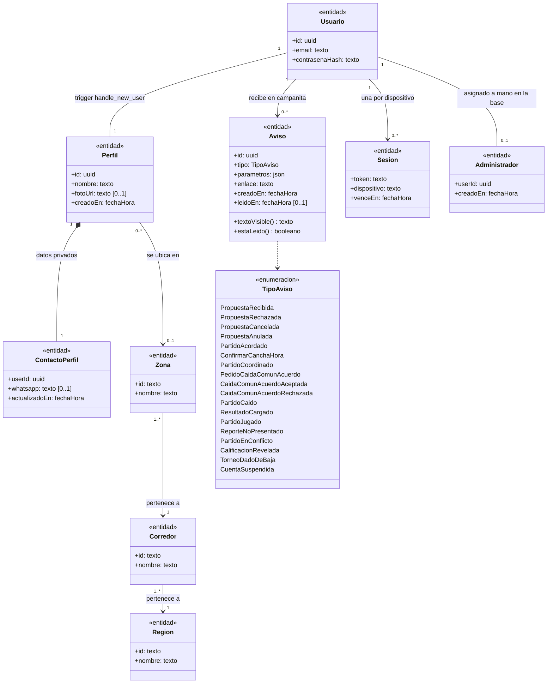
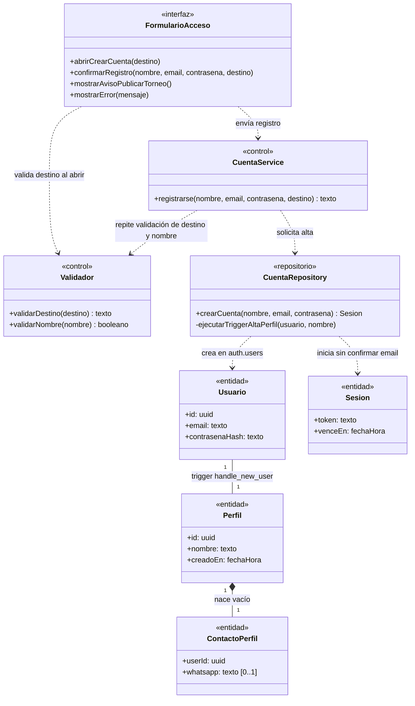
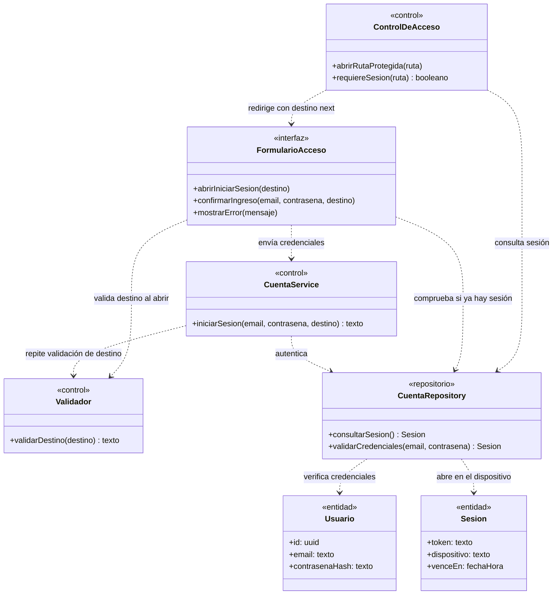
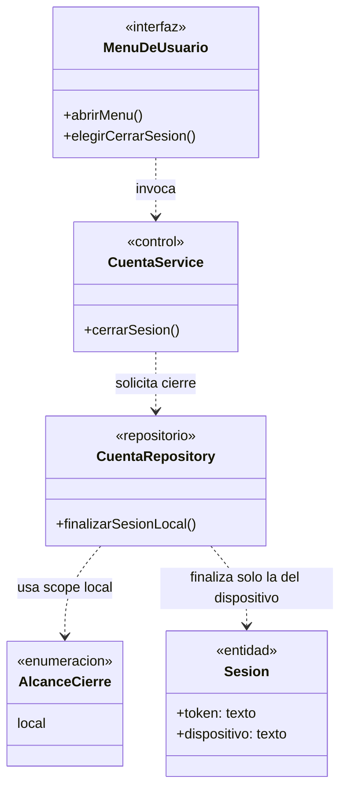
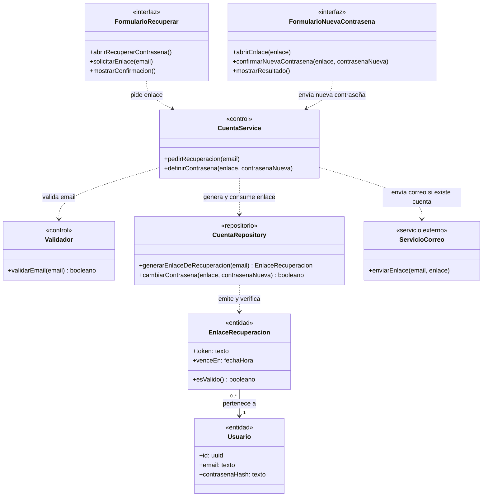
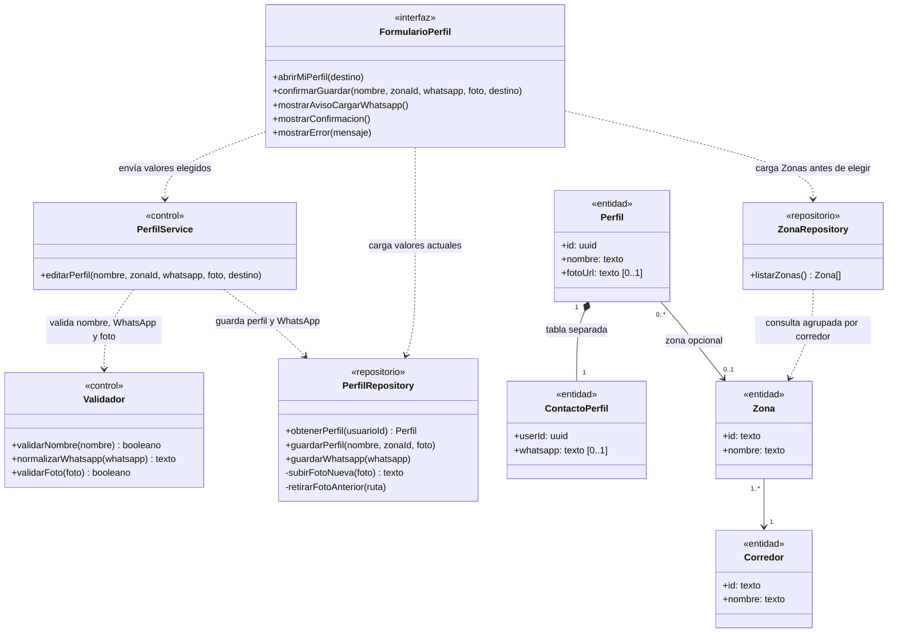
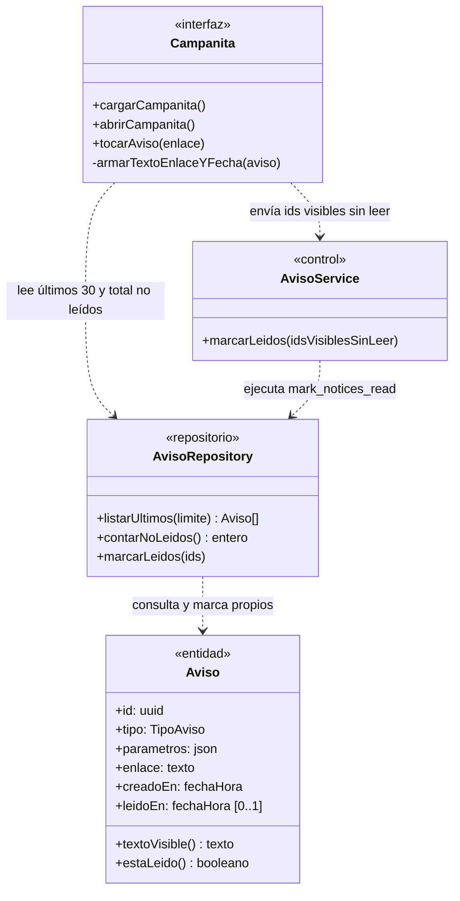

# Módulo A — Cuenta y acceso

Creación de cuenta, inicio y cierre de sesión, regreso al destino pendiente (`next`), recuperación de contraseña, edición del perfil propio y consulta de Avisos en la campanita. Cada persona tiene **una sola cuenta**, con la que puede ser Jugador, Capitán y Organizador a la vez.

Fuentes del módulo: [01-requerimientos.md](../cuenta-y-acceso/01-requerimientos.md) · [02-casos-de-uso.md](../cuenta-y-acceso/02-casos-de-uso.md) · [03-pantallas.md](../cuenta-y-acceso/03-pantallas.md) · [04-diagramas-secuencia/](../cuenta-y-acceso/04-diagramas-secuencia/README.md). Convenciones en el [README](README.md).

## Modelo de dominio del módulo

Vista de conjunto de las entidades y enumeraciones que comparten los casos de uso UC-A01 a UC-A06.

- **Privacidad por tabla (RNF-A01, RNF-A02):** `Perfil` es de lectura pública (`nombre`, `fotoUrl`, `zona`), mientras que `ContactoPerfil` (`whatsapp`) vive en una tabla separada porque RLS filtra **filas** y no columnas. Así ninguna lectura pública del perfil expone el WhatsApp.
- **Una sola cuenta y una sola navegación:** no existen cuentas separadas ni «vista de jugador / vista de organizador» (se retiró el antiguo UC-06).
- **Rol de Administrador (RF-A15):** se inserta manualmente en `public.admins` y nunca se puede escribir desde la app.
- **Avisos inmutables (RF-A22, RNF-A09):** guardan el hecho (`tipo`) y la foto de los datos del momento (`parametros`), y `textoVisible()` arma el mensaje al mostrarlo sin cambiar aunque el rival cambie de nombre.

---

## UC-A01 · Crear cuenta

| Campo | Detalle |
|---|---|
| **Actor primario** | Invitado |
| **Requerimientos** | RF-A01 a RF-A03, RF-A06, RF-A08, RF-A25 |
| **Pantalla** | [P2 · Crear cuenta](../cuenta-y-acceso/03-pantallas.md#p2--crear-cuenta) (`/login?modo=registro`) |
| **Diagrama de secuencia** | [S01 · Crear cuenta](../cuenta-y-acceso/04-diagramas-secuencia/uc-a01-crear-cuenta.md) |
| **Precondiciones** | Ninguna (sin sesión abierta). |
| **Postcondición** | Existen la cuenta, su `Perfil` con el nombre, su `ContactoPerfil` vacío y la sesión iniciada. |
| **Estado** | Implementado (`src/app/login`, `signup`, trigger `handle_new_user`). |

**Flujo principal**

1. El Invitado abre «Crear cuenta» desde la barra superior, desde «Registrate» en Iniciar sesión o desde un link que exige sesión (`next`).
2. `FormularioAcceso` valida el destino pendiente (`next`) con `Validador` y muestra el formulario (sin desplegables).
3. El Invitado completa **nombre**, **email** y **contraseña** y confirma con «Registrarme».
4. `CuentaService` vuelve a validar el destino `next` y valida que el nombre tenga entre 2 y 50 caracteres.
5. `CuentaRepository` crea la cuenta y abre la sesión **en el acto, sin confirmar el email**. En la misma transacción, el trigger `handle_new_user` crea el `Perfil` con el nombre y la fila de `ContactoPerfil` vacía.
6. El sistema redirige al destino interno seguro (`next`) o al catálogo (`/`).

**Reglas y flujos alternativos**

- **A1. Llega desde «¿Organizás torneos? Publicalo» (`/login?next=/mis-torneos`):** abre directamente Crear cuenta con el aviso «Para publicar un torneo necesitás una cuenta. Es gratis.» y conserva el destino al panel.
- **A2. Destino externo o mal formado (`//sitio.com`, `/\sitio.com`):** `Validador` lo descarta y usa el catálogo.
- **A3. Nombre inválido:** vuelve a Crear cuenta con «El nombre tiene que tener entre 2 y 50 caracteres».
- **A4. Email ya registrado u otro rechazo:** vuelve con «Error en registro» (mensaje genérico).
- **A5. Ya tiene sesión:** `/login` redirige directo al destino sin mostrar el formulario.

---

## UC-A02 · Iniciar sesión

| Campo | Detalle |
|---|---|
| **Actor primario** | Invitado |
| **Requerimientos** | RF-A04 a RF-A08, RF-A25 |
| **Pantalla** | [P1 · Iniciar sesión](../cuenta-y-acceso/03-pantallas.md#p1--iniciar-sesión) (`/login`) |
| **Diagrama de secuencia** | [S02 · Iniciar sesión](../cuenta-y-acceso/04-diagramas-secuencia/uc-a02-iniciar-sesion.md) |
| **Precondiciones** | Tiene una cuenta registrada. |
| **Postcondición** | Sesión abierta en el dispositivo; la persona llega al destino pedido (`next`) o al catálogo. |
| **Estado** | Implementado (`src/app/login`, `login`, `src/proxy.ts`). |

**Flujo principal**

1. El Invitado abre «Iniciar sesión» en la barra o es redirigido por `ControlDeAcceso` al intentar entrar a una ruta protegida (`/crear-torneo`, `/mis-torneos`, `/perfil`, `/crear-equipo`, `/mis-equipos`, `/partidos`), conservando la ruta como `next`.
2. `FormularioAcceso` verifica si ya hay sesión con `CuentaRepository` y valida el destino `next` con `Validador`.
3. El Invitado completa **email** y **contraseña** y pulsa «Ingresar».
4. `CuentaService` vuelve a validar `next` con `Validador` y pide a `CuentaRepository` validar las credenciales.
5. `CuentaRepository` abre la sesión y el sistema redirige al destino interno seguro o al catálogo.

**Reglas y flujos alternativos**

- **A1. Credenciales inválidas:** muestra «Invalid Credentials» (sin revelar cuál falló) y conserva `next` y `modo=ingreso`.
- **A2. Destino inválido o externo:** `Validador` lo reemplaza por el catálogo (`/`).
- **A3. Ya tiene sesión:** `/login` lleva directo al destino.
- **A4. Verificación en dos capas:** cada página y acción protegida vuelve a comprobar la sesión además de `ControlDeAcceso`.

---

## UC-A03 · Cerrar sesión

| Campo | Detalle |
|---|---|
| **Actor primario** | Usuario |
| **Requerimientos** | RF-A09, RF-A25 |
| **Pantalla** | [P4 · Barra superior](../cuenta-y-acceso/03-pantallas.md#p4--barra-superior) (menú de usuario) |
| **Diagrama de secuencia** | [S03 · Cerrar sesión](../cuenta-y-acceso/04-diagramas-secuencia/uc-a03-cerrar-sesion.md) |
| **Precondiciones** | Sesión activa en el dispositivo. |
| **Postcondición** | Se cierra únicamente la sesión del dispositivo actual (`scope: 'local'`) y se abre el catálogo. |
| **Estado** | Implementado (`logout` en `src/app/login/actions.ts`, `UserMenu.tsx`). |

**Flujo principal**

1. El Usuario abre `MenuDeUsuario` en la barra superior y elige «Cerrar sesión».
2. `CuentaService` solicita a `CuentaRepository` finalizar la sesión con alcance local.
3. El sistema revalida el layout y lleva al Usuario al catálogo (`/`), ya sin sesión.

**Regla:** sin el alcance `local`, Supabase revocaría las sesiones de la cuenta en todos los dispositivos.

---

## UC-A04 · Recuperar contraseña

| Campo | Detalle |
|---|---|
| **Actor primario** | Invitado |
| **Requerimientos** | RF-A10 |
| **Pantalla** | No existe todavía |
| **Diagrama de secuencia** | [S04 · Recuperar contraseña](../cuenta-y-acceso/04-diagramas-secuencia/uc-a04-recuperar-contrasena.md) (diseño objetivo) |
| **Precondiciones** | Tiene una cuenta registrada. |
| **Postcondición** | La contraseña de la cuenta queda actualizada. |
| **Estado** | **Pendiente, a propósito** (decisión del 27/09/2026: primero producto, después infraestructura de auth). |

**Flujo principal (diseño objetivo)**

1. El Invitado abre `FormularioRecuperar`, ingresa su email y confirma.
2. `CuentaService` valida el formato del email con `Validador` y pide a `CuentaRepository` generar el enlace de recuperación.
3. Si el email corresponde a una cuenta, `ServicioCorreo` envía el enlace (el **único email** que mandaría la app).
4. El Invitado abre el enlace en `FormularioNuevaContrasena`, ingresa la contraseña nueva y confirma.
5. `CuentaService` pide a `CuentaRepository` validar el enlace y actualizar la contraseña.

---

## UC-A05 · Editar perfil

| Campo | Detalle |
|---|---|
| **Actor primario** | Usuario |
| **Requerimientos** | RF-A11 a RF-A18 |
| **Pantalla** | [P3 · Mi perfil](../cuenta-y-acceso/03-pantallas.md#p3--mi-perfil) (`/perfil`) |
| **Diagrama de secuencia** | [S05 · Editar perfil](../cuenta-y-acceso/04-diagramas-secuencia/uc-a05-editar-perfil.md) |
| **Precondiciones** | Sesión activa. |
| **Postcondición** | Nombre, foto, Zona y WhatsApp actualizados; si había destino `next`, vuelve a él. |
| **Estado** | **Parcial** (`src/app/perfil`): todo implementado salvo RF-A17 (impedir que un Capitán de equipo activo deje vacío su WhatsApp). |

**Flujo principal**

1. El Usuario abre `/perfil`. `FormularioPerfil` obtiene los datos actuales desde `PerfilRepository` y la lista cerrada de Zonas desde `ZonaRepository` **antes** de que el Usuario elija.
2. El Usuario modifica **nombre**, **foto**, **Zona** (`zonaId` o «Sin zona») y/o **WhatsApp**, y confirma con «Guardar».
3. `FormularioPerfil` envía a `PerfilService` únicamente los valores elegidos (`nombre`, `zonaId`, `whatsapp`, `foto`, `destino`).
4. `PerfilService` valida con `Validador` el nombre (2 a 50 caracteres), el WhatsApp (normalizado a `549` + 10 dígitos, sin 0 ni 15) y la foto (JPG/PNG/WebP hasta 2 MB).
5. `PerfilRepository` sube la foto nueva (si la hay), actualiza `Perfil` (`nombre`, `zona`, `fotoUrl`) y retira la foto anterior recién después de confirmar el guardado.
6. `PerfilRepository` actualiza `ContactoPerfil` (`whatsapp`).
7. Se muestra «Perfil guardado.» o se redirige al destino pendiente (`next`).

**Reglas y flujos alternativos**

- **A1. Foto nueva y concurrencia (RNF-A07, RNF-A08):** si falla el guardado en la base, se retira la subida nueva y se conserva la foto anterior.
- **A2. Capitán con WhatsApp vacío (RF-A17, pendiente):** el Capitán de un equipo no disuelto no debe poder dejar su WhatsApp vacío; falta implementar la comprobación en la base.
- **A3. Rol de administrador (RF-A15):** no figura en el formulario y los permisos por columna impiden escribirlo.
- **A4–A9. Errores de validación o guardado parcial:** si falla el segundo paso (`guardarWhatsapp`), el nombre, la Zona y la foto ya quedaron guardados y se avisa «No se pudo guardar el WhatsApp».
- **A10. Llegó desde otra acción (`next`):** muestra «Para seguir, cargá tu WhatsApp.» y al guardar vuelve a ese destino.

---

## UC-A06 · Ver avisos (campanita)

| Campo | Detalle |
|---|---|
| **Actor primario** | Usuario |
| **Requerimientos** | RF-A19 a RF-A25 |
| **Pantalla** | [P5 · Campanita de avisos](../cuenta-y-acceso/03-pantallas.md#p5--campanita-de-avisos) |
| **Diagrama de secuencia** | [S06 · Ver avisos](../cuenta-y-acceso/04-diagramas-secuencia/uc-a06-ver-avisos.md) |
| **Precondiciones** | Sesión activa. |
| **Postcondición** | Los Avisos visibles quedan marcados como leídos y el Usuario navega a la pantalla donde está el estado actual. |
| **Estado** | Implementado (`NoticeBell.tsx`, `src/app/layout.tsx`, `markNoticesRead`, RPC `mark_notices_read`). |

**Flujo principal**

1. Al abrir cualquier pantalla con sesión, `Campanita` consulta a `AvisoRepository` los últimos 30 Avisos propios y el total de no leídos, arma el texto, el link y la fecha de cada uno, y muestra el contador rojo.
2. El Usuario abre `Campanita`: se listan los Avisos (los no leídos, resaltados) y el contador baja de inmediato.
3. Si había Avisos sin leer entre los visibles, `Campanita` llama a `AvisoService.marcarLeidos(ids)` para marcar solo esos ids en `AvisoRepository`.
4. El Usuario toca un Aviso y navega al destino (Partidos, el Equipo), que es la fuente de verdad.

**Reglas y flujos alternativos**

- **A1. Sin Avisos:** muestra «Todavía no tenés avisos.».
- **A2. Falla el marcado:** siguen como no leídos para la próxima apertura, sin mostrar error.
- **A3. Llega un Aviso mientras está abierta:** sigue contando como no leído porque solo se marcan los ids visibles.
- **A4. Más de 30 no leídos:** el contador cuenta todos (con más de 99 muestra «99+»); la lista muestra los últimos 30.

---

## Trazabilidad

| Clase | Tipo | Implementación en el repo | Estado |
|---|---|---|---|
| `FormularioAcceso` | `«interfaz»` | `src/app/login/page.tsx` + `src/utils/login-screen.ts` (`loginScreen`, `loginHref`) | Implementada |
| `FormularioPerfil` | `«interfaz»` | `src/app/perfil/page.tsx` | Implementada |
| `MenuDeUsuario` | `«interfaz»` | `src/components/UserMenu.tsx` | Implementada |
| `Campanita` | `«interfaz»` | `src/components/NoticeBell.tsx` + `src/app/layout.tsx` | Implementada |
| `FormularioRecuperar` / `FormularioNuevaContrasena` | `«interfaz»` | — (diseño objetivo de UC-A04) | **Pendiente** |
| `ControlDeAcceso` | `«control»` | `src/proxy.ts` (primera capa; cada página vuelve a verificar) | Implementado |
| `CuentaService` | `«control»` | Server Actions `signup`, `login`, `logout` en `src/app/login/actions.ts` | Implementado (falta UC-A04) |
| `PerfilService` | `«control»` | Server Action `updateProfile` en `src/app/perfil/actions.ts` | Parcial (falta RF-A17) |
| `AvisoService` | `«control»` | Server Action `markNoticesRead` en `src/app/avisos/actions.ts` | Implementado |
| `Validador` | `«control»` | `safeNextPath` (`src/utils/safe-next-path.ts`), `normalizeWhatsapp` (`src/utils/whatsapp.ts`), `parseAvatar` (`src/utils/profile-avatar.ts`) | Implementado |
| `ZonaRepository` | `«repositorio»` | `getZoneGroups()` en `src/components/ZoneSelect.tsx` (`public.zones`, `corridors`, `regions`) | Implementado |
| `CuentaRepository` | `«repositorio»` | Supabase Auth (`signUp`, `signInWithPassword`, `signOut`, `getUser`) + trigger `handle_new_user` | Implementado |
| `PerfilRepository` | `«repositorio»` | `saveProfile` (`src/utils/supabase/profile.ts`), tablas `public.profiles` y `public.profile_contacts`, bucket `avatars` | Parcial (falta RF-A17) |
| `AvisoRepository` | `«repositorio»` | Tabla `public.notices` con RLS + función `public.mark_notices_read` (`20261028000001_notices.sql`) | Implementado |
| `ServicioCorreo` | `«servicio externo»` | — (previsto para UC-A04) | **Pendiente** |
| `Usuario` / `Sesion` | `«entidad»` | `auth.users` y sesiones de Supabase Auth | Implementadas |
| `Perfil` / `ContactoPerfil` / `Administrador` | `«entidad»` | `public.profiles`, `public.profile_contacts`, `public.admins` (`20260928000002_profiles.sql`) | Implementadas |
| `Aviso` | `«entidad»` | `public.notices` + `noticeText`, `noticeLink`, `noticeDate` (`src/utils/notices.ts`) | Implementada |
| `Zona` / `Corredor` / `Region` | `«entidad»` | `public.zones`, `public.corridors`, `public.regions` (`20260928000001_geography.sql`) | Implementadas |
