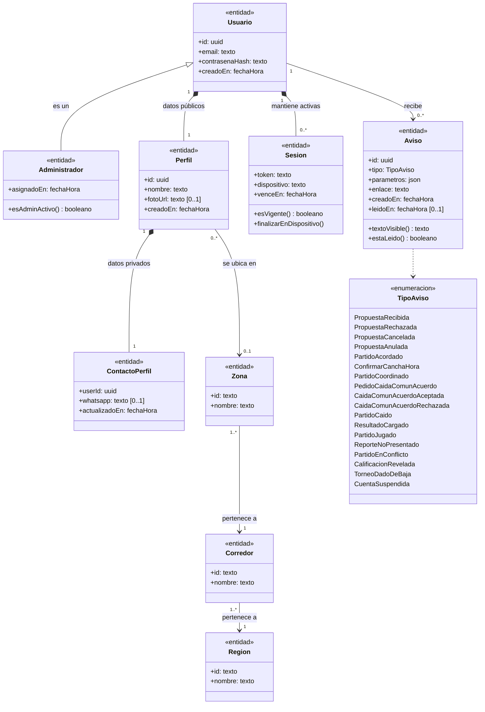
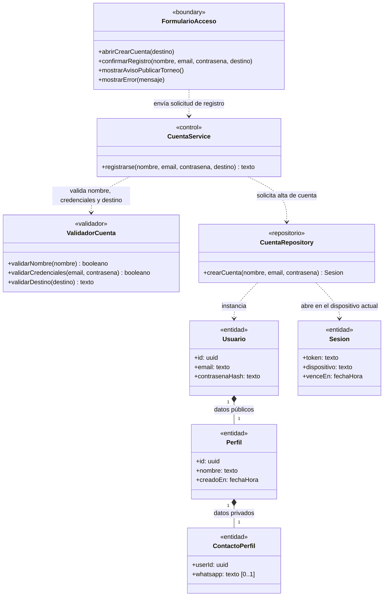
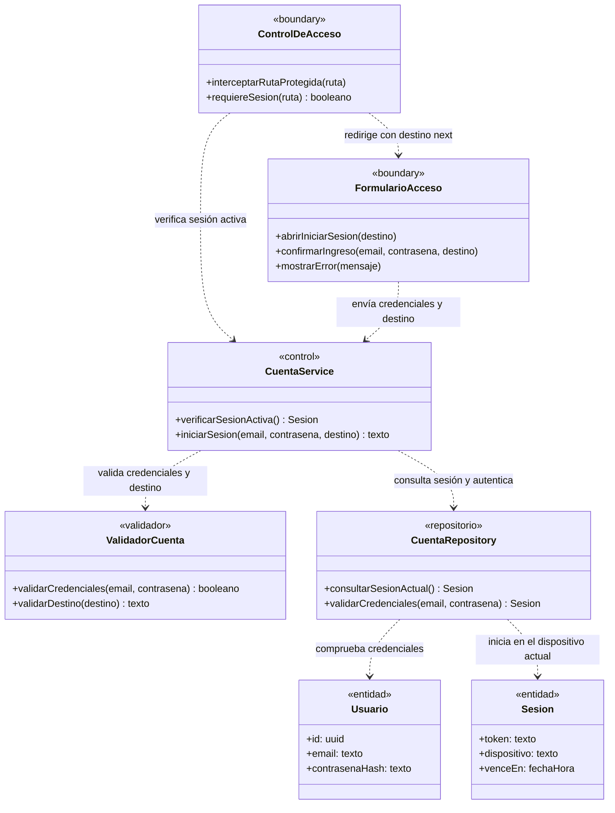
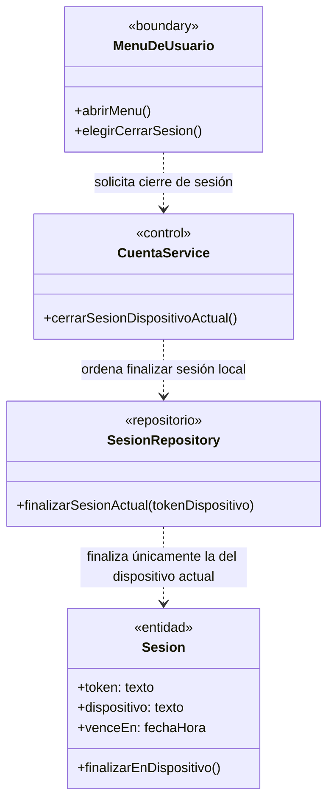
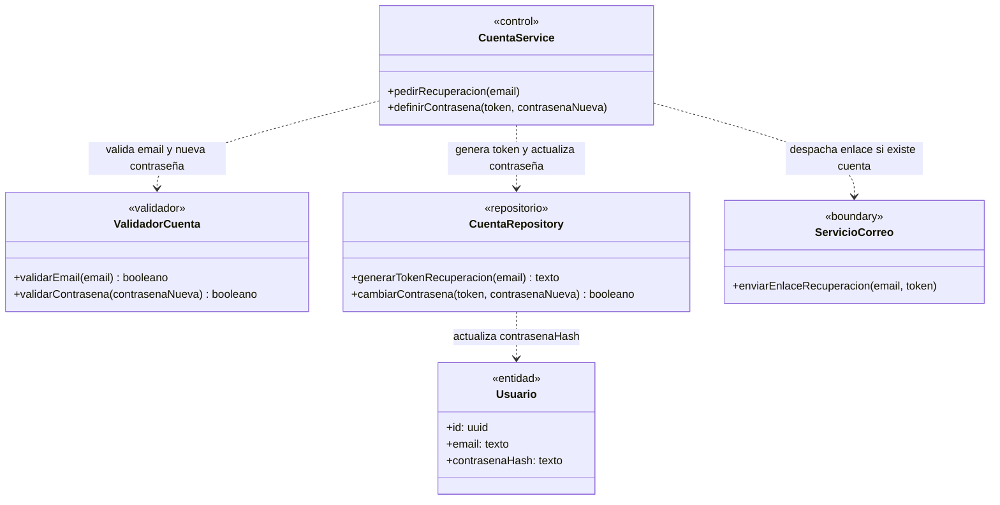
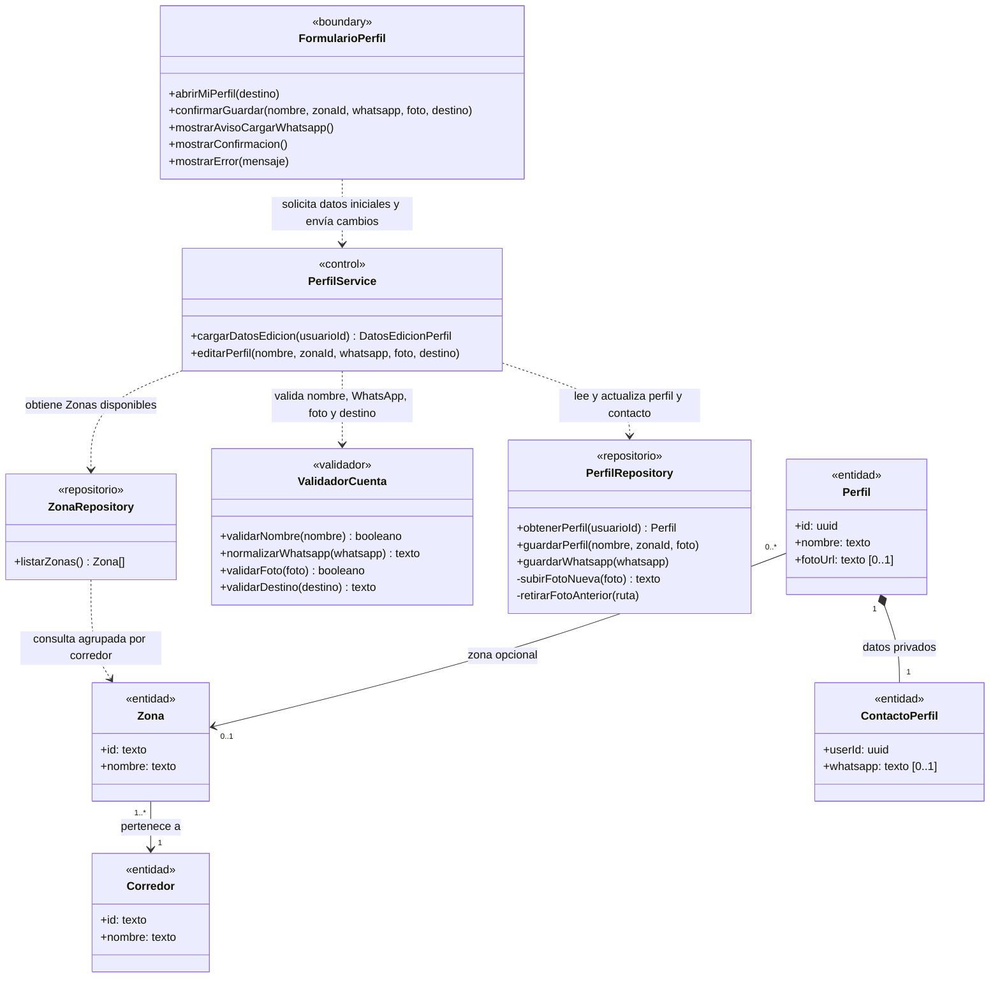
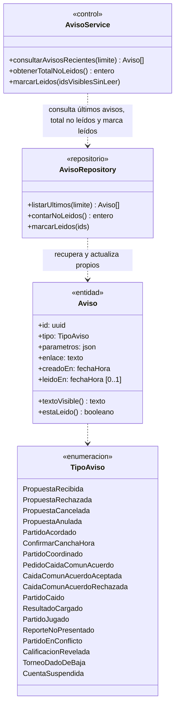

# Módulo A — Cuenta y acceso

> Documenta las clases de dominio y de diseño que participan en el **Módulo A — Cuenta y acceso** (`UC-A01` a `UC-A06`).
> Fuentes del módulo: [01-requerimientos.md](../cuenta-y-acceso/01-requerimientos.md) · [02-casos-de-uso.md](../cuenta-y-acceso/02-casos-de-uso.md) · [03-pantallas.md](../cuenta-y-acceso/03-pantallas.md) · [04-diagramas-secuencia/](../cuenta-y-acceso/04-diagramas-secuencia/README.md). Convenciones en el [README](README.md).

---

## Modelo de dominio del módulo

Vista estructural de las entidades, relaciones de herencia/composición y enumeraciones que comparten los casos de uso `UC-A01` a `UC-A06`.

---

## Clases por caso de uso

### UC-A01 · Crear cuenta

**Requerimientos:** `RF-A01` a `RF-A03`, `RF-A06`, `RF-A08`, `RF-A25` · **Pantalla:** [P2 · Crear cuenta](../cuenta-y-acceso/03-pantallas.md#p2--crear-cuenta) (`/login?modo=registro`) · **Secuencia:** [S01 · Crear cuenta](../cuenta-y-acceso/04-diagramas-secuencia/uc-a01-crear-cuenta.md)

---

### UC-A02 · Iniciar sesión

**Requerimientos:** `RF-A04` a `RF-A08`, `RF-A25` · **Pantalla:** [P1 · Iniciar sesión](../cuenta-y-acceso/03-pantallas.md#p1--iniciar-sesión) (`/login`) · **Secuencia:** [S02 · Iniciar sesión](../cuenta-y-acceso/04-diagramas-secuencia/uc-a02-iniciar-sesion.md)

---

### UC-A03 · Cerrar sesión

**Requerimientos:** `RF-A09`, `RF-A25` · **Pantalla:** [P4 · Barra superior](../cuenta-y-acceso/03-pantallas.md#p4--barra-superior) · **Secuencia:** [S03 · Cerrar sesión](../cuenta-y-acceso/04-diagramas-secuencia/uc-a03-cerrar-sesion.md)

---

### UC-A04 · Recuperar contraseña

**Requerimientos:** `RF-A10` · **Pantalla:** Diseño objetivo · **Secuencia:** [S04 · Recuperar contraseña](../cuenta-y-acceso/04-diagramas-secuencia/uc-a04-recuperar-contrasena.md)

---

### UC-A05 · Editar perfil

**Requerimientos:** `RF-A11` a `RF-A18` · **Pantalla:** [P3 · Mi perfil](../cuenta-y-acceso/03-pantallas.md#p3--mi-perfil) (`/perfil`) · **Secuencia:** [S05 · Editar perfil](../cuenta-y-acceso/04-diagramas-secuencia/uc-a05-editar-perfil.md)

---

### UC-A06 · Ver avisos (campanita)

**Requerimientos:** `RF-A19` a `RF-A25` · **Pantalla:** [P5 · Campanita de avisos](../cuenta-y-acceso/03-pantallas.md#p5--campanita-de-avisos) · **Secuencia:** [S06 · Ver avisos](../cuenta-y-acceso/04-diagramas-secuencia/uc-a06-ver-avisos.md)

---

## Trazabilidad

| Clase | Estereotipo | Implementación en el repo | Estado |
|---|---|---|---|
| `ControlDeAcceso` | `«boundary»` | `src/proxy.ts` | Implementado |
| `FormularioAcceso` | `«boundary»` | `src/app/login/page.tsx` + `src/utils/login-screen.ts` | Implementado |
| `FormularioPerfil` | `«boundary»` | `src/app/perfil/page.tsx` | Implementado |
| `MenuDeUsuario` | `«boundary»` | `src/components/UserMenu.tsx` | Implementado |
| `ServicioCorreo` | `«boundary»` | — (diseño objetivo de UC-A04) | **Pendiente** |
| `CuentaService` | `«control»` | Server Actions `signup`, `login`, `logout` en `src/app/login/actions.ts` | Implementado (falta UC-A04) |
| `PerfilService` | `«control»` | Server Action `updateProfile` en `src/app/perfil/actions.ts` | Parcial (falta RF-A17) |
| `AvisoService` | `«control»` | Lectura de avisos en `src/app/layout.tsx` + Server Action `markNoticesRead` en `src/app/avisos/actions.ts` | Implementado |
| `ValidadorCuenta` | `«validador»` | `safeNextPath` (`src/utils/safe-next-path.ts`), `normalizeWhatsapp` (`src/utils/whatsapp.ts`), `parseAvatar` (`src/utils/profile-avatar.ts`) | Implementado |
| `CuentaRepository` / `SesionRepository` | `«repositorio»` | Supabase Auth (`signUp`, `signInWithPassword`, `signOut({ scope: 'local' })`, `getUser`) + trigger `handle_new_user` | Implementado |
| `ZonaRepository` | `«repositorio»` | `getZoneGroups()` en `src/components/ZoneSelect.tsx` (`public.zones`, `corridors`, `regions`) | Implementado |
| `PerfilRepository` | `«repositorio»` | `saveProfile` (`src/utils/supabase/profile.ts`), tablas `public.profiles` y `public.profile_contacts`, bucket `avatars` | Parcial (falta RF-A17) |
| `AvisoRepository` | `«repositorio»` | Tabla `public.notices` con RLS + función `public.mark_notices_read` (`20261028000001_notices.sql`) | Implementado |
| `Usuario` / `Administrador` / `Sesion` | `«entidad»` | `auth.users`, `public.admins` y sesiones de Supabase Auth | Implementadas |
| `Perfil` / `ContactoPerfil` | `«entidad»` | `public.profiles`, `public.profile_contacts` (`20260928000002_profiles.sql`) | Implementadas |
| `Aviso` | `«entidad»` | `public.notices` + `noticeText`, `noticeLink`, `noticeDate` (`src/utils/notices.ts`) | Implementada |
| `Zona` / `Corredor` / `Region` | `«entidad»` | `public.zones`, `public.corridors`, `public.regions` (`20260928000001_geography.sql`) | Implementadas |
