# Módulo C — Equipos

Creación y gestión de Equipos: formación del **Plantel** mediante un link de invitación de 7 días, página pública con historial de partidos y torneos vinculados, edición de datos y escudo, pase de capitanía, expulsión o salida de jugadores, **disolución** definitiva sin pérdida de historia y reporte de equipos.

Fuentes del módulo: [01-requerimientos.md](../equipos/01-requerimientos.md) · [02-casos-de-uso.md](../equipos/02-casos-de-uso.md) · [03-pantallas.md](../equipos/03-pantallas.md) · [04-diagramas-secuencia/](../equipos/04-diagramas-secuencia/README.md). Convenciones en el [README](README.md).

## Modelo de dominio del módulo

Vista de conjunto de las entidades y enumeraciones que comparten los casos de uso UC-C01 a UC-C10.

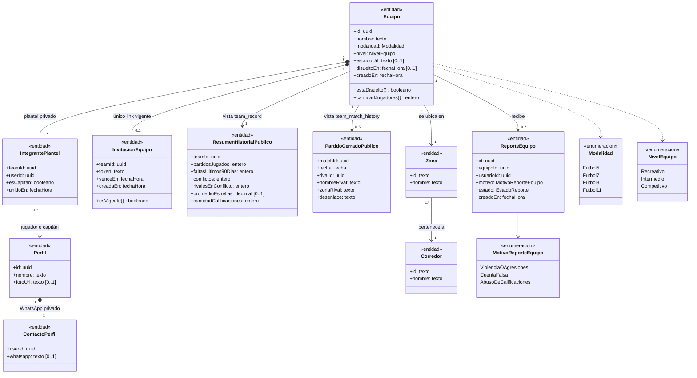

- **Quién es Capitán (RNF-C02, RNF-C04):** la capitanía es una marca dentro del Plantel (`IntegrantePlantel.esCapitan` con índice único parcial `team_members_one_captain`), no una columna pública de `teams`. Así el Plantel y quién es el Capitán solo los ven los integrantes del Equipo.
- **Límite de 3 capitanías y WhatsApp obligatorio (RF-C04, RF-C05, RNF-C03):** una persona puede capitanear hasta 3 Equipos activos (no disueltos) y debe tener su WhatsApp cargado en `ContactoPerfil`.
- **Disolución sin borrado (RF-C22 a RF-C25):** un `Equipo` disuelto (`disueltoEn` no nulo) conserva su página pública, su Plantel, su escudo y su historia, pero no puede operar ni reactivarse.

---

## UC-C01 · Crear equipo

| Campo | Detalle |
|---|---|
| **Actor primario** | Usuario |
| **Requerimientos** | RF-C01 a RF-C06, RF-C27 |
| **Pantalla** | [P1 · Crear equipo](../equipos/03-pantallas.md#p1--crear-equipo) (`/crear-equipo`) |
| **Diagrama de secuencia** | [S01 · Crear equipo](../equipos/04-diagramas-secuencia/uc-c01-crear-equipo.md) |
| **Precondiciones** | Sesión activa; WhatsApp cargado en el perfil; menos de 3 Equipos activos como Capitán; sin Suspensión. |
| **Postcondición** | Existe el `Equipo` activo con el creador como único integrante y `Capitán`. |
| **Estado** | Implementado (`src/app/crear-equipo`, RPC `create_team`, `saveTeam`). |

**Flujo principal**

1. El Usuario abre `/crear-equipo`. `FormularioCrearEquipo` consulta a `EquipoRepository.consultarRequisitos(usuario)` (si tiene WhatsApp y cuántas capitanías activas tiene), obtiene las Zonas de `ZonaRepository.listarZonas()` y las modalidades y niveles de `OpcionesEquipo` **antes** de que el Usuario elija.
2. El Usuario completa **nombre**, elige **Zona**, **modalidad habitual** y **nivel**, opcionalmente adjunta un **escudo** y confirma con «Crear equipo».
3. `FormularioCrearEquipo` envía solo los valores elegidos (`nombre`, `zonaId`, `modalidad`, `nivel`, `escudo`) a `EquipoService`.
4. `EquipoService` valida los datos y el escudo con `Validador`.
5. `EquipoRepository.crearEquipo(datos, usuario)` comprueba en la base el WhatsApp, el límite de 3 capitanías (bloqueando el perfil con `for update`) y que `zonaId` exista, y guarda el `Equipo` y su `IntegrantePlantel` Capitán en **una sola transacción**.
6. Si se adjuntó un escudo, `EquipoRepository.guardarEscudo(id, escudo)` lo sube a Storage y actualiza `escudoUrl`.
7. Se abre la ficha del Equipo (`/equipos/{id}`).

**Reglas y flujos alternativos**

- **A1–A3. Sin sesión, sin WhatsApp o con 3 capitanías:** redirige al login, o muestra el aviso con «Cargar mi WhatsApp» o el mensaje de límite alcanzado.
- **A4–A5. Datos o escudo inválidos:** vuelve al formulario con el motivo exacto; no se crea nada.
- **A6. Nombre repetido:** se permite; públicamente los equipos se distinguen por su Zona.
- **A7. Falla el guardado del escudo después del alta:** el Equipo **ya quedó creado**; redirige a «Editar equipo» con aviso para reintentar.

```mermaid
classDiagram
direction TB
class FormularioCrearEquipo {
  <<interfaz>>
  +abrirCrearEquipo()
  +confirmarCreacion(nombre, zonaId, modalidad, nivel, escudo)
  +mostrarAvisoFaltaWhatsapp()
  +mostrarAvisoLimiteCapitanias()
  +mostrarErrores(errores)
}
class ZonaRepository {
  <<repositorio>>
  +listarZonas() Zona[]
}
class OpcionesEquipo {
  <<proveedor de opciones>>
  +listarModalidades() Modalidad[]
  +listarNiveles() NivelEquipo[]
}
class EquipoService {
  <<control>>
  +crearEquipo(nombre, zonaId, modalidad, nivel, escudo) uuid
}
class Validador {
  <<control>>
  +validarDatos(nombre, zonaId, modalidad, nivel) booleano
  +validarEscudo(escudo) booleano
}
class EquipoRepository {
  <<repositorio>>
  +consultarRequisitos(usuarioId) RequisitosCreacion
  +crearEquipo(datos, usuarioId) uuid
  +guardarEscudo(equipoId, escudo)
  -comprobarWhatsappYLimiteCapitanias(usuarioId)
}
class Equipo {
  <<entidad>>
  +id: uuid
  +nombre: texto
  +modalidad: Modalidad
  +nivel: NivelEquipo
  +escudoUrl: texto [0..1]
}
class IntegrantePlantel {
  <<entidad>>
  +teamId: uuid
  +userId: uuid
  +esCapitan: booleano
}
class Zona {
  <<entidad>>
  +id: texto
  +nombre: texto
}
class Modalidad {
  <<enumeracion>>
  Futbol5
  Futbol7
  Futbol8
  Futbol11
}
class NivelEquipo {
  <<enumeracion>>
  Recreativo
  Intermedio
  Competitivo
}
FormularioCrearEquipo ..> EquipoRepository : consulta requisitos previos
FormularioCrearEquipo ..> ZonaRepository : carga Zonas de la base
FormularioCrearEquipo ..> OpcionesEquipo : carga modalidades y niveles fijos
FormularioCrearEquipo ..> EquipoService : envía valores elegidos
EquipoService ..> Validador : valida datos y escudo
EquipoService ..> EquipoRepository : ejecuta alta y sube escudo
EquipoRepository ..> Equipo : crea en transacción
Equipo "1" *-- "1" IntegrantePlantel : creador como Capitán
Equipo "0..*" --> "1" Zona : se ubica en
OpcionesEquipo ..> Modalidad
OpcionesEquipo ..> NivelEquipo
```

---

## UC-C02 · Invitar jugadores al equipo

| Campo | Detalle |
|---|---|
| **Actor primario** | Capitán |
| **Requerimientos** | RF-C07, RF-C25 |
| **Pantalla** | [P4 · Equipo, vista del Capitán](../equipos/03-pantallas.md#p4--equipo-vista-del-jugador-y-del-capitán) (sección «Invitar jugadores») |
| **Diagrama de secuencia** | [S02 · Invitar jugadores](../equipos/04-diagramas-secuencia/uc-c02-invitar-jugadores.md) |
| **Precondiciones** | Equipo no disuelto; el actor es su Capitán. |
| **Postcondición** | Existe un único link de invitación vigente por 7 días; el anterior (si lo había) queda invalidado. |
| **Estado** | Implementado (`regenerateInvite`, RPC `regenerate_team_invite`, `get_team_invite`, `CopyLinkButton`). |

**Flujo principal**

1. Al abrir `FichaEquipo`, solicita a `EquipoRepository.obtenerInvitacionVigente(equipoId)` el token y su vencimiento, y muestra el link vigente o el botón «Generar link».
2. El Capitán pulsa «Generar link» (o «Regenerar»).
3. `EquipoService.generarInvitacion(equipoId)` delega en `EquipoRepository.regenerarInvitacion(equipoId)`.
4. `EquipoRepository` verifica que quien llama sea el Capitán y que el Equipo esté activo, genera un token aleatorio de 16 bytes en hexadecimal con vencimiento a 7 días y reemplaza el anterior.
5. `FichaEquipo` muestra el link para copiar (`copiarLink()` no toca el servidor).

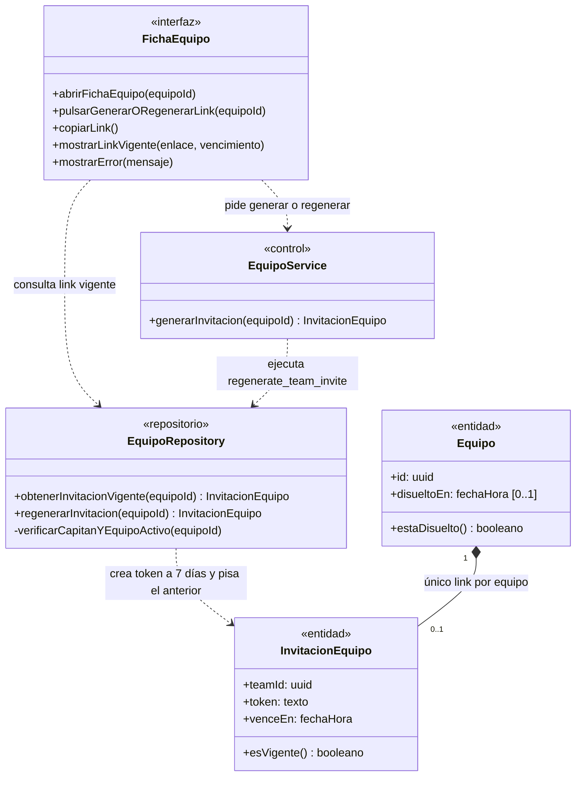

---

## UC-C03 · Unirse a un equipo con el link

| Campo | Detalle |
|---|---|
| **Actor primario** | Usuario |
| **Requerimientos** | RF-C08 a RF-C10, RF-C27 |
| **Pantalla** | [P6 · Unirse al equipo](../equipos/03-pantallas.md#p6--unirse-al-equipo) (`/unirse/{token}`) |
| **Diagrama de secuencia** | [S03 · Unirse al equipo](../equipos/04-diagramas-secuencia/uc-c03-unirse-al-equipo.md) |
| **Precondiciones** | Tiene un link de invitación vigente. |
| **Postcondición** | El Usuario queda incorporado al `Plantel` como Jugador y se abre la página del Equipo. |
| **Estado** | Implementado (`src/app/unirse/[token]`, RPC `join_team`). |

**Flujo principal**

1. El Usuario abre `/unirse/{token}` (si no tiene sesión, redirige a `/login?next=/unirse/{token}` y vuelve).
2. `PantallaUnirse` muestra «Te invitaron a un equipo» y el botón «Unirme al equipo» (**abrir la página no suma a nadie**, para evitar altas por precarga de WhatsApp).
3. El Usuario pulsa «Unirme al equipo».
4. `EquipoService.unirseAlEquipo(token)` llama a `EquipoRepository.incorporarAlPlantel(token)`.
5. `EquipoRepository` valida que el token exista, no haya vencido y su Equipo no esté disuelto, e inserta al Usuario en `IntegrantePlantel` (si ya estaba, no falla ni duplica).
6. Se abre la ficha del Equipo (`/equipos/{id}`).

**Regla (RF-C09):** un link inexistente, vencido, regenerado o de un Equipo disuelto devuelve siempre el mismo mensaje: «El link de invitación no es válido o venció».

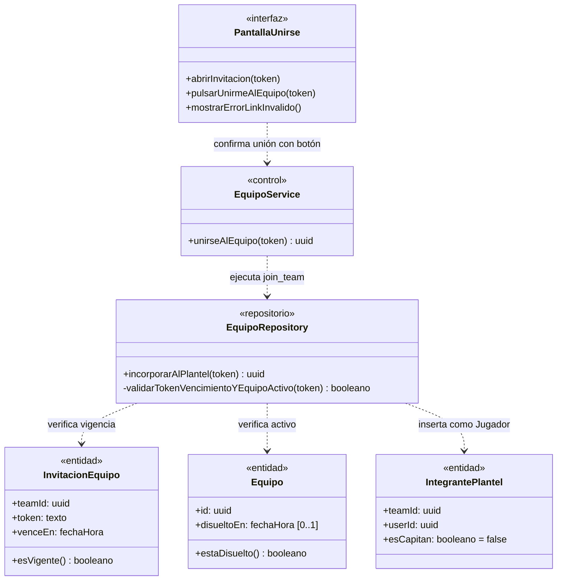

---

## UC-C04 · Ver la página pública del equipo

| Campo | Detalle |
|---|---|
| **Actor primario** | Invitado (y cualquier Usuario, Jugador o Capitán) |
| **Requerimientos** | RF-C11 a RF-C14, RF-C25 |
| **Pantallas** | [P3 · Equipo, vista pública](../equipos/03-pantallas.md#p3--equipo-vista-pública) y [P4 · Vista del Jugador y del Capitán](../equipos/03-pantallas.md#p4--equipo-vista-del-jugador-y-del-capitán) (`/equipos/{id}`) |
| **Diagrama de secuencia** | [S04 · Ver la página del equipo](../equipos/04-diagramas-secuencia/uc-c04-ver-pagina-equipo.md) |
| **Precondiciones** | El Equipo existe (no hace falta sesión). |
| **Postcondición** | Se muestra la página pública con datos, historial de partidos y torneos vinculados; si integra el Plantel, también ve el Plantel y las acciones de su rol. |
| **Estado** | Implementado (`src/app/equipos/[id]/page.tsx`, vistas `team_record` y `team_match_history`). |

**Flujo principal**

1. El Invitado abre `/equipos/{id}`. `FichaEquipo` solicita los datos a `EquipoService.consultarFichaPublica(equipoId)`.
2. `EquipoRepository.obtenerDatosPublicos(equipoId)` devuelve escudo, nombre, Zona con su corredor, modalidad, nivel, cantidad de jugadores y si está disuelto.
3. `InscripcionRepository.obtenerTorneosVinculados(equipoId)` devuelve los torneos donde el Equipo tiene una Inscripción vinculada.
4. `HistorialRepository.obtenerHistorialPublico(equipoId)` devuelve el contador (`Jugó N · N faltas · N conflictos`), el promedio de estrellas reveladas y los últimos 5 partidos cerrados (sin cancha ni hora).
5. Si quien consulta tiene sesión, `EquipoRepository.obtenerPlantel(equipoId)` devuelve los integrantes **solo si la persona pertenece al Plantel** (RLS sobre `team_members`).
6. `FichaEquipo` muestra la página (y las acciones de gestión si es Capitán de un Equipo activo, o «Salir del equipo» si es Jugador).

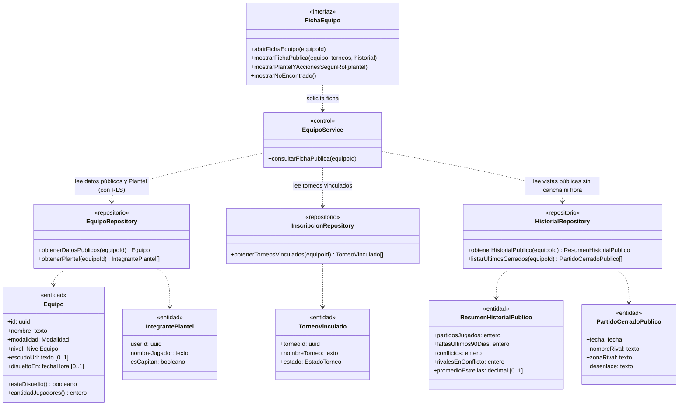

---

## UC-C05 · Editar equipo

| Campo | Detalle |
|---|---|
| **Actor primario** | Capitán |
| **Requerimientos** | RF-C01, RF-C02, RF-C16, RF-C25 |
| **Pantalla** | [P5 · Editar equipo](../equipos/03-pantallas.md#p5--editar-equipo) (`/equipos/{id}/editar`) |
| **Diagrama de secuencia** | [S05 · Editar equipo](../equipos/04-diagramas-secuencia/uc-c05-editar-equipo.md) |
| **Precondiciones** | Equipo no disuelto; el actor es su Capitán. |
| **Postcondición** | Datos y escudo del Equipo actualizados; cambiar Zona o nivel actualiza en el acto cómo aparece entre los rivales compatibles. |
| **Estado** | Implementado (`src/app/equipos/[id]/editar`, `updateTeam`, `saveTeam`). |

**Flujo principal**

1. El Capitán abre `/equipos/{id}/editar`. `FormularioEditarEquipo` comprueba con `EquipoRepository.obtenerEquipoEditable(equipoId)` que sea el Capitán y que el Equipo esté activo; luego carga las Zonas de `ZonaRepository` y las modalidades y niveles de `OpcionesEquipo` **antes** de mostrar el formulario con los valores actuales.
2. El Capitán modifica nombre, Zona, modalidad, nivel o escudo (reemplazar o marcar «Quitar el escudo actual») y confirma con «Guardar cambios».
3. `EquipoService.editarEquipo(...)` vuelve a verificar `esCapitan(equipoId)` con `EquipoRepository` y valida los datos y el escudo con `Validador`.
4. `EquipoRepository.guardarEquipoActivo(...)` sube el escudo nuevo (si lo hay), actualiza el Equipo activo verificando en la base que `zonaId` exista y que quien guarda siga siendo su Capitán, y retira el escudo anterior recién después de confirmar el guardado.
5. Se abre la ficha del Equipo con «Los cambios del equipo se guardaron».

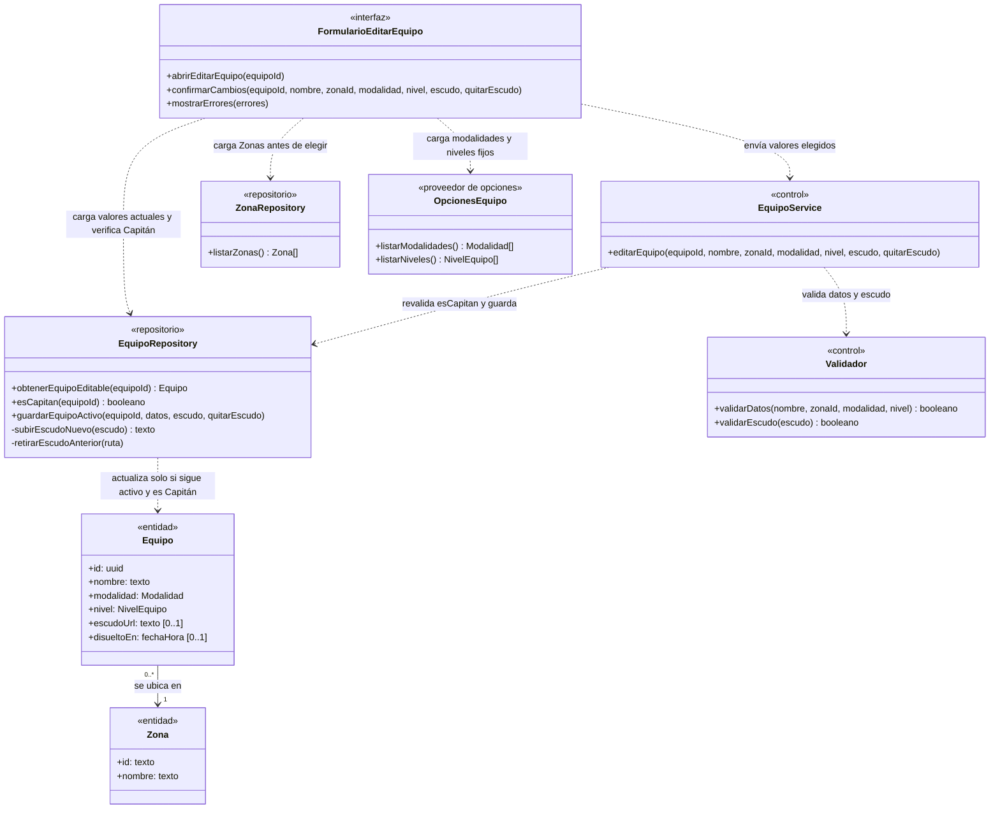

---

## UC-C06 · Pasar la capitanía

| Campo | Detalle |
|---|---|
| **Actor primario** | Capitán |
| **Requerimientos** | RF-C05, RF-C17, RF-C20, RF-C21, RF-C27 |
| **Pantalla** | [P4 · Equipo, vista del Capitán](../equipos/03-pantallas.md#p4--equipo-vista-del-jugador-y-del-capitán) (sección «Plantel») |
| **Diagrama de secuencia** | [S06 · Pasar la capitanía](../equipos/04-diagramas-secuencia/uc-c06-pasar-capitania.md) |
| **Precondiciones** | Equipo no disuelto; el destinatario integra el Plantel, tiene WhatsApp en el perfil, capitanea menos de 3 Equipos activos y no está suspendido. |
| **Postcondición** | El destinatario pasa a ser el único `Capitán` del Equipo y el anterior queda como `Jugador`. |
| **Estado** | **Parcial** (`transferCaptaincy`, RPC `transfer_captaincy`): implementado; la verificación de Suspensión espera a UC-F05. |

**Flujo principal**

1. En la sección Plantel de `FichaEquipo`, el Capitán pulsa «Hacer capitán» en la fila de otro integrante y confirma («¿Pasarle la capitanía a {nombre}? Vas a quedar como jugador»).
2. `EquipoService.pasarCapitania(equipoId, integranteId)` llama a `EquipoRepository.transferirCapitania(equipoId, integranteId)`.
3. `EquipoRepository` serializa el Equipo (`for update`), verifica que esté activo y que quien llama sea el Capitán, comprueba que el destinatario integre el Plantel, tenga WhatsApp en `ContactoPerfil` y menos de 3 capitanías activas, y transfiere la marca `esCapitan` en una sola transacción.

**Regla (RF-C21):** nunca se bloquea por partidos en curso; el Capitán nuevo opera todo lo pendiente del Equipo.

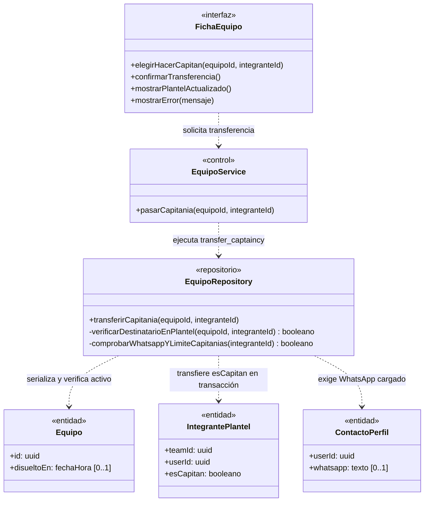

---

## UC-C07 · Sacar a un jugador del plantel

| Campo | Detalle |
|---|---|
| **Actor primario** | Capitán |
| **Requerimientos** | RF-C18, RF-C20, RF-C21, RF-C25 |
| **Pantalla** | [P4 · Equipo, vista del Capitán](../equipos/03-pantallas.md#p4--equipo-vista-del-jugador-y-del-capitán) (sección «Plantel») |
| **Diagrama de secuencia** | [S07 · Sacar a un jugador](../equipos/04-diagramas-secuencia/uc-c07-sacar-jugador.md) |
| **Precondiciones** | Equipo no disuelto; el actor es su Capitán y el jugador a sacar no es él mismo. |
| **Postcondición** | El jugador deja de integrar el `Plantel` (deja de ver los partidos del Equipo y conserva los Avisos ya recibidos). |
| **Estado** | Implementado (`removeMember`, RPC `remove_team_member`). |

**Flujo principal**

1. En `FichaEquipo`, el Capitán pulsa «Sacar» en la fila de otro integrante y confirma («¿Sacar a {nombre} del equipo?»).
2. `EquipoService.sacarJugador(equipoId, integranteId)` delega en `EquipoRepository.quitarIntegrante(equipoId, integranteId)`.
3. `EquipoRepository` serializa el Equipo, verifica que esté activo, que quien llama sea el Capitán y que el destinatario no sea el propio Capitán, y elimina su fila de `IntegrantePlantel`.

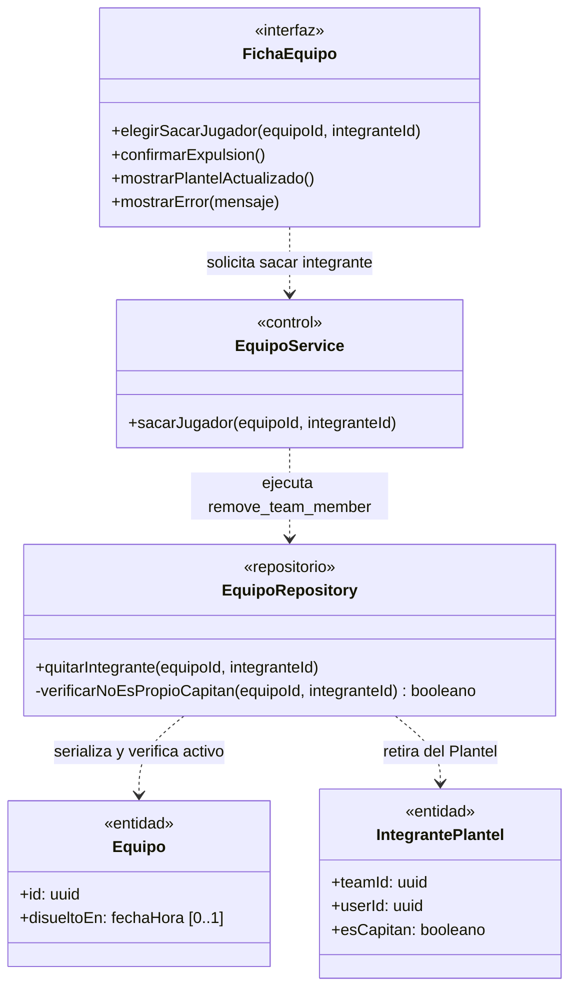

---

## UC-C08 · Salir del equipo

| Campo | Detalle |
|---|---|
| **Actor primario** | Jugador (integrante que no es Capitán) |
| **Requerimientos** | RF-C19 a RF-C21, RF-C25 |
| **Pantalla** | [P4 · Equipo, vista del Jugador](../equipos/03-pantallas.md#p4--equipo-vista-del-jugador-y-del-capitán) (botón «Salir del equipo») |
| **Diagrama de secuencia** | [S08 · Salir del equipo](../equipos/04-diagramas-secuencia/uc-c08-salir-del-equipo.md) |
| **Precondiciones** | Integra el Plantel, no es el Capitán y el Equipo no está disuelto. |
| **Postcondición** | El Jugador deja de pertenecer al Plantel y vuelve a «Mis equipos». |
| **Estado** | Implementado (`leaveTeam`, RPC `leave_team`). |

**Flujo principal**

1. En `FichaEquipo`, el Jugador pulsa «Salir del equipo» y confirma («¿Salir del equipo?»).
2. `EquipoService.salirDelEquipo(equipoId)` delega en `EquipoRepository.quitarPropiaPertenencia(equipoId)`.
3. `EquipoRepository` serializa el Equipo, verifica que esté activo y que quien llama integre el Plantel sin ser su Capitán, y retira su fila de `IntegrantePlantel`.
4. Redirige a `/mis-equipos`.

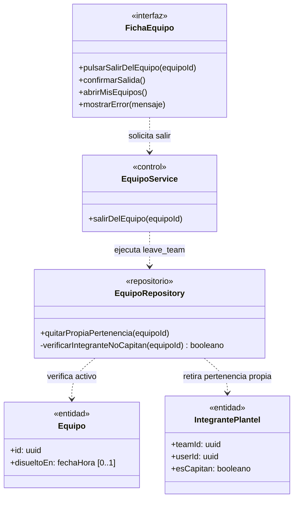

---

## UC-C09 · Disolver equipo

| Campo | Detalle |
|---|---|
| **Actor primario** | Capitán |
| **Requerimientos** | RF-C22 a RF-C25 |
| **Pantalla** | [P4 · Equipo, vista del Capitán](../equipos/03-pantallas.md#p4--equipo-vista-del-jugador-y-del-capitán) (sección «Disolver equipo») |
| **Diagrama de secuencia** | [S09 · Disolver equipo](../equipos/04-diagramas-secuencia/uc-c09-disolver-equipo.md) |
| **Precondiciones** | Equipo no disuelto; el actor es su Capitán; el Equipo no tiene ningún partido por jugarse ni esperando resultado. |
| **Postcondición** | El Equipo queda marcado como **Equipo disuelto** (conserva página, Plantel, escudo e historia, sin reactivación), se invalidan sus invitaciones y se cancelan sus búsquedas de rival activas y propuestas pendientes con Aviso. |
| **Estado** | Implementado (`dissolveTeam`, RPC `dissolve_team` en `20261028000006_matches.sql`). |

**Flujo principal**

1. En `FichaEquipo`, el Capitán tilda «Entiendo que no podré reactivar este equipo», pulsa «Disolver equipo» y acepta la confirmación («No se puede deshacer»).
2. `EquipoService.disolverEquipo(equipoId, confirmacion)` comprueba la casilla y llama a `EquipoRepository.disolver(equipoId)`.
3. En una sola transacción (`dissolve_team`), `EquipoRepository` serializa el Equipo, verifica Capitán y Equipo activo, y consulta a `PartidoRepository.existenPartidosPendientes(equipoId)` que no haya partidos por jugarse ni esperando resultado.
4. Marca `disueltoEn`, invalida la `InvitacionEquipo` y delega en `BusquedaRepository.cancelarBusquedasActivas(equipoId)` la cancelación de las búsquedas activas y sus propuestas pendientes (enviando el Aviso «Se canceló tu propuesta» al otro capitán).

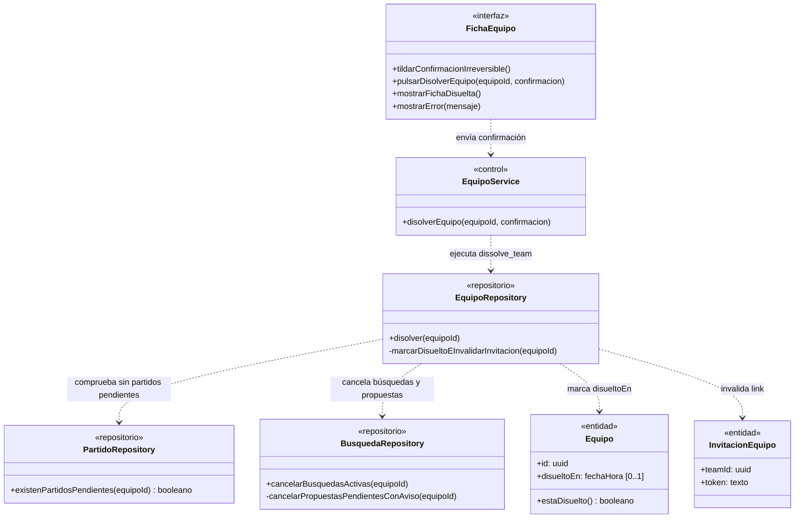

---

## UC-C10 · Reportar un equipo

| Campo | Detalle |
|---|---|
| **Actor primario** | Usuario (Capitán o Jugador de un equipo que jugó al menos un partido contra el reportado) |
| **Requerimientos** | RF-C26 |
| **Pantalla** | [P3 · Equipo, vista pública](../equipos/03-pantallas.md#p3--equipo-vista-pública) (botón «Reportar», pendiente) |
| **Diagrama de secuencia** | [S10 · Reportar un equipo](../equipos/04-diagramas-secuencia/uc-c10-reportar-equipo.md) (diseño objetivo) |
| **Precondiciones** | Tiene sesión y un partido `Jugado` en común con el Equipo reportado. |
| **Postcondición** | El `ReporteEquipo` queda pendiente en el panel de administración (UC-F04). |
| **Estado** | **Pendiente** (diseño objetivo). |

**Flujo principal (diseño objetivo)**

1. Al abrir `FichaEquipo`, consulta a `ReporteRepository.puedeReportar(usuario, equipoId)` si tiene sesión y al menos un partido `Jugado` en común con el Equipo.
2. Si puede reportar, el Usuario toca «Reportar» y `FichaEquipo` carga los motivos de `OpcionesReporte.listarMotivos()` **antes** de que elija («Violencia o agresiones», «Cuenta falsa», «Abuso de calificaciones»).
3. El Usuario elige un motivo y envía; `EquipoService.reportarEquipo(equipoId, motivo)` valida el motivo con `Validador` y delega en `ReporteRepository.crearReporte(equipoId, motivo, usuario)`, que vuelve a comprobar en la base la sesión y el partido jugado en común.

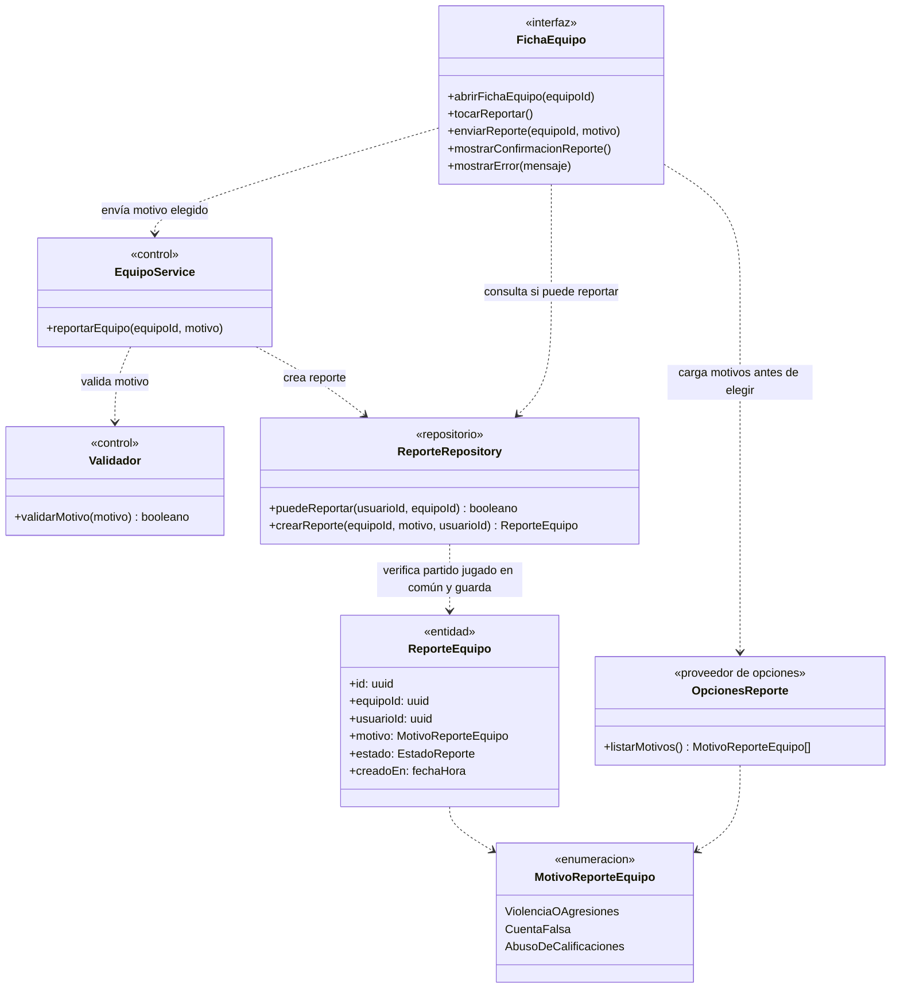

---

## Trazabilidad

| Clase | Tipo | Implementación en el repo | Estado |
|---|---|---|---|
| `FormularioCrearEquipo` / `FormularioEditarEquipo` | `«interfaz»` | `src/app/crear-equipo/page.tsx`, `src/app/equipos/[id]/editar/page.tsx`, `src/components/TeamForm.tsx` | Implementadas |
| `FichaEquipo` | `«interfaz»` | `src/app/equipos/[id]/page.tsx`, `CopyLinkButton.tsx`, `ConfirmButton.tsx` | Implementada |
| `PantallaUnirse` | `«interfaz»` | `src/app/unirse/[token]/page.tsx` | Implementada |
| `ZonaRepository` | `«repositorio»` | `getZoneGroups()` en `src/components/ZoneSelect.tsx` (`public.zones`, `corridors`, `regions`) | Implementado |
| `OpcionesEquipo` | `«proveedor de opciones»` | `SPORT_MODALITIES` (`src/utils/modality.ts`) y `TEAM_LEVELS` (`src/utils/teams.ts`) | Implementado |
| `EquipoService` | `«control»` | Server Actions en `src/app/crear-equipo/actions.ts`, `src/app/equipos/[id]/actions.ts`, `src/app/unirse/[token]/actions.ts` | Implementado (falta UC-C10) |
| `Validador` | `«control»` | `parseTeamForm` (`src/utils/team-form.ts`), `parseCrest` (`src/utils/team-crest.ts`) | Implementado |
| `EquipoRepository` | `«repositorio»` | Tablas `public.teams`, `team_members`, `team_invites`; funciones `create_team`, `join_team`, `leave_team`, `remove_team_member`, `transfer_captaincy`, `regenerate_team_invite`, `get_team_invite`, `dissolve_team`, `is_team_captain`; `saveTeam` (`src/utils/supabase/team.ts`) y bucket `team-crests` | Implementado (falta verificar Suspensión) |
| `InscripcionRepository` | `«repositorio»` | Vista pública `public.tournament_inscriptions` + `public.tournaments` | Implementado |
| `HistorialRepository` | `«repositorio»` | Vistas `public.team_record` y `public.team_match_history` (`20261028000012_team_history.sql`) | Implementado |
| `PartidoRepository` / `BusquedaRepository` | `«repositorio»` | Consultados dentro de `dissolve_team` (`20261028000006_matches.sql`: `matches`, `match_phase`, `rival_searches`, `cancel_proposals`) | Implementados |
| `OpcionesReporte` / `ReporteRepository` / `ReporteEquipo` | `«control»` / `«entidad»` | — (diseño objetivo de UC-C10) | **Pendiente** |
| `Equipo` / `IntegrantePlantel` / `InvitacionEquipo` | `«entidad»` | `public.teams`, `public.team_members`, `public.team_invites` (`20260928000004_teams.sql` a `20261014000003_team_management_locks.sql`) | Implementadas |
| `ResumenHistorialPublico` / `PartidoCerradoPublico` | `«entidad»` | Vistas `public.team_record` y `public.team_match_history` | Implementadas |
