# Módulo C — Equipos

> Documenta las clases de dominio y de diseño que participan en el **Módulo C — Equipos** (`UC-C01` a `UC-C10`).
> Fuentes del módulo: [01-requerimientos.md](../equipos/01-requerimientos.md) · [02-casos-de-uso.md](../equipos/02-casos-de-uso.md) · [03-pantallas.md](../equipos/03-pantallas.md) · [04-diagramas-secuencia/](../equipos/04-diagramas-secuencia/README.md). Convenciones en el [README](README.md).

---

## Modelo de dominio del módulo

Vista estructural de las entidades, relaciones de composición/asociación y enumeraciones que comparten los casos de uso `UC-C01` a `UC-C10`.

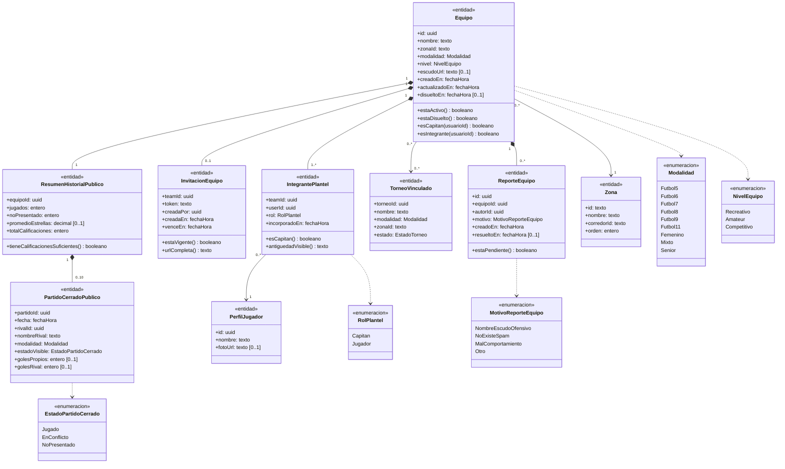

---

## Clases por caso de uso

### UC-C01 · Crear un equipo

> Especificación: [UC-C01](../equipos/02-casos-de-uso.md#uc-c01--crear-un-equipo) · Pantalla: [P2 · Crear equipo](../equipos/03-pantallas.md#p2--crear-equipo) · Secuencia: [S01 · Crear equipo](../equipos/04-diagramas-secuencia/uc-c01-crear-equipo.md)

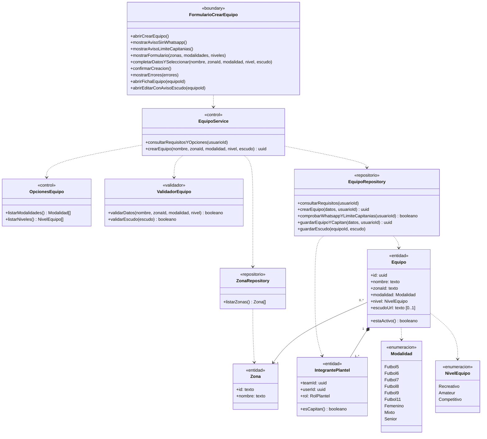

---

### UC-C02 · Invitar jugadores por link

> Especificación: [UC-C02](../equipos/02-casos-de-uso.md#uc-c02--invitar-jugadores-por-link) · Pantalla: [P3 · Ficha del equipo](../equipos/03-pantallas.md#p3--ficha-del-equipo) · Secuencia: [S02 · Invitar jugadores](../equipos/04-diagramas-secuencia/uc-c02-invitar-jugadores.md)

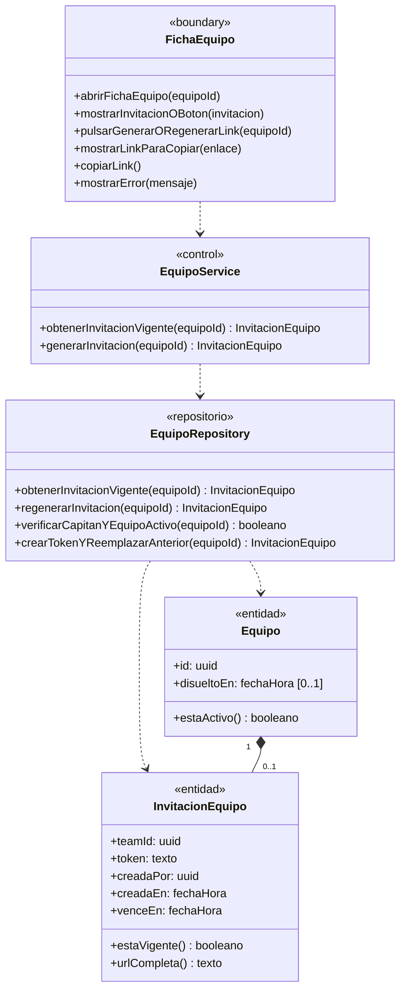

---

### UC-C03 · Unirse a un equipo con el link

> Especificación: [UC-C03](../equipos/02-casos-de-uso.md#uc-c03--unirse-a-un-equipo-con-el-link) · Pantalla: [P5 · Invitación al equipo](../equipos/03-pantallas.md#p5--invitación-al-equipo) · Secuencia: [S03 · Unirse al equipo](../equipos/04-diagramas-secuencia/uc-c03-unirse-al-equipo.md)

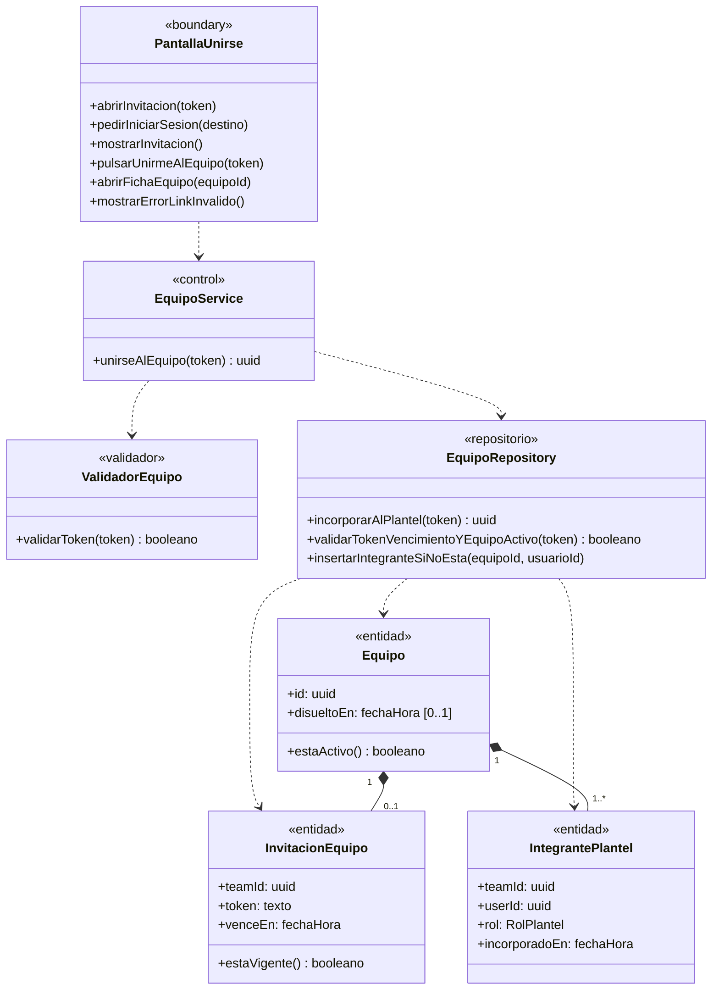

---

### UC-C04 · Ver la página pública de un equipo

> Especificación: [UC-C04](../equipos/02-casos-de-uso.md#uc-c04--ver-la-página-pública-de-un-equipo) · Pantalla: [P3 · Ficha del equipo](../equipos/03-pantallas.md#p3--ficha-del-equipo) · Secuencia: [S04 · Ver página de equipo](../equipos/04-diagramas-secuencia/uc-c04-ver-pagina-equipo.md)

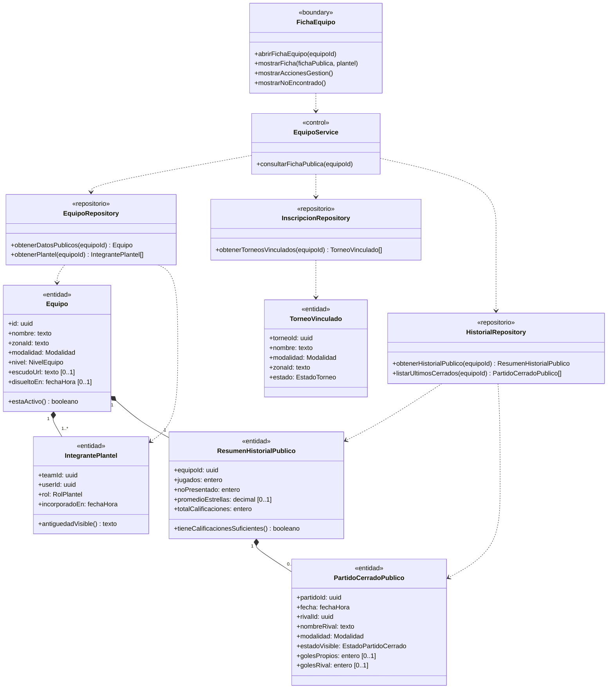

---

### UC-C05 · Editar datos del equipo

> Especificación: [UC-C05](../equipos/02-casos-de-uso.md#uc-c05--editar-datos-del-equipo) · Pantalla: [P4 · Editar equipo](../equipos/03-pantallas.md#p4--editar-equipo) · Secuencia: [S05 · Editar equipo](../equipos/04-diagramas-secuencia/uc-c05-editar-equipo.md)

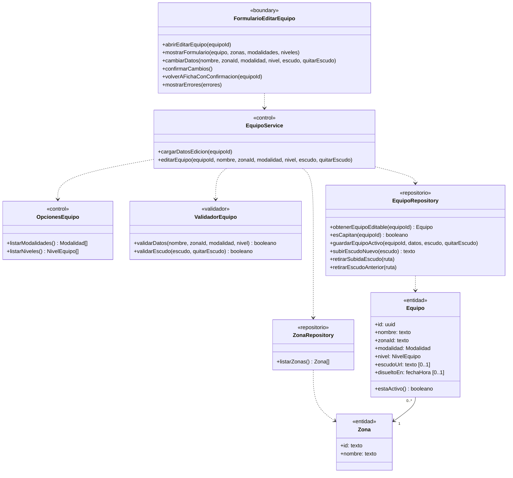

---

### UC-C06 · Pasar la capitanía

> Especificación: [UC-C06](../equipos/02-casos-de-uso.md#uc-c06--pasar-la-capitanía) · Pantalla: [P3 · Ficha del equipo](../equipos/03-pantallas.md#p3--ficha-del-equipo) · Secuencia: [S06 · Pasar capitanía](../equipos/04-diagramas-secuencia/uc-c06-pasar-capitania.md)

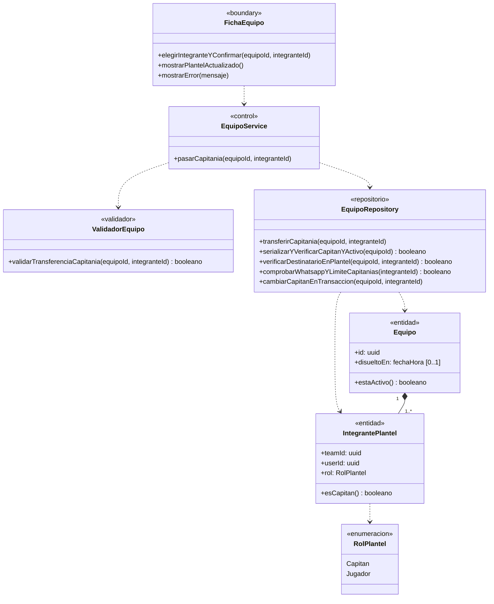

---

### UC-C07 · Sacar un jugador del equipo

> Especificación: [UC-C07](../equipos/02-casos-de-uso.md#uc-c07--sacar-un-jugador-del-equipo) · Pantalla: [P3 · Ficha del equipo](../equipos/03-pantallas.md#p3--ficha-del-equipo) · Secuencia: [S07 · Sacar jugador](../equipos/04-diagramas-secuencia/uc-c07-sacar-jugador.md)

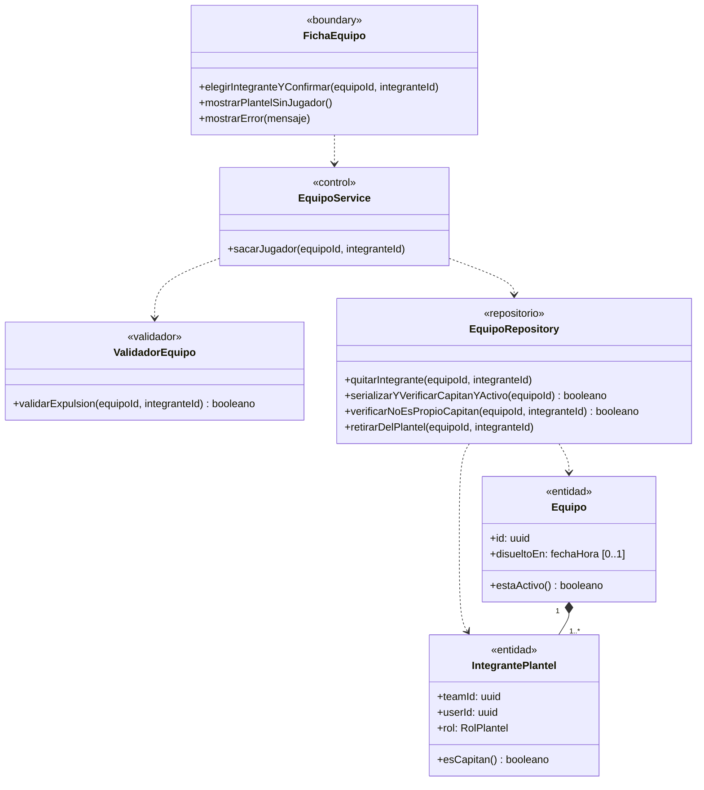

---

### UC-C08 · Salir del equipo

> Especificación: [UC-C08](../equipos/02-casos-de-uso.md#uc-c08--salir-del-equipo) · Pantalla: [P3 · Ficha del equipo](../equipos/03-pantallas.md#p3--ficha-del-equipo) · Secuencia: [S08 · Salir del equipo](../equipos/04-diagramas-secuencia/uc-c08-salir-del-equipo.md)

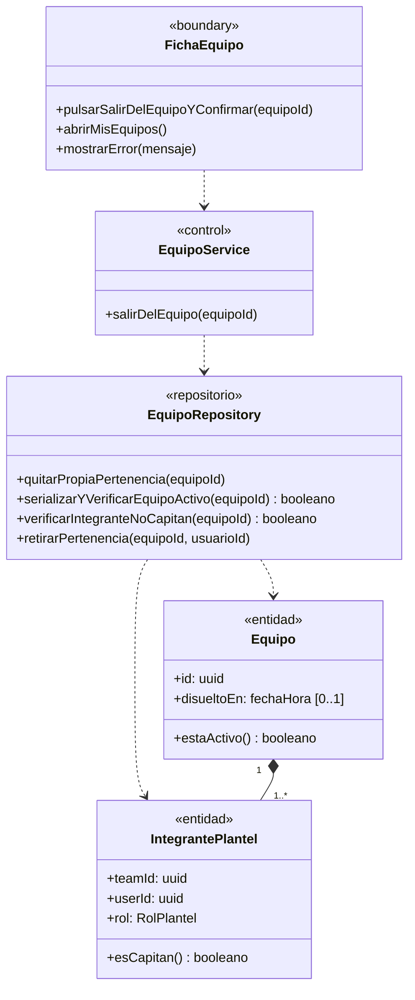

---

### UC-C09 · Disolver el equipo

> Especificación: [UC-C09](../equipos/02-casos-de-uso.md#uc-c09--disolver-el-equipo) · Pantalla: [P3 · Ficha del equipo](../equipos/03-pantallas.md#p3--ficha-del-equipo) · Secuencia: [S09 · Disolver equipo](../equipos/04-diagramas-secuencia/uc-c09-disolver-equipo.md)

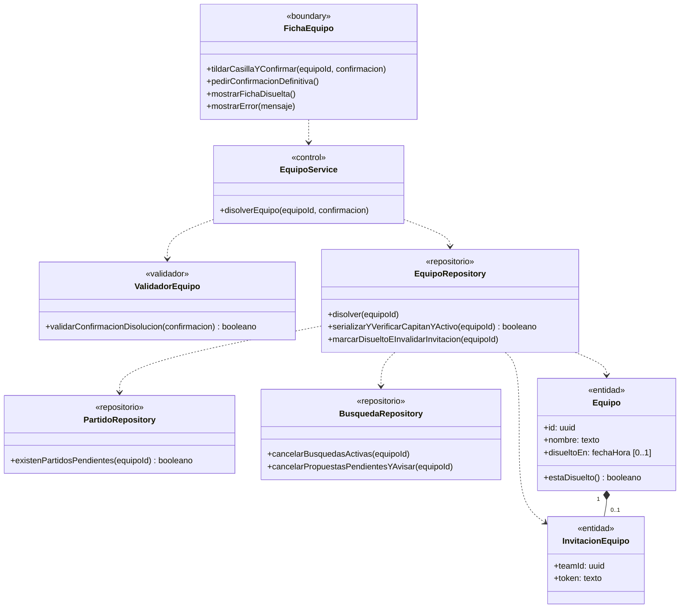

---

### UC-C10 · Reportar un equipo

> Especificación: [UC-C10](../equipos/02-casos-de-uso.md#uc-c10--reportar-un-equipo) · Pantalla: [P3 · Ficha del equipo](../equipos/03-pantallas.md#p3--ficha-del-equipo) · Secuencia: [S10 · Reportar equipo](../equipos/04-diagramas-secuencia/uc-c10-reportar-equipo.md)

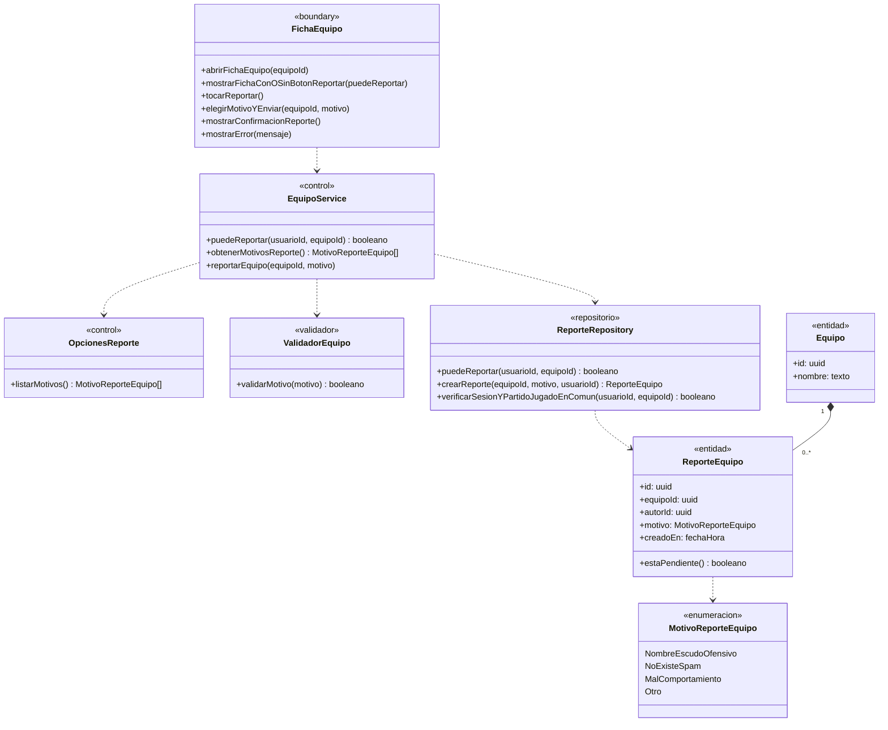

---

## Trazabilidad

| Clase | Estereotipo | Implementación en el repo | Estado |
|---|---|---|---|
| `FormularioCrearEquipo` | `«boundary»` | `src/app/equipos/crear/page.tsx` + `src/components/TeamForm.tsx` | Implementada |
| `FichaEquipo` | `«boundary»` | `src/app/equipos/[id]/page.tsx` + `InviteLinkBox.tsx`, `MemberActions.tsx`, `LeaveTeamForm.tsx`, `DissolveTeamForm.tsx` | Implementada (falta botón «Reportar» de UC-C10) |
| `FormularioEditarEquipo` | `«boundary»` | `src/app/equipos/[id]/editar/page.tsx` + `src/components/TeamForm.tsx` | Implementada |
| `PantallaUnirse` | `«boundary»` | `src/app/equipos/unirse/[token]/page.tsx` | Implementada |
| `EquipoService` / `OpcionesEquipo` / `OpcionesReporte` | `«control»` | Server Actions en `src/app/equipos/crear/actions.ts`, `src/app/equipos/[id]/actions.ts`, `src/app/equipos/[id]/editar/actions.ts`, `src/app/equipos/unirse/[token]/actions.ts`, `SPORT_MODALITIES` (`src/utils/modality.ts`), `TEAM_LEVELS` (`src/utils/teams.ts`) | Implementados (faltan `reportarEquipo` y `OpcionesReporte`) |
| `ValidadorEquipo` | `«validador»` | `parseTeamForm`, `parseCrest`, `parseRemoveCrest`, `parseInviteToken`, `parseMemberTarget`, `parseDissolveConfirmation` (`src/utils/teams.ts`) | Implementado |
| `ZonaRepository` | `«repositorio»` | `getZoneGroups()` en `src/components/ZoneSelect.tsx` (`public.zones`) | Implementado |
| `EquipoRepository` | `«repositorio»` | Tablas `public.teams`, `team_members`, `team_invites`; funciones `create_team`, `regenerate_team_invite`, `join_team`, `transfer_captaincy`, `remove_team_member`, `leave_team`, `dissolve_team`; bucket `crests` (`src/utils/supabase/crest.ts`) | Implementado |
| `InscripcionRepository` | `«repositorio»` | Vista `public.public_inscriptions` filtrada por `team_id` | Implementado |
| `HistorialRepository` | `«repositorio»` | Funciones `public.team_public_record` y `public.team_recent_matches` (`20261028000017_team_public_history.sql`) | Implementado |
| `PartidoRepository` / `BusquedaRepository` | `«repositorio»` | Verificación y cancelaciones invocadas dentro de `public.dissolve_team` (`20261028000015_dissolve_team_matches.sql`) | Implementados |
| `ReporteRepository` | `«repositorio»` | Tabla de reportes de equipo | **Pendiente** |
| `Equipo` / `IntegrantePlantel` / `InvitacionEquipo` | `«entidad»` | `public.teams`, `public.team_members`, `public.team_invites` (`20261028000002_teams.sql`) | Implementadas |
| `ResumenHistorialPublico` / `PartidoCerradoPublico` | `«entidad»` | Retorno de `team_public_record` y `team_recent_matches` | Implementadas |
