# Módulo C — Equipos

> Documenta las clases de dominio y de diseño que participan en el **Módulo C — Equipos** (`UC-C01` a `UC-C10`).
> Fuentes del módulo: [01-requerimientos.md](../equipos/01-requerimientos.md) · [02-casos-de-uso.md](../equipos/02-casos-de-uso.md) · [03-pantallas.md](../equipos/03-pantallas.md) · [04-diagramas-secuencia/](../equipos/04-diagramas-secuencia/README.md). Convenciones en el [README](README.md).

---

## Modelo de dominio del módulo

Vista estructural de las entidades y enumeraciones que comparten los casos de uso `UC-C01` a `UC-C10`.

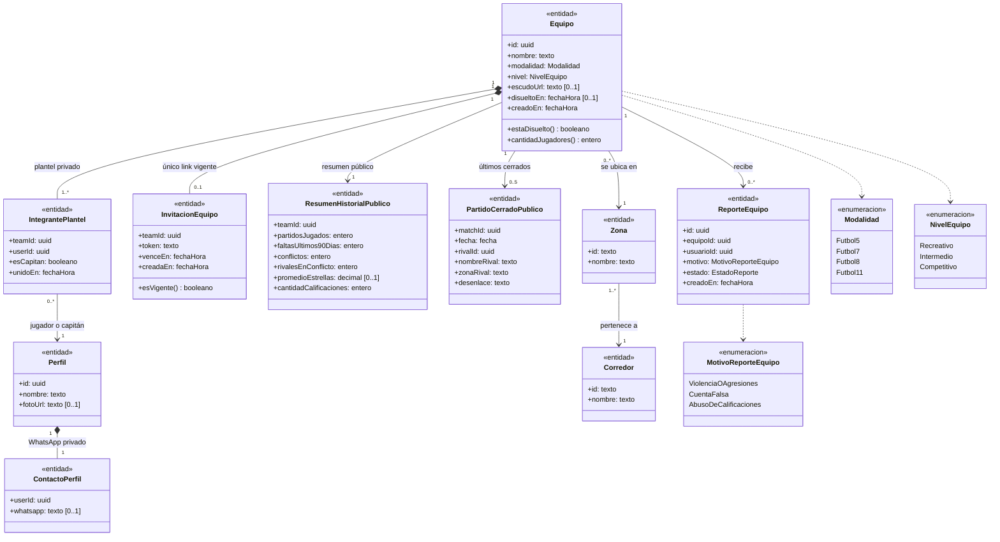

---

## Clases por caso de uso

### UC-C01 · Crear equipo

**Requerimientos:** `RF-C01` a `RF-C06`, `RF-C27` · **Pantalla:** [P1 · Crear equipo](../equipos/03-pantallas.md#p1--crear-equipo) (`/crear-equipo`) · **Secuencia:** [S01 · Crear equipo](../equipos/04-diagramas-secuencia/uc-c01-crear-equipo.md)

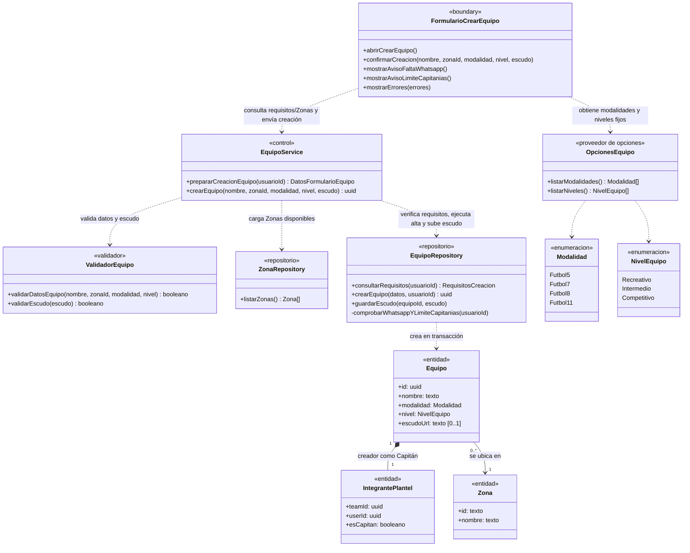

---

### UC-C02 · Invitar jugadores al equipo

**Requerimientos:** `RF-C07`, `RF-C25` · **Pantalla:** [P4 · Equipo, vista del Capitán](../equipos/03-pantallas.md#p4--equipo-vista-del-jugador-y-del-capitán) · **Secuencia:** [S02 · Invitar jugadores](../equipos/04-diagramas-secuencia/uc-c02-invitar-jugadores.md)

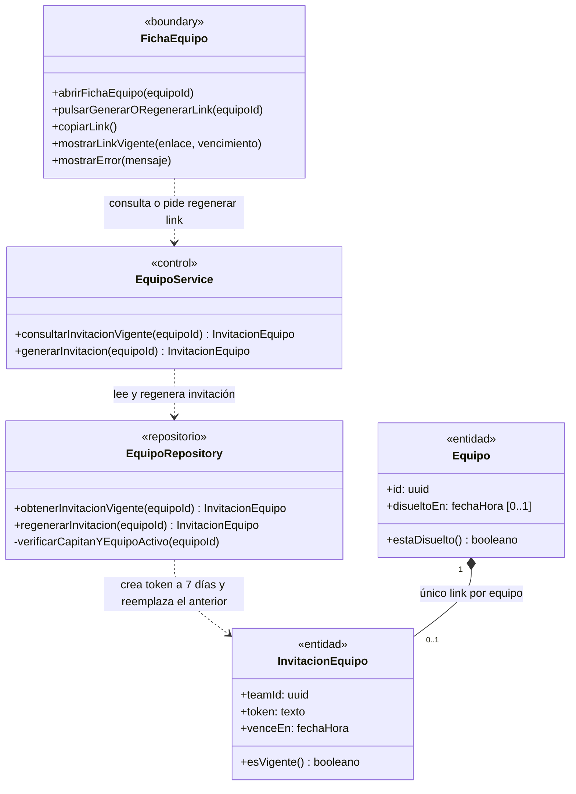

---

### UC-C03 · Unirse a un equipo con el link

**Requerimientos:** `RF-C08` a `RF-C10`, `RF-C27` · **Pantalla:** [P6 · Unirse al equipo](../equipos/03-pantallas.md#p6--unirse-al-equipo) (`/unirse/{token}`) · **Secuencia:** [S03 · Unirse al equipo](../equipos/04-diagramas-secuencia/uc-c03-unirse-al-equipo.md)

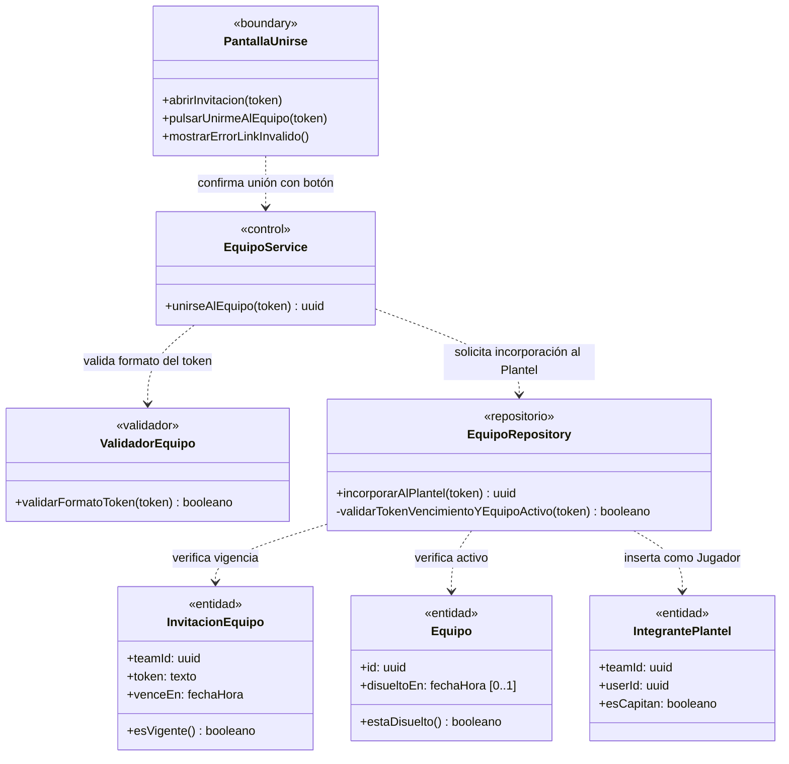

---

### UC-C04 · Ver la página pública del equipo

**Requerimientos:** `RF-C11` a `RF-C14`, `RF-C25` · **Pantallas:** [P3 · Vista pública](../equipos/03-pantallas.md#p3--equipo-vista-pública) y [P4 · Vista del Jugador y del Capitán](../equipos/03-pantallas.md#p4--equipo-vista-del-jugador-y-del-capitán) (`/equipos/{id}`) · **Secuencia:** [S04 · Ver la página del equipo](../equipos/04-diagramas-secuencia/uc-c04-ver-pagina-equipo.md)

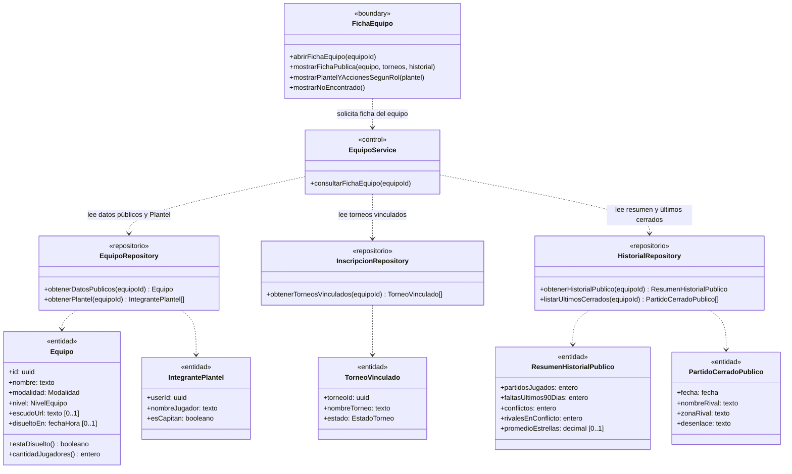

---

### UC-C05 · Editar equipo

**Requerimientos:** `RF-C01`, `RF-C02`, `RF-C16`, `RF-C25` · **Pantalla:** [P5 · Editar equipo](../equipos/03-pantallas.md#p5--editar-equipo) (`/equipos/{id}/editar`) · **Secuencia:** [S05 · Editar equipo](../equipos/04-diagramas-secuencia/uc-c05-editar-equipo.md)

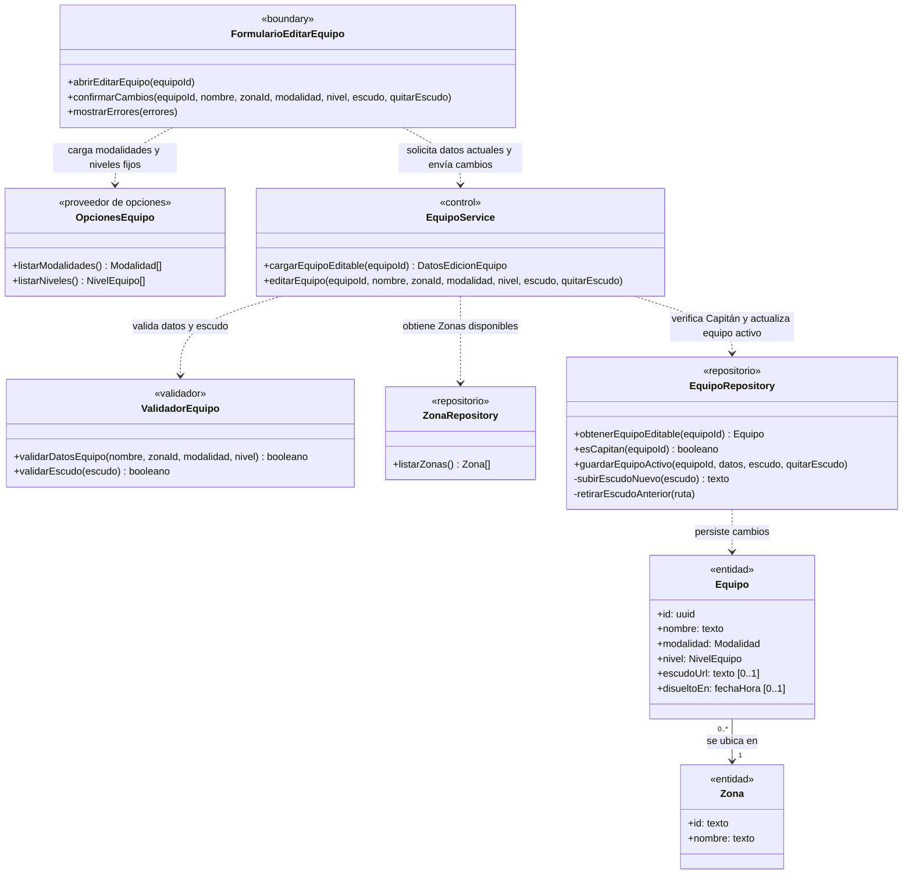

---

### UC-C06 · Pasar la capitanía

**Requerimientos:** `RF-C05`, `RF-C17`, `RF-C20`, `RF-C21`, `RF-C27` · **Pantalla:** [P4 · Equipo, vista del Capitán](../equipos/03-pantallas.md#p4--equipo-vista-del-jugador-y-del-capitán) · **Secuencia:** [S06 · Pasar la capitanía](../equipos/04-diagramas-secuencia/uc-c06-pasar-capitania.md)

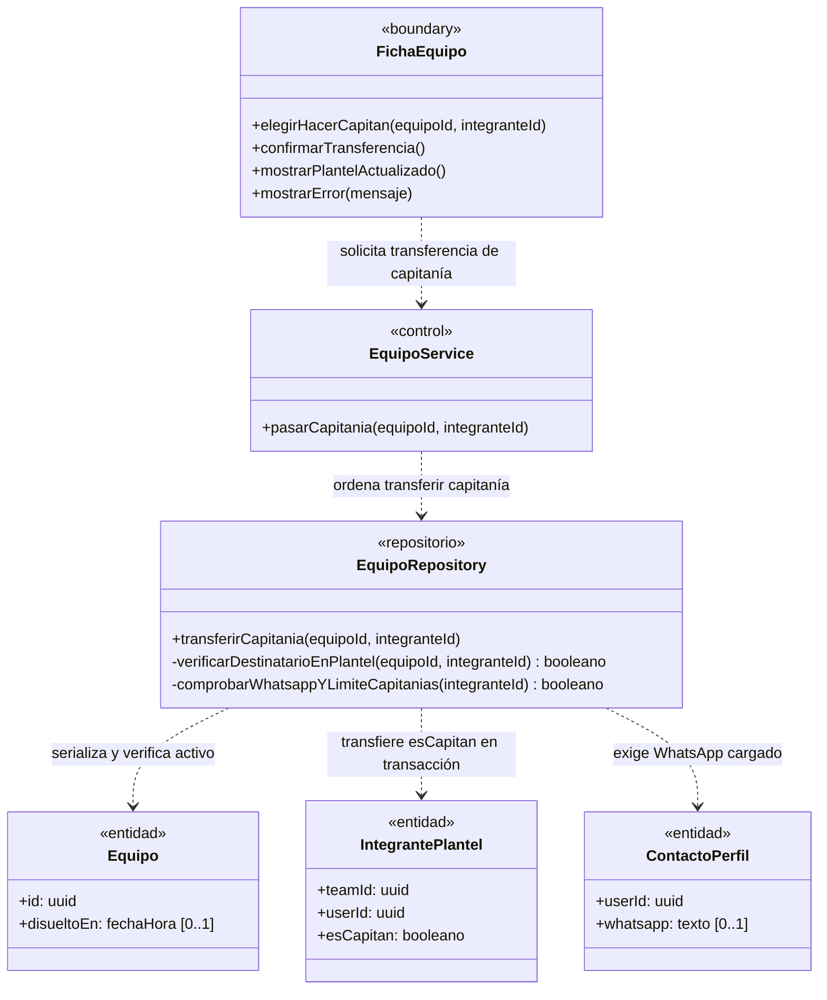

---

### UC-C07 · Sacar a un jugador del plantel

**Requerimientos:** `RF-C18`, `RF-C20`, `RF-C21`, `RF-C25` · **Pantalla:** [P4 · Equipo, vista del Capitán](../equipos/03-pantallas.md#p4--equipo-vista-del-jugador-y-del-capitán) · **Secuencia:** [S07 · Sacar a un jugador](../equipos/04-diagramas-secuencia/uc-c07-sacar-jugador.md)

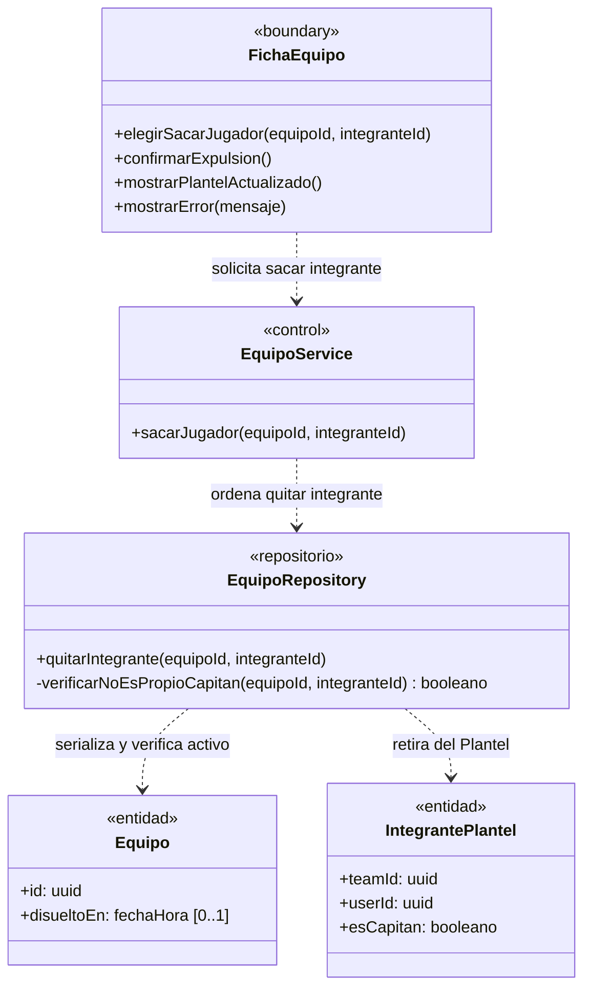

---

### UC-C08 · Salir del equipo

**Requerimientos:** `RF-C19` a `RF-C21`, `RF-C25` · **Pantalla:** [P4 · Equipo, vista del Jugador](../equipos/03-pantallas.md#p4--equipo-vista-del-jugador-y-del-capitán) · **Secuencia:** [S08 · Salir del equipo](../equipos/04-diagramas-secuencia/uc-c08-salir-del-equipo.md)

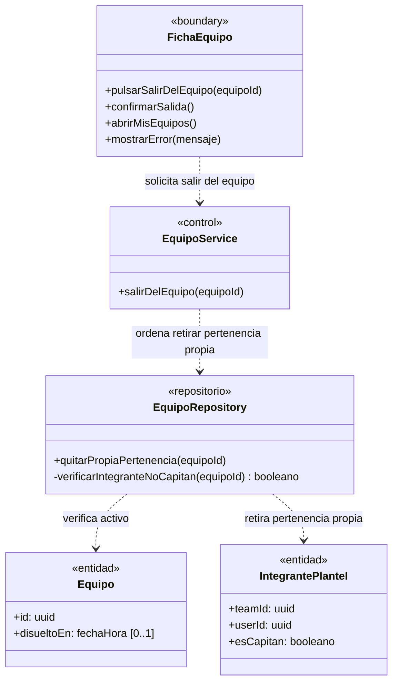

---

### UC-C09 · Disolver equipo

**Requerimientos:** `RF-C22` a `RF-C25` · **Pantalla:** [P4 · Equipo, vista del Capitán](../equipos/03-pantallas.md#p4--equipo-vista-del-jugador-y-del-capitán) · **Secuencia:** [S09 · Disolver equipo](../equipos/04-diagramas-secuencia/uc-c09-disolver-equipo.md)

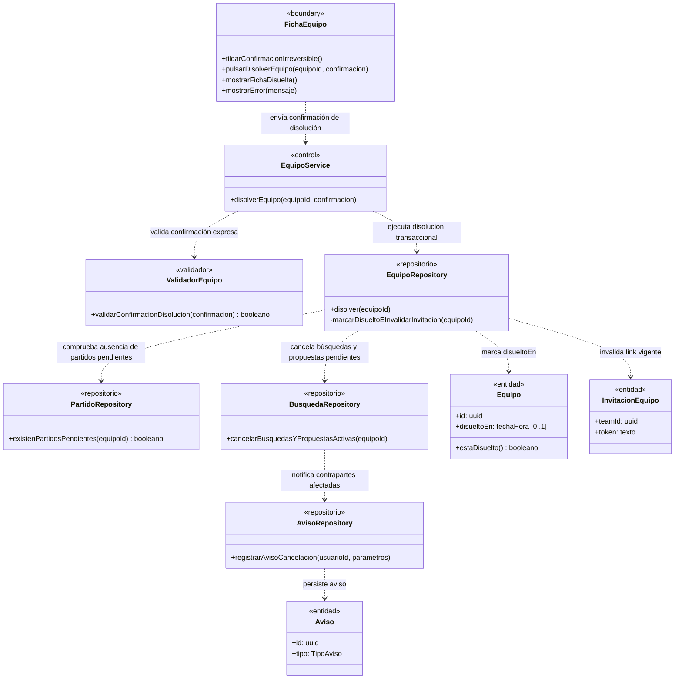

---

### UC-C10 · Reportar un equipo

**Requerimientos:** `RF-C26` · **Pantalla:** [P3 · Equipo, vista pública](../equipos/03-pantallas.md#p3--equipo-vista-pública) · **Secuencia:** [S10 · Reportar un equipo](../equipos/04-diagramas-secuencia/uc-c10-reportar-equipo.md)

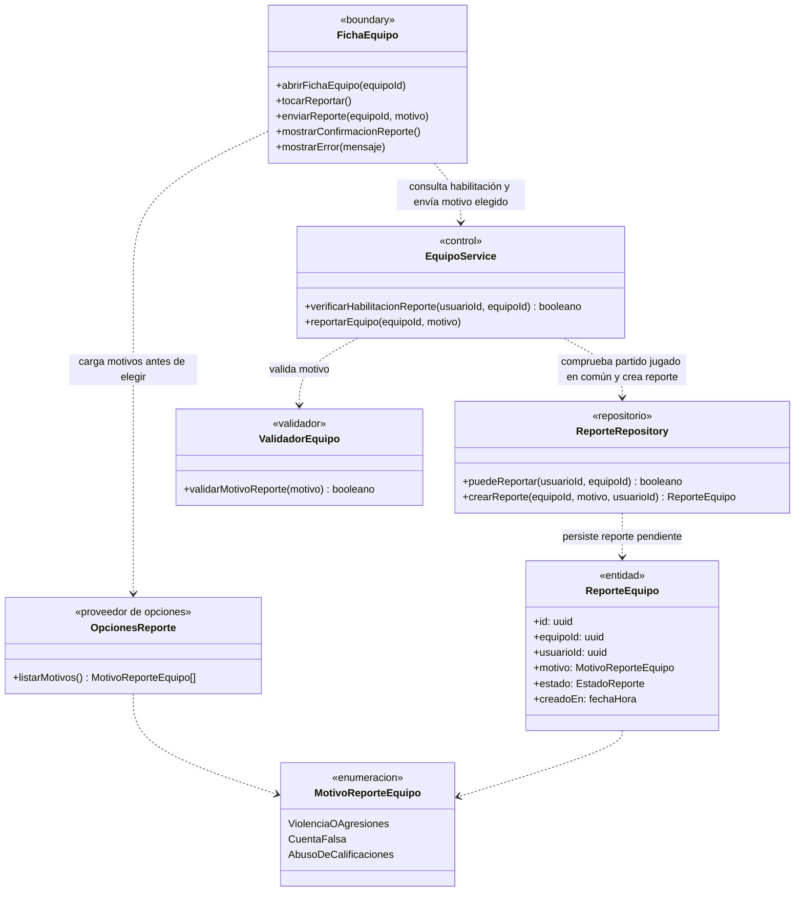

---

## Trazabilidad

| Clase | Estereotipo | Implementación en el repo | Estado |
|---|---|---|---|
| `FormularioCrearEquipo` / `FormularioEditarEquipo` | `«boundary»` | `src/app/crear-equipo/page.tsx`, `src/app/equipos/[id]/editar/page.tsx`, `src/components/TeamForm.tsx` | Implementadas |
| `FichaEquipo` | `«boundary»` | `src/app/equipos/[id]/page.tsx`, `CopyLinkButton.tsx`, `ConfirmButton.tsx` | Implementada |
| `PantallaUnirse` | `«boundary»` | `src/app/unirse/[token]/page.tsx` | Implementada |
| `OpcionesEquipo` | `«proveedor de opciones»` | `SPORT_MODALITIES` (`src/utils/modality.ts`) y `TEAM_LEVELS` (`src/utils/teams.ts`) | Implementado |
| `OpcionesReporte` | `«proveedor de opciones»` | — (diseño objetivo de UC-C10) | **Pendiente** |
| `EquipoService` | `«control»` | Server Actions en `src/app/crear-equipo/actions.ts`, `src/app/equipos/[id]/actions.ts`, `src/app/unirse/[token]/actions.ts` | Implementado (falta UC-C10) |
| `ValidadorEquipo` | `«validador»` | `parseTeamForm` (`src/utils/team-form.ts`), `parseCrest` (`src/utils/team-crest.ts`) | Implementado |
| `ZonaRepository` | `«repositorio»` | `getZoneGroups()` en `src/components/ZoneSelect.tsx` (`public.zones`, `corridors`, `regions`) | Implementado |
| `EquipoRepository` | `«repositorio»` | Tablas `public.teams`, `team_members`, `team_invites`; funciones `create_team`, `join_team`, `leave_team`, `remove_team_member`, `transfer_captaincy`, `regenerate_team_invite`, `get_team_invite`, `dissolve_team`, `is_team_captain`; `saveTeam` (`src/utils/supabase/team.ts`) y bucket `team-crests` | Implementado |
| `InscripcionRepository` | `«repositorio»` | Vista pública `public.tournament_inscriptions` + `public.tournaments` | Implementado |
| `HistorialRepository` | `«repositorio»` | Vistas `public.team_record` y `public.team_match_history` (`20261028000012_team_history.sql`) | Implementado |
| `PartidoRepository` / `BusquedaRepository` / `AvisoRepository` | `«repositorio»` | Consultados dentro de `dissolve_team` (`20261028000006_matches.sql`: `matches`, `match_phase`, `rival_searches`, `cancel_proposals`, `notices`) | Implementados |
| `ReporteRepository` | `«repositorio»` | — (diseño objetivo de UC-C10) | **Pendiente** |
| `Equipo` / `IntegrantePlantel` / `InvitacionEquipo` | `«entidad»` | `public.teams`, `public.team_members`, `public.team_invites` | Implementadas |
| `ResumenHistorialPublico` / `PartidoCerradoPublico` / `ReporteEquipo` | `«entidad»` | Vistas `public.team_record` y `public.team_match_history` | Implementadas (salvo `ReporteEquipo`) |
