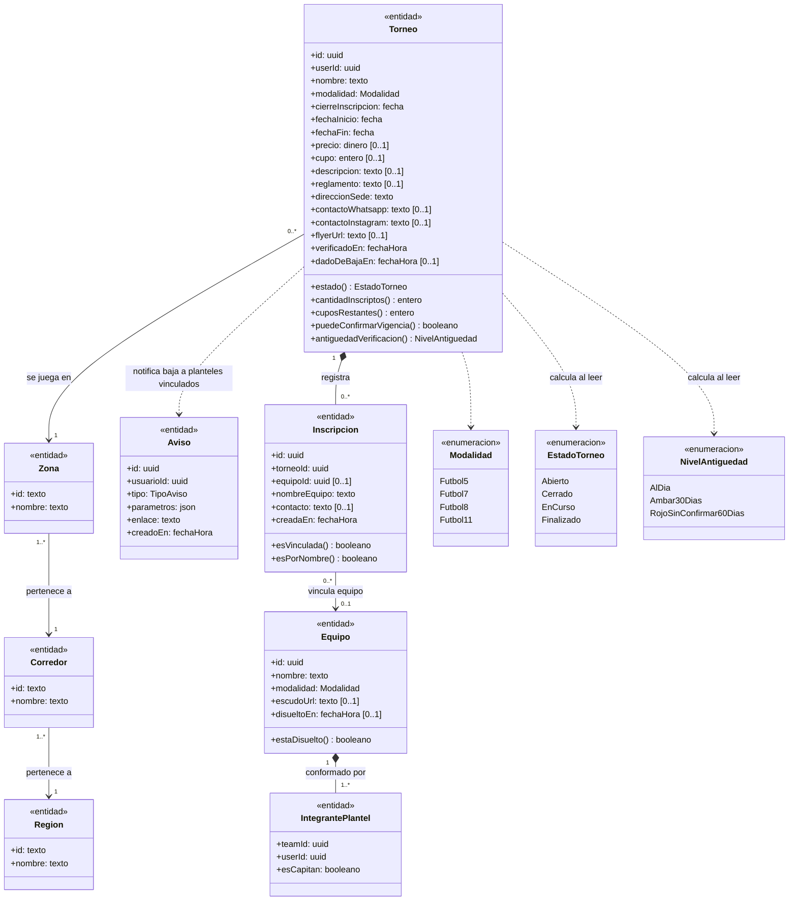
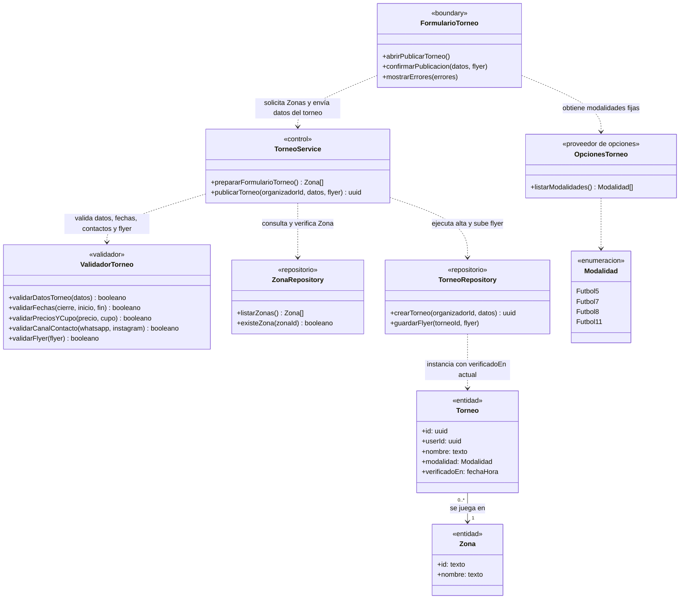
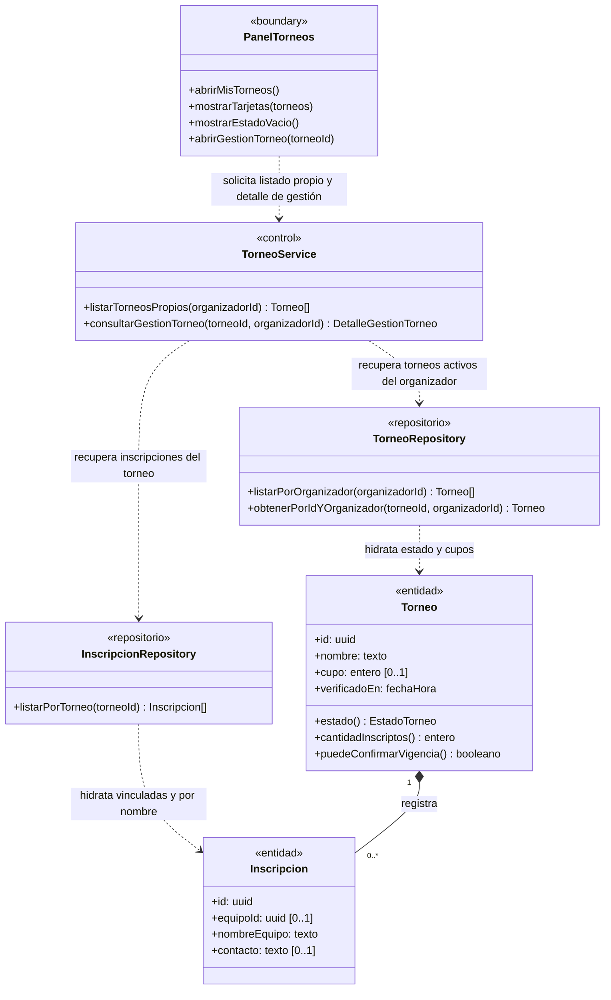
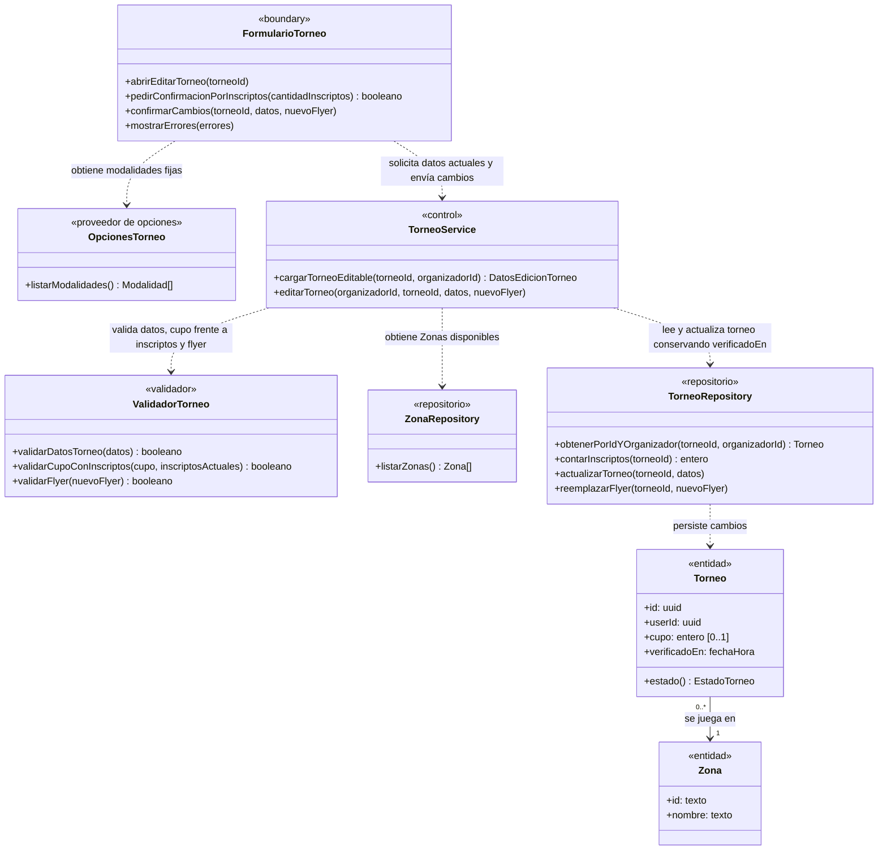
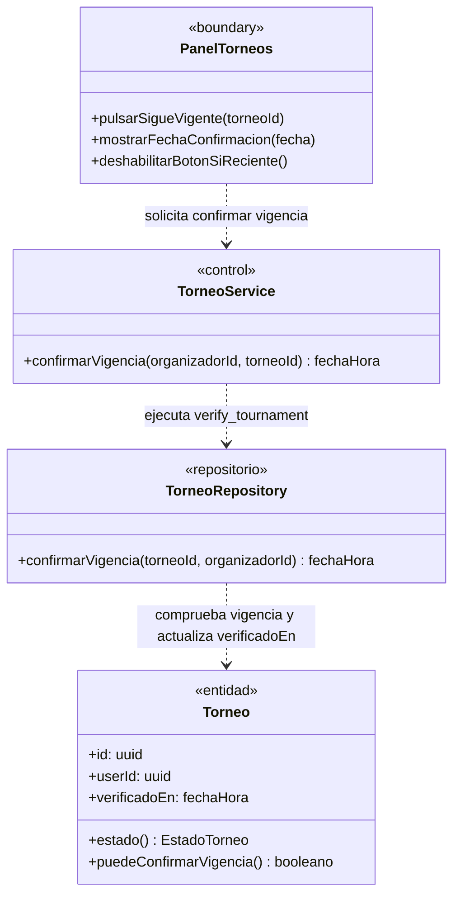
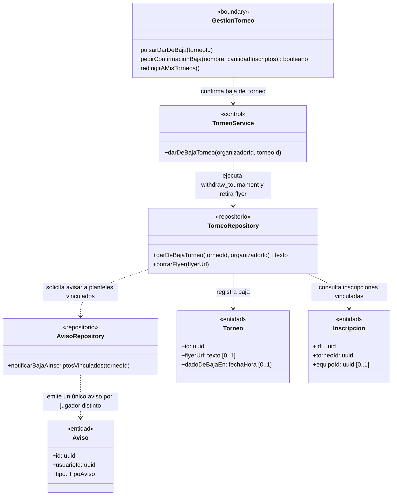
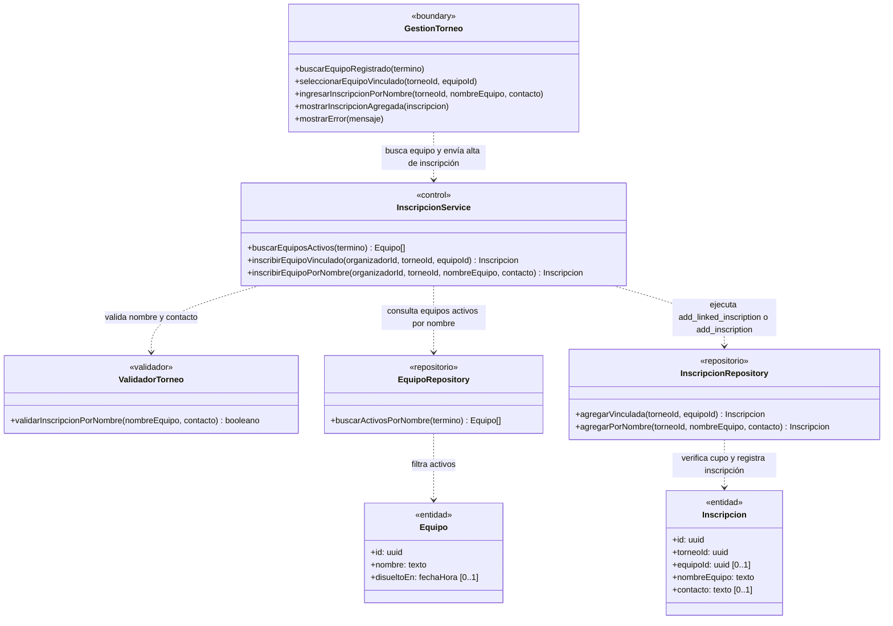
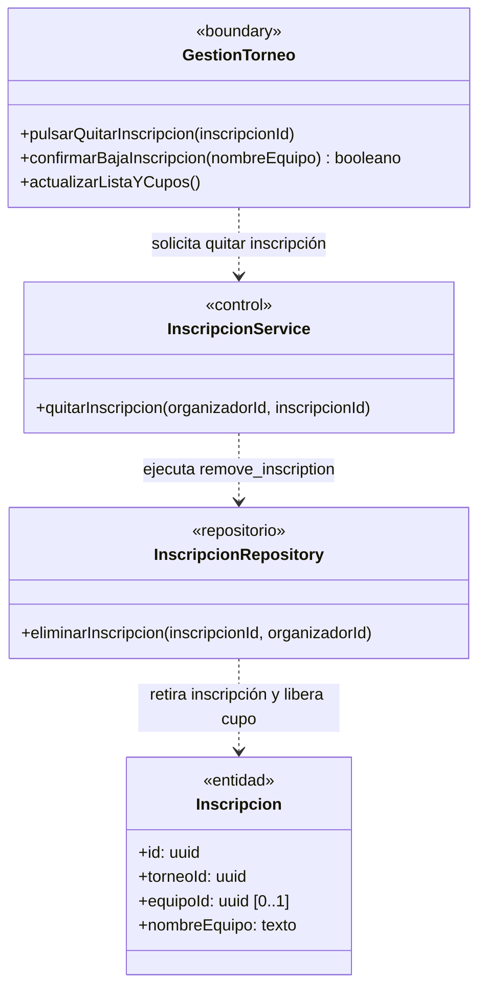

# Módulo E — Organizador

> Documenta las clases de dominio y de diseño que participan en el **Módulo E — Organizador** (`UC-E01` a `UC-E07`).
> Fuentes del módulo: [01-requerimientos.md](../organizador/01-requerimientos.md) · [02-casos-de-uso.md](../organizador/02-casos-de-uso.md) · [03-pantallas.md](../organizador/03-pantallas.md) · [04-diagramas-secuencia/](../organizador/04-diagramas-secuencia/README.md). Convenciones en el [README](README.md).

---

## Modelo de dominio del módulo

Vista estructural de las entidades y enumeraciones que sostienen la publicación y gestión de torneos e inscripciones por parte del Organizador (`UC-E01` a `UC-E07`).

---

## Clases por caso de uso

### UC-E01 · Publicar un torneo

**Requerimientos:** `RF-E01`, `RF-E02`, `RNF-E01` · **Pantalla:** [P-E01 · Publicar torneo](../organizador/03-pantallas.md) (`/crear-torneo`) · **Secuencia:** [`uc-e01-publicar-torneo.md`](../organizador/04-diagramas-secuencia/uc-e01-publicar-torneo.md)

---

### UC-E02 · Ver mis torneos

**Requerimientos:** `RF-E03`, `RF-E04` · **Pantallas:** [P-E02 · Mis torneos](../organizador/03-pantallas.md) (`/mis-torneos`) y [P-E04 · Gestión del torneo](../organizador/03-pantallas.md) (`/mis-torneos/[id]`) · **Secuencia:** [`uc-e02-ver-mis-torneos.md`](../organizador/04-diagramas-secuencia/uc-e02-ver-mis-torneos.md)

---

### UC-E03 · Editar un torneo

**Requerimientos:** `RF-E05`, `RF-E06`, `RNF-E01` · **Pantalla:** [P-E03 · Editar torneo](../organizador/03-pantallas.md) (`/mis-torneos/[id]/editar`) · **Secuencia:** [`uc-e03-editar-torneo.md`](../organizador/04-diagramas-secuencia/uc-e03-editar-torneo.md)

---

### UC-E04 · Verificar que el torneo sigue vigente

**Requerimientos:** `RF-E06`, `RNF-E01` · **Pantallas:** [P-E02 · Mis torneos](../organizador/03-pantallas.md) y [P-E04 · Gestión del torneo](../organizador/03-pantallas.md) · **Secuencia:** [`uc-e04-verificar-torneo.md`](../organizador/04-diagramas-secuencia/uc-e04-verificar-torneo.md)

---

### UC-E05 · Dar de baja un torneo

**Requerimientos:** `RF-E07`, `RNF-E01` · **Pantallas:** [P-E02 · Mis torneos](../organizador/03-pantallas.md) y [P-E04 · Gestión del torneo](../organizador/03-pantallas.md) · **Secuencia:** [`uc-e05-dar-de-baja-torneo.md`](../organizador/04-diagramas-secuencia/uc-e05-dar-de-baja-torneo.md)

---

### UC-E06 · Cargar una inscripción

**Requerimientos:** `RF-E08`, `RF-E09`, `RF-E10`, `RNF-E01` · **Pantalla:** [P-E04 · Gestión del torneo](../organizador/03-pantallas.md) (`/mis-torneos/[id]`) · **Secuencia:** [`uc-e06-cargar-inscripcion.md`](../organizador/04-diagramas-secuencia/uc-e06-cargar-inscripcion.md)

---

### UC-E07 · Dar de baja una inscripción

**Requerimientos:** `RF-E11`, `RNF-E01` · **Pantalla:** [P-E04 · Gestión del torneo](../organizador/03-pantallas.md) (`/mis-torneos/[id]`) · **Secuencia:** [`uc-e07-dar-de-baja-inscripcion.md`](../organizador/04-diagramas-secuencia/uc-e07-dar-de-baja-inscripcion.md)

---

## Trazabilidad

| Clase | Estereotipo | Implementación en el repo | Estado |
|---|---|---|---|
| `FormularioTorneo` | `«boundary»` | `src/app/crear-torneo/page.tsx`, `src/app/mis-torneos/[id]/editar/page.tsx`, `src/components/TournamentForm.tsx` | Implementada |
| `PanelTorneos` / `GestionTorneo` | `«boundary»` | `src/app/mis-torneos/page.tsx`, `src/app/mis-torneos/[id]/page.tsx` | Implementadas |
| `OpcionesTorneo` | `«proveedor de opciones»` | `SPORT_MODALITIES` (`src/utils/modality.ts`) | Implementado |
| `TorneoService` / `InscripcionService` | `«control»` | Server Actions en `src/app/crear-torneo/actions.ts`, `src/app/mis-torneos/actions.ts`, `src/app/mis-torneos/[id]/actions.ts` | Implementados |
| `ValidadorTorneo` | `«validador»` | `parseTournamentForm` (`src/utils/tournament-form.ts`), `parseFlyer` (`src/utils/tournament-flyer.ts`), `parseInscription` (`src/utils/inscriptions.ts`) | Implementado |
| `ZonaRepository` | `«repositorio»` | `getZoneGroups()` en `src/components/ZoneSelect.tsx` (`public.zones`, `corridors`, `regions`) | Implementado |
| `TorneoRepository` | `«repositorio»` | Tabla `public.tournaments`, funciones `verify_tournament`, `withdraw_tournament`, `saveTournament` (`src/utils/supabase/tournament.ts`), bucket `flyers` | Implementado |
| `InscripcionRepository` / `EquipoRepository` | `«repositorio»` | Tabla `public.inscriptions`, funciones `add_inscription`, `add_linked_inscription`, `remove_inscription`, búsqueda sobre `public.teams` | Implementados |
| `AvisoRepository` | `«repositorio»` | Emisión de avisos en `withdraw_tournament` (`public.notices`, `20261028000003_tournament_withdraw_notices.sql`) | Implementado |
| `Torneo` / `Inscripcion` / `Equipo` / `Aviso` | `«entidad»` | `public.tournaments`, `public.inscriptions`, `public.teams`, `public.notices` | Implementadas |
