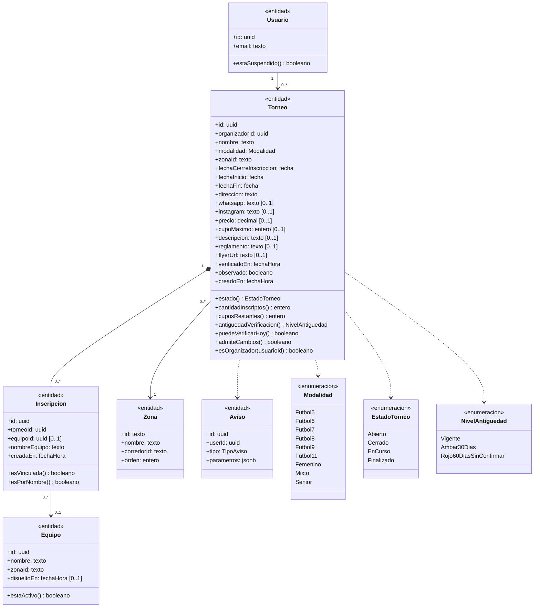
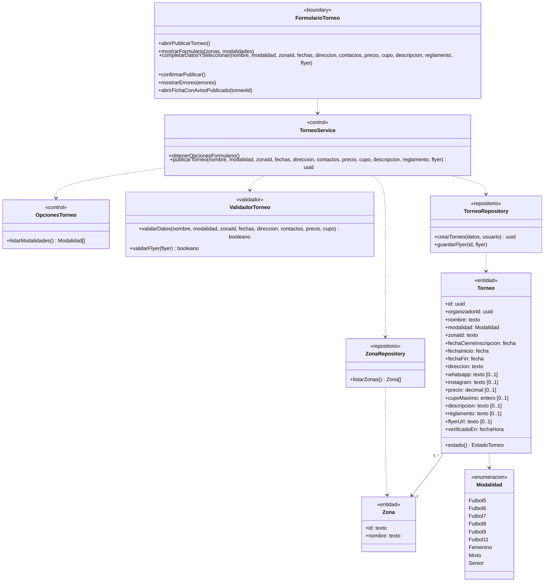
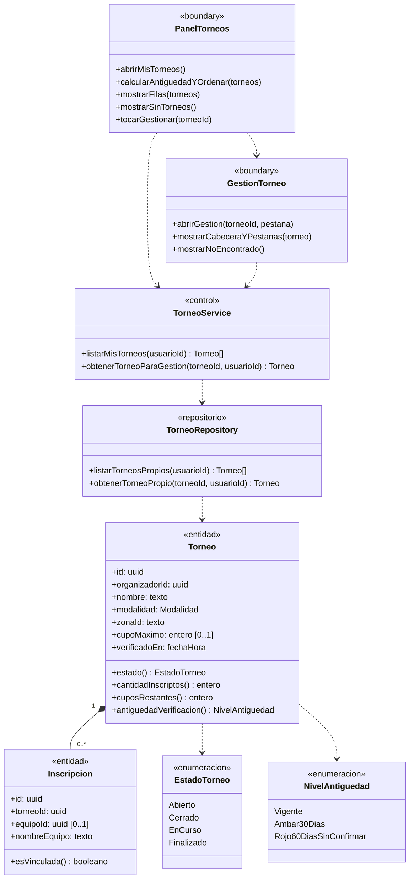
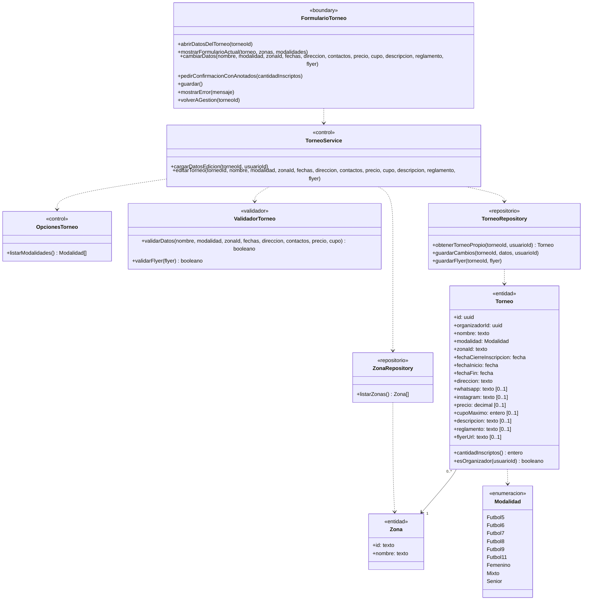
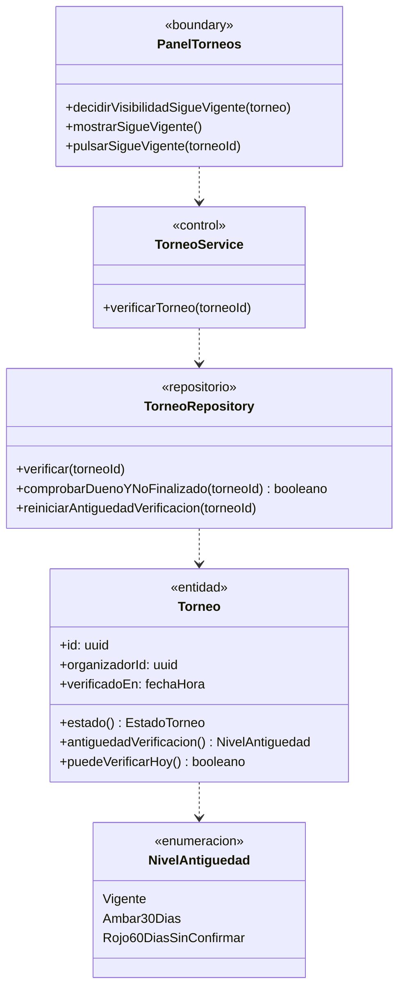
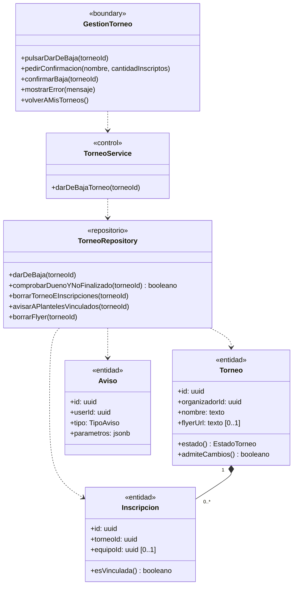
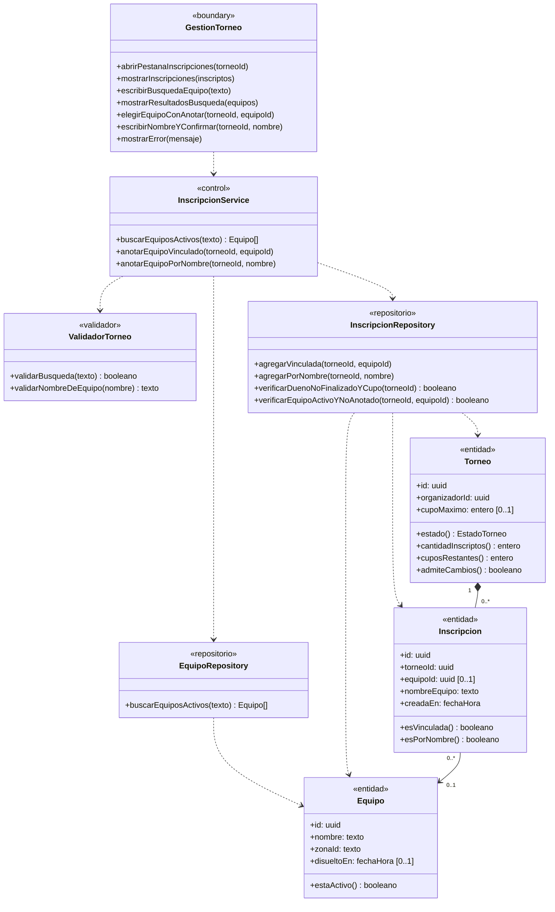
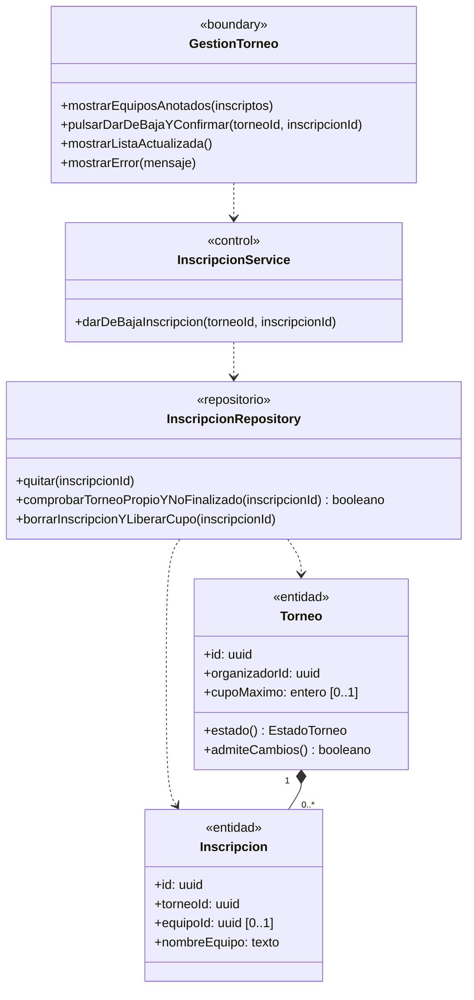

# Módulo E — Organizador

> Documenta las clases de dominio y de diseño que participan en el **Módulo E — Organizador** (`UC-E01` a `UC-E07`).
> Fuentes del módulo: [01-requerimientos.md](../organizador/01-requerimientos.md) · [02-casos-de-uso.md](../organizador/02-casos-de-uso.md) · [03-pantallas.md](../organizador/03-pantallas.md) · [04-diagramas-secuencia/](../organizador/04-diagramas-secuencia/README.md). Convenciones en el [README](README.md).

---

## Modelo de dominio del módulo

Vista estructural de las entidades, relaciones de composición/asociación y enumeraciones que comparten los casos de uso `UC-E01` a `UC-E07`.

---

## Clases por caso de uso

### UC-E01 · Publicar un torneo

> Especificación: [UC-E01](../organizador/02-casos-de-uso.md#uc-e01--publicar-un-torneo) · Pantalla: [P2 · Publicar torneo](../organizador/03-pantallas.md#p2--publicar-torneo) · Secuencia: [S01 · Publicar torneo](../organizador/04-diagramas-secuencia/uc-e01-publicar-torneo.md)

---

### UC-E02 · Ver mis torneos (Panel de organizador)

> Especificación: [UC-E02](../organizador/02-casos-de-uso.md#uc-e02--ver-mis-torneos-panel-de-organizador) · Pantallas: [P1 · Mis torneos](../organizador/03-pantallas.md#p1--mis-torneos) y [P3 · Gestión del torneo](../organizador/03-pantallas.md#p3--gestión-del-torneo) · Secuencia: [S02 · Ver mis torneos](../organizador/04-diagramas-secuencia/uc-e02-ver-mis-torneos.md)

---

### UC-E03 · Editar un torneo

> Especificación: [UC-E03](../organizador/02-casos-de-uso.md#uc-e03--editar-un-torneo) · Pantalla: [P3 · Gestión del torneo](../organizador/03-pantallas.md#p3--gestión-del-torneo) · Secuencia: [S03 · Editar torneo](../organizador/04-diagramas-secuencia/uc-e03-editar-torneo.md)

---

### UC-E04 · Verificar que el torneo sigue vigente

> Especificación: [UC-E04](../organizador/02-casos-de-uso.md#uc-e04--verificar-que-el-torneo-sigue-vigente) · Pantallas: [P1 · Mis torneos](../organizador/03-pantallas.md#p1--mis-torneos) y [P3 · Gestión del torneo](../organizador/03-pantallas.md#p3--gestión-del-torneo) · Secuencia: [S04 · Verificar torneo](../organizador/04-diagramas-secuencia/uc-e04-verificar-torneo.md)

---

### UC-E05 · Dar de baja un torneo

> Especificación: [UC-E05](../organizador/02-casos-de-uso.md#uc-e05--dar-de-baja-un-torneo) · Pantalla: [P3 · Gestión del torneo](../organizador/03-pantallas.md#p3--gestión-del-torneo) · Secuencia: [S05 · Dar de baja torneo](../organizador/04-diagramas-secuencia/uc-e05-dar-de-baja-torneo.md)

---

### UC-E06 · Cargar una inscripción

> Especificación: [UC-E06](../organizador/02-casos-de-uso.md#uc-e06--cargar-una-inscripción) · Pantalla: [P3 · Gestión del torneo](../organizador/03-pantallas.md#p3--gestión-del-torneo) · Secuencia: [S06 · Cargar inscripción](../organizador/04-diagramas-secuencia/uc-e06-cargar-inscripcion.md)

---

### UC-E07 · Dar de baja una inscripción

> Especificación: [UC-E07](../organizador/02-casos-de-uso.md#uc-e07--dar-de-baja-una-inscripción) · Pantalla: [P3 · Gestión del torneo](../organizador/03-pantallas.md#p3--gestión-del-torneo) · Secuencia: [S07 · Dar de baja inscripción](../organizador/04-diagramas-secuencia/uc-e07-dar-de-baja-inscripcion.md)

---

## Trazabilidad

| Clase | Estereotipo | Implementación en el repo | Estado |
|---|---|---|---|
| `FormularioTorneo` | `«boundary»` | `src/components/TournamentForm.tsx` en `src/app/crear-torneo/page.tsx` y `src/app/mis-torneos/[id]/DatosTab.tsx` | Implementada |
| `PanelTorneos` | `«boundary»` | `src/app/mis-torneos/page.tsx` + `src/components/VerifyButton.tsx` | Implementada |
| `GestionTorneo` | `«boundary»` | `src/app/mis-torneos/[id]/page.tsx`, `DatosTab.tsx`, `InscripcionesTab.tsx`, `TeamSearch.tsx`, `WithdrawButton.tsx` | Implementada |
| `TorneoService` / `InscripcionService` / `OpcionesTorneo` | `«control»` | Server Actions en `src/app/crear-torneo/actions.ts`, `src/app/mis-torneos/actions.ts`, `src/app/mis-torneos/[id]/editar/actions.ts`, `inscripciones/actions.ts` y `SPORT_MODALITIES` (`src/utils/modality.ts`) | Implementados |
| `ValidadorTorneo` | `«validador»` | `parseTournamentForm`, `parseFlyer` (`src/utils/tournament-form.ts`), `parseTeamName`, `parseTeamQuery` (`src/utils/inscriptions.ts`) | Implementado |
| `ZonaRepository` | `«repositorio»` | `getZoneGroups()` en `src/components/ZoneSelect.tsx` (`public.zones`, `corridors`, `regions`) | Implementado |
| `TorneoRepository` | `«repositorio»` | Tabla `public.tournaments` con RLS, funciones `verify_tournament` y `withdraw_tournament` (`20261028000016`), bucket `flyers` (`src/utils/supabase/flyer.ts`) | Implementado |
| `InscripcionRepository` | `«repositorio»` | Tabla `public.inscriptions`, funciones `add_inscription`, `add_linked_inscription`, `remove_inscription` (`20261001000000_inscriptions.sql`, `20261028000002_teams.sql`) | Implementado |
| `EquipoRepository` | `«repositorio»` | Tabla `public.teams` (búsqueda de equipos activos por nombre) | Implementado |
| `Torneo` / `Inscripcion` / `Equipo` / `Zona` / `Aviso` | `«entidad»` | `tournaments`, `inscriptions`, `teams`, `zones`, `notices` | Implementadas |
