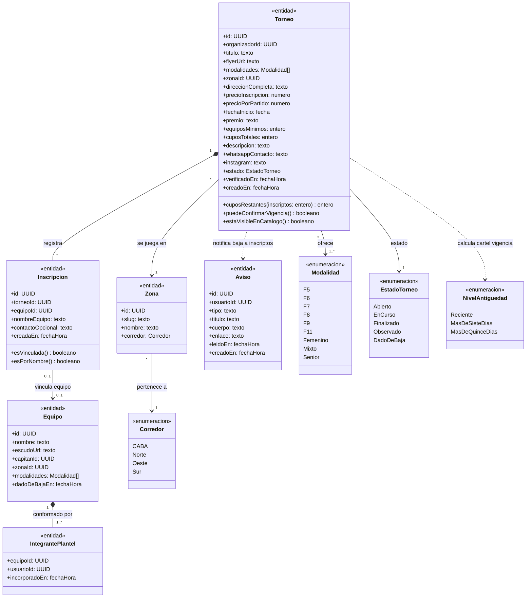
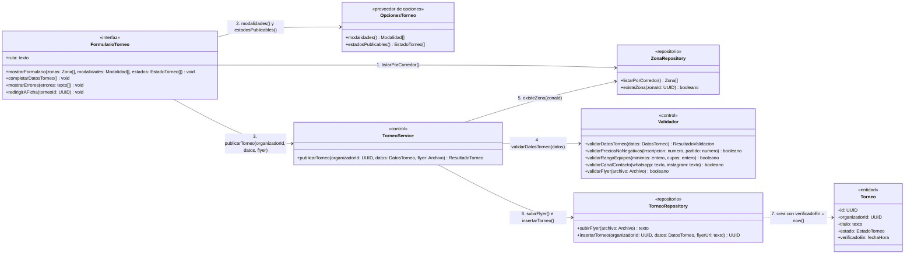
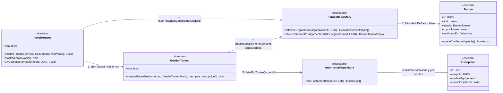
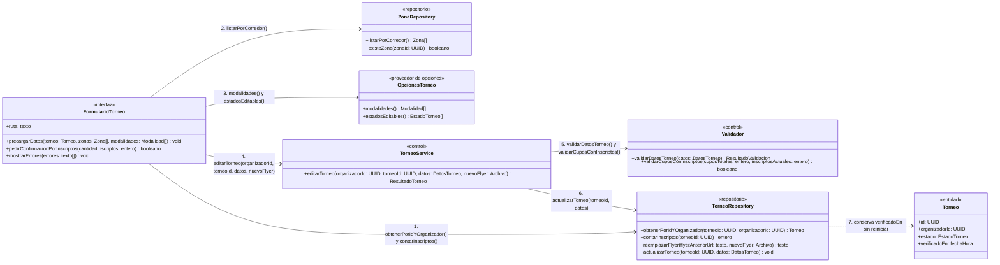
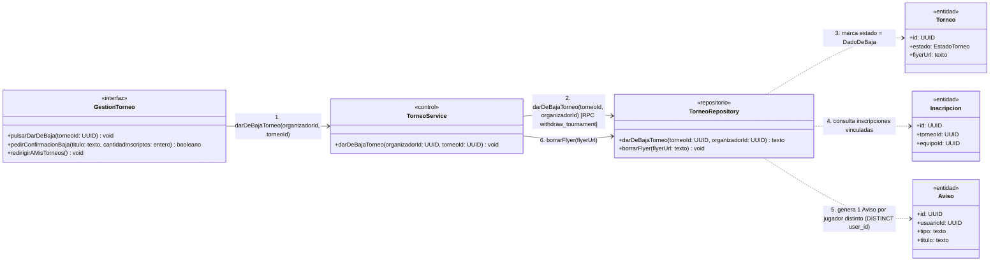
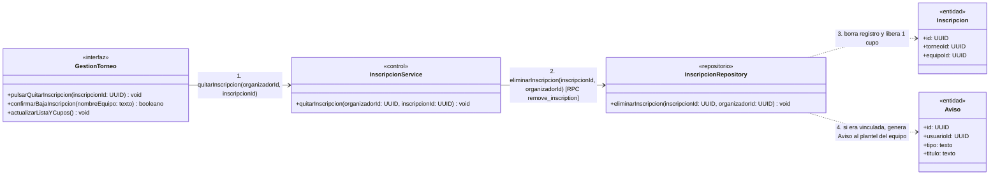

# Diagramas de clases — Organizador

> Documenta las clases que participan en el **Módulo E — Organizador** (`UC-E01` a `UC-E07`).
> Se alinea con [01-requerimientos.md](../organizador/01-requerimientos.md), [02-casos-de-uso.md](../organizador/02-casos-de-uso.md), [03-pantallas.md](../organizador/03-pantallas.md) y los diagramas de secuencia en [`04-diagramas-secuencia/`](../organizador/04-diagramas-secuencia/README.md).
> Todos los términos provienen de [`CONTEXT.md`](../../CONTEXT.md).

---

## Modelo de dominio del módulo

Vista estructural de las entidades y enumeraciones que sostienen la publicación y gestión de torneos e inscripciones por parte del Organizador.

---

## Clases por caso de uso

### UC-E01 — Publicar un torneo

**Requerimientos:** `RF-E01`, `RF-E02`, `RNF-E01` · **Pantalla:** `P-E01` (`/crear-torneo`) · **Secuencia:** [`uc-e01-publicar-torneo.md`](../organizador/04-diagramas-secuencia/uc-e01-publicar-torneo.md)

- **Reglas de negocio:** Cualquier usuario con sesión activa no suspendida puede publicar torneos como Organizador (`tournaments.user_id` obligatorio). Al menos uno de `whatsappContacto` o `instagram` es obligatorio. Si se informan ambos, `equiposMinimos <= cuposTotales`. Al publicarse, `verificadoEn` toma la fecha de creación.

---

### UC-E02 — Ver mis torneos

**Requerimientos:** `RF-E03`, `RF-E04` · **Pantallas:** `P-E02` (`/mis-torneos`), `P-E04` (`/mis-torneos/[id]`) · **Secuencia:** [`uc-e02-ver-mis-torneos.md`](../organizador/04-diagramas-secuencia/uc-e02-ver-mis-torneos.md)

- **Reglas de negocio:** Lista los torneos propios que no fueron dados de baja, incluyendo los marcados como `Observado` (con aviso visible del motivo). Muestra título, zona, modalidades, estado, inscriptos sobre cupos totales y última fecha de confirmación de vigencia.

---

### UC-E03 — Editar un torneo

**Requerimientos:** `RF-E05`, `RF-E06`, `RNF-E01` · **Pantalla:** `P-E03` (`/mis-torneos/[id]/editar`) · **Secuencia:** [`uc-e03-editar-torneo.md`](../organizador/04-diagramas-secuencia/uc-e03-editar-torneo.md)

- **Reglas de negocio:** Si el torneo ya tiene equipos inscriptos, pide confirmación antes de guardar («Este torneo tiene X equipos inscriptos, ¿confirmás los cambios?») y no permite fijar `cuposTotales` por debajo de los inscriptos actuales. Editar el torneo **no** reinicia `verificadoEn` (`RF-E06`).

---

### UC-E04 — Verificar que el torneo sigue vigente

**Requerimientos:** `RF-E06`, `RNF-E01` · **Pantallas:** `P-E02` (`/mis-torneos`), `P-E04` (`/mis-torneos/[id]`) · **Secuencia:** [`uc-e04-verificar-vigencia.md`](../organizador/04-diagramas-secuencia/uc-e04-verificar-vigencia.md)

```mermaid
classDiagram
    direction LR

    class PanelTorneos {
        <<interfaz>>
        +pulsarSigueVigente(torneoId: UUID) void
        +mostrarFechaConfirmacion(fecha: fechaHora) void
        +deshabilitarBotonSiReciente() void
    }

    class TorneoService {
        <<control>>
        +confirmarVigencia(organizadorId: UUID, torneoId: UUID) ResultadoVigencia
    }

    class TorneoRepository {
        <<repositorio>>
        +confirmarVigencia(torneoId: UUID, organizadorId: UUID) fechaHora
    }

    class Torneo {
        <<entidad>>
        +id: UUID
        +organizadorId: UUID
        +estado: EstadoTorneo
        +verificadoEn: fechaHora
        +puedeConfirmarVigencia() booleano
    }

    PanelTorneos --> TorneoService : 1. confirmarVigencia(organizadorId, torneoId)
    TorneoService --> TorneoRepository : 2. confirmarVigencia(torneoId, organizadorId) [RPC verify_tournament]
    TorneoRepository ..> Torneo : 3. verifica estado != Finalizado y > 24 h, actualiza verificadoEn
    TorneoService --> PanelTorneos : 4. retorna nueva fecha de vigencia
```

- **Reglas de negocio:** Solo disponible en torneos `Abierto` o `En curso`, y como máximo una vez cada 24 horas por torneo. Actualiza `verificadoEn = now()`, volviendo el cartel de vigencia del catálogo al nivel verde (`Reciente`).

---

### UC-E05 — Dar de baja un torneo

**Requerimientos:** `RF-E07`, `RNF-E01` · **Pantallas:** `P-E02` (`/mis-torneos`), `P-E04` (`/mis-torneos/[id]`) · **Secuencia:** [`uc-e05-dar-de-baja-torneo.md`](../organizador/04-diagramas-secuencia/uc-e05-dar-de-baja-torneo.md)

- **Reglas de negocio:** El torneo deja de aparecer en el catálogo público y en «Mis torneos», y su flyer se borra del almacenamiento. Si tenía equipos con **Inscripción vinculada**, se envía un único **Aviso** a cada jugador distinto del plantel de esos equipos (si un usuario integra dos equipos inscriptos al mismo torneo, recibe un solo Aviso). Las inscripciones por nombre no generan Aviso.

---

### UC-E06 — Cargar una inscripción

**Requerimientos:** `RF-E08`, `RF-E09`, `RF-E10`, `RNF-E01` · **Pantalla:** `P-E04` (`/mis-torneos/[id]`) · **Secuencia:** [`uc-e06-cargar-inscripcion.md`](../organizador/04-diagramas-secuencia/uc-e06-cargar-inscripcion.md)

```mermaid
classDiagram
    direction LR

    class GestionTorneo {
        <<interfaz>>
        +ruta: texto
        +buscarEquipoRegistrado(texto: texto) void
        +seleccionarEquipo(equipoId: UUID) void
        +ingresarInscripcionPorNombre(nombreEquipo: texto, contacto: texto) void
        +mostrarInscripcionAgregada(inscripcion: Inscripcion) void
        +mostrarError(mensaje: texto) void
    }

    class EquipoRepository {
        <<repositorio>>
        +buscarActivosPorNombre(texto: texto) Equipo[]
    }

    class InscripcionService {
        <<control>>
        +inscribirEquipoVinculado(organizadorId: UUID, torneoId: UUID, equipoId: UUID) ResultadoInscripcion
        +inscribirEquipoPorNombre(organizadorId: UUID, torneoId: UUID, nombreEquipo: texto, contacto: texto) ResultadoInscripcion
    }

    class Validador {
        <<control>>
        +validarNombreEquipoInscripto(nombre: texto, contacto: texto) ResultadoValidacion
    }

    class InscripcionRepository {
        <<repositorio>>
        +agregarVinculada(torneoId: UUID, equipoId: UUID) Inscripcion
        +agregarPorNombre(torneoId: UUID, nombreEquipo: texto, contacto: texto) Inscripcion
    }

    class Inscripcion {
        <<entidad>>
        +id: UUID
        +torneoId: UUID
        +equipoId: UUID
        +nombreEquipo: texto
        +contactoOpcional: texto
    }

    class Aviso {
        <<entidad>>
        +id: UUID
        +usuarioId: UUID
        +tipo: texto
        +titulo: texto
    }

    GestionTorneo --> EquipoRepository : 1a. buscarActivosPorNombre(texto)
    GestionTorneo --> InscripcionService : 2a. inscribirEquipoVinculado(organizadorId, torneoId, equipoId)
    InscripcionService --> InscripcionRepository : 3a. agregarVinculada(torneoId, equipoId) [RPC add_linked_inscription]
    InscripcionRepository ..> Inscripcion : 4a. verifica cupo y unicidad, crea Inscripcion vinculada
    InscripcionRepository ..> Aviso : 5a. genera Aviso para todo el plantel del equipo
    GestionTorneo --> InscripcionService : 1b. inscribirEquipoPorNombre(organizadorId, torneoId, nombre, contacto)
    InscripcionService --> Validador : 2b. validarNombreEquipoInscripto(nombre, contacto)
    InscripcionService --> InscripcionRepository : 3b. agregarPorNombre(torneoId, nombre, contacto) [RPC add_inscription]
    InscripcionRepository ..> Inscripcion : 4b. verifica cupo y crea Inscripcion por nombre
```

- **Reglas de negocio:** La inscripción siempre se acuerda por fuera (WhatsApp/Instagram) y la registra manualmente el Organizador. Soporta dos variantes:
  1. **Inscripción vinculada** (`RF-E08`): vincula un `Equipo` registrado activo; no permite duplicar el mismo equipo en el torneo; envía un **Aviso** a todos los integrantes actuales del plantel y el torneo pasa a figurar en «Torneos jugados» de la ficha del equipo.
  2. **Inscripción por nombre** (`RF-E09`): anota nombre libre (2–60 caracteres) y contacto opcional para equipos no registrados en la plataforma.
  - En ambos casos descuenta un cupo y bloquea el alta si `cuposTotales` está completo (`RF-E10`).

---

### UC-E07 — Dar de baja una inscripción

**Requerimientos:** `RF-E11`, `RNF-E01` · **Pantalla:** `P-E04` (`/mis-torneos/[id]`) · **Secuencia:** [`uc-e07-dar-de-baja-inscripcion.md`](../organizador/04-diagramas-secuencia/uc-e07-dar-de-baja-inscripcion.md)

- **Reglas de negocio:** Libera el cupo inmediatamente. Si era una **Inscripción vinculada**, el torneo deja de figurar en la ficha del equipo y todos los integrantes del plantel reciben un **Aviso**.

---

## Trazabilidad

| Caso de uso | Requerimientos | Pantalla | Clases principales |
| --- | --- | --- | --- |
| `UC-E01` Publicar un torneo | `RF-E01`, `RF-E02`, `RNF-E01` | `P-E01` `/crear-torneo` | `FormularioTorneo`, `ZonaRepository`, `OpcionesTorneo`, `TorneoService`, `Validador`, `TorneoRepository`, `Torneo` |
| `UC-E02` Ver mis torneos | `RF-E03`, `RF-E04` | `P-E02` `/mis-torneos`, `P-E04` `/mis-torneos/[id]` | `PanelTorneos`, `GestionTorneo`, `TorneoRepository`, `InscripcionRepository`, `Torneo`, `Inscripcion` |
| `UC-E03` Editar un torneo | `RF-E05`, `RF-E06`, `RNF-E01` | `P-E03` `/mis-torneos/[id]/editar` | `FormularioTorneo`, `ZonaRepository`, `OpcionesTorneo`, `TorneoService`, `Validador`, `TorneoRepository`, `Torneo` |
| `UC-E04` Verificar que el torneo sigue vigente | `RF-E06`, `RNF-E01` | `P-E02`, `P-E04` | `PanelTorneos`, `TorneoService`, `TorneoRepository`, `Torneo` |
| `UC-E05` Dar de baja un torneo | `RF-E07`, `RNF-E01` | `P-E02`, `P-E04` | `GestionTorneo`, `TorneoService`, `TorneoRepository`, `Torneo`, `Inscripcion`, `Aviso` |
| `UC-E06` Cargar una inscripción | `RF-E08`, `RF-E09`, `RF-E10`, `RNF-E01` | `P-E04` `/mis-torneos/[id]` | `GestionTorneo`, `EquipoRepository`, `InscripcionService`, `Validador`, `InscripcionRepository`, `Inscripcion`, `Aviso` |
| `UC-E07` Dar de baja una inscripción | `RF-E11`, `RNF-E01` | `P-E04` `/mis-torneos/[id]` | `GestionTorneo`, `InscripcionService`, `InscripcionRepository`, `Inscripcion`, `Aviso` |
