# Diagramas de clases — Partidos

> Documenta las clases que participan en el **Módulo D — Partidos** (`UC-D01` a `UC-D14`).
> Se alinea con [01-requerimientos.md](../partidos/01-requerimientos.md), [02-casos-de-uso.md](../partidos/02-casos-de-uso.md), [03-pantallas.md](../partidos/03-pantallas.md) y los diagramas de secuencia en [`04-diagramas-secuencia/`](../partidos/04-diagramas-secuencia/README.md).
> Todos los términos provienen de [`CONTEXT.md`](../../CONTEXT.md).

---

## Modelo de dominio del módulo

Vista estructural de las entidades y enumeraciones involucradas en la **Búsqueda de rival**, el cruce de **Franjas**, las **Propuestas**, la máquina de estados del **Partido**, el presentismo (**Faltas** y **Bloqueo por faltas**) y la **Calificación** con revelación cruzada.

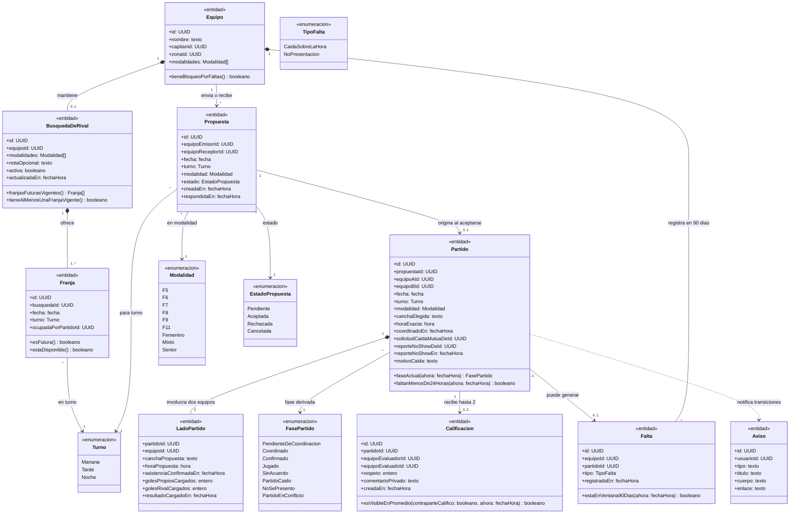

---

## Clases por caso de uso

### UC-D01 — Publicar una búsqueda de rival

**Requerimientos:** `RF-D01`, `RF-D02`, `RNF-D01` · **Pantalla:** `P-D01` (`/buscar-rival`) · **Secuencia:** [`uc-d01-publicar-busqueda-rival.md`](../partidos/04-diagramas-secuencia/uc-d01-publicar-busqueda-rival.md)

```mermaid
classDiagram
    direction LR

    class PantallaBuscarRival {
        <<interfaz>>
        +ruta: texto
        +seleccionarEquipoCapitan(equipoId: UUID) void
        +mostrarFormularioBusqueda(modalidadesEquipo: Modalidad[], turnos: Turno[]) void
        +guardarBusqueda(equipoId: UUID, modalidades: Modalidad[], franjas: Franja[], nota: texto) void
        +mostrarAvisoBloqueoPorFaltas(fechaFinBloqueo: fechaHora) void
    }

    class EquipoRepository {
        <<repositorio>>
        +listarEquiposComoCapitan(usuarioId: UUID) Equipo[]
    }

    class OpcionesBusqueda {
        <<proveedor de opciones>>
        +turnos() Turno[]
    }

    class BusquedaService {
        <<control>>
        +publicarBusqueda(usuarioId: UUID, equipoId: UUID, modalidades: Modalidad[], franjas: Franja[], nota: texto) ResultadoBusqueda
    }

    class Validador {
        <<control>>
        +validarBusquedaRival(modalidades: Modalidad[], franjas: Franja[], nota: texto) ResultadoValidacion
        +validarSubconjuntoModalidades(modalidadesElegidas: Modalidad[], modalidadesEquipo: Modalidad[]) booleano
        +validarFranjasFuturas(franjas: Franja[]) booleano
    }

    class BusquedaRepository {
        <<repositorio>>
        +guardarBusqueda(equipoId: UUID, modalidades: Modalidad[], franjas: Franja[], nota: texto) BusquedaDeRival
    }

    class BusquedaDeRival {
        <<entidad>>
        +id: UUID
        +equipoId: UUID
        +modalidades: Modalidad[]
        +notaOpcional: texto
        +activa: booleano
    }

    class Franja {
        <<entidad>>
        +id: UUID
        +fecha: fecha
        +turno: Turno
    }

    PantallaBuscarRival --> EquipoRepository : 1. listarEquiposComoCapitan(usuarioId)
    PantallaBuscarRival --> OpcionesBusqueda : 2. turnos() [Manana, Tarde, Noche]
    PantallaBuscarRival --> BusquedaService : 3. publicarBusqueda(usuarioId, equipoId, modalidades, franjas, nota)
    BusquedaService --> Validador : 4. validarBusquedaRival() y validarFranjasFuturas()
    BusquedaService --> BusquedaRepository : 5. guardarBusqueda() [RPC save_rival_search]
    BusquedaRepository ..> BusquedaDeRival : 6. verifica sin bloqueo por faltas y guarda busqueda unica
    BusquedaRepository ..> Franja : 7. inserta franjas futuras
```

- **Reglas de negocio:** Cada equipo tiene como máximo **una búsqueda activa** a la vez (`RF-D01`). Requiere elegir al menos una modalidad entre las que juega el equipo y al menos una **Franja** futura (`fecha` + `turno`: `Mañana`, `Tarde`, `Noche`). Si el equipo tiene **Bloqueo por faltas** (3 o más faltas en los últimos 90 días), la operación se rechaza mostrando la fecha en que se libera (`RF-D02`).

---

### UC-D02 — Editar o cancelar la búsqueda

**Requerimientos:** `RF-D01`, `RF-D03`, `RNF-D01` · **Pantalla:** `P-D01` (`/buscar-rival`) · **Secuencia:** [`uc-d02-editar-cancelar-busqueda.md`](../partidos/04-diagramas-secuencia/uc-d02-editar-cancelar-busqueda.md)

```mermaid
classDiagram
    direction LR

    class PantallaBuscarRival {
        <<interfaz>>
        +ruta: texto
        +modificarModalidadesYFranjas(modalidades: Modalidad[], franjas: Franja[], nota: texto) void
        +pulsarCancelarBusqueda(equipoId: UUID) void
    }

    class BusquedaService {
        <<control>>
        +actualizarBusqueda(usuarioId: UUID, equipoId: UUID, modalidades: Modalidad[], franjas: Franja[], nota: texto) void
        +cancelarBusqueda(usuarioId: UUID, equipoId: UUID) void
    }

    class Validador {
        <<control>>
        +validarBusquedaRival(modalidades: Modalidad[], franjas: Franja[], nota: texto) ResultadoValidacion
    }

    class BusquedaRepository {
        <<repositorio>>
        +actualizarBusqueda(equipoId: UUID, modalidades: Modalidad[], franjas: Franja[], nota: texto) void
        +cancelarBusqueda(equipoId: UUID) void
    }

    class Propuesta {
        <<entidad>>
        +id: UUID
        +estado: EstadoPropuesta
    }

    class Aviso {
        <<entidad>>
        +id: UUID
        +usuarioId: UUID
        +tipo: texto
        +titulo: texto
    }

    PantallaBuscarRival --> BusquedaService : 1a. actualizarBusqueda(usuarioId, equipoId, modalidades, franjas, nota)
    BusquedaService --> Validador : 2a. validarBusquedaRival(modalidades, franjas, nota)
    BusquedaService --> BusquedaRepository : 3a. actualizarBusqueda() [RPC save_rival_search]
    PantallaBuscarRival --> BusquedaService : 1b. cancelarBusqueda(usuarioId, equipoId)
    BusquedaService --> BusquedaRepository : 2b. cancelarBusqueda(equipoId) [RPC cancel_rival_search]
    BusquedaRepository ..> Propuesta : 3. cancela propuestas pendientes de franjas quitadas
    BusquedaRepository ..> Aviso : 4. avisa a capitanes de la contraparte
```

- **Reglas de negocio:** Al quitar una franja o cancelar la búsqueda completa, las propuestas `Pendiente` asociadas a las franjas eliminadas pasan automáticamente a `Cancelada` y el Capitán de la contraparte recibe un **Aviso**. Las franjas cuya fecha ya pasó dejan de considerarse vigentes sin intervención manual (`RF-D03`).

---

### UC-D03 — Ver rivales compatibles

**Requerimientos:** `RF-D04` · **Pantalla:** `P-D01` (`/buscar-rival`) · **Secuencia:** [`uc-d03-ver-rivales-compatibles.md`](../partidos/04-diagramas-secuencia/uc-d03-ver-rivales-compatibles.md)

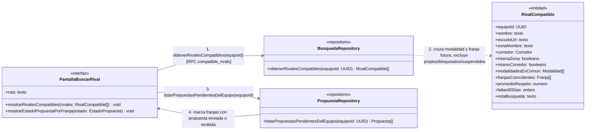

- **Reglas de negocio:** Un equipo aparece como **Rival compatible** si su búsqueda está activa, no es otro equipo del mismo Capitán, su Capitán no está suspendido, el equipo no tiene **Bloqueo por faltas**, comparte al menos una modalidad y coincide en al menos una franja futura (`fecha` + `turno`). La lista se ordena priorizando misma zona, luego mismo corredor y por último otro corredor (`RF-D04`).

---

### UC-D04 — Proponer un partido

**Requerimientos:** `RF-D02`, `RF-D05`, `RNF-D01` · **Pantalla:** `P-D01` (`/buscar-rival`) · **Secuencia:** [`uc-d04-proponer-partido.md`](../partidos/04-diagramas-secuencia/uc-d04-proponer-partido.md)

```mermaid
classDiagram
    direction LR

    class PantallaBuscarRival {
        <<interfaz>>
        +ruta: texto
        +elegirFranjaYModalidad(rivalId: UUID, fecha: fecha, turno: Turno, modalidad: Modalidad) void
        +enviarPropuesta() void
        +mostrarPropuestaEnviada() void
    }

    class BusquedaService {
        <<control>>
        +proponerPartido(usuarioId: UUID, equipoEmisorId: UUID, equipoReceptorId: UUID, fecha: fecha, turno: Turno, modalidad: Modalidad) ResultadoPropuesta
    }

    class Validador {
        <<control>>
        +validarDatosPropuesta(fecha: fecha, turno: Turno, modalidad: Modalidad) ResultadoValidacion
    }

    class PropuestaRepository {
        <<repositorio>>
        +enviarPropuesta(equipoEmisorId: UUID, equipoReceptorId: UUID, fecha: fecha, turno: Turno, modalidad: Modalidad) UUID
    }

    class Propuesta {
        <<entidad>>
        +id: UUID
        +equipoEmisorId: UUID
        +equipoReceptorId: UUID
        +fecha: fecha
        +turno: Turno
        +modalidad: Modalidad
        +estado: EstadoPropuesta
    }

    class Aviso {
        <<entidad>>
        +id: UUID
        +usuarioId: UUID
        +tipo: texto
        +titulo: texto
    }

    PantallaBuscarRival --> BusquedaService : 1. proponerPartido(usuarioId, emisorId, receptorId, fecha, turno, modalidad)
    BusquedaService --> Validador : 2. validarDatosPropuesta(fecha, turno, modalidad)
    BusquedaService --> PropuestaRepository : 3. enviarPropuesta() [RPC send_proposal]
    PropuestaRepository ..> Propuesta : 4. verifica coincidencia vigente y unicidad en la franja, crea Pendiente
    PropuestaRepository ..> Aviso : 5. genera Aviso para el Capitan receptor
```

- **Reglas de negocio:** No permite dos propuestas `Pendiente` entre el mismo par de equipos para la misma franja (`fecha` + `turno`) en ninguna dirección. Envía un **Aviso** al Capitán del equipo receptor (`RF-D05`).

---

### UC-D05 — Cancelar una propuesta enviada

**Requerimientos:** `RF-D05`, `RNF-D01` · **Pantallas:** `P-D01` (`/buscar-rival`), `P-D02` (`/partidos`) · **Secuencia:** [`uc-d05-cancelar-propuesta.md`](../partidos/04-diagramas-secuencia/uc-d05-cancelar-propuesta.md)

```mermaid
classDiagram
    direction LR

    class PantallaPartidos {
        <<interfaz>>
        +pulsarCancelarPropuesta(propuestaId: UUID) void
        +actualizarListaPropuestas() void
    }

    class BusquedaService {
        <<control>>
        +cancelarPropuestaEnviada(usuarioId: UUID, propuestaId: UUID) void
    }

    class PropuestaRepository {
        <<repositorio>>
        +cancelarPropuesta(propuestaId: UUID, capitanEmisorId: UUID) void
    }

    class Propuesta {
        <<entidad>>
        +id: UUID
        +equipoEmisorId: UUID
        +estado: EstadoPropuesta
    }

    PantallaPartidos --> BusquedaService : 1. cancelarPropuestaEnviada(usuarioId, propuestaId)
    BusquedaService --> PropuestaRepository : 2. cancelarPropuesta(propuestaId, usuarioId) [RPC respond_proposal('cancel')]
    PropuestaRepository ..> Propuesta : 3. verifica estado == Pendiente y cambia a Cancelada (sin Aviso)
```

- **Reglas de negocio:** El Capitán emisor puede cancelar una propuesta mientras siga `Pendiente`. Pasa a `Cancelada` y desaparece de la bandeja del receptor sin generar **Aviso** (`RF-D05`).

---

### UC-D06 — Aceptar o rechazar una propuesta

**Requerimientos:** `RF-D06`, `RNF-D01`, `RNF-D02` · **Pantalla:** `P-D02` (`/partidos`) · **Secuencia:** [`uc-d06-aceptar-rechazar-propuesta.md`](../partidos/04-diagramas-secuencia/uc-d06-aceptar-rechazar-propuesta.md)

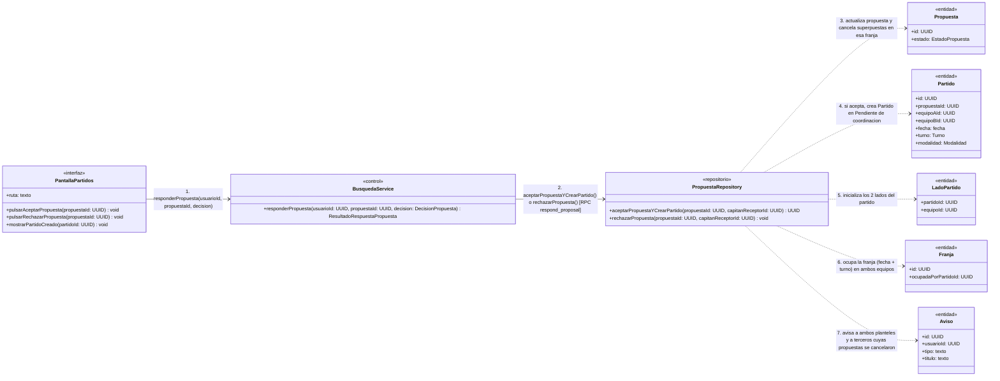

- **Reglas de negocio:**
  - **Al aceptar:** en una sola transacción se marca `Aceptada`, se crea el `Partido` en `Pendiente de coordinación` con sus dos `LadoPartido`, se ocupa esa franja (`fecha` + `turno`) en las búsquedas de ambos equipos (conservando activas las demás franjas libres), se cancelan automáticamente las otras propuestas `Pendiente` que cualquiera de los dos equipos tuviera para esa misma franja (enviando **Aviso** a los terceros afectados) y se envía un **Aviso** a todos los integrantes de ambos planteles (`RF-D06`).
  - **Al rechazar:** pasa a `Rechazada` y envía un **Aviso** al Capitán emisor; las franjas siguen libres.

---

### UC-D07 — Coordinar cancha y hora

**Requerimientos:** `RF-D07`, `RF-D08`, `RF-D09`, `RNF-D01`, `RNF-D02` · **Pantalla:** `P-D02` (`/partidos`) · **Secuencia:** [`uc-d07-coordinar-cancha-hora.md`](../partidos/04-diagramas-secuencia/uc-d07-coordinar-cancha-hora.md)

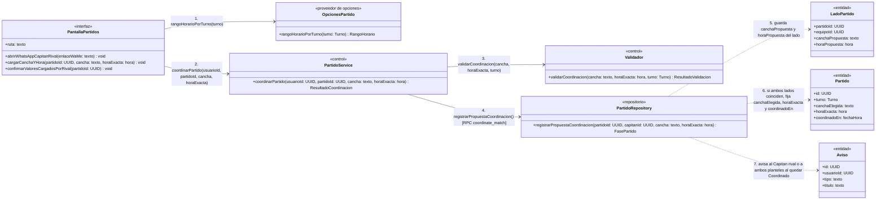

- **Reglas de negocio:** Desde que existe el partido en `Pendiente de coordinación`, ambos Capitanes ven el botón al WhatsApp del Capitán rival si este lo cargó en su perfil (`RF-D07`). Para pasar a `Coordinado`, ambos Capitanes deben coincidir en `cancha` (2–120 caracteres) y `horaExacta` (`RF-D08`). Si llegada la fecha del partido no quedó `Coordinado`, pasa a **Partido caído** por falta de coordinación sin sumar falta a ninguno (`RF-D09`).

---

### UC-D08 — Confirmar asistencia

**Requerimientos:** `RF-D10`, `RNF-D01`, `RNF-D02` · **Pantalla:** `P-D02` (`/partidos`) · **Secuencia:** [`uc-d08-confirmar-asistencia.md`](../partidos/04-diagramas-secuencia/uc-d08-confirmar-asistencia.md)

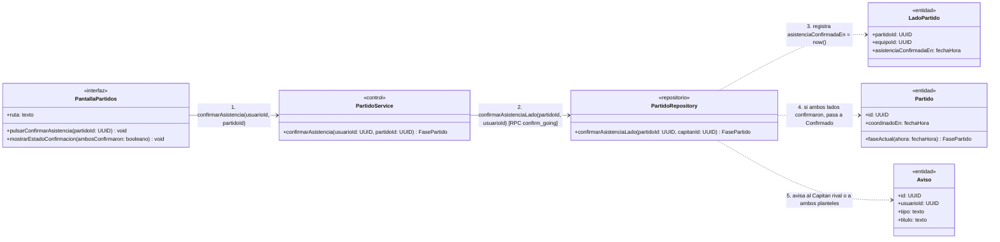

- **Reglas de negocio:** Disponible cuando el partido está `Coordinado` y antes de la hora de inicio. Cuando el segundo Capitán confirma, el partido pasa a `Confirmado` y todos los integrantes de ambos planteles reciben un **Aviso** (`RF-D10`). Si llega la hora del partido estando `Coordinado`, el partido se juega igual aunque alguno no haya tocado «Confirmar asistencia».

---

### UC-D09 — Tirar el partido

**Requerimientos:** `RF-D11`, `RF-D16`, `RNF-D01`, `RNF-D02` · **Pantalla:** `P-D02` (`/partidos`) · **Secuencia:** [`uc-d09-tirar-partido.md`](../partidos/04-diagramas-secuencia/uc-d09-tirar-partido.md)

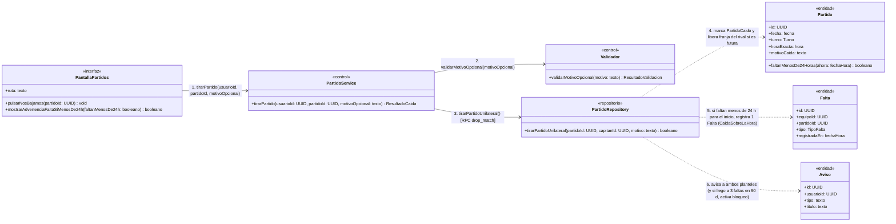

- **Reglas de negocio:** Un Capitán puede dar de baja unilateralmente un partido en `Pendiente de coordinación`, `Coordinado` o `Confirmado` antes de su inicio (`RF-D11`):
  - Si faltan **24 horas o más**, pasa a **Partido caído** sin sumar falta.
  - Si faltan **menos de 24 horas** (para `Pendiente de coordinación` sin hora exacta se toma el inicio del turno: `Mañana` 08:00, `Tarde` 13:00, `Noche` 19:00), suma **1 Falta** al equipo que se baja. Si con esa falta alcanza 3 faltas en los últimos 90 días, se activa el **Bloqueo por faltas** y se cancela su búsqueda activa (`RF-D16`).

---

### UC-D10 — Caída de común acuerdo

**Requerimientos:** `RF-D12`, `RNF-D01`, `RNF-D02` · **Pantalla:** `P-D02` (`/partidos`) · **Secuencia:** [`uc-d10-caida-comun-acuerdo.md`](../partidos/04-diagramas-secuencia/uc-d10-caida-comun-acuerdo.md)

```mermaid
classDiagram
    direction LR

    class PantallaPartidos {
        <<interfaz>>
        +ruta: texto
        +solicitarCaidaComunAcuerdo(partidoId: UUID, motivoOpcional: texto) void
        +responderCaidaComunAcuerdo(partidoId: UUID, acepta: booleano) void
    }

    class PartidoService {
        <<control>>
        +solicitarCaidaMutua(usuarioId: UUID, partidoId: UUID, motivo: texto) void
        +responderCaidaMutua(usuarioId: UUID, partidoId: UUID, acepta: booleano) void
    }

    class Validador {
        <<control>>
        +validarMotivoOpcional(motivo: texto) ResultadoValidacion
    }

    class PartidoRepository {
        <<repositorio>>
        +solicitarCaidaMutua(partidoId: UUID, capitanId: UUID, motivo: texto) void
        +responderCaidaMutua(partidoId: UUID, capitanId: UUID, acepta: booleano) void
    }

    class Partido {
        <<entidad>>
        +id: UUID
        +solicitudCaidaMutuaDeId: UUID
        +motivoCaida: texto
    }

    class Aviso {
        <<entidad>>
        +id: UUID
        +usuarioId: UUID
        +tipo: texto
        +titulo: texto
    }

    PantallaPartidos --> PartidoService : 1a. solicitarCaidaMutua(usuarioId, partidoId, motivo)
    PartidoService --> Validador : 2a. validarMotivoOpcional(motivo)
    PartidoService --> PartidoRepository : 3a. solicitarCaidaMutua() [RPC request_mutual_drop]
    PartidoRepository ..> Partido : 4a. registra solicitudCaidaMutuaDeId
    PartidoRepository ..> Aviso : 5a. avisa al Capitan rival
    PantallaPartidos --> PartidoService : 1b. responderCaidaMutua(usuarioId, partidoId, acepta)
    PartidoService --> PartidoRepository : 2b. responderCaidaMutua() [RPC answer_mutual_drop]
    PartidoRepository ..> Partido : 3b. si acepta pasa a PartidoCaido sin falta, y si rechaza limpia solicitud
```

- **Reglas de negocio:** Permite dar de baja un partido por lluvia o imprevisto mutuo **incluso dentro de las 24 horas previas sin sumar falta a ninguno de los dos equipos**, siempre que el Capitán rival acepte la solicitud antes de la hora de inicio (`RF-D12`).

---

### UC-D11 — Cargar el resultado

**Requerimientos:** `RF-D13`, `RF-D14`, `RNF-D01`, `RNF-D02` · **Pantalla:** `P-D02` (`/partidos`) · **Secuencia:** [`uc-d11-cargar-resultado.md`](../partidos/04-diagramas-secuencia/uc-d11-cargar-resultado.md)

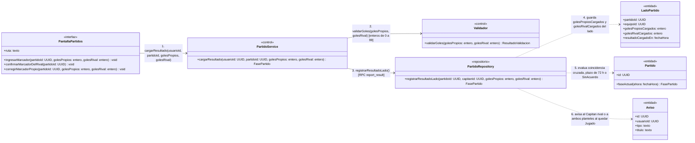

- **Reglas de negocio:** Se habilita una vez pasada la hora del partido (`Coordinado` o `Confirmado`) y no puede usarse si hay un reporte de no presentación pendiente de descargo (`RF-D13`, `RF-D14`):
  - Si ambos Capitanes cargan marcadores equivalentes (`golesPropiosA == golesRivalB` y `golesRivalA == golesPropiosB`), el partido pasa inmediatamente a `Jugado` y suma en las estadísticas.
  - Si un solo Capitán carga el marcador y el otro no responde ni reporta en **72 horas**, el marcador cargado queda firme y el partido pasa a `Jugado`.
  - Si cargan marcadores distintos, el sistema avisa a ambos para corregir dentro de las 72 horas desde la primera carga; vencido ese plazo sin coincidencia, queda en `Sin acuerdo` (no suma estadísticas para ninguno).

---

### UC-D12 — Reportar que el rival no se presentó

**Requerimientos:** `RF-D15`, `RF-D16`, `RNF-D01`, `RNF-D02` · **Pantalla:** `P-D02` (`/partidos`) · **Secuencia:** [`uc-d12-reportar-no-presentacion.md`](../partidos/04-diagramas-secuencia/uc-d12-reportar-no-presentacion.md)

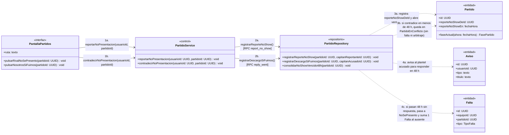

- **Reglas de negocio:**
  1. Cuando un Capitán reporta «El rival no se presentó», se abre una ventana de **48 horas** para que el Capitán acusado responda.
  2. Si el Capitán acusado no responde en 48 horas, el partido pasa a `No se presentó` y el equipo ausente suma **1 Falta** (`NoPresentacion`, pudiendo activar **Bloqueo por faltas** si llega a 3 en 90 días).
  3. Si el Capitán acusado responde «Nosotros sí fuimos» dentro de las 48 horas, el partido queda en **Partido en conflicto**: no suma estadísticas ni faltas para ninguno y **no se deriva al Administrador** (la plataforma no arbitra hechos ocurridos en la cancha, `RF-D15`).

---

### UC-D13 — Calificar al rival

**Requerimientos:** `RF-D17`, `RF-D18`, `RNF-D01` · **Pantalla:** `P-D02` (`/partidos`) · **Secuencia:** [`uc-d13-calificar-rival.md`](../partidos/04-diagramas-secuencia/uc-d13-calificar-rival.md)

```mermaid
classDiagram
    direction LR

    class PantallaPartidos {
        <<interfaz>>
        +ruta: texto
        +mostrarFormularioCalificacion(partidoId: UUID) void
        +enviarCalificacion(partidoId: UUID, respeto: entero, comentarioPrivado: texto) void
    }

    class PartidoService {
        <<control>>
        +calificarRival(usuarioId: UUID, partidoId: UUID, respeto: entero, comentarioPrivado: texto) void
    }

    class Validador {
        <<control>>
        +validarCalificacion(respeto: entero, comentarioPrivado: texto) ResultadoValidacion
    }

    class CalificacionRepository {
        <<repositorio>>
        +guardarCalificacion(partidoId: UUID, capitanId: UUID, respeto: entero, comentarioPrivado: texto) UUID
    }

    class Calificacion {
        <<entidad>>
        +id: UUID
        +partidoId: UUID
        +equipoEvaluadorId: UUID
        +equipoEvaluadoId: UUID
        +respeto: entero
        +comentarioPrivado: texto
        +creadaEn: fechaHora
        +esVisibleEnPromedio(contraparteCalifico: booleano, ahora: fechaHora) booleano
    }

    class Aviso {
        <<entidad>>
        +id: UUID
        +usuarioId: UUID
        +tipo: texto
        +titulo: texto
    }

    PantallaPartidos --> PartidoService : 1. calificarRival(usuarioId, partidoId, respeto, comentarioPrivado)
    PartidoService --> Validador : 2. validarCalificacion(respeto de 1 a 5, comentario hasta 500)
    PartidoService --> CalificacionRepository : 3. guardarCalificacion() [RPC rate_rival]
    CalificacionRepository ..> Calificacion : 4. verifica 1 sola vez dentro de los 7 dias posteriores
    CalificacionRepository ..> Aviso : 5. si ambos calificaron, revela en promedios y avisa
```

- **Reglas de negocio:** Disponible únicamente dentro de los **7 días posteriores** a que el partido quedó en `Jugado`, `Sin acuerdo`, `No se presentó` o `Partido en conflicto`, una sola vez por equipo y sin edición posterior (`RF-D17`). Regla de **revelación cruzada** (`RF-D18`): el puntaje de respeto (1 a 5) recién impacta en el promedio público cuando ambos Capitanes calificaron o cuando vence el plazo de 7 días. El `comentarioPrivado` nunca es público; solo lo ve el Administrador al revisar un reporte de equipo (`UC-F04`).

---

### UC-D14 — Ver mis partidos

**Requerimientos:** `RF-D07`, `RF-D19` · **Pantalla:** `P-D02` (`/partidos`) · **Secuencia:** [`uc-d14-ver-mis-partidos.md`](../partidos/04-diagramas-secuencia/uc-d14-ver-mis-partidos.md)

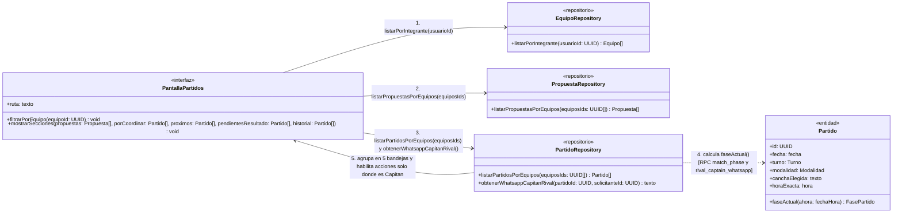

- **Reglas de negocio:** Cualquier Jugador del plantel puede consultar las 5 bandejas de sus equipos (`Propuestas pendientes`, `Por coordinar`, `Próximos`, `Pendientes de resultado` e `Historial`), pero los botones de acción y el acceso al WhatsApp del Capitán rival solo se habilitan en los equipos donde el usuario tiene rol de **Capitán** (`RF-D07`, `RF-D19`).

---

## Trazabilidad

| Caso de uso | Requerimientos | Pantalla | Clases principales |
| --- | --- | --- | --- |
| `UC-D01` Publicar una búsqueda de rival | `RF-D01`, `RF-D02`, `RNF-D01` | `P-D01` `/buscar-rival` | `PantallaBuscarRival`, `EquipoRepository`, `OpcionesBusqueda`, `BusquedaService`, `Validador`, `BusquedaRepository`, `BusquedaDeRival`, `Franja` |
| `UC-D02` Editar o cancelar la búsqueda | `RF-D01`, `RF-D03`, `RNF-D01` | `P-D01` `/buscar-rival` | `PantallaBuscarRival`, `BusquedaService`, `Validador`, `BusquedaRepository`, `Propuesta`, `Aviso` |
| `UC-D03` Ver rivales compatibles | `RF-D04` | `P-D01` `/buscar-rival` | `PantallaBuscarRival`, `BusquedaRepository`, `PropuestaRepository`, `RivalCompatible` |
| `UC-D04` Proponer un partido | `RF-D02`, `RF-D05`, `RNF-D01` | `P-D01` `/buscar-rival` | `PantallaBuscarRival`, `BusquedaService`, `Validador`, `PropuestaRepository`, `Propuesta`, `Aviso` |
| `UC-D05` Cancelar una propuesta enviada | `RF-D05`, `RNF-D01` | `P-D01`, `P-D02` | `PantallaPartidos`, `BusquedaService`, `PropuestaRepository`, `Propuesta` |
| `UC-D06` Aceptar o rechazar una propuesta | `RF-D06`, `RNF-D01`, `RNF-D02` | `P-D02` `/partidos` | `PantallaPartidos`, `BusquedaService`, `PropuestaRepository`, `Propuesta`, `Partido`, `LadoPartido`, `Franja`, `Aviso` |
| `UC-D07` Coordinar cancha y hora | `RF-D07`, `RF-D08`, `RF-D09`, `RNF-D01`, `RNF-D02` | `P-D02` `/partidos` | `PantallaPartidos`, `OpcionesPartido`, `PartidoService`, `Validador`, `PartidoRepository`, `Partido`, `LadoPartido`, `Aviso` |
| `UC-D08` Confirmar asistencia | `RF-D10`, `RNF-D01`, `RNF-D02` | `P-D02` `/partidos` | `PantallaPartidos`, `PartidoService`, `PartidoRepository`, `Partido`, `LadoPartido`, `Aviso` |
| `UC-D09` Tirar el partido | `RF-D11`, `RF-D16`, `RNF-D01`, `RNF-D02` | `P-D02` `/partidos` | `PantallaPartidos`, `PartidoService`, `Validador`, `PartidoRepository`, `Partido`, `Falta`, `Aviso` |
| `UC-D10` Caída de común acuerdo | `RF-D12`, `RNF-D01`, `RNF-D02` | `P-D02` `/partidos` | `PantallaPartidos`, `PartidoService`, `Validador`, `PartidoRepository`, `Partido`, `Aviso` |
| `UC-D11` Cargar el resultado | `RF-D13`, `RF-D14`, `RNF-D01`, `RNF-D02` | `P-D02` `/partidos` | `PantallaPartidos`, `PartidoService`, `Validador`, `PartidoRepository`, `Partido`, `LadoPartido`, `Aviso` |
| `UC-D12` Reportar que el rival no se presentó | `RF-D15`, `RF-D16`, `RNF-D01`, `RNF-D02` | `P-D02` `/partidos` | `PantallaPartidos`, `PartidoService`, `PartidoRepository`, `Partido`, `Falta`, `Aviso` |
| `UC-D13` Calificar al rival | `RF-D17`, `RF-D18`, `RNF-D01` | `P-D02` `/partidos` | `PantallaPartidos`, `PartidoService`, `Validador`, `CalificacionRepository`, `Calificacion`, `Aviso` |
| `UC-D14` Ver mis partidos | `RF-D07`, `RF-D19` | `P-D02` `/partidos` | `PantallaPartidos`, `EquipoRepository`, `PropuestaRepository`, `PartidoRepository`, `Partido` |
