# Módulo D — Partidos

> Documenta las clases de dominio y de diseño que participan en el **Módulo D — Partidos** (`UC-D01` a `UC-D14`).
> Fuentes del módulo: [01-requerimientos.md](../partidos/01-requerimientos.md) · [02-casos-de-uso.md](../partidos/02-casos-de-uso.md) · [03-pantallas.md](../partidos/03-pantallas.md) · [04-diagramas-secuencia/](../partidos/04-diagramas-secuencia/README.md). Convenciones en el [README](README.md).

---

## Modelo de dominio del módulo

Vista estructural de las entidades, relaciones de composición/asociación y enumeraciones involucradas en la **Búsqueda de rival**, el cruce de **Franjas**, las **Propuestas**, la máquina de estados del **Partido**, el presentismo (**Faltas** y **Bloqueo por faltas**) y la **Calificación** con revelación cruzada (`UC-D01` a `UC-D14`).

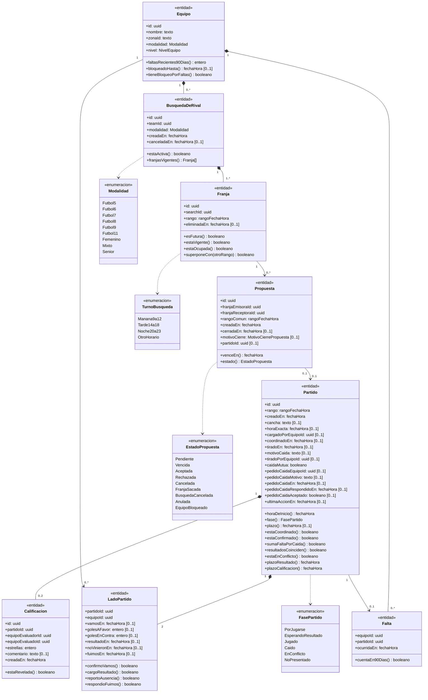

---

## Clases por caso de uso

### UC-D01 · Publicar una búsqueda de rival

> Especificación: [UC-D01](../partidos/02-casos-de-uso.md#uc-d01--publicar-una-búsqueda-de-rival) · Pantalla: [P1 · Buscar rival](../partidos/03-pantallas.md#p1--buscar-rival) · Secuencia: [S01 · Publicar búsqueda](../partidos/04-diagramas-secuencia/uc-d01-publicar-busqueda.md)

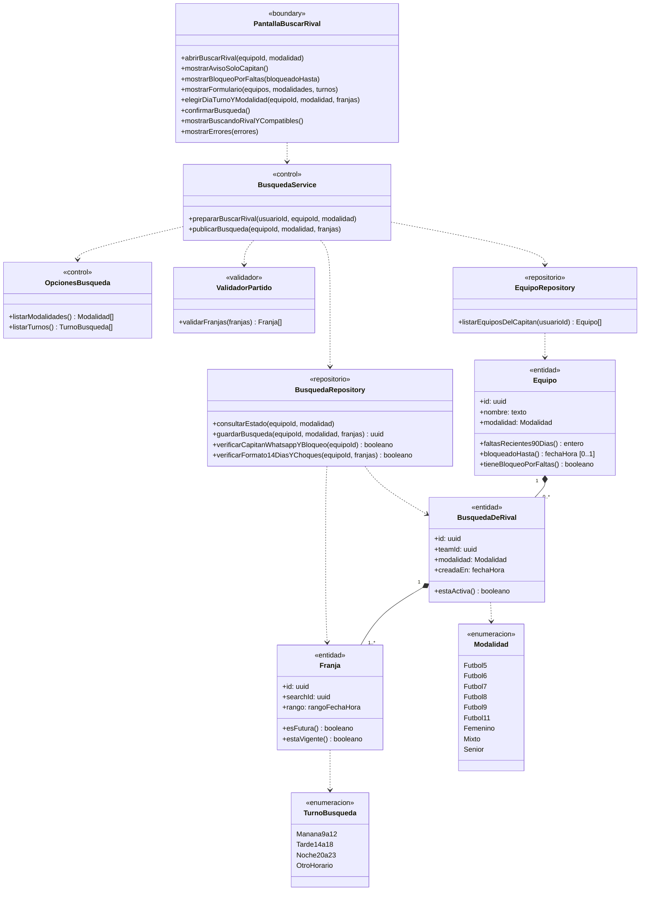

---

### UC-D02 · Editar o cancelar la búsqueda

> Especificación: [UC-D02](../partidos/02-casos-de-uso.md#uc-d02--editar-o-cancelar-la-búsqueda) · Pantalla: [P1 · Buscar rival](../partidos/03-pantallas.md#p1--buscar-rival) · Secuencia: [S02 · Editar o cancelar búsqueda](../partidos/04-diagramas-secuencia/uc-d02-editar-cancelar-busqueda.md)

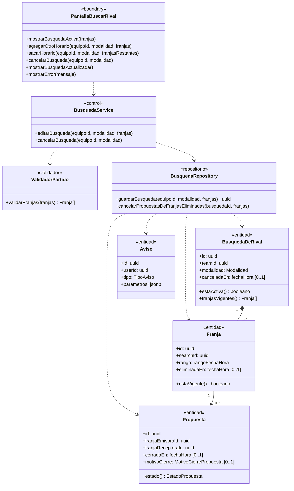

---

### UC-D03 · Ver rivales compatibles

> Especificación: [UC-D03](../partidos/02-casos-de-uso.md#uc-d03--ver-rivales-compatibles) · Pantalla: [P1 · Buscar rival](../partidos/03-pantallas.md#p1--buscar-rival) · Secuencia: [S03 · Ver rivales compatibles](../partidos/04-diagramas-secuencia/uc-d03-ver-rivales-compatibles.md)

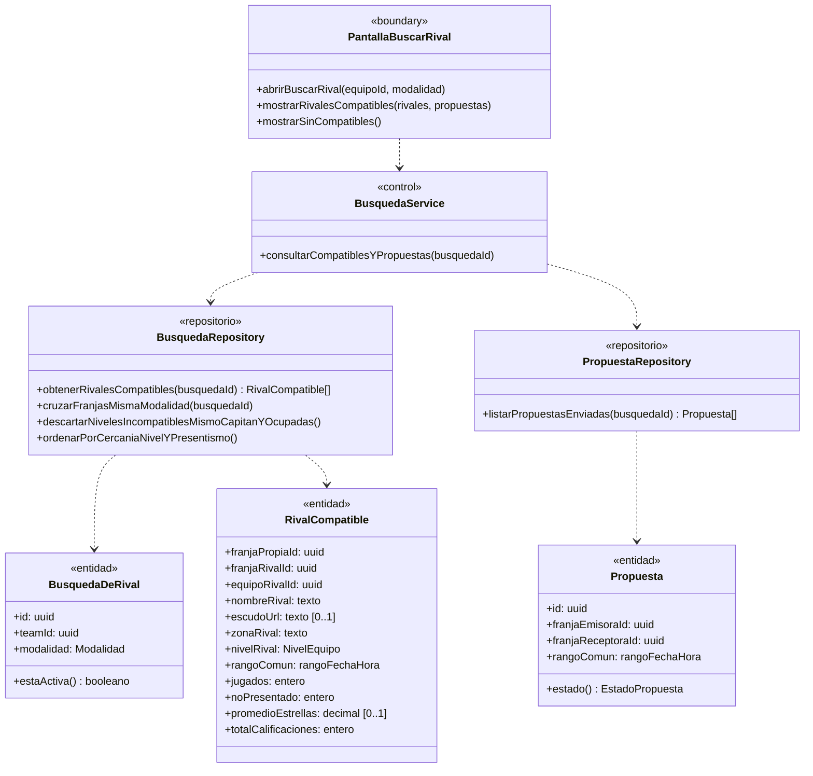

---

### UC-D04 · Proponer un partido

> Especificación: [UC-D04](../partidos/02-casos-de-uso.md#uc-d04--proponer-un-partido) · Pantalla: [P1 · Buscar rival](../partidos/03-pantallas.md#p1--buscar-rival) · Secuencia: [S04 · Proponer partido](../partidos/04-diagramas-secuencia/uc-d04-proponer-partido.md)

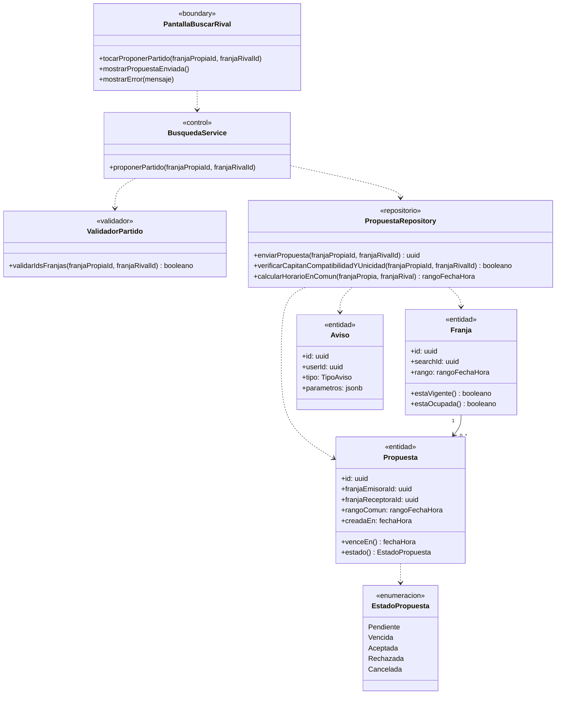

---

### UC-D05 · Cancelar una propuesta enviada

> Especificación: [UC-D05](../partidos/02-casos-de-uso.md#uc-d05--cancelar-una-propuesta-enviada) · Pantalla: [P1 · Buscar rival](../partidos/03-pantallas.md#p1--buscar-rival) · Secuencia: [S05 · Cancelar propuesta](../partidos/04-diagramas-secuencia/uc-d05-cancelar-propuesta.md)

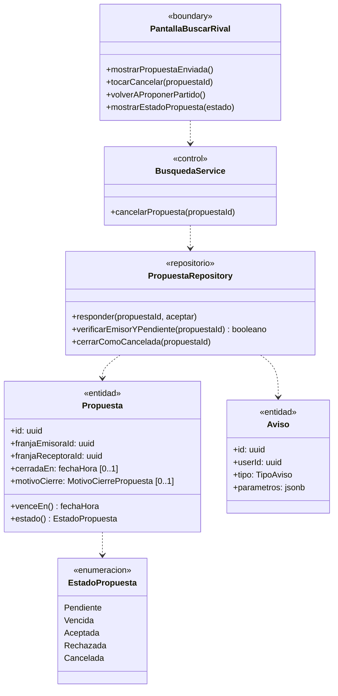

---

### UC-D06 · Aceptar o rechazar una propuesta

> Especificación: [UC-D06](../partidos/02-casos-de-uso.md#uc-d06--aceptar-o-rechazar-una-propuesta) · Pantalla: [P2 · Partidos](../partidos/03-pantallas.md#p2--partidos) · Secuencia: [S06 · Responder propuesta](../partidos/04-diagramas-secuencia/uc-d06-responder-propuesta.md)

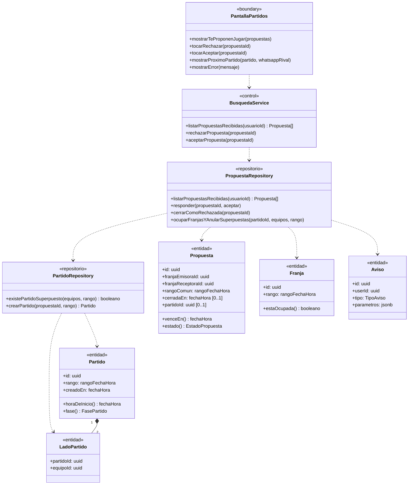

---

### UC-D07 · Coordinar cancha y hora

> Especificación: [UC-D07](../partidos/02-casos-de-uso.md#uc-d07--coordinar-cancha-y-hora) · Pantalla: [P2 · Partidos](../partidos/03-pantallas.md#p2--partidos) · Secuencia: [S07 · Coordinar cancha y hora](../partidos/04-diagramas-secuencia/uc-d07-coordinar-cancha-hora.md)

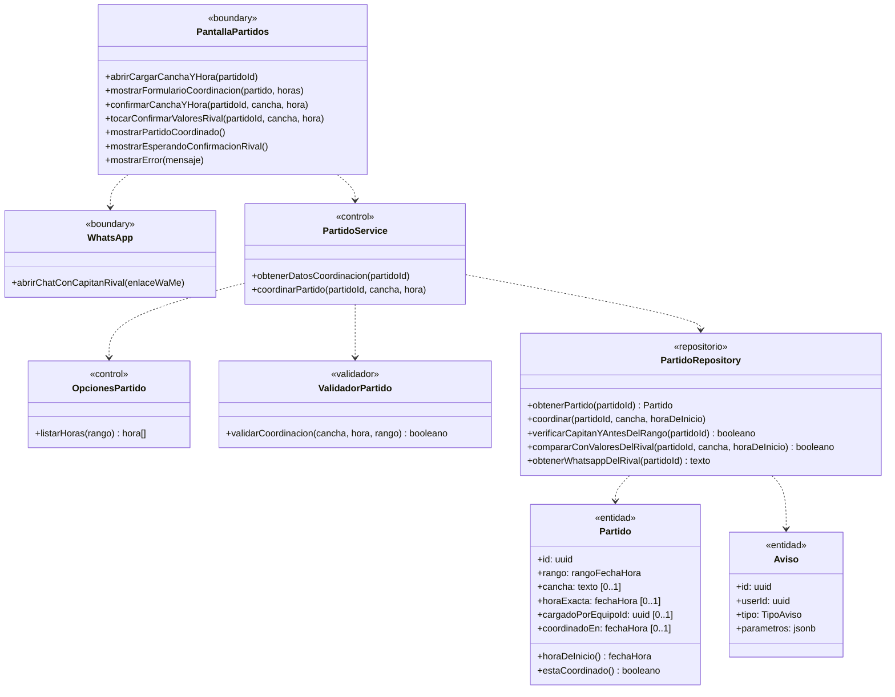

---

### UC-D08 · Confirmar asistencia

> Especificación: [UC-D08](../partidos/02-casos-de-uso.md#uc-d08--confirmar-asistencia) · Pantalla: [P2 · Partidos](../partidos/03-pantallas.md#p2--partidos) · Secuencia: [S08 · Confirmar asistencia](../partidos/04-diagramas-secuencia/uc-d08-confirmar-asistencia.md)

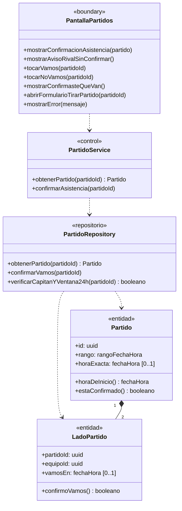

---

### UC-D09 · Tirar el partido

> Especificación: [UC-D09](../partidos/02-casos-de-uso.md#uc-d09--tirar-el-partido) · Pantalla: [P2 · Partidos](../partidos/03-pantallas.md#p2--partidos) · Secuencia: [S09 · Tirar el partido](../partidos/04-diagramas-secuencia/uc-d09-tirar-partido.md)

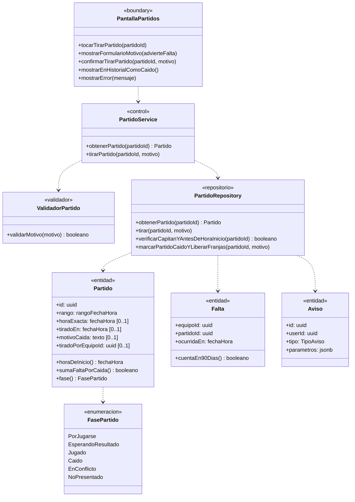

---

### UC-D10 · Caída de común acuerdo

> Especificación: [UC-D10](../partidos/02-casos-de-uso.md#uc-d10--caída-de-común-acuerdo) · Pantalla: [P2 · Partidos](../partidos/03-pantallas.md#p2--partidos) · Secuencia: [S10 · Caída de común acuerdo](../partidos/04-diagramas-secuencia/uc-d10-caida-comun-acuerdo.md)

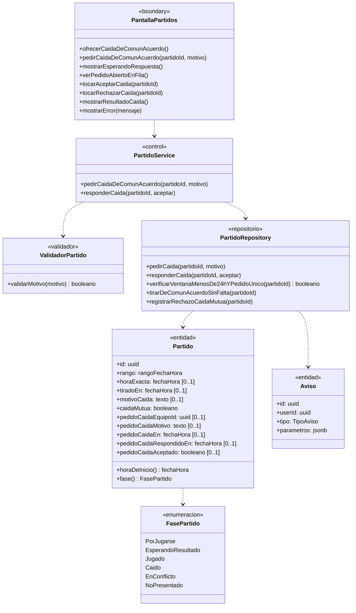

---

### UC-D11 · Cargar el resultado

> Especificación: [UC-D11](../partidos/02-casos-de-uso.md#uc-d11--cargar-el-resultado) · Pantalla: [P2 · Partidos](../partidos/03-pantallas.md#p2--partidos) · Secuencia: [S11 · Cargar el resultado](../partidos/04-diagramas-secuencia/uc-d11-cargar-resultado.md)

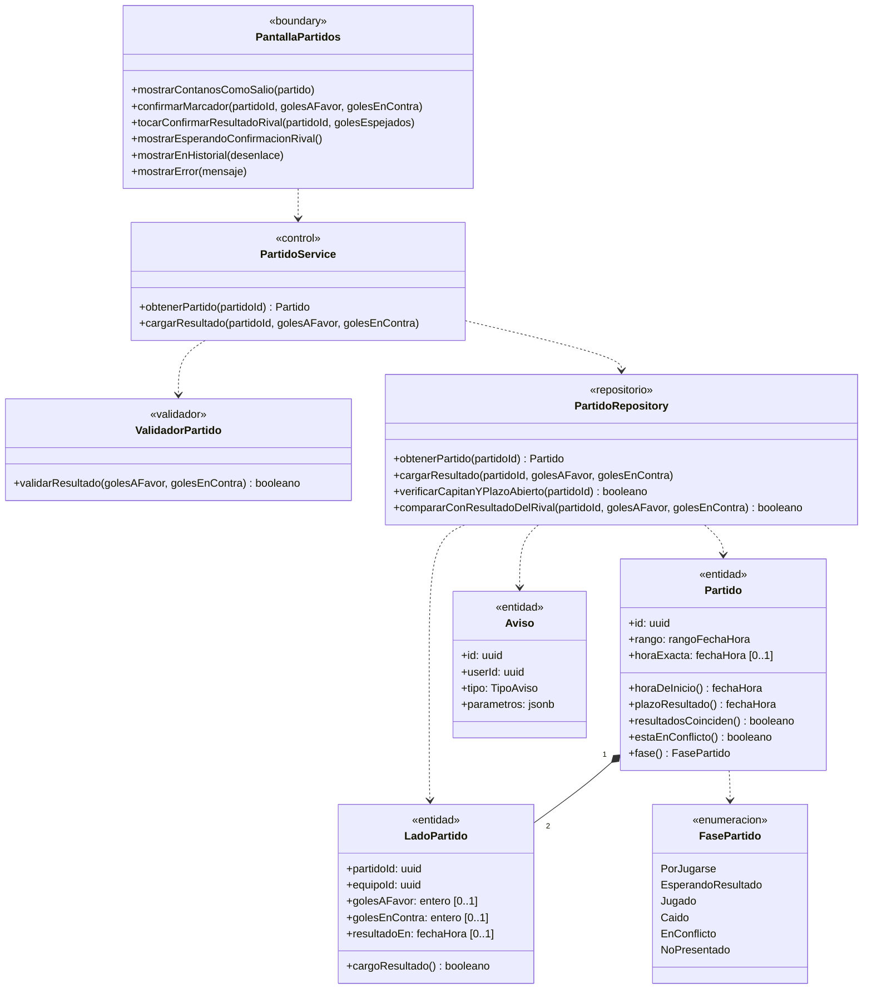

---

### UC-D12 · Reportar que el rival no se presentó

> Especificación: [UC-D12](../partidos/02-casos-de-uso.md#uc-d12--reportar-que-el-rival-no-se-presentó) · Pantalla: [P2 · Partidos](../partidos/03-pantallas.md#p2--partidos) · Secuencia: [S12 · Reportar no se presentó](../partidos/04-diagramas-secuencia/uc-d12-reportar-no-se-presento.md)

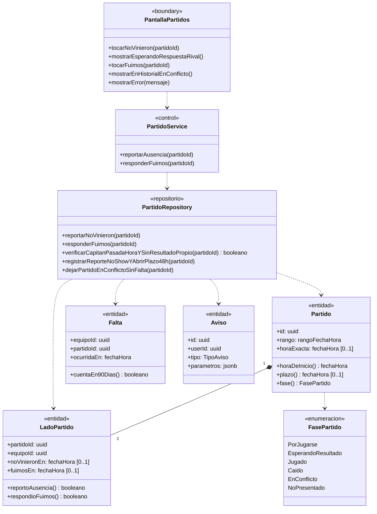

---

### UC-D13 · Calificar al rival

> Especificación: [UC-D13](../partidos/02-casos-de-uso.md#uc-d13--calificar-al-rival) · Pantalla: [P2 · Partidos](../partidos/03-pantallas.md#p2--partidos) · Secuencia: [S13 · Calificar al rival](../partidos/04-diagramas-secuencia/uc-d13-calificar-rival.md)

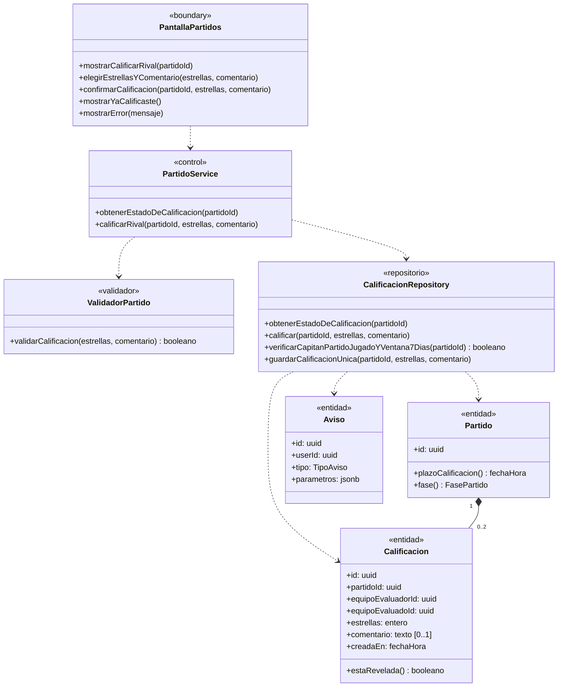

---

### UC-D14 · Ver mis partidos

> Especificación: [UC-D14](../partidos/02-casos-de-uso.md#uc-d14--ver-mis-partidos) · Pantalla: [P2 · Partidos](../partidos/03-pantallas.md#p2--partidos) · Secuencia: [S14 · Ver mis partidos](../partidos/04-diagramas-secuencia/uc-d14-ver-mis-partidos.md)

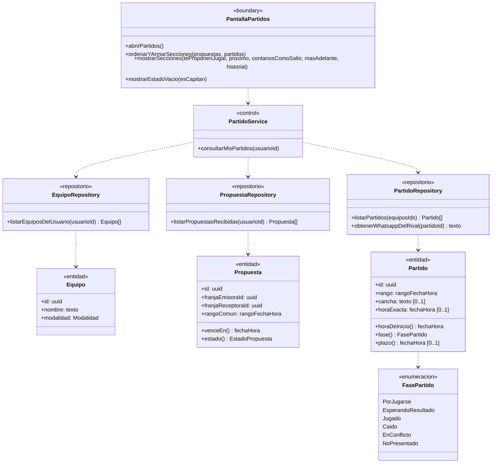

---

## Trazabilidad

| Clase | Estereotipo | Implementación en el repo | Estado |
|---|---|---|---|
| `PantallaBuscarRival` / `PantallaPartidos` | `«boundary»` | `src/app/partidos/buscar/page.tsx`, `src/app/partidos/page.tsx` y formularios de acción en `src/components/matches/` | Implementadas |
| `WhatsApp` | `«boundary»` | `whatsappLink` (`src/utils/whatsapp.ts`) | Implementado |
| `BusquedaService` / `PartidoService` / `OpcionesBusqueda` / `OpcionesPartido` | `«control»` | Server Actions en `src/app/partidos/actions.ts` y `src/app/partidos/buscar/actions.ts`, `SPORT_MODALITIES` (`src/utils/modality.ts`), `TIME_SLOTS` y horas de inicio (`src/utils/matches.ts`) | Implementados |
| `ValidadorPartido` | `«validador»` | `parseSearchSlots`, `parseProposalTarget`, `parseCoordinateForm`, `parseDropReason`, `parseResultForm`, `parseRatingForm` (`src/utils/matches.ts`) | Implementado |
| `EquipoRepository` | `«repositorio»` | Consultas de pertenencia y capitanías en `public.teams` y `public.team_members` | Implementado |
| `BusquedaRepository` / `PropuestaRepository` | `«repositorio»` | Tablas `public.rival_searches`, `search_slots`, `proposals`; funciones `save_rival_search`, `compatible_rivals`, `send_proposal`, `respond_proposal`, `proposal_status` (`20261028000003..06`) | Implementados |
| `PartidoRepository` | `«repositorio»` | Tablas `public.matches`, `match_sides`, `team_faults`; funciones `coordinate_match`, `confirm_going`, `drop_match`, `request_mutual_drop`, `answer_mutual_drop`, `report_result`, `report_no_show`, `reply_went`, `match_phase`, `match_deadline`, `rival_captain_whatsapp` (`20261028000006..09`) | Implementado |
| `CalificacionRepository` | `«repositorio»` | Tabla `public.ratings`; funciones `rate_rival`, `my_match_rating_status` (`20261028000009_match_results.sql`) | Implementado |
| `BusquedaDeRival` / `Franja` / `Propuesta` / `Partido` / `LadoPartido` / `Calificacion` / `Falta` | `«entidad»` | Esquema `20261028000003_rival_searches.sql` a `20261028000017_team_public_history.sql` | Implementadas |
