# Módulo D — Partidos

> Documenta las clases de dominio y de diseño que participan en el **Módulo D — Partidos** (`UC-D01` a `UC-D14`).
> Fuentes del módulo: [01-requerimientos.md](../partidos/01-requerimientos.md) · [02-casos-de-uso.md](../partidos/02-casos-de-uso.md) · [03-pantallas.md](../partidos/03-pantallas.md) · [04-diagramas-secuencia/](../partidos/04-diagramas-secuencia/README.md). Convenciones en el [README](README.md).

---

## Modelo de dominio del módulo

Vista estructural de las entidades y enumeraciones involucradas en la **Búsqueda de rival**, el cruce de **Franjas**, las **Propuestas**, la máquina de estados del **Partido**, el presentismo (**Faltas** y **Bloqueo por faltas**) y la **Calificación** con revelación cruzada (`UC-D01` a `UC-D14`).

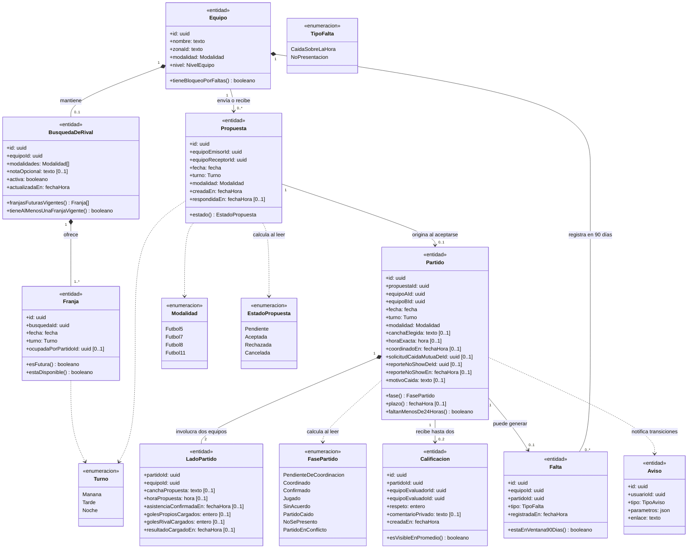

---

## Clases por caso de uso

### UC-D01 · Publicar una búsqueda de rival

**Requerimientos:** `RF-D01`, `RF-D02`, `RNF-D01` · **Pantalla:** [P-D01 · Buscar rival](../partidos/03-pantallas.md) (`/buscar-rival`) · **Secuencia:** [`uc-d01-publicar-busqueda.md`](../partidos/04-diagramas-secuencia/uc-d01-publicar-busqueda.md)

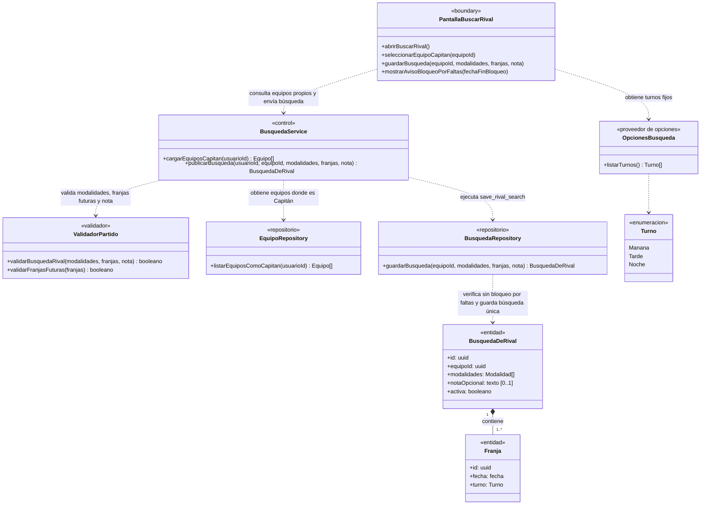

---

### UC-D02 · Editar o cancelar la búsqueda

**Requerimientos:** `RF-D01`, `RF-D03`, `RNF-D01` · **Pantalla:** [P-D01 · Buscar rival](../partidos/03-pantallas.md) (`/buscar-rival`) · **Secuencia:** [`uc-d02-editar-cancelar-busqueda.md`](../partidos/04-diagramas-secuencia/uc-d02-editar-cancelar-busqueda.md)

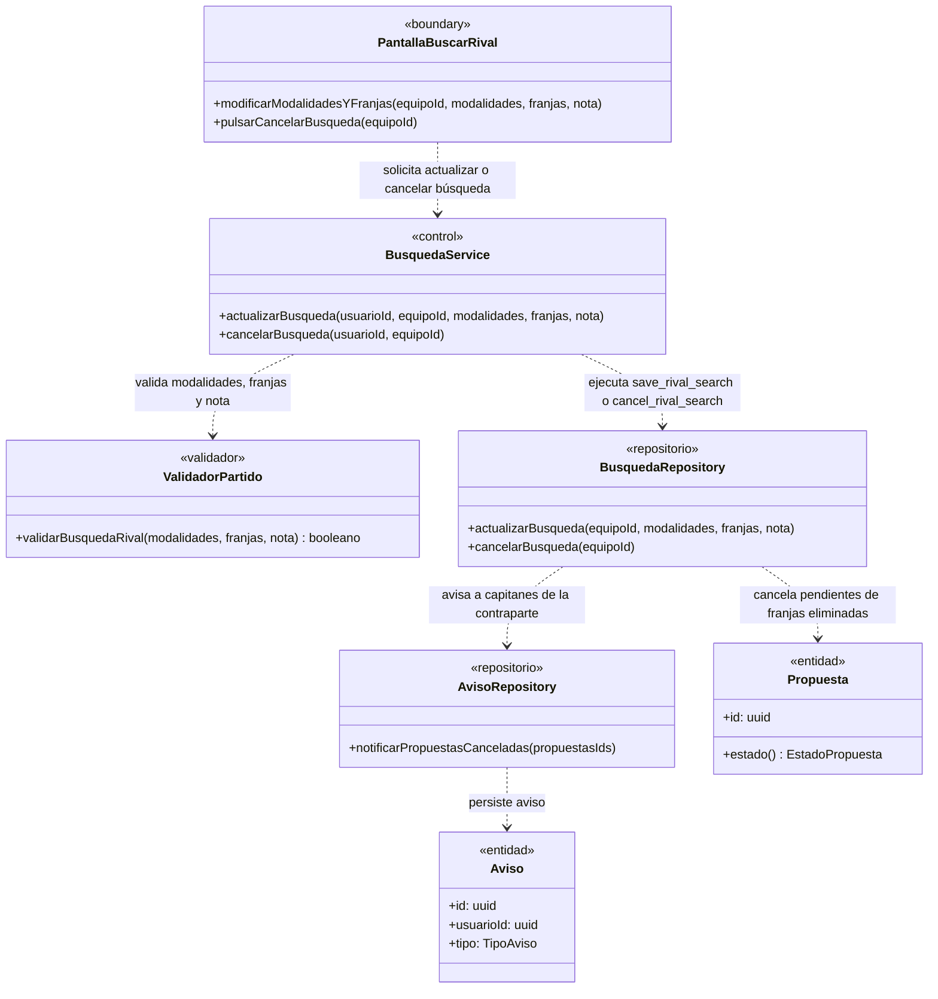

---

### UC-D03 · Ver rivales compatibles

**Requerimientos:** `RF-D04` · **Pantalla:** [P-D01 · Buscar rival](../partidos/03-pantallas.md) (`/buscar-rival`) · **Secuencia:** [`uc-d03-ver-rivales-compatibles.md`](../partidos/04-diagramas-secuencia/uc-d03-ver-rivales-compatibles.md)

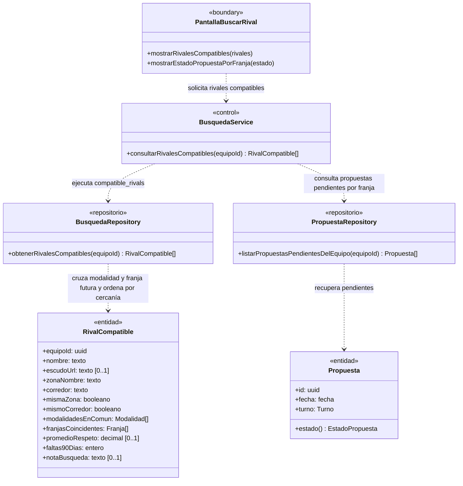

---

### UC-D04 · Proponer un partido

**Requerimientos:** `RF-D02`, `RF-D05`, `RNF-D01` · **Pantalla:** [P-D01 · Buscar rival](../partidos/03-pantallas.md) (`/buscar-rival`) · **Secuencia:** [`uc-d04-proponer-partido.md`](../partidos/04-diagramas-secuencia/uc-d04-proponer-partido.md)

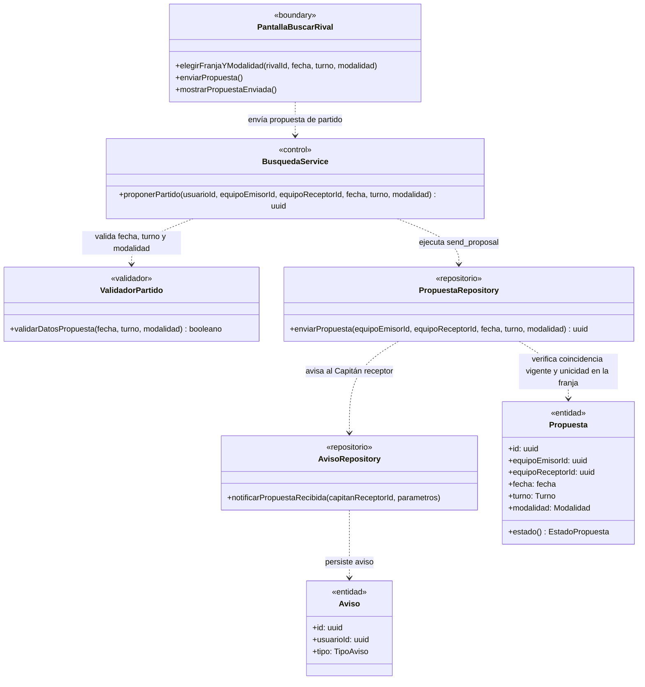

---

### UC-D05 · Cancelar una propuesta enviada

**Requerimientos:** `RF-D05`, `RNF-D01` · **Pantallas:** [P-D01 · Buscar rival](../partidos/03-pantallas.md) y [P-D02 · Partidos](../partidos/03-pantallas.md) · **Secuencia:** [`uc-d05-cancelar-propuesta.md`](../partidos/04-diagramas-secuencia/uc-d05-cancelar-propuesta.md)

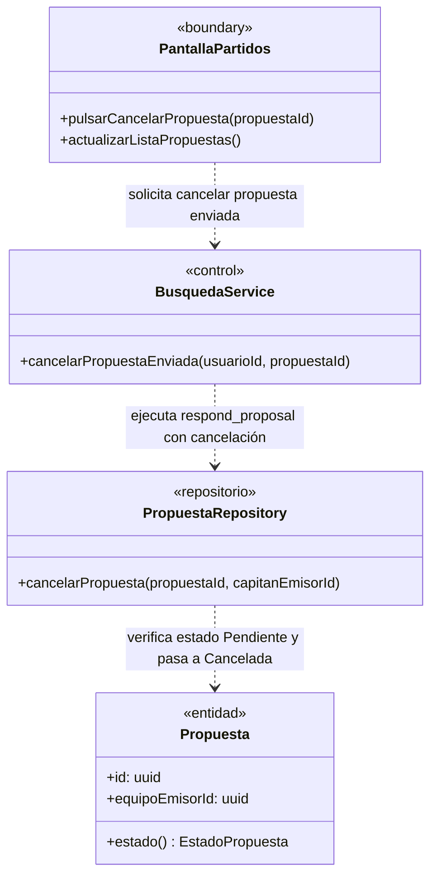

---

### UC-D06 · Aceptar o rechazar una propuesta

**Requerimientos:** `RF-D06`, `RNF-D01`, `RNF-D02` · **Pantalla:** [P-D02 · Partidos](../partidos/03-pantallas.md) (`/partidos`) · **Secuencia:** [`uc-d06-responder-propuesta.md`](../partidos/04-diagramas-secuencia/uc-d06-responder-propuesta.md)

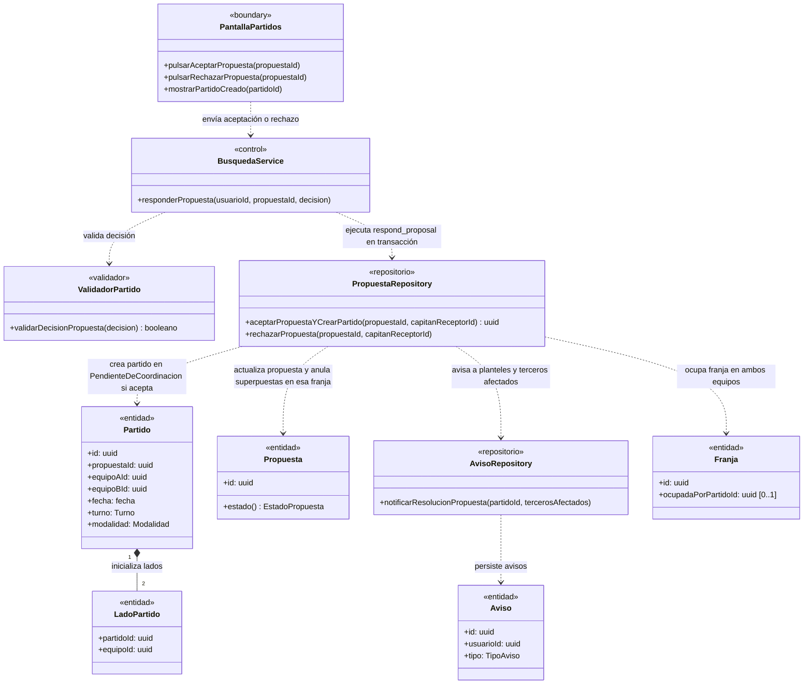

---

### UC-D07 · Coordinar cancha y hora

**Requerimientos:** `RF-D07`, `RF-D08`, `RF-D09`, `RNF-D01`, `RNF-D02` · **Pantalla:** [P-D02 · Partidos](../partidos/03-pantallas.md) (`/partidos`) · **Secuencia:** [`uc-d07-coordinar-cancha-hora.md`](../partidos/04-diagramas-secuencia/uc-d07-coordinar-cancha-hora.md)

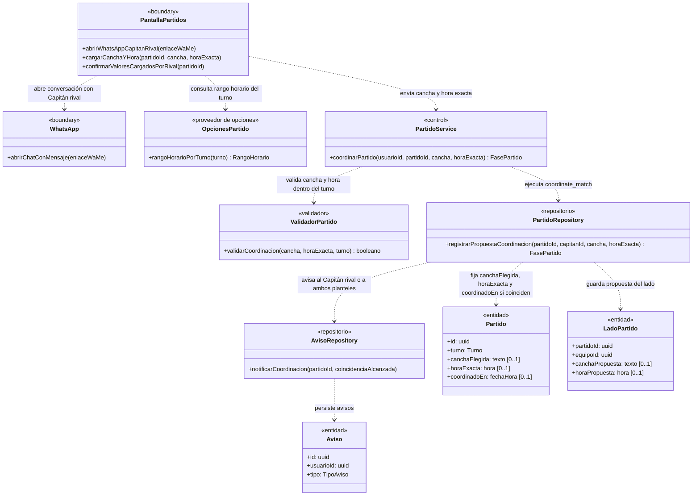

---

### UC-D08 · Confirmar asistencia

**Requerimientos:** `RF-D10`, `RNF-D01`, `RNF-D02` · **Pantalla:** [P-D02 · Partidos](../partidos/03-pantallas.md) (`/partidos`) · **Secuencia:** [`uc-d08-confirmar-asistencia.md`](../partidos/04-diagramas-secuencia/uc-d08-confirmar-asistencia.md)

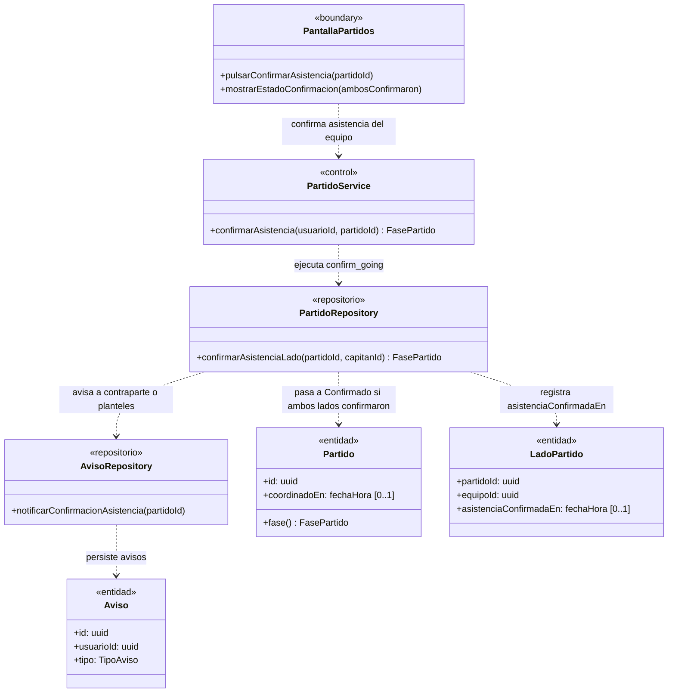

---

### UC-D09 · Tirar el partido

**Requerimientos:** `RF-D11`, `RF-D16`, `RNF-D01`, `RNF-D02` · **Pantalla:** [P-D02 · Partidos](../partidos/03-pantallas.md) (`/partidos`) · **Secuencia:** [`uc-d09-tirar-partido.md`](../partidos/04-diagramas-secuencia/uc-d09-tirar-partido.md)

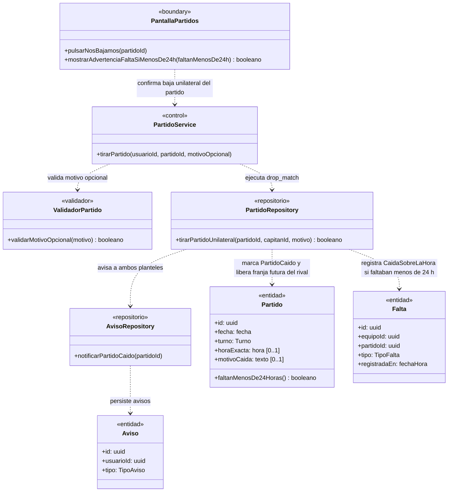

---

### UC-D10 · Caída de común acuerdo

**Requerimientos:** `RF-D12`, `RNF-D01`, `RNF-D02` · **Pantalla:** [P-D02 · Partidos](../partidos/03-pantallas.md) (`/partidos`) · **Secuencia:** [`uc-d10-caida-comun-acuerdo.md`](../partidos/04-diagramas-secuencia/uc-d10-caida-comun-acuerdo.md)

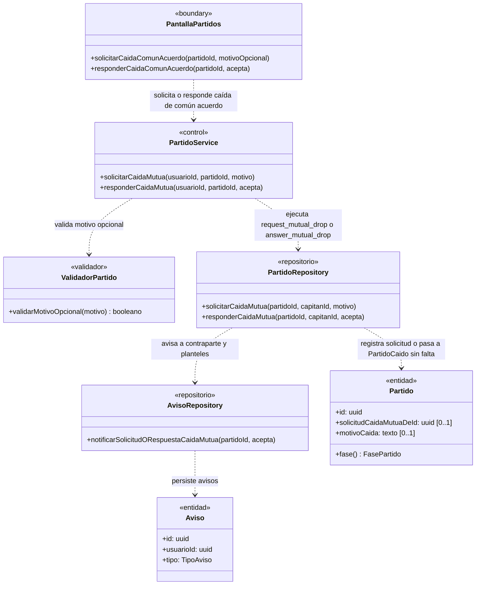

---

### UC-D11 · Cargar el resultado

**Requerimientos:** `RF-D13`, `RF-D14`, `RNF-D01`, `RNF-D02` · **Pantalla:** [P-D02 · Partidos](../partidos/03-pantallas.md) (`/partidos`) · **Secuencia:** [`uc-d11-cargar-resultado.md`](../partidos/04-diagramas-secuencia/uc-d11-cargar-resultado.md)

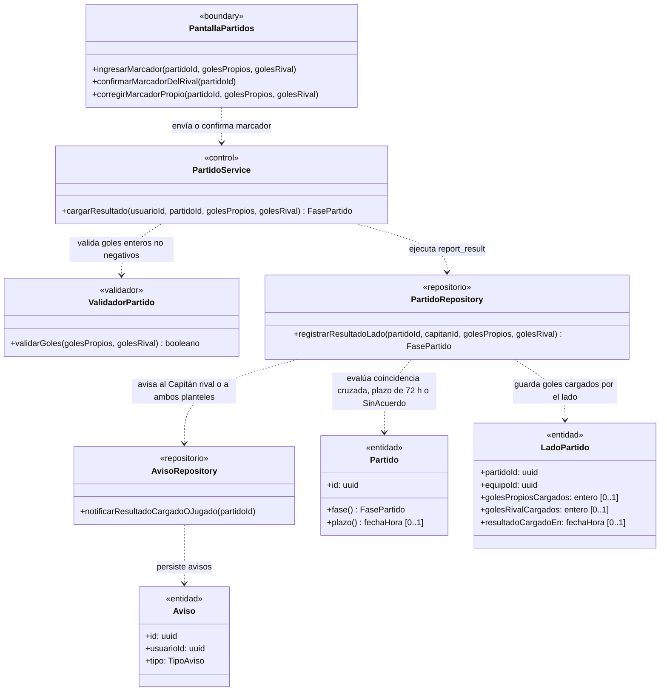

---

### UC-D12 · Reportar que el rival no se presentó

**Requerimientos:** `RF-D15`, `RF-D16`, `RNF-D01`, `RNF-D02` · **Pantalla:** [P-D02 · Partidos](../partidos/03-pantallas.md) (`/partidos`) · **Secuencia:** [`uc-d12-reportar-no-se-presento.md`](../partidos/04-diagramas-secuencia/uc-d12-reportar-no-se-presento.md)

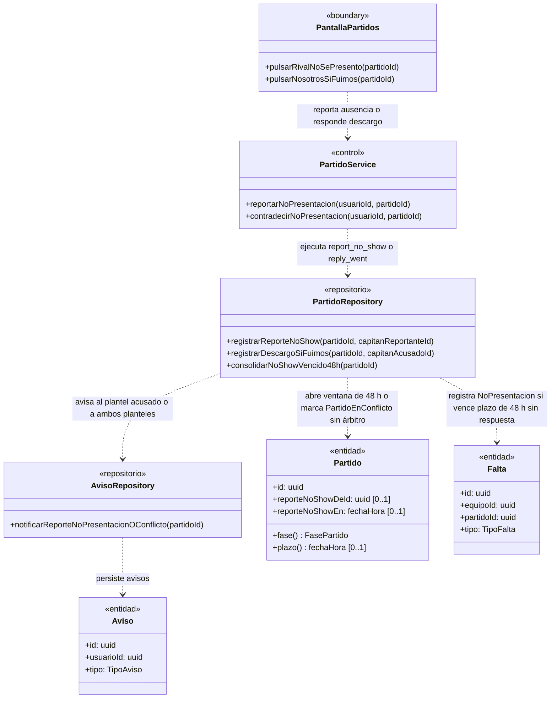

---

### UC-D13 · Calificar al rival

**Requerimientos:** `RF-D17`, `RF-D18`, `RNF-D01` · **Pantalla:** [P-D02 · Partidos](../partidos/03-pantallas.md) (`/partidos`) · **Secuencia:** [`uc-d13-calificar-rival.md`](../partidos/04-diagramas-secuencia/uc-d13-calificar-rival.md)

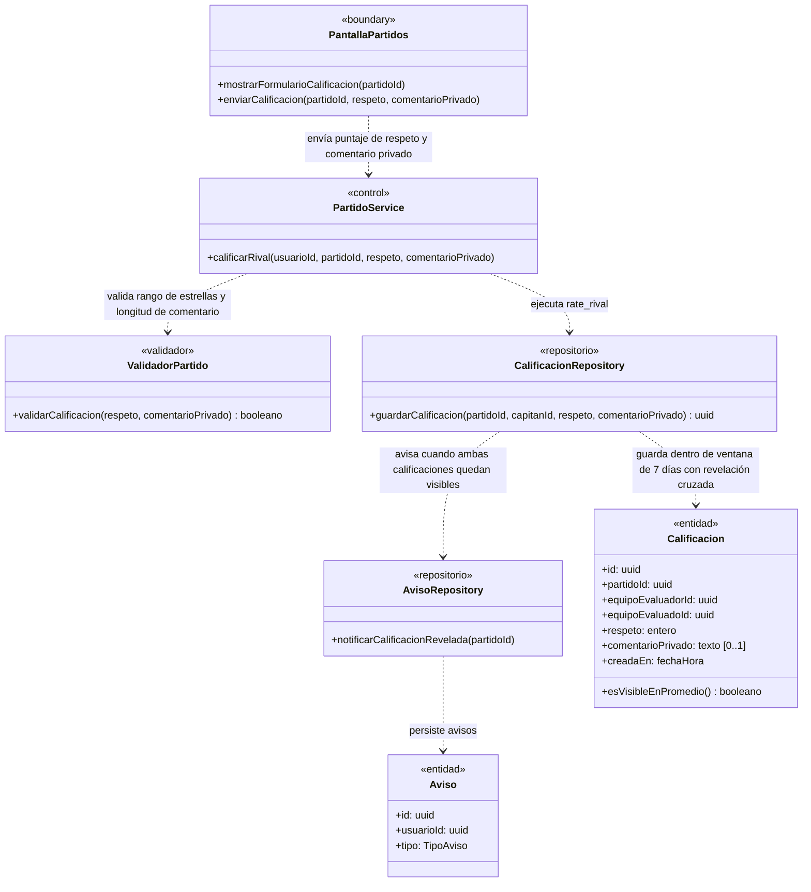

---

### UC-D14 · Ver mis partidos

**Requerimientos:** `RF-D07`, `RF-D19` · **Pantalla:** [P-D02 · Partidos](../partidos/03-pantallas.md) (`/partidos`) · **Secuencia:** [`uc-d14-ver-mis-partidos.md`](../partidos/04-diagramas-secuencia/uc-d14-ver-mis-partidos.md)

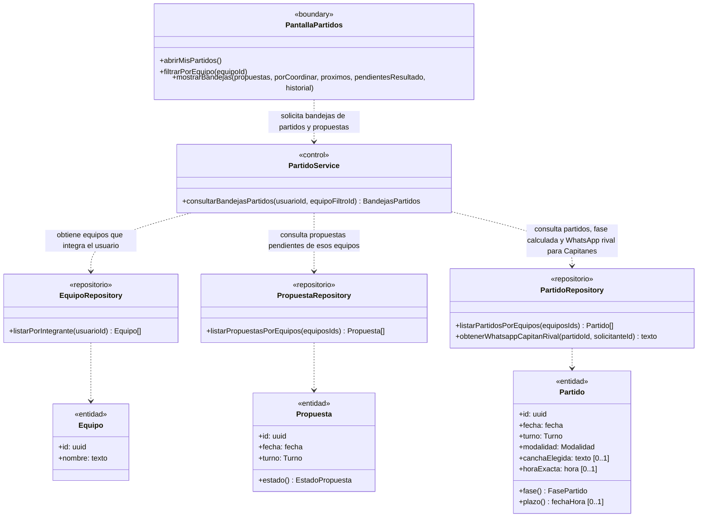

---

## Trazabilidad

| Clase | Estereotipo | Implementación en el repo | Estado |
|---|---|---|---|
| `PantallaBuscarRival` / `PantallaPartidos` | `«boundary»` | `src/app/partidos/page.tsx`, `src/app/buscar-rival/page.tsx` | Implementadas |
| `WhatsApp` | `«boundary»` | `whatsappLink` (`src/utils/whatsapp.ts`) | Implementado |
| `OpcionesBusqueda` / `OpcionesPartido` | `«proveedor de opciones»` | `TIME_SLOTS`, rangos horarios por turno (`src/utils/matches.ts`) | Implementados |
| `BusquedaService` / `PartidoService` | `«control»` | Server Actions en `src/app/partidos/actions.ts` | Implementados |
| `ValidadorPartido` | `«validador»` | Validadores de franjas, propuestas, coordinación, marcadores y calificaciones (`src/utils/matches.ts`) | Implementado |
| `BusquedaRepository` / `PropuestaRepository` | `«repositorio»` | Tablas `public.rival_searches`, `proposals`; funciones `save_rival_search`, `cancel_rival_search`, `compatible_rivals`, `send_proposal`, `respond_proposal` | Implementados |
| `PartidoRepository` / `CalificacionRepository` | `«repositorio»` | Tablas `public.matches`, `match_sides`, `ratings`, `team_faults`; funciones `coordinate_match`, `confirm_going`, `drop_match`, `request_mutual_drop`, `answer_mutual_drop`, `report_result`, `report_no_show`, `reply_went`, `rate_rival`, `match_phase`, `rival_captain_whatsapp` | Implementados |
| `AvisoRepository` | `«repositorio»` | Tabla `public.notices` | Implementado |
| `BusquedaDeRival` / `Franja` / `Propuesta` / `Partido` / `LadoPartido` / `Calificacion` / `Falta` | `«entidad»` | Esquema `20261028000004_rival_search.sql` a `20261028000011_ratings.sql` | Implementadas |
