# Diagramas de secuencia

Diagramas de los flujos vigentes de Torneos Amateur BA. La fuente de alcance es [`decisiones-casos-de-uso.md`](decisiones-casos-de-uso.md); los casos originales se consultan en `docs/casos-de-uso.pdf`. Cada diagrama representa un caso de uso o una acción específica. Los participantes son conceptuales: `Usuario`, `Navegador`, `UI` (Interfaz), `Localidad` y `Acceso a datos`. `Localidad` figura en todos los diagramas; intercambia mensajes cuando el flujo necesita resolver o mostrar una Zona. `Navegador` y `UI` permanecen como objetos distintos; `UI` nombra la interfaz. `Acceso a datos` encapsula la persistencia y las reglas de acceso, sin nombrar proveedores ni infraestructura.

## Cobertura

El PDF fuente contiene 43 entradas: UC-01 a UC-30, UC-51 a UC-53, SPEC-E01 a SPEC-E04 y CU-F01 a CU-F06. Se excluyen UC-06, porque la elección de perfil se retiró, y CU-F04, porque el Administrador no arbitra Partidos. La base vigente es de 41 entradas; se cubren 33/41 (80,5%).

SPEC-E01 y SPEC-E02 se desglosan en diagramas distintos para que publicar, editar, consultar, verificar y dar de baja no queden mezclados. Cada diagrama referencia su caso de origen. SPEC-E03 muestra únicamente la carga de la Inscripción por el Organizador; el flujo original donde el Capitán se anota desde la app fue retirado.

| Diagrama | Caso de uso | Acción |
|---|---|---|
| [D01](#d01--registrarse) | UC-01 | Registrarse |
| [D02](#d02--iniciar-sesion) | UC-02 | Iniciar sesión |
| [D03](#d03--cerrar-sesion) | UC-03 | Cerrar sesión |
| [D04](#d04--recuperar-contrasena) | UC-04 | Recuperar contraseña |
| [D05](#d05--volver-a-la-accion-solicitada) | UC-05 | Volver a la acción solicitada |
| [D06](#d06--editar-perfil) | UC-07 | Editar perfil |
| [D07](#d07--consultar-catalogo) | UC-08 | Consultar catálogo |
| [D08](#d08--filtrar-catalogo) | UC-09 | Filtrar catálogo |
| [D09](#d09--compartir-busqueda-filtrada) | UC-10 | Compartir búsqueda filtrada |
| [D10](#d10--consultar-ficha-de-torneo) | UC-11 | Consultar ficha de Torneo |
| [D11](#d11--contactar-al-organizador) | UC-12 | Contactar al Organizador |
| [D12](#d12--publicar-busqueda-de-rival) | UC-13 | Publicar búsqueda de rival |
| [D13](#d13--consultar-rivales-compatibles) | UC-14 | Consultar rivales compatibles |
| [D14](#d14--enviar-propuesta) | UC-15 | Enviar Propuesta |
| [D15](#d15--responder-propuesta-recibida) | UC-16 | Responder Propuesta recibida |
| [D16](#d16--cancelar-propuesta-enviada) | UC-17 | Cancelar Propuesta enviada |
| [D17](#d17--coordinar-partido) | UC-18 | Coordinar Partido |
| [D18](#d18--confirmar-asistencia) | UC-19 | Confirmar asistencia |
| [D19](#d19--dejar-un-partido-caido) | UC-20 | Dejar un Partido caído |
| [D20](#d20--crear-equipo) | UC-25 | Crear Equipo |
| [D21](#d21--crear-invitacion) | UC-27 | Crear invitación |
| [D22](#d22--aceptar-invitacion) | UC-28 | Aceptar invitación |
| [D23](#d23--publicar-torneo) | SPEC-E01 | Publicar Torneo |
| [D24](#d24--editar-torneo) | SPEC-E01 | Editar Torneo |
| [D25](#d25--consultar-torneos-propios) | SPEC-E02 | Consultar torneos propios |
| [D26](#d26--verificar-torneo) | SPEC-E02 | Verificar Torneo |
| [D27](#d27--dar-de-baja-torneo) | SPEC-E02 | Dar de baja Torneo |
| [D28](#d28--cargar-inscripcion) | SPEC-E03 | Cargar Inscripción |
| [D29](#d29--consultar-pagina-publica-del-organizador) | SPEC-E04 | Consultar página pública del Organizador |
| [D30](#d30--acceder-a-administracion) | CU-F01 | Acceder a administración |
| [D31](#d31--consultar-datos-de-lectura-publica) | UC-51 | Consultar datos de lectura pública |
| [D31](#d31--modificar-datos-como-administrador) | UC-53 | Modificar datos como Administrador |
| [D31](#d31--modificar-datos-propios) | UC-52 | Modificar datos propios |
| [D31](#d31--registrar-resolucion-administrativa) | CU-F06 | Registrar resolución administrativa |
| [D31](#d31--resolver-reporte) | CU-F03 | Resolver Reporte |
| [D31](#d31--suspender-cuenta) | CU-F05 | Suspender cuenta |
| [D37](#d37--cargar-torneo-copiado) | CU-F01 | Cargar Torneo copiado |

Quedan para otra tanda: UC-21, UC-22, UC-23, UC-24, UC-26, UC-29, UC-30 y CU-F02. UC-06 y CU-F04 no se cuentan como pendientes porque fueron retirados por las decisiones vigentes.

## A. Cuenta y acceso

### D01 - Registrarse

Referencia: UC-01. La persona completa los datos de alta y recibe una cuenta y perfil.

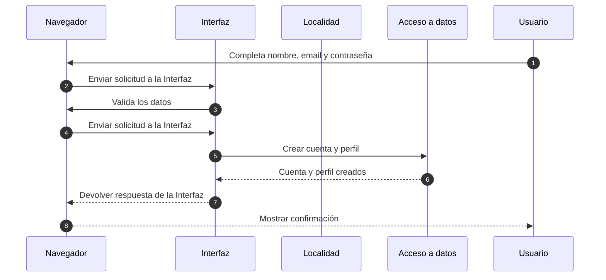

### D02 - Iniciar sesión

Referencia: UC-02. La persona ingresa con credenciales válidas o ve un error.

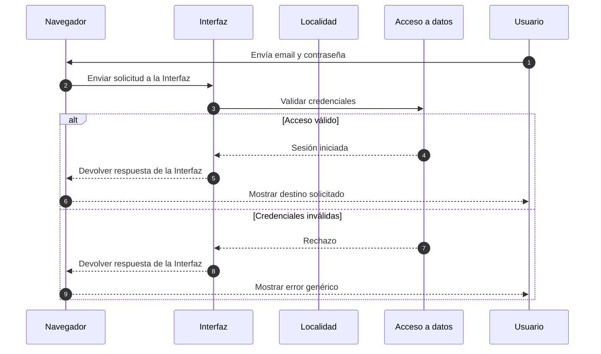

### D03 - Cerrar sesión

Referencia: UC-03. La persona cierra su sesión actual.


### D04 - Recuperar contraseña

Referencia: UC-04. La persona solicita un enlace de recuperación.

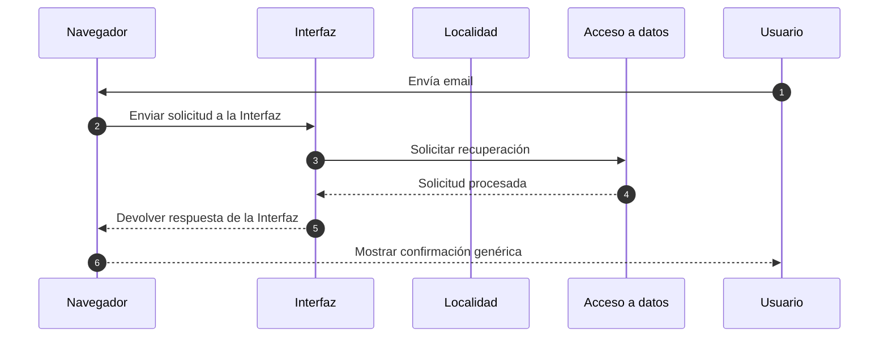

### D05 - Volver a la acción solicitada

Referencia: UC-05. Tras iniciar sesión, la persona vuelve a la ruta interna segura que había solicitado.

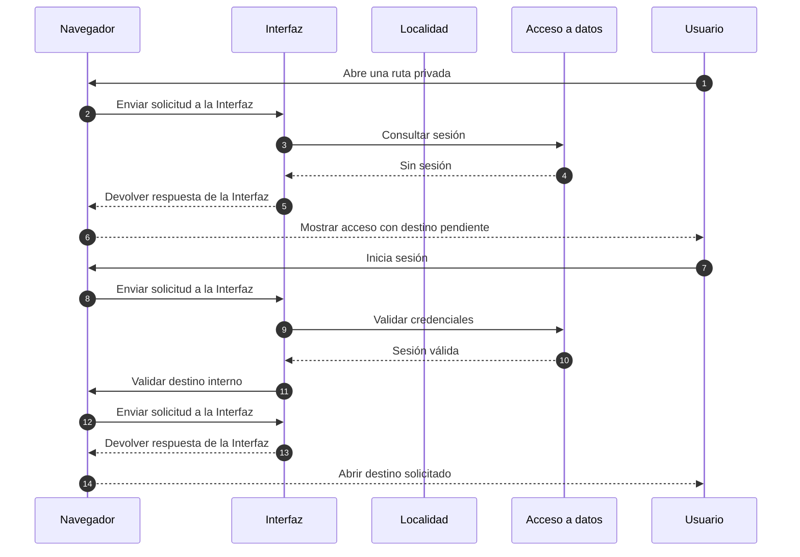

### D06 - Editar perfil

Referencia: UC-07. La persona actualiza los datos públicos de su perfil.


## B. Torneos públicos

### D07 - Consultar catálogo

Referencia: UC-08. La persona consulta los torneos publicados.

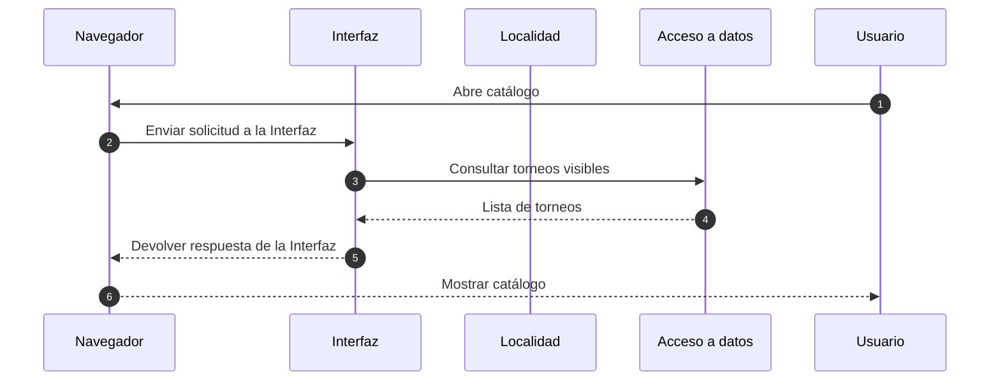

### D08 - Filtrar catálogo

Referencia: UC-09. La persona filtra torneos por criterios, incluida Zona.

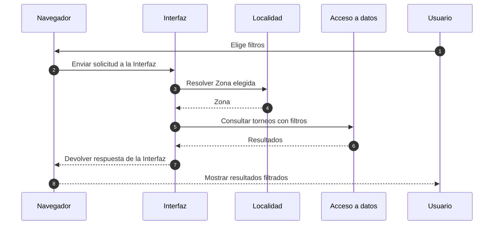

### D09 - Compartir búsqueda filtrada

Referencia: UC-10. La persona comparte una URL con los filtros seleccionados.

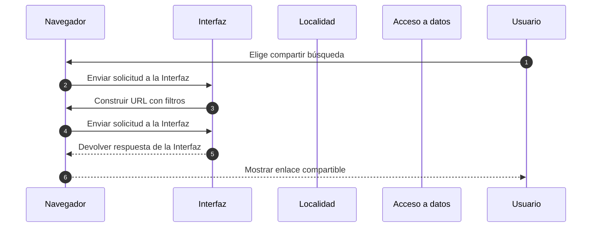

### D10 - Consultar ficha de Torneo

Referencia: UC-11. La persona abre la información pública de un Torneo.


### D11 - Contactar al Organizador

Referencia: UC-12. La persona continúa el contacto fuera de la app.

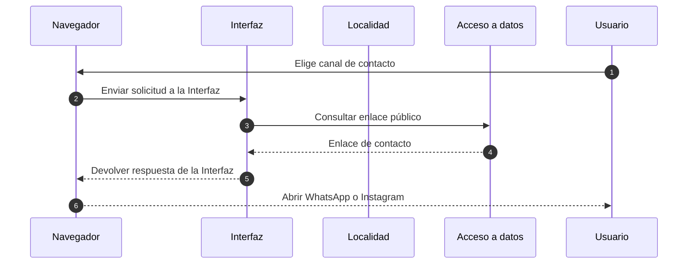

## C. Buscar partido

### D12 - Publicar búsqueda de rival

Referencia: UC-13. El Capitán publica una búsqueda para su Equipo.


### D13 - Consultar rivales compatibles

Referencia: UC-14. El Capitán consulta búsquedas compatibles con su Equipo.


### D14 - Enviar Propuesta

Referencia: UC-15. El Capitán propone un Partido ante una búsqueda compatible.

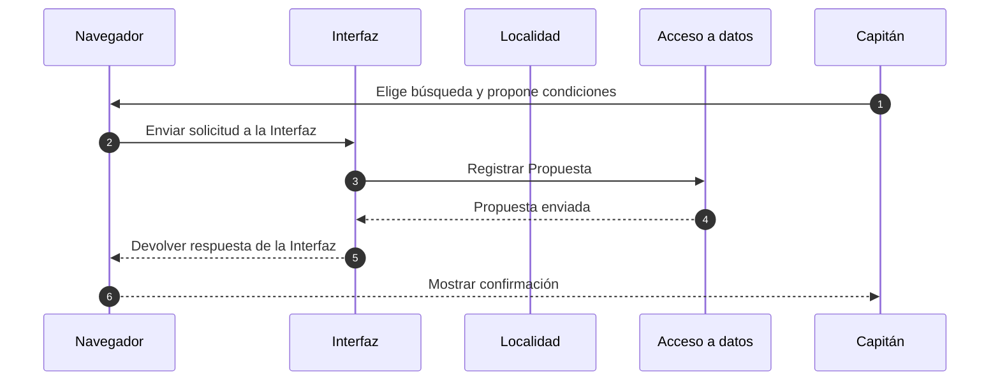

### D15 - Responder Propuesta recibida

Referencia: UC-16. El Capitán acepta o rechaza la Propuesta.


### D16 - Cancelar Propuesta enviada

Referencia: UC-17. El Capitán retira una Propuesta que envió.

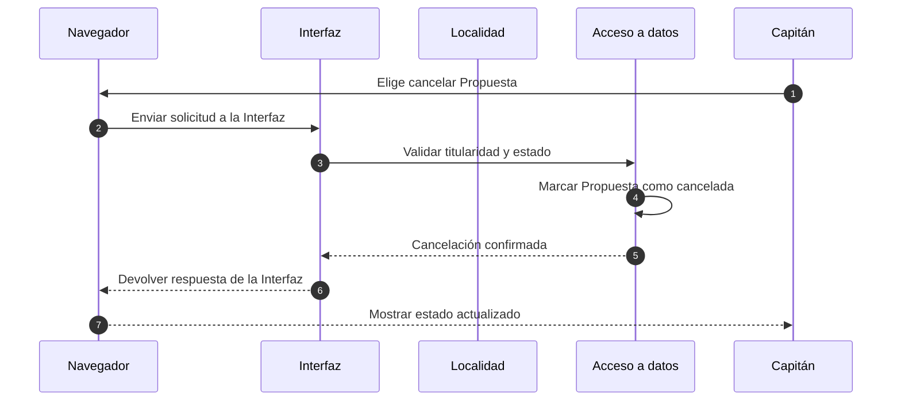

### D17 - Coordinar Partido

Referencia: UC-18. Los Capitanes acuerdan los datos operativos del Partido.


### D18 - Confirmar asistencia

Referencia: UC-19. Cada Capitán confirma la asistencia de su Equipo.

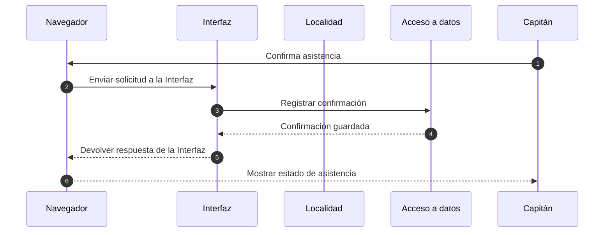

### D19 - Dejar un Partido caído

Referencia: UC-20. Un Capitán informa que el Partido se cae.

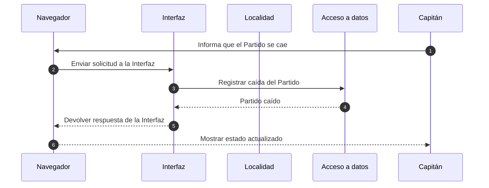

## D. Equipos

### D20 - Crear Equipo

Referencia: UC-25. Una persona crea un Equipo y queda como Capitán.

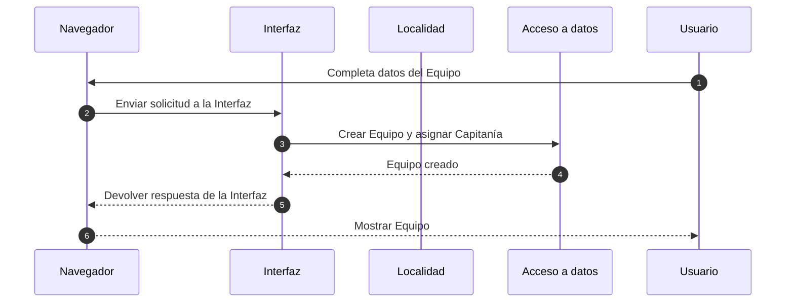

### D21 - Crear invitación

Referencia: UC-27. El Capitán genera una invitación para sumar una persona al Plantel.

```mermaid
sequenceDiagram
    autonumber
    participant Navegador
    participant UI as Interfaz
    participant Localidad
    participant Datos as Acceso a datos
    Capitán->>Navegador: Elige invitar persona
    Navegador->>UI: Enviar solicitud a la Interfaz
    UI->>Datos: Crear invitación
    Datos-->>UI: Invitación creada
    UI-->>Navegador: Devolver respuesta de la Interfaz
    Navegador-->>Capitán: Mostrar enlace de invitación
```

### D22 - Aceptar invitación

Referencia: UC-28. La persona acepta una invitación vigente y se suma al Plantel.

```mermaid
sequenceDiagram
    autonumber
    participant Navegador
    participant UI as Interfaz
    participant Localidad
    participant Datos as Acceso a datos
    Usuario->>Navegador: Abre invitación
    Navegador->>UI: Enviar solicitud a la Interfaz
    UI->>Datos: Consultar vigencia y elegibilidad
    Datos-->>UI: Invitación válida
    Usuario->>Navegador: Confirma aceptación
    Navegador->>UI: Enviar solicitud a la Interfaz
    UI->>Datos: Incorporar al Plantel
    Datos-->>UI: Plantel actualizado
    UI-->>Navegador: Devolver respuesta de la Interfaz
    Navegador-->>Usuario: Mostrar confirmación
```

## E. Torneos del Organizador

### D23 - Publicar Torneo

Referencia: SPEC-E01. El Organizador publica un Torneo con la información requerida.

```mermaid
sequenceDiagram
    autonumber
    participant Navegador
    participant UI as Interfaz
    participant Localidad
    participant Datos as Acceso a datos
    Organizador->>Navegador: Completa Torneo
    Navegador->>UI: Enviar solicitud a la Interfaz
    UI->>Datos: Validar y guardar Torneo
    Datos-->>UI: Torneo publicado
    UI-->>Navegador: Devolver respuesta de la Interfaz
    Navegador-->>Organizador: Mostrar publicación
```

### D24 - Editar Torneo

Referencia: SPEC-E01. El Organizador modifica un Torneo propio editable.

```mermaid
sequenceDiagram
    autonumber
    participant Navegador
    participant UI as Interfaz
    participant Localidad
    participant Datos as Acceso a datos
    Organizador->>Navegador: Edita Torneo propio
    Navegador->>UI: Enviar solicitud a la Interfaz
    UI->>Datos: Validar titularidad y guardar cambios
    Datos-->>UI: Torneo actualizado
    UI-->>Navegador: Devolver respuesta de la Interfaz
    Navegador-->>Organizador: Mostrar cambios
```

### D25 - Consultar torneos propios

Referencia: SPEC-E02. El Organizador consulta sus torneos y sus estados.

```mermaid
sequenceDiagram
    autonumber
    participant Navegador
    participant UI as Interfaz
    participant Localidad
    participant Datos as Acceso a datos
    Organizador->>Navegador: Abre Mis torneos
    Navegador->>UI: Enviar solicitud a la Interfaz
    UI->>Datos: Consultar torneos propios
    Datos-->>UI: Torneos y estados
    UI-->>Navegador: Devolver respuesta de la Interfaz
    Navegador-->>Organizador: Mostrar listado
```

### D26 - Verificar Torneo

Referencia: SPEC-E02. El Organizador registra la verificación que corresponde a un Torneo propio.

```mermaid
sequenceDiagram
    autonumber
    participant Navegador
    participant UI as Interfaz
    participant Localidad
    participant Datos as Acceso a datos
    Organizador->>Navegador: Elige verificar Torneo
    Navegador->>UI: Enviar solicitud a la Interfaz
    UI->>Datos: Validar titularidad y registrar verificación
    Datos-->>UI: Verificación registrada
    UI-->>Navegador: Devolver respuesta de la Interfaz
    Navegador-->>Organizador: Mostrar estado
```

### D27 - Dar de baja Torneo

Referencia: SPEC-E02. El Organizador da de baja un Torneo propio.

```mermaid
sequenceDiagram
    autonumber
    participant Navegador
    participant UI as Interfaz
    participant Localidad
    participant Datos as Acceso a datos
    Organizador->>Navegador: Elige dar de baja Torneo
    Navegador->>UI: Enviar solicitud a la Interfaz
    UI->>Datos: Validar titularidad y registrar baja
    Datos-->>UI: Torneo dado de baja
    UI-->>Navegador: Devolver respuesta de la Interfaz
    Navegador-->>Organizador: Mostrar estado actualizado
```

### D28 - Cargar Inscripción

Referencia: SPEC-E03. El Organizador carga una Inscripción para su Torneo.

```mermaid
sequenceDiagram
    autonumber
    participant Navegador
    participant UI as Interfaz
    participant Localidad
    participant Datos as Acceso a datos
    Organizador->>Navegador: Completa Inscripción
    Navegador->>UI: Enviar solicitud a la Interfaz
    UI->>Datos: Validar y registrar Inscripción
    Datos-->>UI: Inscripción guardada
    UI-->>Navegador: Devolver respuesta de la Interfaz
    Navegador-->>Organizador: Mostrar confirmación
```

### D29 - Consultar página pública del Organizador

Referencia: SPEC-E04. Una persona consulta la página pública del Organizador.

```mermaid
sequenceDiagram
    autonumber
    participant Navegador
    participant UI as Interfaz
    participant Localidad
    participant Datos as Acceso a datos
    Usuario->>Navegador: Abre página del Organizador
    Navegador->>UI: Enviar solicitud a la Interfaz
    UI->>Datos: Consultar perfil y torneos visibles
    Datos-->>UI: Información pública
    UI-->>Navegador: Devolver respuesta de la Interfaz
    Navegador-->>Usuario: Mostrar página
```

## F. Administración

### D30 - Acceder a administración

Referencia: CU-F01. El Administrador solicita acceso a administración; el flujo termina al habilitar o denegar ese acceso.

```mermaid
sequenceDiagram
    autonumber
    participant Navegador
    participant UI as Interfaz
    participant Localidad
    participant Datos as Acceso a datos
    Administrador->>Navegador: Abre administración
    Navegador->>UI: Enviar solicitud a la Interfaz
    UI->>Datos: Validar permiso administrativo
    alt Acceso permitido
        Datos-->>UI: Permiso confirmado
        UI-->>Navegador: Devolver respuesta de la Interfaz
        Navegador-->>Administrador: Mostrar administración
    else Acceso denegado
        Datos-->>UI: Permiso denegado
        UI-->>Navegador: Devolver respuesta de la Interfaz
        Navegador-->>Administrador: Mostrar acceso denegado
    end
```

### D31 - Resolver Reporte

Referencia: CU-F03. El Administrador registra una resolución de Reporte.

```mermaid
sequenceDiagram
    autonumber
    participant Navegador
    participant UI as Interfaz
    participant Localidad
    participant Datos as Acceso a datos
    Administrador->>Navegador: Revisa Reporte
    Navegador->>UI: Enviar solicitud a la Interfaz
    UI->>Datos: Consultar Reporte
    Datos-->>UI: Reporte y contexto
    Administrador->>Navegador: Registra resolución
    Navegador->>UI: Enviar solicitud a la Interfaz
    UI->>Datos: Guardar resolución
    Datos-->>UI: Resolución registrada
    UI-->>Navegador: Devolver respuesta de la Interfaz
    Navegador-->>Administrador: Mostrar resultado
```

### D31 - Suspender cuenta

Referencia: CU-F05. El Administrador suspende una cuenta según las reglas vigentes.

```mermaid
sequenceDiagram
    autonumber
    participant Navegador
    participant UI as Interfaz
    participant Localidad
    participant Datos as Acceso a datos
    Administrador->>Navegador: Elige suspender cuenta
    Navegador->>UI: Enviar solicitud a la Interfaz
    UI->>Datos: Validar permiso y registrar suspensión
    Datos-->>UI: Cuenta suspendida
    UI-->>Navegador: Devolver respuesta de la Interfaz
    Navegador-->>Administrador: Mostrar estado
```

### D31 - Registrar resolución administrativa

Referencia: CU-F06. El Administrador registra una resolución administrativa.

```mermaid
sequenceDiagram
    autonumber
    participant Navegador
    participant UI as Interfaz
    participant Localidad
    participant Datos as Acceso a datos
    Administrador->>Navegador: Completa resolución
    Navegador->>UI: Enviar solicitud a la Interfaz
    UI->>Datos: Guardar resolución administrativa
    Datos-->>UI: Resolución registrada
    UI-->>Navegador: Devolver respuesta de la Interfaz
    Navegador-->>Administrador: Mostrar confirmación
```

## T. Seguridad y acceso

### D31 - Consultar datos de lectura pública

Referencia: UC-51. La persona consulta datos que la regla de visibilidad define como públicos.

```mermaid
sequenceDiagram
    autonumber
    participant Navegador
    participant UI as Interfaz
    participant Localidad
    participant Datos as Acceso a datos
    Usuario->>Navegador: Solicita recurso público
    Navegador->>UI: Enviar solicitud a la Interfaz
    UI->>Datos: Consultar datos visibles públicamente
    Datos-->>UI: Datos permitidos
    UI-->>Navegador: Devolver respuesta de la Interfaz
    Navegador-->>Usuario: Mostrar recurso
```

### D31 - Modificar datos propios

Referencia: UC-52. La persona modifica datos propios o de su Equipo cuando su relación y rol lo permiten.

```mermaid
sequenceDiagram
    autonumber
    participant Navegador
    participant UI as Interfaz
    participant Localidad
    participant Datos as Acceso a datos
    Usuario->>Navegador: Edita datos propios
    Navegador->>UI: Enviar solicitud a la Interfaz
    UI->>Datos: Verificar relación y permiso
    alt Tiene permiso
        Datos-->>UI: Modificación autorizada
        UI->>Datos: Guardar cambios
        Datos-->>UI: Datos actualizados
        UI-->>Navegador: Devolver respuesta de la Interfaz
        Navegador-->>Usuario: Mostrar datos actualizados
    else Sin permiso
        Datos-->>UI: Acceso denegado
        UI-->>Navegador: Devolver respuesta de la Interfaz
        Navegador-->>Usuario: Mostrar respuesta de acceso
    end
```

## D36 - Consultar o modificar datos propios

Referencia: UC-52. La persona accede a datos propios o de su Equipo según su rol.

```mermaid
sequenceDiagram
    autonumber
    participant Navegador
    participant UI as Interfaz
    participant Localidad
    participant Datos as Acceso a datos
    Usuario->>Navegador: Solicita recurso propio
    Navegador->>UI: Enviar solicitud a la Interfaz
    UI->>Datos: Verificar relación y permiso
    alt Tiene permiso
    Datos-->>UI: Datos autorizados
    UI-->>Navegador: Devolver respuesta de la Interfaz
    Navegador-->>Usuario: Mostrar o guardar recurso
    else Sin permiso
    Datos-->>UI: Acceso denegado
    UI-->>Navegador: Devolver respuesta de la Interfaz
    Navegador-->>Usuario: Mostrar respuesta de acceso
    end
```

### D31 - Modificar datos como Administrador

Referencia: UC-53. El Administrador modifica datos dentro de su permiso administrativo.

```mermaid
sequenceDiagram
    autonumber
    participant Navegador
    participant UI as Interfaz
    participant Localidad
    participant Datos as Acceso a datos
    Administrador->>Navegador: Edita datos administrativos
    Navegador->>UI: Enviar solicitud a la Interfaz
    UI->>Datos: Verificar rol y permiso
    alt Tiene permiso
        Datos-->>UI: Modificación autorizada
        UI->>Datos: Guardar cambios
        Datos-->>UI: Datos actualizados
        UI-->>Navegador: Devolver respuesta de la Interfaz
        Navegador-->>Administrador: Mostrar datos actualizados
    else Sin permiso
        Datos-->>UI: Acceso denegado
        UI-->>Navegador: Devolver respuesta de la Interfaz
        Navegador-->>Administrador: Mostrar respuesta de acceso
    end
```

## D37 - Consultar o modificar datos como Administrador

Referencia: UC-53. El Administrador opera datos administrativos con permiso válido.

```mermaid
sequenceDiagram
    autonumber
    participant Navegador
    participant UI as Interfaz
    participant Localidad
    participant Datos as Acceso a datos
    Administrador->>Navegador: Solicita operación administrativa
    Navegador->>UI: Enviar solicitud a la Interfaz
    UI->>Datos: Verificar rol y permiso
    alt Tiene permiso
    Datos-->>UI: Operación autorizada
    UI-->>Navegador: Devolver respuesta de la Interfaz
    Navegador-->>Administrador: Mostrar resultado
    else Sin permiso
    Datos-->>UI: Acceso denegado
    UI-->>Navegador: Devolver respuesta de la Interfaz
    Navegador-->>Administrador: Mostrar respuesta de acceso
    end
```

## F. Administración (continuación)

### D37 - Cargar Torneo copiado

Referencia: CU-F01. Con acceso administrativo disponible, el Administrador carga un Torneo copiado sin Organizador.

```mermaid
sequenceDiagram
    autonumber
    participant Navegador
    participant UI as Interfaz
    participant Localidad
    participant Datos as Acceso a datos
    Administrador->>Navegador: Completa datos del Torneo copiado
    Navegador->>UI: Enviar solicitud a la Interfaz
    UI->>Datos: Guardar Torneo sin Organizador
    Datos-->>UI: Torneo copiado guardado
    UI-->>Navegador: Devolver respuesta de la Interfaz
    Navegador-->>Administrador: Mostrar confirmación
```
