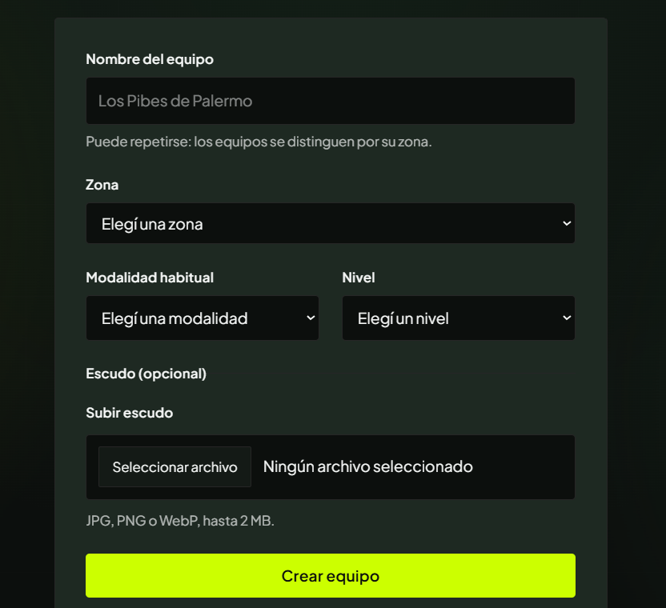
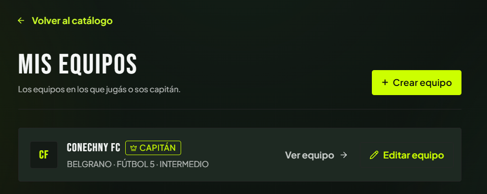
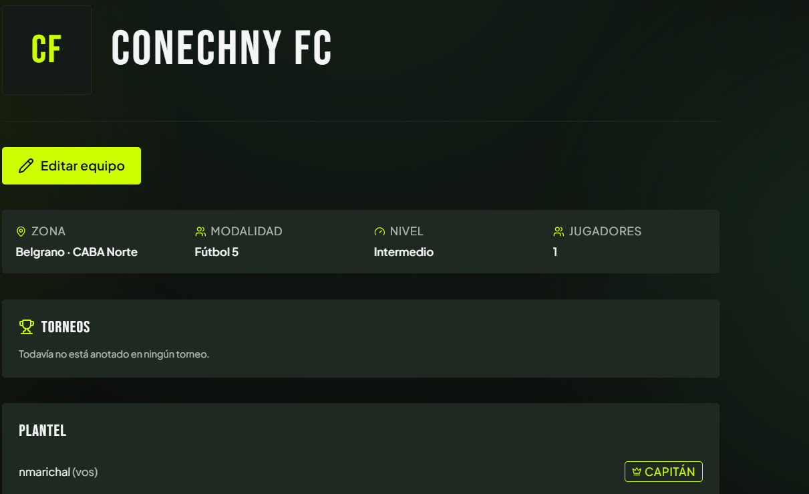
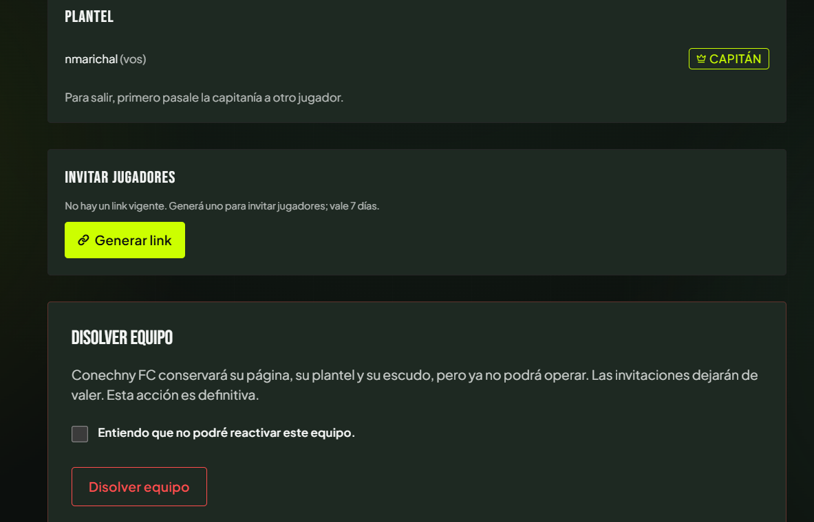
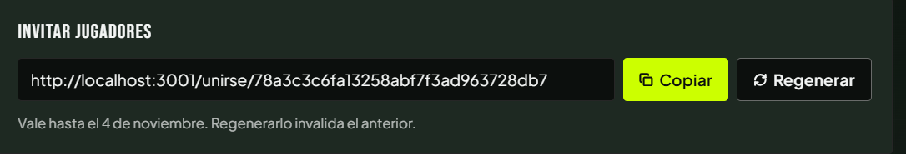

# Módulo Equipos · Pantallas

Versión del **04/11/2026**. Cada pantalla de la app que representa un caso de uso del módulo, con la ruta, el caso, los requerimientos, lo que muestra y la captura. Siguen a los [casos de uso](02-casos-de-uso.md) y preceden a los [diagramas de secuencia](04-diagramas-secuencia/README.md).

**Estado de las capturas**

| Marca | Significa |
|---|---|
| ✅ **Vigente** | Coincide con el código de `main` del 04/11/2026. |
| ⚠️ **Desactualizada** | Es de la especificación del 28/10; falta algo que se agregó después. Se indica qué. |
| ⏳ **Pendiente** | Todavía no hay captura. Al final están los pasos para sacarla. |

Las imágenes están en [`pantallas/`](pantallas/). Todas son de un entorno local con la UI lima y negro del sistema de diseño actual.

## Mapa de pantallas

| Pantalla | Ruta | Casos de uso | Sesión |
|---|---|---|---|
| [P1 · Crear equipo](#p1--crear-equipo) | `/crear-equipo` | UC-C01 | Obligatoria |
| [P2 · Mis equipos](#p2--mis-equipos) | `/mis-equipos` | acceso a UC-C01, C04, C05 | Obligatoria |
| [P3 · Equipo, vista pública](#p3--equipo-vista-pública) | `/equipos/{id}` | UC-C04, UC-C10 | No |
| [P4 · Equipo, vista del Jugador y del Capitán](#p4--equipo-vista-del-jugador-y-del-capitán) | `/equipos/{id}` | UC-C02, C04, C06, C07, C08, C09 | Integrante del Plantel |
| [P5 · Editar equipo](#p5--editar-equipo) | `/equipos/{id}/editar` | UC-C05 | Capitán |
| [P6 · Unirse al equipo](#p6--unirse-al-equipo) | `/unirse/{token}` | UC-C03 | Obligatoria |

`/crear-equipo`, `/mis-equipos` y `/equipos/{id}/editar` exigen sesión (el middleware `src/proxy.ts` y cada página redirigen a `/login?next=…`). `/equipos/{id}` **no está protegida a propósito**: es pública. `/unirse/{token}` maneja su propio redirect al login para conservar el token.

---

## P1 · Crear equipo

**Ruta:** `/crear-equipo` · **Caso de uso:** [UC-C01](02-casos-de-uso.md#uc-c01--crear-equipo) · **Requerimientos:** RF-C01 a RF-C06 · **Diagrama:** [S01](04-diagramas-secuencia/uc-c01-crear-equipo.md)

*Captura ✅ vigente del formulario. Falta la cabecera de la página («Crear equipo», «Vas a quedar como capitán…»): ver pendientes.*

**Qué muestra.** Un formulario con:

| Campo | Tipo | De dónde salen las opciones | Obligatorio |
|---|---|---|---|
| Nombre del equipo | texto (2 a 50 caracteres) | — | Sí |
| **Zona** | desplegable, agrupado por corredor | Se **consulta en la base** (`zones`, vía `getZoneGroups`) | Sí |
| **Modalidad habitual** | desplegable | Lista **fija del código** (`SPORT_MODALITIES`: Fútbol 5, 7, 8 y 11) | Sí |
| **Nivel** | desplegable | Lista **fija del código** (`TEAM_LEVELS`: Recreativo, Intermedio, Competitivo) | Sí |
| Escudo (opcional) | archivo JPG, PNG o WebP, hasta 2 MB | — | No |

Debajo del nombre, el texto «Puede repetirse: los equipos se distinguen por su zona» (RF-C03). El botón principal es «Crear equipo».

**Estados de la pantalla**

| Estado | Qué ve la persona |
|---|---|
| Normal | El formulario habilitado. |
| Sin WhatsApp en el perfil | Aviso ámbar «Para crear un equipo necesitás tener tu WhatsApp en el perfil…» con el botón «Cargar mi WhatsApp»; el formulario se ve **deshabilitado**. |
| Ya capitanea 3 equipos | En lugar del formulario: «Ya sos capitán de 3 equipos, que es el máximo. Para crear otro, pasá la capitanía de alguno o disolvelo». |
| Error al enviar | Banda roja arriba del formulario con el motivo. |
| Sin sesión | No se ve la pantalla: se redirige a `/login?next=/crear-equipo`. |

Los avisos de WhatsApp y límite anticipan lo que `create_team` comprueba al guardar; **la base es la que decide**.

---

## P2 · Mis equipos

**Ruta:** `/mis-equipos` · **Casos de uso:** punto de entrada a [UC-C01](02-casos-de-uso.md#uc-c01--crear-equipo), [UC-C04](02-casos-de-uso.md#uc-c04--ver-la-página-pública-del-equipo) y [UC-C05](02-casos-de-uso.md#uc-c05--editar-equipo) · **Requerimientos:** RF-C15 · **Diagrama:** no tiene (no toma ninguna decisión)

*Captura ✅ vigente.*

**Qué muestra.** Una fila por Equipo que el Usuario integra: escudo (o las iniciales), nombre, la marca **CAPITÁN** si lo es, la marca **DISUELTO** si corresponde, y «Zona · Modalidad · Nivel». Cada fila ofrece «Ver equipo» y, solo al Capitán de un Equipo activo, «Editar equipo». Arriba a la derecha, «Crear equipo».

**Orden:** activos primero, disueltos después (conservan su historia, así que siguen en la lista).

**Estados:** *vacío* («Todavía no estás en ningún equipo. Creá uno, o pedile al capitán de tu equipo el link de invitación»); *error de carga* («No pudimos cargar tus equipos. Probá de nuevo»).

---

## P3 · Equipo, vista pública

**Ruta:** `/equipos/{id}` · **Casos de uso:** [UC-C04](02-casos-de-uso.md#uc-c04--ver-la-página-pública-del-equipo), [UC-C10](02-casos-de-uso.md#uc-c10--reportar-un-equipo) (pendiente) · **Requerimientos:** RF-C11 a RF-C14 · **Diagrama:** [S04](04-diagramas-secuencia/uc-c04-ver-pagina-equipo.md)

> ⏳ **Captura pendiente:** la vista de un Invitado, sin sesión, con la sección «Partidos». La captura de la ficha del Capitán de abajo (P4) es la más cercana, pero es anterior a esa sección.

**Qué muestra a cualquier persona, con o sin sesión:**

1. **Cabecera:** escudo, nombre y, si está disuelto, la marca «Equipo disuelto».
2. **Datos:** Zona (con su corredor), Modalidad, Nivel y Jugadores.
3. **Partidos:** el contador («Jugó N · N faltas · N conflictos…»), las estrellas y los últimos 5 partidos cerrados, cada uno con fecha, «vs» el rival (link a su página) y el desenlace. Sin partidos: «Todavía no tiene partidos cerrados».
4. **Torneos:** los torneos con Inscripción vinculada, con fecha y estado. Sin torneos: «Todavía no está anotado en ningún torneo».

**No muestra** el Plantel ni ningún contacto. Para un Invitado el link de vuelta dice «Volver al catálogo».

**Estados:** *Equipo disuelto* (marca visible, sin acciones); *no existe* (404).

---

## P4 · Equipo, vista del Jugador y del Capitán

**Ruta:** `/equipos/{id}` · **Casos de uso:** [UC-C02](02-casos-de-uso.md#uc-c02--invitar-jugadores-al-equipo), [UC-C04](02-casos-de-uso.md#uc-c04--ver-la-página-pública-del-equipo) (A1), [UC-C06](02-casos-de-uso.md#uc-c06--pasar-la-capitanía), [UC-C07](02-casos-de-uso.md#uc-c07--sacar-a-un-jugador-del-plantel), [UC-C08](02-casos-de-uso.md#uc-c08--salir-del-equipo), [UC-C09](02-casos-de-uso.md#uc-c09--disolver-equipo) · **Requerimientos:** RF-C07, RF-C14, RF-C17 a RF-C25 · **Diagramas:** [S02](04-diagramas-secuencia/uc-c02-invitar-jugadores.md), [S06](04-diagramas-secuencia/uc-c06-pasar-capitania.md), [S07](04-diagramas-secuencia/uc-c07-sacar-jugador.md), [S08](04-diagramas-secuencia/uc-c08-salir-del-equipo.md), [S09](04-diagramas-secuencia/uc-c09-disolver-equipo.md)

Es **la misma página que P3**: cuando quien la mira integra el Plantel, la página agrega secciones. Qué se agrega depende del rol.

| Elemento | Jugador (no Capitán) | Capitán de Equipo activo | Equipo disuelto |
|---|---|---|---|
| Sección **Plantel** (nombres, marca CAPITÁN, «(vos)») | Sí | Sí | Sí (se conserva) |
| «Editar equipo» | No | Sí | No |
| «Hacer capitán» y «Sacar» en cada fila de otro jugador | No | Sí | No |
| «Salir del equipo» | Sí | No: «Para salir, primero pasale la capitanía a otro jugador» | No |
| Sección **Invitar jugadores** (UC-C02) | No | Sí | No |
| Sección **Disolver equipo** (UC-C09) | No | Sí | No |
| Link de vuelta | «Mis equipos» | «Mis equipos» | «Mis equipos» |

### Vista del Capitán: datos y Plantel

*Captura ⚠️ **desactualizada**: es del 28/10 y no tiene la sección «Partidos» (entre los datos y «Torneos»), que se agregó con el historial público. El resto coincide. Reemplazar por una captura nueva (ver pendientes).*

### Vista del Capitán: invitar y disolver

*Captura ✅ vigente.* El Capitán es el único integrante: no hay filas con «Hacer capitán» ni «Sacar», y se ve «Para salir, primero pasale la capitanía a otro jugador». Sin link vigente, «Invitar jugadores» ofrece «Generar link». En «Disolver equipo», el botón exige tildar antes «Entiendo que no podré reactivar este equipo».

### Vista del Capitán: link de invitación vigente

*Captura ✅ vigente.* Con un link vigente se ve el enlace, «Copiar» y «Regenerar», y el texto «Vale hasta el 4 de noviembre. Regenerarlo invalida el anterior». El token de la captura es un ejemplo de un entorno local.

**Confirmaciones.** «Hacer capitán», «Sacar», «Salir del equipo» y «Disolver equipo» piden confirmación con un cuadro del navegador (`window.confirm`) antes de enviar: «¿Pasarle la capitanía a {nombre}? Vas a quedar como jugador», «¿Sacar a {nombre} del equipo?», «¿Salir del equipo?» y «¿Disolver "{nombre}"? La página y la historia se conservan. No se puede deshacer».

**Mensajes de la página:** error (recuadro con el motivo que devolvió la base), «Los cambios del equipo se guardaron» y «El equipo quedó disuelto. Su página y su historia se conservan».

---

## P5 · Editar equipo

**Ruta:** `/equipos/{id}/editar` · **Caso de uso:** [UC-C05](02-casos-de-uso.md#uc-c05--editar-equipo) · **Requerimientos:** RF-C01, RF-C02, RF-C16 · **Diagrama:** [S05](04-diagramas-secuencia/uc-c05-editar-equipo.md)

> ⏳ **Captura pendiente.**

**Qué muestra.** Cabecera «Editar equipo — Actualizá los datos de {nombre}» y **el mismo formulario que P1**, con los valores actuales cargados y el botón «Guardar cambios». Los tres desplegables (Zona, Modalidad habitual, Nivel) tienen el mismo origen que en P1. La sección del escudo agrega:

- el escudo actual;
- «Reemplazar escudo» (si ya tiene uno) en vez de «Subir escudo», y «Si no elegís otro, conservás el escudo actual»;
- la casilla «Quitar el escudo actual» (solo si tiene escudo).

**Quién la ve:** solo el Capitán de un Equipo activo. Cualquier otra persona vuelve a la página del Equipo; sin sesión, al login.

**Estados:** *error* (banda roja con el motivo, por ejemplo «El equipo se creó. No se pudo subir el escudo…» cuando se llega desde UC-C01 A7).

---

## P6 · Unirse al equipo

**Ruta:** `/unirse/{token}` · **Caso de uso:** [UC-C03](02-casos-de-uso.md#uc-c03--unirse-a-un-equipo-con-el-link) · **Requerimientos:** RF-C08 a RF-C10 · **Diagrama:** [S03](04-diagramas-secuencia/uc-c03-unirse-al-equipo.md)

> ⏳ **Captura pendiente.**

**Qué muestra.** Una tarjeta centrada con el ícono de invitación, el título **«Te invitaron a un equipo»**, el texto «Al unirte vas a formar parte del plantel y el capitán te va a ver en él» y el botón **«Unirme al equipo»**. Unirse es un botón y **no un efecto de abrir la página**: los chats y los navegadores precargan los links y eso nunca debe sumar a alguien a un Plantel.

**Estados:** *error* («El link de invitación no es válido o venció», con el mismo texto para un link inexistente, vencido, regenerado o de un Equipo disuelto). *Sin sesión:* no se ve la pantalla; se redirige a `/login?next=/unirse/{token}`.

---

## Capturas pendientes

Para completar los casos. Convención: PNG en `docs/equipos/pantallas/`, ventana de escritorio de unos 1280 px de ancho, sin la barra del navegador, con datos de prueba (nunca cuentas reales). Hacen falta estas cuentas y estados:

| Archivo | Pantalla y estado | Cómo conseguirlo |
|---|---|---|
| `crear-equipo-pagina.png` | P1 completa, con la cabecera | Con sesión y WhatsApp cargado, abrir `/crear-equipo` y capturar la página entera. |
| `crear-equipo-sin-whatsapp.png` | P1 con el aviso ámbar y el formulario deshabilitado | Con una cuenta **sin** WhatsApp en el perfil. |
| `crear-equipo-limite.png` | P1 con «Ya sos capitán de 3 equipos…» | Con una cuenta que capitanea 3 Equipos activos. |
| `equipo-publico.png` | P3 sin sesión, con «Partidos» y «Torneos» | Abrir `/equipos/{id}` en una ventana privada, de un Equipo con partidos cerrados. |
| `equipo-disuelto.png` | P3/P4 con «Equipo disuelto» | Un Equipo disuelto, abierto con y sin sesión. |
| `equipo-capitan-datos.png` | P4, vista del Capitán, **reemplaza** la desactualizada | El Capitán de un Equipo con varios integrantes: se ven «Partidos», «Torneos» y «Plantel» con «Hacer capitán» y «Sacar». |
| `equipo-jugador.png` | P4, vista del Jugador | Una cuenta que integra el Plantel sin ser Capitán: se ve «Salir del equipo». |
| `editar-equipo.png` | P5 | Como Capitán, «Editar equipo»; mejor con un escudo cargado para que se vean «Reemplazar» y «Quitar». |
| `unirse-equipo.png` | P6 | Con sesión, abrir un link de invitación vigente **sin** pulsar el botón. |
| `unirse-equipo-error.png` | P6 con el mensaje de link inválido | Abrir `/unirse/cualquier-cosa` con sesión y pulsar «Unirme al equipo». |
| `disolver-confirmacion.png` | Cuadro de confirmación de disolver | Tildar la casilla y pulsar «Disolver equipo» (sin aceptar). |

Al agregar una captura nueva, actualizar acá su marca de estado y, si reemplaza a una vieja, borrar la vieja.
