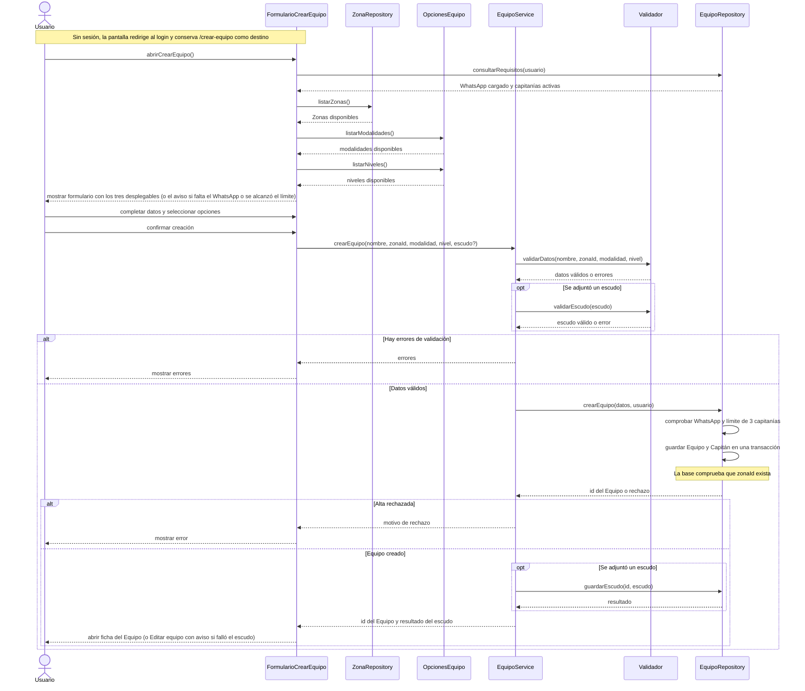

# S01 · UC-C01 — Crear equipo

Caso de uso: [UC-C01](../02-casos-de-uso.md#uc-c01--crear-equipo) · Pantalla: [P1](../03-pantallas.md#p1--crear-equipo) · Requerimientos: RF-C01 a RF-C06

El formulario carga las opciones de sus tres desplegables **antes** de permitir que el Usuario envíe el alta. `ZonaRepository` representa la consulta de la lista cerrada de Zonas; `OpcionesEquipo` provee las listas fijas de modalidades y niveles. Son responsabilidades conceptuales, no clases con esos nombres (ver [participantes](README.md#participantes-responsabilidad-y-correspondencia-en-el-repo)).

## Cómo se lee

- **Antes de elegir:** la pantalla obtiene las Zonas de `ZonaRepository` y las modalidades y los niveles de `OpcionesEquipo`, y recién entonces muestra el formulario. `consultarRequisitos` es lo que le permite mostrar de entrada el aviso de WhatsApp o de límite de capitanías; es un adelanto, no una garantía.
- **Al enviar:** `crearEquipo(...)` recibe solo los **valores elegidos** (`zonaId`, `modalidad`, `nivel`), no las listas.
- **Se valida de nuevo al guardar.** `Validador` revisa nombre, Zona, modalidad y nivel aunque la pantalla solo ofrezca opciones válidas. Después, la base vuelve a comprobar WhatsApp y límite, y que `zonaId` exista (clave foránea): una Zona que desapareció entre la carga del formulario y el envío hace fallar el alta.
- **El Equipo y su Capitán se guardan juntos**, en una transacción (`create_team`): nunca queda un Equipo sin Capitán.
- **El escudo se guarda después del alta**, no dentro de ella. Si falla, el Equipo ya existe y la persona llega a «Editar equipo» con el aviso «El equipo se creó. …» para reintentar (UC-C01 A7).

## Correspondencia en el código

`createTeam` (`src/app/crear-equipo/actions.ts`) hace: `parseTeamForm` → `parseCrest` → RPC `create_team` → `saveTeam` si hubo escudo. Las Zonas salen de `zones` mediante `getZoneGroups()`; modalidad y nivel, de `SPORT_MODALITIES` y `TEAM_LEVELS`.
