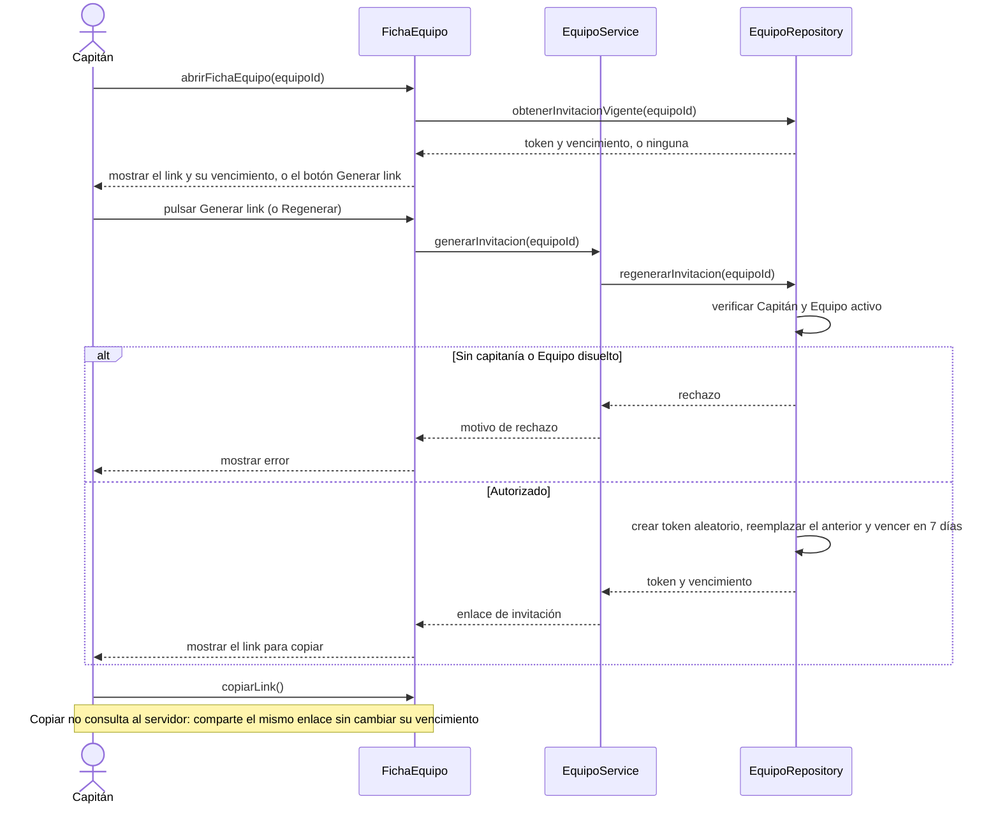

# S02 · UC-C02 — Invitar jugadores al equipo

Caso de uso: [UC-C02](../02-casos-de-uso.md#uc-c02--invitar-jugadores-al-equipo) · Pantalla: [P4](../03-pantallas.md#p4--equipo-vista-del-jugador-y-del-capitán) (sección «Invitar jugadores») · Requerimientos: RF-C07, RF-C25

No hay desplegables: la pantalla solo muestra el link vigente o el botón para generarlo.

## Cómo se lee

- **Generar y regenerar son la misma operación** (`regenerarInvitacion`): hay una sola fila de invitación por Equipo y regenerarla pisa el token, con lo que **el link anterior deja de valer**. Sin link vigente el botón dice «Generar link»; con uno, «Regenerar».
- **Quién puede:** solo el Capitán de un Equipo activo. La pantalla no ofrece la sección a nadie más, pero la base lo verifica igual.
- **El token** son 16 bytes aleatorios en hexadecimal y la tabla no se puede leer directo: solo se toca desde funciones (RNF-C05).
- Pasados los 7 días, `obtenerInvitacionVigente` no devuelve nada y la pantalla vuelve a ofrecer «Generar link».

## Correspondencia en el código

`regenerateInvite` (`src/app/equipos/[id]/actions.ts`) llama a la RPC `regenerate_team_invite`; la página lee el link con `get_team_invite` y `CopyLinkButton` copia al portapapeles.
