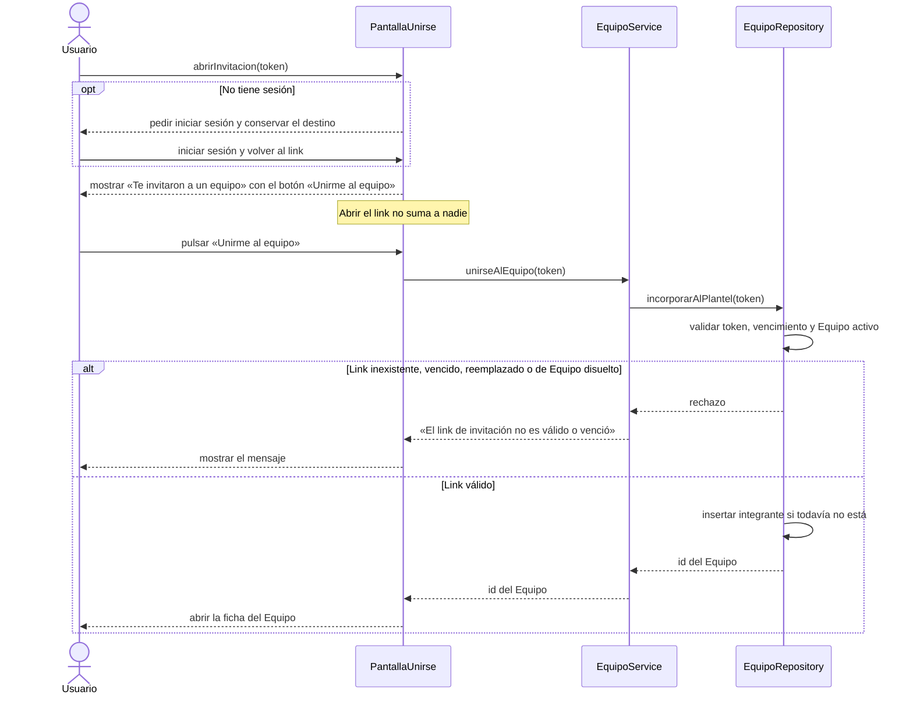

# S03 · UC-C03 — Unirse a un equipo con el link

Caso de uso: [UC-C03](../02-casos-de-uso.md#uc-c03--unirse-a-un-equipo-con-el-link) · Pantalla: [P6](../03-pantallas.md#p6--unirse-al-equipo) · Requerimientos: RF-C08, RF-C09, RF-C10

No hay desplegables. La pantalla tiene un único botón.

## Cómo se lee

- **Unirse es un botón, no un efecto de abrir la página.** Las aplicaciones de chat y los navegadores precargan los links; si abrir `/unirse/{token}` sumara al Plantel, una vista previa de WhatsApp incorporaría gente sin que lo sepa. Por eso el paso 1 solo muestra la pantalla y el alta ocurre en el paso 2.
- **Un solo mensaje** para link inexistente, vencido, regenerado o de un Equipo disuelto. No se revela cuál fue la causa.
- **Si ya integra el Plantel**, `incorporarAlPlantel` no falla ni duplica: lo lleva a la ficha del Equipo.
- **Sin aprobación del Capitán**: quien tiene un link vigente entra directo.
- **El destino se conserva** al iniciar sesión (`/login?next=/unirse/{token}`), así que después del login la persona vuelve a esta pantalla.
- Un Usuario suspendido puede sumarse; lo que no podrá es recibir la capitanía (UC-C06).

## Correspondencia en el código

`UnirsePage` redirige al login sin sesión y muestra el botón; `joinTeam` (`src/app/unirse/[token]/actions.ts`) llama a la RPC `join_team`, que valida el link y hace `insert … on conflict do nothing`.
