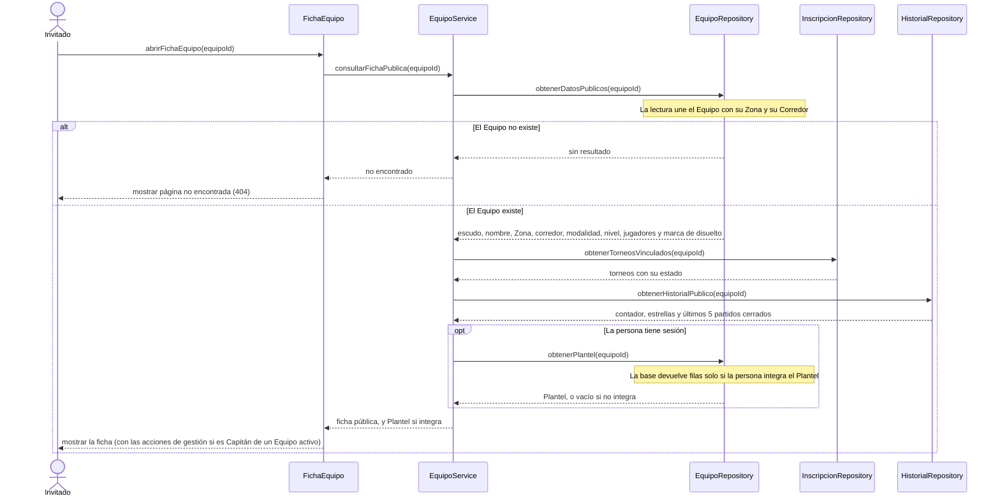

# S04 · UC-C04 — Ver la página pública del equipo

Caso de uso: [UC-C04](../02-casos-de-uso.md#uc-c04--ver-la-página-pública-del-equipo) · Pantallas: [P3](../03-pantallas.md#p3--equipo-vista-pública) y [P4](../03-pantallas.md#p4--equipo-vista-del-jugador-y-del-capitán) · Requerimientos: RF-C11 a RF-C14

No hay desplegables ni envío de datos: es una consulta. El actor es un Invitado; si quien mira tiene sesión, puede sumarse el Plantel.

## Cómo se lee

- **Lo público no necesita sesión:** datos del Equipo, torneos vinculados e historial. La página `/equipos/{id}` no está protegida a propósito.
- **El Plantel es privado.** La pantalla no decide quién lo ve: pide las filas y **la base responde vacío** si quien pregunta no integra el Equipo (RLS sobre `team_members`). Un resultado vacío significa «no sos integrante» (o «sin sesión»).
- **El historial no expone cancha ni hora.** Los partidos solo los lee su plantel; el historial público lo arman funciones que devuelven solo lo que se puede mostrar (RNF-C12).
- **Las acciones de gestión** (UC-C02, C05 a C09) aparecen según el rol que resulta de ese Plantel: Capitán de un Equipo activo, Jugador, o ninguno. Un Equipo disuelto no ofrece acciones.
- **Torneos vinculados:** son datos del módulo de torneos (vista pública `tournament_inscriptions`). Un torneo dado de baja se lleva sus inscripciones, así que acá solo quedan los vigentes.

## Correspondencia en el código

`EquipoPage` (`src/app/equipos/[id]/page.tsx`) lee `teams` (con `zones` y `corridors`), `team_members` (filtrado por RLS), `tournament_inscriptions` + `tournaments`, y las vistas `team_record` y `team_match_history`. Sin resultado de `teams`, llama a `notFound()`.
