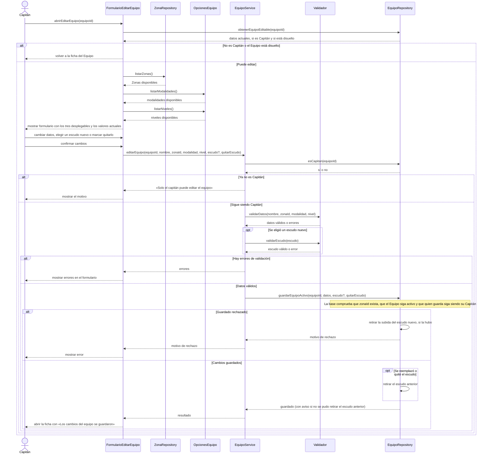

# S05 · UC-C05 — Editar equipo

Caso de uso: [UC-C05](../02-casos-de-uso.md#uc-c05--editar-equipo) · Pantalla: [P5](../03-pantallas.md#p5--editar-equipo) · Requerimientos: RF-C01, RF-C02, RF-C16

Es el mismo formulario que [S01](uc-c01-crear-equipo.md): comparte los tres desplegables, así que sigue el mismo criterio. La carga de las opciones y el guardado van en este único diagrama. La diferencia es que el formulario llega con los **valores actuales** y que antes de guardar se **vuelve a comprobar que quien edita sigue siendo el Capitán**.

## Cómo se lee

- **Mismo patrón que crear:** la pantalla obtiene las Zonas de `ZonaRepository` y las modalidades y niveles de `OpcionesEquipo` antes de mostrar el formulario, y al enviar manda solo los **valores elegidos**. Los valores actuales del Equipo vienen de `obtenerEquipoEditable`.
- **Quién puede editar se comprueba dos veces:** al abrir (si no es Capitán o el Equipo está disuelto, no hay formulario) y al guardar (`esCapitan`), porque pudo dejar de serlo mientras tenía el formulario abierto. Además, la base solo deja actualizar a un Capitán de un Equipo activo.
- **Se valida de nuevo al guardar**, igual que en el alta, y la base vuelve a comprobar que la Zona exista.
- **El escudo se maneja con cuidado de no perder el actual:** el archivo nuevo se **sube antes** de guardar; si el guardado falla se retira esa subida y el escudo anterior queda intacto; el escudo anterior **solo se retira después** de guardar. Si ese último retiro falla, la edición ya está hecha y se avisa.
- **Dejar el archivo vacío conserva el escudo actual.** Reemplazar y quitar a la vez se rechaza.
- **Cambios concurrentes:** cuando se cambia el escudo, el guardado exige que siga siendo el que se leyó, así que reemplazarlo desde otra pestaña no se pisa en silencio. Si el Equipo se disolvió o la persona dejó de ser Capitán, la actualización no encuentra ninguna fila y se rechaza.

## Correspondencia en el código

`updateTeam` (`src/app/equipos/[id]/actions.ts`): RPC `is_team_captain` → `parseTeamForm` → `parseCrest` → `saveTeam` (`src/utils/supabase/team.ts`). La página es `equipos/[id]/editar/page.tsx`, con `TeamForm`.
