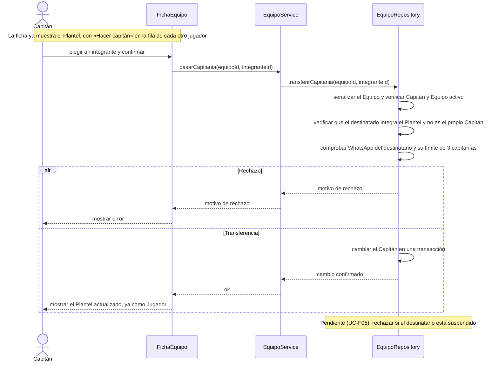

# S06 · UC-C06 — Pasar la capitanía

Caso de uso: [UC-C06](../02-casos-de-uso.md#uc-c06--pasar-la-capitanía) · Pantalla: [P4](../03-pantallas.md#p4--equipo-vista-del-jugador-y-del-capitán) (sección «Plantel») · Requerimientos: RF-C05, RF-C17, RF-C20, RF-C21

No hay desplegables: el jugador se elige con el botón «Hacer capitán» de su fila en el Plantel, que ya cargó [S04](uc-c04-ver-pagina-equipo.md).

## Cómo se lee

- **Un solo Capitán por Equipo, siempre.** El cambio se hace en una transacción y primero se le quita la marca al Capitán actual, porque el índice único de «un capitán por equipo» se evalúa en cada sentencia.
- **El límite de 3 capitanías se respeta aunque haya altas simultáneas:** la función bloquea el perfil del destinatario antes de contar, igual que `create_team`.
- **Nunca se bloquea por partidos en curso.** Las búsquedas, propuestas y partidos son del Equipo: el Capitán nuevo opera todo lo pendiente. El anterior deja de ver las propuestas y sigue viendo los partidos. El Capitán nuevo no hereda los Avisos del anterior.
- **Regla pendiente:** un usuario suspendido no puede recibir la capitanía. Está definida pero la base todavía no la verifica, porque la Suspensión se implementa con el módulo de administración (UC-F05).

## Correspondencia en el código

`transferCaptaincy` (`src/app/equipos/[id]/actions.ts`) llama a la RPC `transfer_captaincy`. Los mensajes de rechazo llegan al usuario porque la función usa `raise exception` (código `P0001`).
