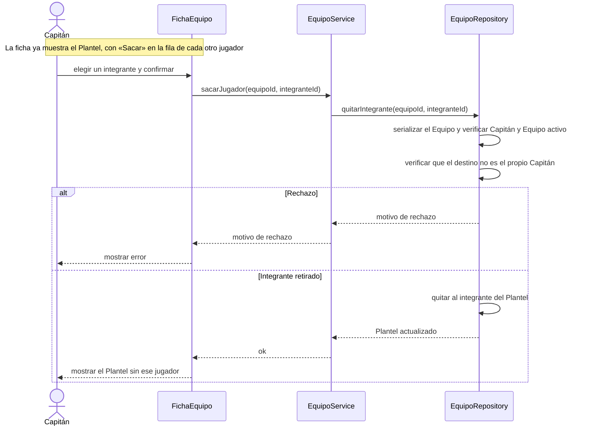

# S07 · UC-C07 — Sacar a un jugador del plantel

Caso de uso: [UC-C07](../02-casos-de-uso.md#uc-c07--sacar-a-un-jugador-del-plantel) · Pantalla: [P4](../03-pantallas.md#p4--equipo-vista-del-jugador-y-del-capitán) (sección «Plantel») · Requerimientos: RF-C18, RF-C20, RF-C21

No hay desplegables: el jugador se elige con el botón «Sacar» de su fila en el Plantel.

## Cómo se lee

- **El Capitán no puede sacarse a sí mismo:** si quiere irse, primero pasa la capitanía ([S06](uc-c06-pasar-capitania.md)). Su propia fila no tiene el botón; la base lo rechaza igual («El capitán no puede sacarse a sí mismo: pasá la capitanía primero»).
- **Si el jugador ya no está** (otro lo sacó o salió mientras tanto), la base responde «Ese jugador no está en el equipo».
- **Efectos para quien sale:** deja de ver los partidos del Equipo y **conserva los Avisos** que ya recibió. Nunca se bloquea por partidos en curso.
- Un Equipo disuelto no admite expulsiones.

## Correspondencia en el código

`removeMember` (`src/app/equipos/[id]/actions.ts`) llama a la RPC `remove_team_member`.
