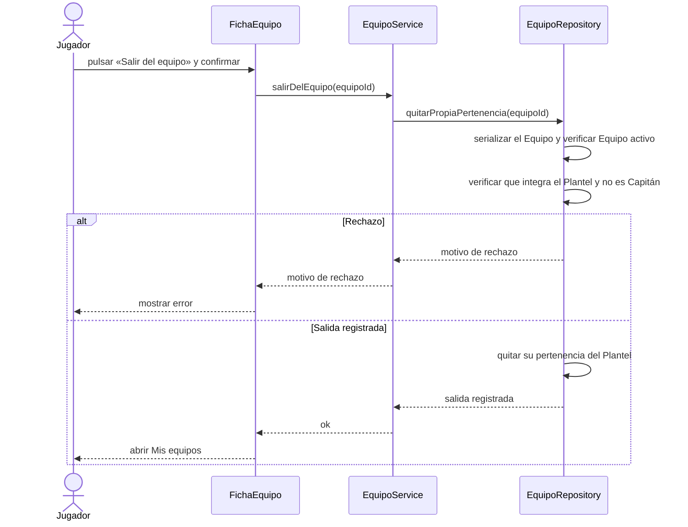

# S08 · UC-C08 — Salir del equipo

Caso de uso: [UC-C08](../02-casos-de-uso.md#uc-c08--salir-del-equipo) · Pantalla: [P4](../03-pantallas.md#p4--equipo-vista-del-jugador-y-del-capitán) (botón «Salir del equipo») · Requerimientos: RF-C19, RF-C20, RF-C21

No hay desplegables ni datos que cargar: la salida es siempre la del propio actor.

## Cómo se lee

- **Quién puede salir:** cualquier Jugador **que no sea Capitán**. Al Capitán la página no le ofrece el botón y le dice «Para salir, primero pasale la capitanía a otro jugador»; si igual lo intentara, la base responde «Pasá la capitanía antes de salir del equipo» ([S06](uc-c06-pasar-capitania.md)).
- **Un Equipo disuelto no admite salidas** («El equipo está disuelto»).
- **Efectos:** la persona deja de ver los partidos del Equipo y conserva los Avisos que ya recibió. Nunca se bloquea por partidos en curso.
- No hay confirmación del Capitán: la salida es unilateral.

## Correspondencia en el código

`leaveTeam` (`src/app/equipos/[id]/actions.ts`) llama a la RPC `leave_team` y redirige a `/mis-equipos`.
